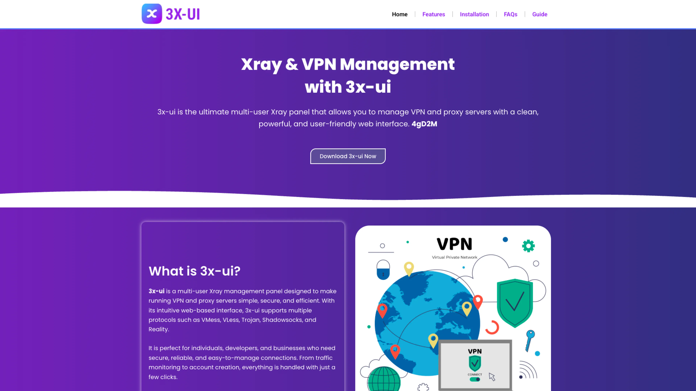

# Deploy and Host 3x-ui on Sealos

3x-ui is a multi-user Xray management panel for building and operating proxy services through a browser interface. This Sealos template runs 3x-ui 3.11.0 with a persistent configuration volume, a public HTTPS panel, and credentials supplied at deployment time.

## About Hosting 3x-ui

3x-ui organizes Xray inbounds, clients, outbounds, routing rules, traffic statistics, and subscription settings in one administrative interface. It supports protocols such as VLESS, VMess, Trojan, Shadowsocks, WireGuard, Hysteria, and mixed HTTP/SOCKS inbounds. The panel also provides client traffic limits, expiration dates, online-session views, and backup and restore controls.

This template runs one StatefulSet with the official `ghcr.io/mhsanaei/3x-ui:v3.11.0` image. The panel listens on port `2053`, and a 1Gi persistent volume at `/etc/x-ui` stores the panel database, certificates, and generated Xray configuration. A ClusterIP Service publishes the panel internally, while a Sealos Ingress provides the public HTTPS address.

The deployment inputs set the administrator username and password. An init container applies both values with the 3x-ui CLI before the panel starts, sets the web base path to `/`, resets two-factor authentication, and confirms port `2053`. Fail2ban remains disabled because its packet-filtering mode requires additional network capabilities.

## Common Use Cases

- **Private Proxy Gateway**: Run a personal Xray endpoint for controlled access to private or public networks.
- **Team Access Management**: Create separate client credentials with traffic quotas and expiration dates.
- **Protocol Migration**: Test VLESS, VMess, Trojan, Shadowsocks, Hysteria, and WireGuard configurations from one panel.
- **Multi-Region Routing**: Combine multiple Xray nodes and routing rules behind a central management surface.
- **Subscription Distribution**: Publish client subscription links generated by 3x-ui.

## Dependencies for 3x-ui Hosting

The template includes the 3x-ui StatefulSet, persistent data volume, Service, HTTPS Ingress, and Sealos App entry. The panel publishes over HTTPS. Xray inbound proxy ports remain closed by default and require separate network exposure after an inbound is created.

### Deployment Dependencies

- [3x-ui official site](https://3x-ui.com/) - Product overview and downloads
- [3x-ui documentation](https://docs.sanaei.dev/) - Installation and panel guides
- [3x-ui repository](https://github.com/MHSanaei/3x-ui) - Source code and release notes
- [3x-ui container image](https://github.com/MHSanaei/3x-ui/pkgs/container/3x-ui) - Official image used by this template
- [Xray-core repository](https://github.com/XTLS/Xray-core) - Proxy core bundled with the application

## Implementation Details

**Architecture Components:**

- **3x-ui StatefulSet**: One replica running `ghcr.io/mhsanaei/3x-ui:v3.11.0` with the panel on port `2053`.
- **Credential init container**: Applies the deployment username and password and normalizes the panel settings before startup.
- **Data volume**: A 1Gi volume mounted at `/etc/x-ui` for the panel database, certificates, and Xray configuration.
- **Service**: ClusterIP port `80` forwarding to the panel HTTP port.
- **Ingress**: Sealos-managed HTTPS host with support for large panel API responses and 300-second proxy timeouts.
- **App entry**: Opens the management panel from the Sealos desktop.

**Configuration:**

- **Image**: `ghcr.io/mhsanaei/3x-ui:v3.11.0`
- **Panel port**: `2053`
- **Panel path**: `/`
- **Administrator username**: Deployment input `panel_username`, default `admin`
- **Administrator password**: Deployment input `panel_password`
- **Timezone**: `Asia/Shanghai`
- **Fail2ban**: Disabled
- **Persistence**: `/etc/x-ui` on a 1Gi volume
- **Health checks**: HTTP startup, readiness, and liveness probes against `/`

**Resource Allocation:**

| Component | CPU Request | CPU Limit | Memory Request | Memory Limit | Storage |
| --- | ---: | ---: | ---: | ---: | ---: |
| 3x-ui | 20m | 200m | 25Mi | 256Mi | 1Gi |
| Credential init | 10m | 100m | 12Mi | 128Mi | None |

The profile passed a cold start, panel login, dashboard load, Xray status check, inbound creation, and inbound deletion with zero restarts. Combined process memory reached approximately 115Mi during validation.

## Why Deploy 3x-ui on Sealos?

Sealos is an AI-assisted cloud operating system built on Kubernetes that combines deployment, networking, storage, and operations in one interface. Deploying 3x-ui on Sealos gives you:

- **One-Click Deployment**: Launch the panel without assembling StatefulSet, Service, and Ingress resources.
- **Automatic HTTPS**: Receive a managed public domain and TLS certificate for the administrative interface.
- **Persistent State**: Keep the panel database, certificates, and Xray configuration on a dedicated volume.
- **Predictable Credentials**: Set the administrator username and password before the first start.
- **Validated Runtime**: Use a tested 200m CPU and 256Mi memory profile for a personal panel.
- **Sealos Operations**: Inspect the StatefulSet, logs, storage, and resource usage from Canvas or the Sealos AI dialog.

## Deployment Guide

1. Open the [3x-ui template](https://sealos.io/products/app-store/3x-ui) and click **Deploy Now**.
2. Enter the administrator username and password, review the generated application name and host, and confirm the resource plan.
3. Wait for deployment to complete, typically in 2-3 minutes. Use Canvas to follow the StatefulSet, Pod, and volume status.
4. Open the public URL and sign in with the username and password entered during deployment.
5. Confirm that the dashboard reports **Xray running**, then create an inbound on the **Inbounds** page.
6. Expose the inbound listening port through additional network resources before connecting external clients.

## Creating and Exposing a Proxy Inbound

The template publishes the web panel on HTTPS. An inbound created inside 3x-ui listens inside the Pod, and its proxy port needs an additional network path for external traffic.

1. Open **Inbounds** and select **Add Inbound**.
2. Choose a protocol, listening address, port, and transport and security settings.
3. Save the inbound and confirm that the Xray status remains **Running**.
4. Create a separate Kubernetes Service that selects the 3x-ui Pod and targets the inbound port.
5. Publish that Service through the network exposure method available in your Sealos region, such as a NodePort or an external TCP load balancer.
6. Use the resulting address and port in the client configuration or share link.

The panel Service and Ingress continue to serve only the administrative interface.

## Using 3x-ui

- Review system, Xray, CPU, memory, storage, and connection statistics from **Dashboard**.
- Manage proxy endpoints, clients, traffic limits, and expiration dates from **Inbounds**.
- Review active clients and per-user traffic from **Clients**.
- Configure outbounds and routing rules for transport chains and traffic policies.
- Adjust the panel path, session duration, and other settings from **Panel Settings**.
- Create a backup from the dashboard before upgrades or major configuration changes.

## Scaling

Run 3x-ui as a single replica. The panel database and Xray configuration use a ReadWriteOnce volume, and multiple replicas would write independent state. For more capacity, raise CPU and memory limits, expand the data volume, and distribute additional traffic across separate 3x-ui deployments or dedicated Xray nodes.

## Troubleshooting

### The panel does not accept the deployment password

The init container reapplies the configured username and password on every Pod start. Confirm the values in the deployed application and inspect the `set-credentials` init-container logs for successful settings output.

### The dashboard opens but an inbound is unreachable

The template exposes the panel only. Confirm that the inbound is enabled, that it listens on the intended port, and that a separate Service and external network path publish the same port.

### Xray stops after changing an advanced configuration

Review the Xray logs from the dashboard or Pod logs, restore the previous backup, and reapply the change in smaller steps. Invalid transport, TLS, or sniffing settings can prevent the core from starting.

### The Pod stays Pending

Check that the namespace has 1Gi of available storage for the data volume. Review Pod events in Canvas for volume-binding or scheduling errors.

### Traffic statistics remain at zero

Confirm that clients connect through the exposed inbound port and that the inbound traffic counters are enabled. Statistics appear after Xray processes client traffic.

### Getting Help

- [3x-ui documentation](https://docs.sanaei.dev/)
- [3x-ui GitHub discussions](https://github.com/MHSanaei/3x-ui/discussions)
- [Sealos documentation](https://sealos.io/docs)

## License

3x-ui is licensed under the [GNU General Public License v3.0](https://github.com/MHSanaei/3x-ui/blob/main/LICENSE). This Sealos template is distributed under the templates repository license.
