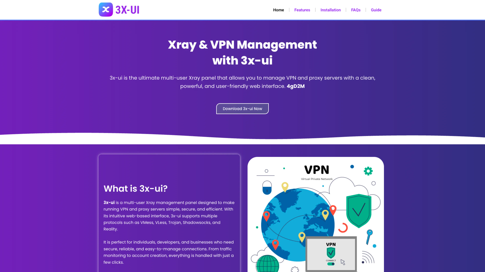

# 在 Sealos 上部署和托管 3x-ui

3x-ui 是多用户 Xray 管理面板，通过浏览器界面创建和运营代理服务。本 Sealos 模板运行 3x-ui 3.11.0，提供持久化配置卷、公网 HTTPS 面板，并在部署时设置管理员凭据。

## 关于 3x-ui 托管

3x-ui 将 Xray 入站、客户端、出站、路由规则、流量统计和订阅设置集中在一个管理界面中。面板支持 VLESS、VMess、Trojan、Shadowsocks、WireGuard、Hysteria 和混合 HTTP/SOCKS 入站，也提供客户端流量限额、到期时间、在线会话、备份与恢复功能。

本模板运行一个 StatefulSet，使用官方 `ghcr.io/mhsanaei/3x-ui:v3.11.0` 镜像。面板监听 `2053` 端口，挂载到 `/etc/x-ui` 的 1Gi 持久化卷保存面板数据库、证书和生成的 Xray 配置。ClusterIP Service 在集群内发布面板，Sealos Ingress 提供公网 HTTPS 地址。

部署输入用于设置管理员用户名和密码。初始化容器会在面板启动前通过 3x-ui CLI 应用这两个值，将 Web 基础路径设为 `/`，重置双因素认证，并确认端口为 `2053`。Fail2ban 保持关闭，因为其数据包过滤模式需要额外网络权限。

## 常见使用场景

- **私有代理入口**：运行个人 Xray 端点，控制访问私有网络或公网资源的路径。
- **团队访问管理**：为不同用户创建独立客户端凭据，并设置流量配额和到期时间。
- **协议迁移测试**：在同一面板中测试 VLESS、VMess、Trojan、Shadowsocks、Hysteria 和 WireGuard 配置。
- **多区域路由**：将多个 Xray 节点和路由规则接入统一管理界面。
- **订阅分发**：发布由 3x-ui 生成的客户端订阅链接。

## 3x-ui 托管依赖

模板包含 3x-ui StatefulSet、持久化数据卷、Service、HTTPS Ingress 和 Sealos App 入口。面板通过 HTTPS 发布。Xray 入站代理端口默认保持关闭，创建入站后需要单独配置网络暴露。

### 部署依赖

- [3x-ui 官网](https://3x-ui.com/) - 产品介绍与下载
- [3x-ui 文档](https://docs.sanaei.dev/) - 安装与面板指南
- [3x-ui 仓库](https://github.com/MHSanaei/3x-ui) - 源代码与发布记录
- [3x-ui 容器镜像](https://github.com/MHSanaei/3x-ui/pkgs/container/3x-ui) - 本模板使用的官方镜像
- [Xray-core 仓库](https://github.com/XTLS/Xray-core) - 应用内置的代理核心

## 实现细节

**架构组件：**

- **3x-ui StatefulSet**：单副本运行 `ghcr.io/mhsanaei/3x-ui:v3.11.0`，面板监听 `2053` 端口。
- **凭据初始化容器**：启动前应用部署时输入的用户名和密码，并规范化面板设置。
- **数据卷**：1Gi 卷挂载到 `/etc/x-ui`，保存面板数据库、证书和 Xray 配置。
- **Service**：ClusterIP 的 `80` 端口转发到面板 HTTP 端口。
- **Ingress**：Sealos 管理的 HTTPS 域名，支持较大的面板 API 响应和 300 秒代理超时。
- **App 入口**：从 Sealos 桌面直接打开管理面板。

**配置：**

- **镜像**：`ghcr.io/mhsanaei/3x-ui:v3.11.0`
- **面板端口**：`2053`
- **面板路径**：`/`
- **管理员用户名**：部署输入 `panel_username`，默认 `admin`
- **管理员密码**：部署输入 `panel_password`
- **时区**：`Asia/Shanghai`
- **Fail2ban**：关闭
- **持久化**：`/etc/x-ui` 挂载 1Gi 卷
- **健康检查**：对 `/` 执行 HTTP 启动、就绪和存活探针

**资源分配：**

| 组件 | CPU 请求 | CPU 限制 | 内存请求 | 内存限制 | 存储 |
| --- | ---: | ---: | ---: | ---: | ---: |
| 3x-ui | 20m | 200m | 25Mi | 256Mi | 1Gi |
| 凭据初始化容器 | 10m | 100m | 12Mi | 128Mi | 无 |

该规格通过了冷启动、面板登录、仪表盘加载、Xray 状态检查、入站创建和入站删除，Pod 重启次数为 0。验证期间合计进程内存约为 115Mi。

## 为什么在 Sealos 上部署 3x-ui？

Sealos 是构建在 Kubernetes 之上的 AI 辅助云操作系统，将部署、网络、存储和运维统一在一个界面中。在 Sealos 上部署 3x-ui 可以带来：

- **一键部署**：无需组装 StatefulSet、Service 和 Ingress 清单即可启动面板。
- **自动 HTTPS**：为管理界面自动提供公网域名和 TLS 证书。
- **持久化状态**：面板数据库、证书和 Xray 配置保存在独立卷上。
- **可控凭据**：在首次启动前设置管理员用户名和密码。
- **经验证的运行规格**：使用经过测试的 200m CPU 与 256Mi 内存配置运行个人面板。
- **Sealos 运维**：在 Canvas 或 Sealos AI 对话中查看 StatefulSet、日志、存储和资源用量。

## 部署指南

1. 打开 [3x-ui 模板](https://sealos.io/products/app-store/3x-ui)，点击 **Deploy Now**。
2. 输入管理员用户名和密码，检查自动生成的应用名称和域名，确认资源规格。
3. 等待部署完成，通常需要 2-3 分钟。通过 Canvas 查看 StatefulSet、Pod 和存储卷状态。
4. 打开公网地址，使用部署时输入的用户名和密码登录。
5. 确认仪表盘显示 **Xray 运行中**，然后在 **入站** 页面创建入站。
6. 在外部客户端连接前，通过额外网络资源暴露入站监听端口。

## 创建和暴露代理入站

模板发布的是 HTTPS Web 面板。在 3x-ui 中创建的入站会在 Pod 内监听，外部流量需要额外的网络路径才能访问代理端口。

1. 打开 **入站**，点击 **添加入站**。
2. 选择协议、监听地址、端口、传输方式和安全设置。
3. 保存入站，确认 Xray 状态保持 **运行中**。
4. 创建一个独立 Kubernetes Service，选择 3x-ui Pod，并将目标端口设为入站端口。
5. 使用当前 Sealos 区域支持的网络暴露方式发布该 Service，例如 NodePort 或外部 TCP 负载均衡。
6. 将最终地址和端口写入客户端配置或分享链接。

面板 Service 和 Ingress 继续提供管理界面流量。

## 使用 3x-ui

- 在 **仪表盘** 查看系统、Xray、CPU、内存、存储和连接统计。
- 在 **入站** 管理代理端点、客户端、流量限额和到期时间。
- 在 **客户端** 查看在线用户和单用户流量。
- 配置出站和路由规则，实现传输链路和流量策略。
- 在 **面板设置** 中调整面板路径、会话时长和其他选项。
- 升级或重大配置调整前，在仪表盘创建备份。

## 扩缩容

3x-ui 以单副本运行。面板数据库和 Xray 配置使用 ReadWriteOnce 卷，多副本会维护彼此独立的状态。规模增长时提高 CPU 和内存限制、扩大数据卷，并将新增流量分配到独立的 3x-ui 部署或专用 Xray 节点。

## 故障排查

### 面板不接受部署密码

初始化容器会在每次 Pod 启动时重新应用配置的用户名和密码。确认已部署应用中的输入值，并查看 `set-credentials` 初始化容器日志中的设置结果。

### 仪表盘可以打开但入站无法访问

模板只发布面板。确认入站已启用、监听端口正确，并且独立 Service 与外部网络路径发布了同一端口。

### 修改高级配置后 Xray 停止

从仪表盘或 Pod 日志查看 Xray 日志，恢复之前的备份，然后将变更拆分为更小的步骤。无效的传输、TLS 或嗅探设置会导致核心启动失败。

### Pod 一直处于 Pending

确认命名空间有 1Gi 可用存储供数据卷使用。在 Canvas 中查看 Pod 事件中的卷绑定或调度错误。

### 流量统计持续为零

确认客户端通过已暴露的入站端口连接，并启用入站流量计数。Xray 处理客户端流量后会显示统计数据。

### 获取帮助

- [3x-ui 文档](https://docs.sanaei.dev/)
- [3x-ui GitHub 讨论区](https://github.com/MHSanaei/3x-ui/discussions)
- [Sealos 文档](https://sealos.io/docs)

## 许可证

3x-ui 使用 [GNU General Public License v3.0](https://github.com/MHSanaei/3x-ui/blob/main/LICENSE) 许可证。本 Sealos 模板遵循 templates 仓库许可证。
