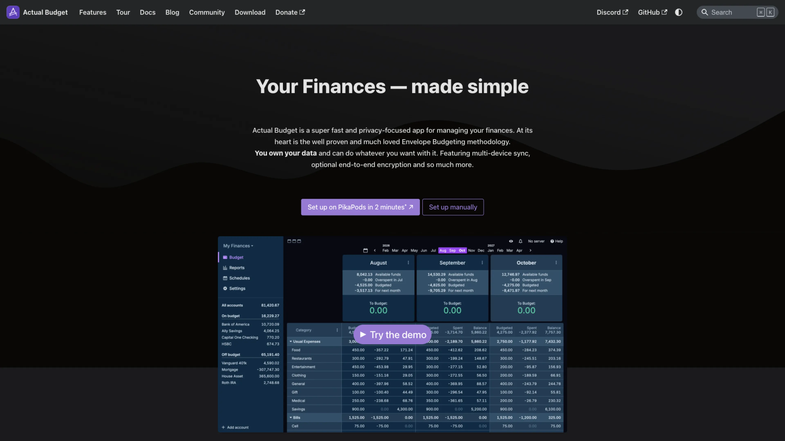

# Deploy and Host Actual Budget on Sealos

Actual Budget is a local-first personal finance application with envelope budgeting, account tracking, reports, and optional multi-device sync. This Sealos template runs Actual Server 26.11.0 with a persistent data volume and a public HTTPS address.

## About Hosting Actual Budget

Actual stores budgets as local data and uses Actual Server to synchronize changes across devices. The interface covers account imports, scheduled transactions, category budgets, reports, and end-to-end encrypted file sync. The server also acts as the first login boundary for a self-hosted instance.

This template runs one StatefulSet with the official `actualbudget/actual-server:26.11.0` image. The server listens on port `5006`, and a 1Gi volume at `/data` stores budgets, authentication state, and server configuration. A ClusterIP Service exposes port `80`, with a Sealos Ingress publishing the application over HTTPS.

The container runs as the image's non-root user and receives a group-writable data volume. Health checks use the official `/health` endpoint. The first browser visit starts on a local-only bootstrap page; select **Set up sync**, connect to the current HTTPS address, and create the server password.

## Common Use Cases

- **Personal Budgeting**: Track spending and allocate income with envelope-style categories.
- **Household Finance**: Share a budget across laptops, phones, and tablets through your own server.
- **Offline-First Planning**: Keep working with local data and synchronize when connectivity returns.
- **Account Reconciliation**: Import bank statements, reconcile balances, and review category spending.
- **Long-Term Reporting**: Compare monthly cash flow, net worth, and category trends.

## Dependencies for Actual Budget Hosting

The template includes the Actual Server StatefulSet, persistent data volume, Service, HTTPS Ingress, and Sealos App entry. Bank sync providers, email notifications, and external backups are optional extension points configured after deployment.

### Deployment Dependencies

- [Actual Budget official site](https://actualbudget.org/) - Product overview and guides
- [Actual GitHub repository](https://github.com/actualbudget/actual) - Source code and release notes
- [Actual Server image](https://hub.docker.com/r/actualbudget/actual-server) - Container image used by this template
- [Self-hosting instructions](https://actualbudget.org/docs/install/) - Supported server deployment models
- [Configuration reference](https://actualbudget.org/docs/config/) - Server environment options

## Implementation Details

**Architecture Components:**

- **Actual Server StatefulSet**: One replica running `actualbudget/actual-server:26.11.0` on port `5006`.
- **Data volume**: A 1Gi volume mounted at `/data` for budgets, authentication, and server state.
- **Service**: ClusterIP port `80` forwarding to the Actual Server HTTP port.
- **Ingress**: Sealos-managed HTTPS host with a 32Mi request-body limit and 300-second proxy timeouts.
- **App entry**: Opens Actual Budget from the Sealos desktop.

**Configuration:**

- **Image**: `actualbudget/actual-server:26.11.0`
- **Container port**: `5006`
- **Data directory**: `/data`
- **Timezone**: `Asia/Shanghai`
- **Persistence**: `/data` on a 1Gi volume
- **Health checks**: HTTP startup, readiness, and liveness probes against `/health`
- **User**: Runs as UID and GID `1001`

**Resource Allocation:**

| Component | CPU Request | CPU Limit | Memory Request | Memory Limit | Storage |
| --- | ---: | ---: | ---: | ---: | ---: |
| Actual Server | 20m | 200m | 25Mi | 256Mi | 1Gi |

The profile passed a cold start, server password creation, login, initial budget creation, account creation, and page navigation with zero restarts. Memory settled around 123Mi.

## Why Deploy Actual Budget on Sealos?

Sealos is an AI-assisted cloud operating system built on Kubernetes that combines deployment, networking, storage, and operations in one interface. Deploying Actual Budget on Sealos gives you:

- **One-Click Deployment**: Launch the server without assembling StatefulSet and Ingress resources.
- **Automatic HTTPS**: Receive a managed public domain and TLS certificate.
- **Persistent Budget Data**: Keep synchronization data and server state on a dedicated volume.
- **Private Synchronization**: Control the server that connects your devices.
- **Validated Runtime**: Use a tested 200m CPU and 256Mi memory profile for personal use.
- **Sealos Operations**: Inspect the StatefulSet, logs, and resource usage from Canvas or the Sealos AI dialog.

## Deployment Guide

1. Open the [Actual Budget template](https://sealos.io/products/app-store/actual) and click **Deploy Now**.
2. Review the generated application name and host, confirm the resource plan, and start the deployment.
3. Wait for deployment to complete, typically in 2-3 minutes. Use Canvas to follow the StatefulSet and volume status.
4. Open the public URL and select **Set up sync** on the bootstrap page.
5. Connect to the displayed HTTPS server address and create a server password.
6. Sign in with the new password, start a budget, and add the first account.

## Using Actual Budget

- Create accounts from the sidebar and enter starting balances.
- Add transactions from an account page with **Add New**.
- Assign income to categories from the monthly budget view.
- Import QIF, OFX, and QFX files from **Import**.
- Review trends from **Reports** and scheduled entries from **Schedules**.
- Configure server preferences from **Settings**.
- Use **Server Sync** in the header to confirm the server connection.

## Scaling

Run Actual Server as a single replica. The data volume uses ReadWriteOnce access, and multiple server replicas would maintain independent authentication and synchronization state. For larger budgets, raise memory limits, expand the data volume, and keep regular off-cluster backups of `/data`.

## Troubleshooting

### The first page shows a local-only budget

Select **Set up sync**, confirm the current HTTPS address, and connect. The server password prompt appears after the client attaches to Actual Server.

### The client reports the server is offline

Check the Pod readiness state, `/health`, and the Ingress. Confirm that the public host matches the address entered on the **Connect to a server** page.

### The login password is lost

Use the Actual Server password reset command in the container, then set a new password. Treat the reset as a security operation and review connected clients afterward.

### A budget change does not appear on another device

Confirm **Server Sync** is online on both devices and that each client points to the same server URL. Offline changes synchronize after connectivity returns.

### The Pod stays Pending

Check that the namespace has 1Gi of available storage. Review Pod events in Canvas for volume-binding or scheduling errors.

### Getting Help

- [Actual Budget documentation](https://actualbudget.org/docs/)
- [Actual GitHub discussions](https://github.com/actualbudget/actual/discussions)
- [Sealos documentation](https://sealos.io/docs)

## License

Actual Budget is licensed under the [MIT License](https://github.com/actualbudget/actual/blob/master/LICENSE.txt). This Sealos template is distributed under the templates repository license.
