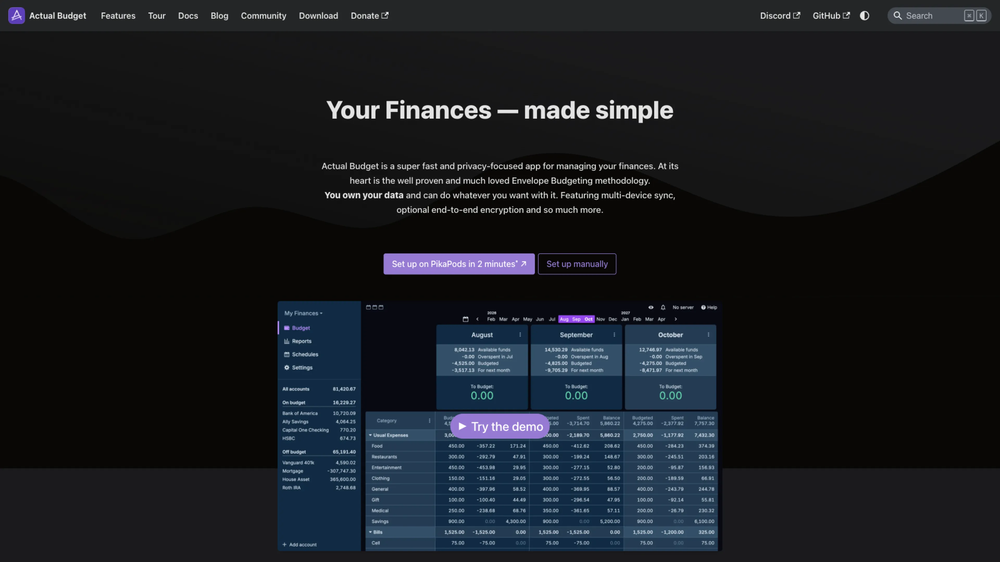

# 在 Sealos 上部署和托管 Actual Budget

Actual Budget 是本地优先的个人财务应用，提供信封预算、账户管理、报表和多设备同步。本 Sealos 模板运行 Actual Server 26.11.0，提供持久化数据卷和公网 HTTPS 地址。

## 关于 Actual Budget 托管

Actual 将预算保存为本地数据，并通过 Actual Server 在多台设备之间同步变更。界面覆盖账单导入、计划交易、分类预算、报表和端到端加密文件同步。服务器同时承担自托管实例的首次登录边界。

本模板运行一个 StatefulSet，使用官方 `actualbudget/actual-server:26.11.0` 镜像。服务器监听 `5006` 端口，挂载到 `/data` 的 1Gi 卷保存预算、认证状态和服务器配置。ClusterIP Service 发布 `80` 端口，Sealos Ingress 通过 HTTPS 开放应用。

容器使用镜像内置的非 root 用户，并获得组可写的数据卷。健康检查使用官方 `/health` 端点。首次浏览器访问会显示仅本地模式页面；点击 **Set up sync**，连接当前 HTTPS 地址，然后创建服务器密码。

## 常见使用场景

- **个人预算**：通过信封式分类跟踪支出并分配收入。
- **家庭财务**：通过自托管服务器在笔记本、手机和平板之间共享预算。
- **离线优先规划**：本地数据继续工作，网络恢复后再同步。
- **账户对账**：导入银行账单、核对余额并查看分类支出。
- **长期报表**：比较月度现金流、净资产和分类趋势。

## Actual Budget 托管依赖

模板包含 Actual Server StatefulSet、持久化数据卷、Service、HTTPS Ingress 和 Sealos App 入口。银行同步服务、邮件通知和外部备份属于部署后配置的可选扩展。

### 部署依赖

- [Actual Budget 官网](https://actualbudget.org/) - 产品介绍与指南
- [Actual GitHub 仓库](https://github.com/actualbudget/actual) - 源代码与发布记录
- [Actual Server 镜像](https://hub.docker.com/r/actualbudget/actual-server) - 本模板使用的容器镜像
- [自托管说明](https://actualbudget.org/docs/install/) - 支持的服务器部署方式
- [配置参考](https://actualbudget.org/docs/config/) - 服务器环境选项

## 实现细节

**架构组件：**

- **Actual Server StatefulSet**：单副本运行 `actualbudget/actual-server:26.11.0`，监听 `5006` 端口。
- **数据卷**：1Gi 卷挂载到 `/data`，保存预算、认证和服务器状态。
- **Service**：ClusterIP 的 `80` 端口转发到 Actual Server HTTP 端口。
- **Ingress**：Sealos 管理的 HTTPS 域名，请求体上限 32Mi，代理超时 300 秒。
- **App 入口**：从 Sealos 桌面直接打开 Actual Budget。

**配置：**

- **镜像**：`actualbudget/actual-server:26.11.0`
- **容器端口**：`5006`
- **数据目录**：`/data`
- **时区**：`Asia/Shanghai`
- **持久化**：`/data` 挂载 1Gi 卷
- **健康检查**：对 `/health` 执行 HTTP 启动、就绪和存活探针
- **用户**：以 UID 和 GID `1001` 运行

**资源分配：**

| 组件 | CPU 请求 | CPU 限制 | 内存请求 | 内存限制 | 存储 |
| --- | ---: | ---: | ---: | ---: | ---: |
| Actual Server | 20m | 200m | 25Mi | 256Mi | 1Gi |

该规格通过了冷启动、服务器密码创建、登录、初始预算创建、账户创建和页面导航，Pod 重启次数为 0。内存稳定在约 123Mi。

## 为什么在 Sealos 上部署 Actual Budget？

Sealos 是构建在 Kubernetes 之上的 AI 辅助云操作系统，将部署、网络、存储和运维统一在一个界面中。在 Sealos 上部署 Actual Budget 可以带来：

- **一键部署**：无需组装 StatefulSet 和 Ingress 清单即可启动服务器。
- **自动 HTTPS**：自动获得公网域名和 TLS 证书。
- **持久化预算数据**：同步数据和服务器状态保存在独立卷上。
- **私有同步**：由你控制连接各台设备的服务器。
- **经验证的运行规格**：使用经过测试的 200m CPU 与 256Mi 内存配置运行个人实例。
- **Sealos 运维**：在 Canvas 或 Sealos AI 对话中查看 StatefulSet、日志和资源用量。

## 部署指南

1. 打开 [Actual Budget 模板](https://sealos.io/products/app-store/actual)，点击 **Deploy Now**。
2. 检查自动生成的应用名称和域名，确认资源规格后开始部署。
3. 等待部署完成，通常需要 2-3 分钟。通过 Canvas 查看 StatefulSet 和存储卷状态。
4. 打开公网地址，在引导页面点击 **Set up sync**。
5. 连接页面显示的 HTTPS 服务器地址，并创建服务器密码。
6. 使用新密码登录，创建预算并添加第一个账户。

## 使用 Actual Budget

- 在侧边栏创建账户并填写起始余额。
- 在账户页面点击 **Add New** 添加交易。
- 在月度预算视图将收入分配到分类。
- 通过 **Import** 导入 QIF、OFX 和 QFX 文件。
- 在 **Reports** 查看趋势，在 **Schedules** 管理计划交易。
- 在 **Settings** 配置服务器偏好。
- 使用页头的 **Server Sync** 确认服务器连接状态。

## 扩缩容

Actual Server 以单副本运行。数据卷使用 ReadWriteOnce 访问模式，多副本服务器会维护彼此独立的认证和同步状态。预算规模增长时提高内存限制、扩大数据卷，并定期将 `/data` 备份到集群外部。

## 故障排查

### 首次页面显示仅本地预算

点击 **Set up sync**，确认当前 HTTPS 地址并连接。客户端接入 Actual Server 后会显示服务器密码创建页面。

### 客户端显示服务器离线

检查 Pod 就绪状态、`/health` 和 Ingress。确认公网域名与 **Connect to a server** 页面输入的地址一致。

### 登录密码丢失

在容器中执行 Actual Server 的密码重置命令，然后设置新密码。将重置视为安全操作，并在完成后检查已连接客户端。

### 其他设备看不到预算变更

确认两台设备上的 **Server Sync** 均在线，并且客户端指向同一服务器地址。离线期间的变更会在网络恢复后同步。

### Pod 一直处于 Pending

确认命名空间有 1Gi 可用存储。在 Canvas 中查看 Pod 事件中的卷绑定或调度错误。

### 获取帮助

- [Actual Budget 文档](https://actualbudget.org/docs/)
- [Actual GitHub 讨论区](https://github.com/actualbudget/actual/discussions)
- [Sealos 文档](https://sealos.io/docs)

## 许可证

Actual Budget 使用 [MIT License](https://github.com/actualbudget/actual/blob/master/LICENSE.txt) 许可证。本 Sealos 模板遵循 templates 仓库许可证。
