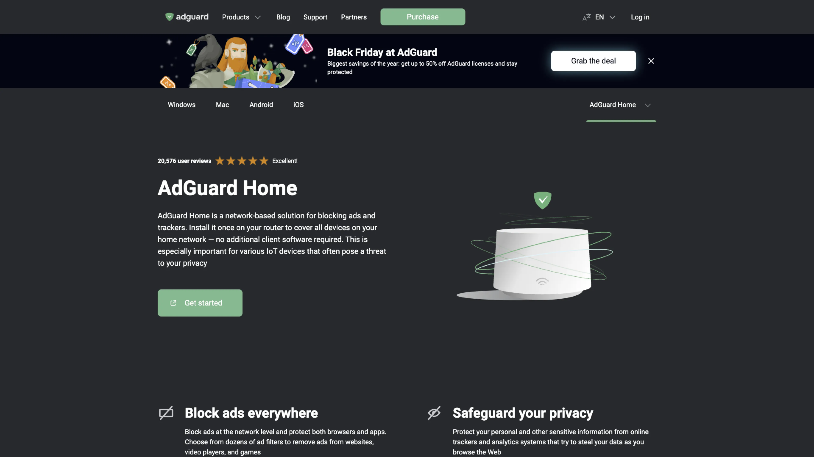

# Deploy and Host AdGuard Home on Sealos

AdGuard Home is a network-wide DNS server with a web management console for blocking ads, trackers, and malicious domains.

## About Hosting AdGuard Home

This template runs the official AdGuard Home image as a single StatefulSet with persistent volumes for configuration and working data. The web console listens on port 80, and the container starts with explicit config, work-directory, and web-address arguments.

The first visit opens the setup wizard, where you create the administrator account, choose the web and DNS listener addresses, and set an upstream resolver. After setup, the dashboard manages filters, query logs, clients, and DNS rewrites.

## Common Use Cases

- Block advertising and tracking domains for a home or office network.
- Apply curated filter lists and custom blocking rules.
- Inspect DNS query logs and client activity from one dashboard.
- Add DNS rewrites for internal services and lab hostnames.
- Provide encrypted DNS upstreams for a private network.

## Dependencies for AdGuard Home Hosting

- A Sealos workspace with CPU, memory, and storage quota.
- Persistent volumes for `/opt/adguardhome/conf` and `/opt/adguardhome/work`.
- A UDP/TCP port 53 Service when client devices query this instance for DNS.
- Upstream DNS resolvers reachable from the cluster.

## Why Deploy AdGuard Home on Sealos?

- One-click deployment with the management console exposed over public HTTPS.
- Kubernetes health probes, scheduling, and automatic pod recovery.
- Persistent configuration and query statistics across pod restarts.
- Pay-as-you-go resource cards sized for small DNS deployments.
- Canvas view for the StatefulSet, Service, Ingress, and PVCs.
- AI dialog for deployment guidance in the Sealos desktop.

## Deployment Guide

1. Open the [AdGuard Home template](https://sealos.io/products/app-store/adguardhome) and click **Deploy Now**.
2. Keep the generated application name, confirm the storage plan, and submit the deployment.
3. Wait 2-3 minutes for the StatefulSet to become ready, then open the public URL from the App card.
4. Complete the setup wizard with an administrator username and password, web address `0.0.0.0:80`, and a reachable upstream DNS server.
5. For client DNS traffic, add a Service that exposes UDP and TCP port 53, then point your devices at its address.

## License

AdGuard Home is released under the [GNU General Public License v3.0](https://github.com/AdguardTeam/AdGuardHome/blob/master/LICENSE).
