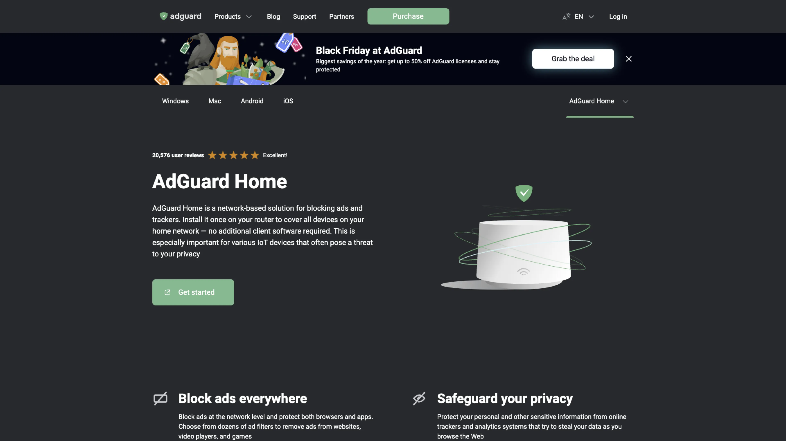

# 在 Sealos 上部署和托管 AdGuard Home

AdGuard Home 是网络级 DNS 服务，提供 Web 管理控制台，可拦截广告、追踪器和恶意域名。

## 关于 AdGuard Home 托管

本模板以单副本 StatefulSet 运行 AdGuard Home 官方镜像，为配置和工作数据分别挂载持久卷。Web 控制台监听 80 端口，容器启动时显式指定配置、工作目录和 Web 监听地址。

首次访问会进入设置向导，用于创建管理员账号、选择 Web 与 DNS 监听地址并设置上游解析器。完成设置后，可在仪表盘管理过滤器、查询日志、客户端和 DNS 重写规则。

## 常见使用场景

- 为家庭或办公网络拦截广告与追踪域名。
- 应用精选过滤列表和自定义拦截规则。
- 在一个仪表盘中查看 DNS 查询日志和客户端活动。
- 为内部服务和实验环境主机名添加 DNS 重写。
- 为私有网络提供加密 DNS 上游。

## AdGuard Home 托管依赖

- 具备 CPU、内存和存储配额的 Sealos 工作空间。
- 用于 `/opt/adguardhome/conf` 和 `/opt/adguardhome/work` 的持久卷。
- 客户端需要使用该实例解析 DNS 时，需提供暴露 UDP/TCP 53 端口的 Service。
- 集群可访问的上游 DNS 解析器。

## 为什么在 Sealos 上部署 AdGuard Home？

- 一键部署即可通过公网 HTTPS 使用管理控制台。
- 由 Kubernetes 提供健康探针、调度和 Pod 自动恢复。
- 持久化配置和查询统计可在 Pod 重启后保留。
- 按量计费的资源卡适合小型 DNS 部署。
- 通过 Canvas 查看 StatefulSet、Service、Ingress 和 PVC。
- 在 Sealos 桌面中通过 AI 对话获取部署指导。

## 部署指南

1. 打开 [AdGuard Home 模板](https://sealos.io/products/app-store/adguardhome)，点击 **Deploy Now**。
2. 保留自动生成的应用名称，确认存储规格后提交部署。
3. 等待 2-3 分钟让 StatefulSet 就绪，然后从 App 卡片打开公网地址。
4. 在设置向导中填写管理员用户名和密码、Web 地址 `0.0.0.0:80`，以及可访问的上游 DNS 服务。
5. 需要为客户端提供 DNS 时，新增暴露 UDP 和 TCP 53 端口的 Service，并将设备指向其地址。

## 许可证

AdGuard Home 使用 [GNU General Public License v3.0](https://github.com/AdguardTeam/AdGuardHome/blob/master/LICENSE) 许可证。
