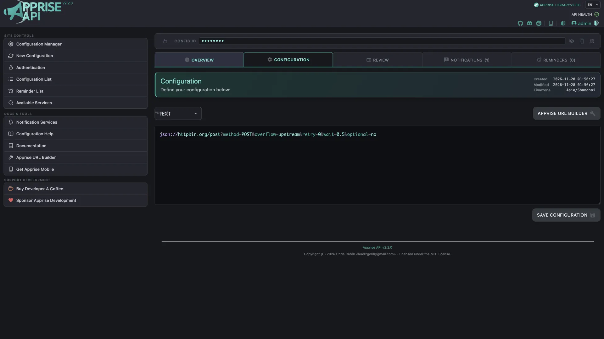

# Deploy and Host Apprise on Sealos

Apprise is a self-hosted notification gateway that sends messages to more than 100 services through one URL syntax, a web configuration manager, and a REST API. This Sealos template runs Apprise API 2.2.0 with Basic Authentication and separate persistent volumes for configuration and attachments.



## About Hosting Apprise

Apprise converts service-specific notification APIs into a consistent URL format. A configuration key represents one or more delivery URLs, so an application can publish an alert through a single endpoint while Apprise handles Slack, Discord, Telegram, email, ntfy, Feishu, generic webhooks, and other supported services.

This template runs one StatefulSet with the official `caronc/apprise:2.2.0` image. The image bundles Nginx, a Gunicorn/gevent web process, a reminder scheduler, and a disk-prune loop under Supervisor. The web application listens on port `8000`; the Service exposes port `80`, and the Sealos Ingress publishes the interface with managed TLS.

The deployment creates a 1Gi volume at `/config` for configuration keys, authentication state, reminders, and runtime metadata. A second 1Gi volume at `/attach` stores uploaded notification attachments. Both volumes survive Pod restarts and redeployments, while the fixed single replica keeps the file-backed state consistent.

## Common Use Cases

- **Central Alert Routing**: Give backups, cron jobs, monitoring checks, and CI pipelines one notification endpoint.
- **Multi-Channel Delivery**: Fan a single event out to chat, email, push, SMS, and webhook destinations.
- **Application Integration**: Add notification support to internal tools through the documented REST API.
- **Attachment Delivery**: Send reports, screenshots, and generated files to services that accept attachments.
- **Scheduled Reminders**: Manage recurring reminders and notification schedules from the Apprise interface.

## Dependencies for Apprise Hosting

The template includes the Apprise StatefulSet, two persistent volumes, Service, HTTPS Ingress, and Sealos App entry. A browser and the administrator credentials are sufficient for web use. Notification delivery requires outbound HTTPS access from the cluster to each configured provider.

### Deployment Dependencies

- [Apprise official site](https://appriseit.com/) - Product overview and documentation entry point
- [Apprise API repository](https://github.com/caronc/apprise-api) - API source code and release history
- [Supported notification services](https://appriseit.com/services/) - Service URL formats and capabilities
- [Apprise URL Builder](https://appriseit.com/url-builder/) - Interactive notification URL generator
- [Apprise container image](https://hub.docker.com/r/caronc/apprise) - Image used by this template

## Implementation Details

**Architecture Components:**

- **Apprise API StatefulSet**: One replica running `caronc/apprise:2.2.0`, Apprise library `2.3.0`, and the web service on port `8000`.
- **Supervisor process group**: Nginx proxies requests to a Gunicorn/gevent worker, the scheduler dispatches reminders, and the prune loop removes expired runtime data.
- **Configuration volume**: A 1Gi volume at `/config` with one subdirectory per configuration key, scheduler files, and persistent state.
- **Attachment volume**: A 1Gi volume at `/attach` for uploaded files and the temporary health-check file.
- **Service and Ingress**: ClusterIP port `80` forwards to port `8000`; the Ingress provides HTTPS, a 32Mi request body limit, 300-second proxy timeouts, and static asset caching.
- **App entry**: Opens the Apprise configuration manager from the Sealos desktop.

**Configuration:**

- **Image**: `caronc/apprise:2.2.0`
- **Container port**: `8000`
- **Stateful mode**: `APPRISE_STATEFUL_MODE=simple`
- **Web worker**: One Gunicorn/gevent worker
- **Authentication**: HTTP Basic Authentication required for the web interface and API
- **Administrator username**: Deployment input `admin_username`, default `admin`; the value must omit colons
- **Administrator password**: Required deployment input `admin_password`
- **Session secret**: A generated 64-character `APPRISE_WEB_AUTH_SECRET`
- **Default message format**: `text`
- **Timezone**: `Asia/Shanghai`
- **Persistence**: `/config` and `/attach`, each on a 1Gi volume
- **Health checks**: Authenticated requests to `/status` for startup, readiness, and liveness
- **Attachment limits**: Six files per notification, with a 32Mi request body ceiling at the Ingress

**Resource Allocation:**

| Component | CPU Request | CPU Limit | Memory Request | Memory Limit | Storage |
| --- | ---: | ---: | ---: | ---: | ---: |
| Apprise API | 300m | 3 | 51Mi | 512Mi | 1Gi configuration + 1Gi attachments |

The profile passed a cold start, administrator login, two rounds of status checks, configuration reads, notification delivery, restart persistence, and a 60-second stability window with zero restarts. Memory peaked near 283Mi. The CPU limit preserves the runtime's startup burst while keeping throttling within the 10% validation threshold.

## Why Deploy Apprise on Sealos?

Sealos is an AI-assisted cloud operating system built on Kubernetes that combines deployment, networking, storage, and operations in one interface. Deploying Apprise on Sealos gives you:

- **One-Click Deployment**: Launch the API, proxy, scheduler, storage, and HTTPS endpoint as one application.
- **Managed HTTPS**: Access the configuration manager and notification API through a public TLS domain.
- **Persistent Notification Setup**: Keep configuration keys, reminders, and attachments across restarts.
- **Credential-Protected Access**: Require Basic Authentication for browser and API requests.
- **Validated Runtime**: Use a tested profile for the bundled Nginx, Gunicorn, and scheduler processes.
- **Sealos Operations**: Inspect Pods, logs, volumes, and resource usage from Canvas or the Sealos AI dialog.

## Deployment Guide

1. Open the [Apprise template](https://sealos.io/products/app-store/apprise) and click **Deploy Now**.
2. Enter the administrator username and password, then review the generated application name and public host.
3. Wait for deployment to complete, typically in 2-3 minutes. Use Canvas to follow the StatefulSet and both volume claims.
4. Open the generated HTTPS address and sign in with the deployment credentials.
5. Select **New Configuration**, provide a configuration key, and add one or more Apprise notification URLs.
6. Save the configuration, send a test notification, and confirm delivery in the target service.

## Using Apprise

The **Configuration Manager** groups notification URLs under a configuration key. Apprise accepts one URL per line, along with tags and common parameters such as `tag=`, `format=`, and `overflow=`. The **Apprise URL Builder** produces the service-specific URL when the syntax is unfamiliar.

The authenticated API uses the same keys:

```bash
export APPRISE_URL="https://<generated-host>"
export APPRISE_USER="<admin-username>"
export APPRISE_PASSWORD="<admin-password>"

curl --fail --user "$APPRISE_USER:$APPRISE_PASSWORD" "$APPRISE_URL/status"

curl --fail --user "$APPRISE_USER:$APPRISE_PASSWORD" \
  -X POST "$APPRISE_URL/get/<config-key>"

curl --fail --user "$APPRISE_USER:$APPRISE_PASSWORD" \
  -X POST \
  --data-urlencode "title=Backup complete" \
  --data-urlencode "body=Nightly backup finished successfully." \
  "$APPRISE_URL/notify/<config-key>"
```

- `GET /status` reports persistent storage health, write permissions, scheduler state, and reminder support.
- `POST /get/<key>` returns the saved notification URLs for a key.
- `POST /notify/<key>` delivers a message to every service in the key.
- `POST /add/<key>` and `POST /del/<key>` manage configuration keys through the API.

Use `APPRISE_CONFIG_LOCK=yes` in the StatefulSet environment when configuration management must become read-only after setup. Use `APPRISE_ATTACH_SIZE` to tighten the application-level attachment ceiling. The template leaves both settings at their defaults.

## Storage and Backups

Configuration keys, reminder state, and service credentials live under `/config`. Uploaded files live under `/attach`. Back up both volumes together so configuration references and attachment data remain consistent. The files contain notification tokens and must be protected with the same controls as application secrets.

Sealos block volumes create a `lost+found` directory at the filesystem root. It is a normal filesystem artifact and has no effect on Apprise. Keep the directory in place when browsing or backing up a volume.

## Scaling

Run Apprise with one replica. The configuration store is file-backed, both volumes use ReadWriteOnce access, and the bundled scheduler runs inside the same Pod. Multiple replicas would operate on independent state and duplicate reminders. For team isolation or larger volumes, deploy separate Apprise instances and raise the CPU, memory, or storage allocation of each instance.

## Troubleshooting

### The browser or API returns HTTP 401

Send the deployment username and password with HTTP Basic Authentication. Confirm that the username omits colons and matches `APPRISE_USER`. Test `/status` with the same credentials before debugging an individual configuration key.

### An API request returns HTTP 405

Send `/get/<key>`, `/add/<key>`, `/del/<key>`, and `/notify/<key>` as POST requests. `/status` uses GET. The web configuration manager uses the same methods and can confirm the endpoint behavior.

### The notify endpoint returns "Payload lacks minimum requirements"

Include a message body and title in the form payload. The request must contain actual notification content; an empty POST reaches the API and stops at validation.

### Notifications fail for one service

Check the notification URL syntax with the Apprise URL Builder, verify provider credentials, and inspect the Pod logs. Apprise requires outbound connectivity from the cluster to the provider endpoint. A webhook test endpoint can isolate URL syntax from provider-specific authentication.

### Configuration changes are rejected

Open `/status` and confirm `can_write_config` and `can_write_attach` are `true`. If `APPRISE_CONFIG_LOCK=yes` is present in the environment, configuration writes are intentionally locked. Review the configuration volume and Pod events when persistent storage reports degraded access.

### An attachment upload fails

The Ingress accepts request bodies up to 32Mi and Apprise accepts up to six attachments per notification. Reduce file size or split the delivery. The application-level ceiling is larger than the template's public request limit.

### The Pod remains Pending

Confirm that the namespace can provision two 1Gi ReadWriteOnce volumes. Review Canvas events for storage binding or scheduling errors.

### Getting Help

- [Apprise documentation](https://appriseit.com/getting-started/)
- [Apprise API repository](https://github.com/caronc/apprise-api)
- [Sealos documentation](https://sealos.io/docs)

## License

Apprise API is released under the [MIT License](https://github.com/caronc/apprise-api/blob/master/LICENSE). This Sealos template is distributed under the templates repository license.
