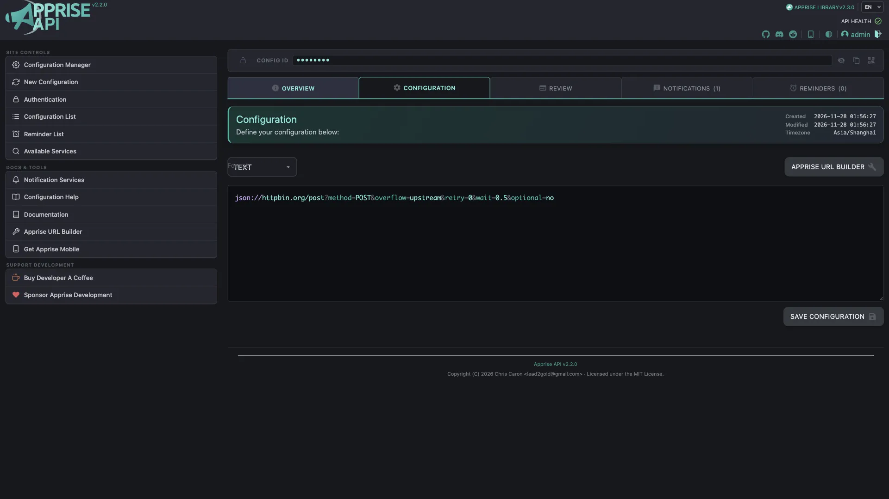

# 在 Sealos 上部署和托管 Apprise

Apprise 是一个自托管通知网关，通过统一 URL 语法、Web 配置管理器和 REST API 向 100 多种服务发送消息。本 Sealos 模板运行 Apprise API 2.2.0，启用 Basic Authentication，并为配置和附件分别提供持久卷。



## 托管 Apprise 简介

Apprise 将各家服务的通知 API 统一为一致 URL 格式。一个配置 Key 可以包含一个或多个通知 URL，应用只需调用一个端点，Apprise 负责处理 Slack、Discord、Telegram、邮件、ntfy、飞书、通用 Webhook 以及其他支持的服务。

本模板运行一个 StatefulSet，使用官方 `caronc/apprise:2.2.0` 镜像。镜像通过 Supervisor 内置 Nginx、Gunicorn/gevent Web 进程、提醒调度器和磁盘清理循环。Web 应用监听 `8000` 端口，Service 暴露 `80` 端口，Sealos Ingress 通过托管 TLS 证书发布访问地址。

部署会创建两个 1Gi 数据卷：`/config` 保存配置 Key、认证状态、提醒和运行元数据，`/attach` 保存通知附件。两个数据卷在 Pod 重启和重新部署后保持不变，固定单副本保证文件状态一致。

## 常见使用场景

- **集中告警路由**：为备份、定时任务、监控检查和 CI 流水线提供统一通知端点。
- **多通道投递**：将同一事件同时发送到聊天、邮件、推送、短信和 Webhook。
- **应用集成**：通过文档化的 REST API 为内部工具增加通知能力。
- **附件通知**：将报表、截图和生成文件发送到支持附件的服务。
- **定时提醒**：在 Apprise 界面管理周期提醒和通知计划。

## 托管 Apprise 的依赖

模板包含 Apprise StatefulSet、两个持久卷、Service、HTTPS Ingress 和 Sealos 应用入口。Web 使用只需要浏览器和管理员凭据。通知投递需要集群能够出网访问各通知服务提供商的 HTTPS 端点。

### 部署依赖

- [Apprise 官网](https://appriseit.com/) - 产品介绍和文档入口
- [Apprise API 代码仓库](https://github.com/caronc/apprise-api) - API 源代码和版本历史
- [支持的通知服务](https://appriseit.com/services/) - 各服务 URL 格式和能力
- [Apprise URL Builder](https://appriseit.com/url-builder/) - 交互式通知 URL 生成器
- [Apprise 容器镜像](https://hub.docker.com/r/caronc/apprise) - 模板使用的官方镜像

## 实现细节

**架构组件：**

- **Apprise API StatefulSet**：单副本运行 `caronc/apprise:2.2.0`、Apprise 库 `2.3.0`，Web 服务监听 `8000` 端口。
- **Supervisor 进程组**：Nginx 将请求转发给 Gunicorn/gevent Worker，调度器负责提醒投递，清理循环删除过期运行数据。
- **配置卷**：1Gi 数据卷挂载到 `/config`，保存每个配置 Key 的子目录、调度器文件和持久状态。
- **附件卷**：1Gi 数据卷挂载到 `/attach`，保存上传文件和健康检查临时文件。
- **Service 与 Ingress**：ClusterIP `80` 端口转发到 `8000`；Ingress 提供 HTTPS、32Mi 请求体上限、300 秒代理超时和静态资源缓存。
- **应用入口**：从 Sealos 桌面打开 Apprise 配置管理器。

**配置：**

- **镜像**：`caronc/apprise:2.2.0`
- **容器端口**：`8000`
- **状态模式**：`APPRISE_STATEFUL_MODE=simple`
- **Web Worker**：一个 Gunicorn/gevent Worker
- **认证**：Web 界面和 API 强制使用 HTTP Basic Authentication
- **管理员用户名**：部署输入 `admin_username`，默认值 `admin`，不能包含冒号
- **管理员密码**：必填部署输入 `admin_password`
- **会话密钥**：自动生成的 64 字符 `APPRISE_WEB_AUTH_SECRET`
- **默认消息格式**：`text`
- **时区**：`Asia/Shanghai`
- **持久化**：`/config` 和 `/attach` 各使用一个 1Gi 数据卷
- **健康检查**：使用带认证的 `/status` 请求执行启动、就绪和存活探针
- **附件限制**：每条通知最多六个文件，Ingress 请求体上限为 32Mi

**资源分配：**

| 组件 | CPU 请求 | CPU 上限 | 内存请求 | 内存上限 | 存储 |
| --- | ---: | ---: | ---: | ---: | ---: |
| Apprise API | 300m | 3 | 51Mi | 512Mi | 1Gi 配置卷 + 1Gi 附件卷 |

该配置通过冷启动、管理员登录、两轮状态检查、配置读取、通知投递、重启持久化和 60 秒稳定性验证，重启次数为零。内存峰值约 283Mi。CPU 上限覆盖运行时启动突发，节流比例保持在 10% 验证阈值以内。

## 为什么在 Sealos 上部署 Apprise

Sealos 是构建在 Kubernetes 之上的 AI 辅助云操作系统，将部署、网络、存储和运维整合在一个界面中。在 Sealos 上部署 Apprise 可以获得：

- **一键部署**：将 API、反向代理、调度器、存储和 HTTPS 端点作为一个应用启动。
- **托管 HTTPS**：通过公网 TLS 域名访问配置管理器和通知 API。
- **持久化通知配置**：配置 Key、提醒和附件在重启后保持不变。
- **凭据保护**：浏览器和 API 请求都需要 Basic Authentication。
- **经过验证的运行时**：使用针对 Nginx、Gunicorn 和调度器组合验证的资源档位。
- **Sealos 运维能力**：通过 Canvas 或 Sealos AI 对话查看 Pod、日志、存储和资源使用情况。

## 部署指南

1. 打开 [Apprise 模板](https://sealos.io/products/app-store/apprise)，点击 **Deploy Now**。
2. 输入管理员用户名和密码，确认生成的应用名称和公网域名。
3. 等待部署完成，通常需要 2-3 分钟。可以在 Canvas 中查看 StatefulSet 和两个数据卷的创建状态。
4. 打开生成的 HTTPS 地址，使用部署凭据登录。
5. 选择 **New Configuration**，填写配置 Key，并添加一个或多个 Apprise 通知 URL。
6. 保存配置，发送测试通知，并在目标服务中确认消息已经送达。

## 使用 Apprise

**Configuration Manager** 使用配置 Key 组织通知 URL。Apprise 支持每行一个 URL，也可以添加标签以及 `tag=`、`format=`、`overflow=` 等通用参数。遇到不熟悉的服务语法时，可以使用 **Apprise URL Builder** 生成 URL。

认证 API 使用同一组配置 Key：

```bash
export APPRISE_URL="https://<生成的域名>"
export APPRISE_USER="<管理员用户名>"
export APPRISE_PASSWORD="<管理员密码>"

curl --fail --user "$APPRISE_USER:$APPRISE_PASSWORD" "$APPRISE_URL/status"

curl --fail --user "$APPRISE_USER:$APPRISE_PASSWORD" \
  -X POST "$APPRISE_URL/get/<config-key>"

curl --fail --user "$APPRISE_USER:$APPRISE_PASSWORD" \
  -X POST \
  --data-urlencode "title=备份完成" \
  --data-urlencode "body=夜间备份已成功完成。" \
  "$APPRISE_URL/notify/<config-key>"
```

- `GET /status` 返回持久化存储健康状态、写权限、调度器状态和提醒能力。
- `POST /get/<key>` 返回该 Key 保存的通知 URL。
- `POST /notify/<key>` 向该 Key 中的全部服务投递消息。
- `POST /add/<key>` 和 `POST /del/<key>` 通过 API 管理配置 Key。

配置完成后需要只读管理时，可以在 StatefulSet 环境变量中设置 `APPRISE_CONFIG_LOCK=yes`。需要收紧应用层附件上限时，可以设置 `APPRISE_ATTACH_SIZE`。模板默认保留这两项的运行默认值。

## 存储与备份

配置 Key、提醒状态和服务凭据保存在 `/config`，上传文件保存在 `/attach`。备份时同时处理两个数据卷，确保配置引用与附件数据保持一致。这些文件包含通知 Token，需要采用与应用密钥相同的保护措施。

Sealos 块存储会在文件系统根目录创建 `lost+found`。这是正常的文件系统目录，对 Apprise 运行没有影响。浏览和备份数据卷时保留该目录。

## 扩缩容

Apprise 以单副本运行。配置存储采用文件形式，两个数据卷使用 ReadWriteOnce 访问模式，内置调度器运行在同一个 Pod 内。多个副本会维护彼此独立的状态并重复执行提醒。需要团队隔离或更大容量时，可以部署多个 Apprise 实例，并分别提升每个实例的 CPU、内存或存储配额。

## 故障排查

### 浏览器或 API 返回 HTTP 401

请求需要携带部署时设置的用户名和密码，并使用 HTTP Basic Authentication。确认用户名不包含冒号且与 `APPRISE_USER` 一致。先用同一组凭据测试 `/status`，再排查具体配置 Key。

### API 返回 HTTP 405

`/get/<key>`、`/add/<key>`、`/del/<key>` 和 `/notify/<key>` 都使用 POST 请求，`/status` 使用 GET 请求。Web 配置管理器可以帮助确认各端点的请求行为。

### notify 端点返回 Payload lacks minimum requirements

在表单中提供消息标题和正文。请求需要包含实际通知内容，空 POST 会到达 API 并在校验阶段停止。

### 单个服务的通知失败

使用 Apprise URL Builder 检查通知 URL 语法，核对服务凭据，并查看 Pod 日志。Apprise 需要从集群出网访问服务提供商端点。可以先用 Webhook 测试端点区分 URL 语法问题和服务认证问题。

### 配置修改被拒绝

打开 `/status`，确认 `can_write_config` 和 `can_write_attach` 为 `true`。如果环境中存在 `APPRISE_CONFIG_LOCK=yes`，配置写入处于预期锁定状态。持久化存储报告降级访问时，检查配置卷和 Pod 事件。

### 附件上传失败

Ingress 接受的最大请求体为 32Mi，Apprise 每条通知最多接受六个附件。可以减少文件大小或拆分投递。应用层附件上限高于模板的公网请求上限。

### Pod 持续处于 Pending

确认命名空间可以创建两个 1Gi ReadWriteOnce 数据卷。在 Canvas 事件中检查存储绑定和调度错误。

### 获取帮助

- [Apprise 文档](https://appriseit.com/getting-started/)
- [Apprise API 代码仓库](https://github.com/caronc/apprise-api)
- [Sealos 文档](https://sealos.io/docs)

## 许可证

Apprise API 基于 [MIT 许可证](https://github.com/caronc/apprise-api/blob/master/LICENSE)发布。本 Sealos 模板遵循 templates 仓库的许可证。
