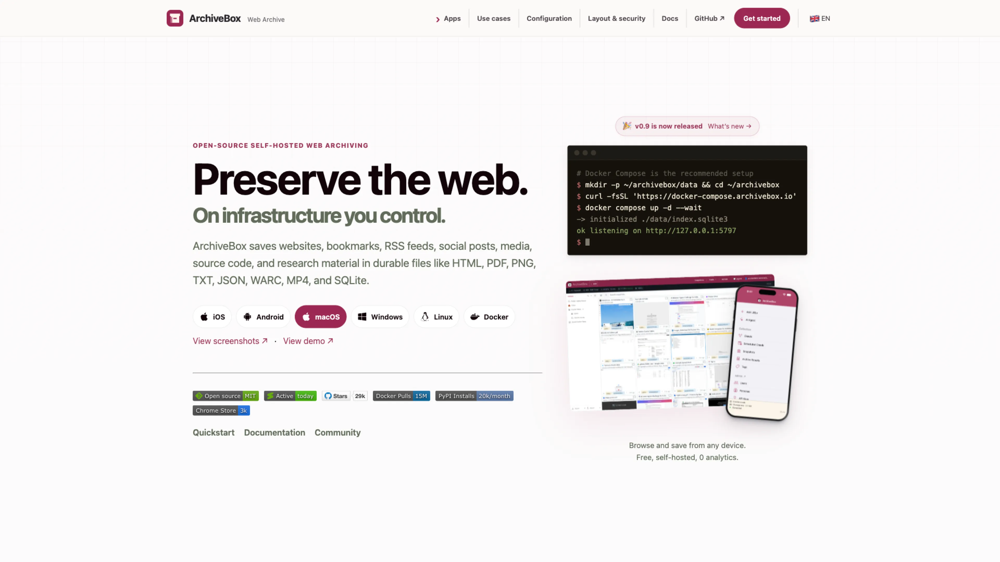

# Deploy and Host ArchiveBox on Sealos

ArchiveBox is a self-hosted web archive that saves pages, bookmarks, RSS feeds, social posts, media, source code, and research material in durable files. This Sealos template runs ArchiveBox 0.9.77 with persistent storage, a dedicated shared-memory volume for Chrome, and administrator credentials supplied at deployment time.

## About Hosting ArchiveBox

ArchiveBox captures each URL with multiple extractors and stores the results as HTML, PDF, PNG, TXT, JSON, WARC, SQLite, and media files. The web UI provides a searchable snapshot index, full-text and metadata search, crawl management, tags, and per-snapshot permissions. It also exposes a REST API and management commands for automation.

This template runs one StatefulSet with the official `archivebox/archivebox:0.9.77` image. The web server listens on port `5797`, and a 1Gi persistent volume at `/data` stores the SQLite database, configuration, personas, and archived snapshots. A second 1Gi volume is mounted at `/dev/shm` because headless Chrome needs a shared-memory area larger than the Kubernetes default. The container also receives 5Gi of ephemeral storage for temporary browser and extraction files.

The deployment creates the administrator account from `ADMIN_USERNAME` and `ADMIN_PASSWORD` during the first initialization. `BASE_URL` is pinned to the public HTTPS address, `SERVER_SECURITY_MODE` uses the single-domain `auto` mode, and both public index and public add views remain disabled so visitors must authenticate.

## Common Use Cases

- **Personal Web Archive**: Preserve articles, documentation, and research before links change or disappear.
- **Team Knowledge Base**: Keep a shared, searchable archive of references with tags and full-text search.
- **Content Preservation**: Capture social posts, RSS entries, and media in durable local formats.
- **Compliance and Evidence**: Store timestamped copies of pages with multiple output formats.
- **Automation**: Submit URLs through the REST API, importers, or the browser extension.

## Dependencies for ArchiveBox Hosting

The template includes the ArchiveBox StatefulSet, two persistent volumes, a data preparation init container, a Service, an HTTPS Ingress, and a Sealos App entry. A browser and the administrator credentials are required for first access.

### Deployment Dependencies

- [ArchiveBox official site](https://archivebox.io/) - Product overview and feature list
- [ArchiveBox documentation](https://github.com/ArchiveBox/ArchiveBox/wiki) - Installation, configuration, and usage guides
- [ArchiveBox repository](https://github.com/ArchiveBox/ArchiveBox) - Source code and release notes
- [ArchiveBox container image](https://hub.docker.com/r/archivebox/archivebox) - Official image used by this template
- [ArchiveBox REST API](https://archivebox.github.io/ArchiveBox/api/) - API reference for automation

## Implementation Details

**Architecture Components:**

- **ArchiveBox StatefulSet**: One replica running `archivebox/archivebox:0.9.77` with the web server on port `5797`.
- **Data preparation init container**: A BusyBox container sets ownership on both mounted volumes so the archive process can run as UID `911`.
- **Data volume**: A 1Gi volume at `/data` for the database, configuration, personas, and archive output.
- **Shared-memory volume**: A 1Gi volume at `/dev/shm` to satisfy Chrome's shared-memory requirement.
- **Ephemeral storage**: 5Gi for temporary browser profiles and extraction work outside the persistent volumes.
- **Service**: ClusterIP port `80` forwarding to the web server.
- **Ingress**: Sealos-managed HTTPS host with the standard 32Mi body limit, 300-second proxy timeouts, and static asset caching.
- **App entry**: Opens the ArchiveBox login page from the Sealos desktop.

**Configuration:**

- **Image**: `archivebox/archivebox:0.9.77`
- **Web port**: `5797`
- **Administrator username**: Deployment input `admin_username`, default `admin`
- **Administrator password**: Deployment input `admin_password`
- **Canonical URL**: `BASE_URL=https://<generated-host>`
- **Security mode**: `auto` with one public host and admin enabled
- **Public index**: Disabled
- **Public add view**: Disabled
- **Persistence**: `/data` on a 1Gi volume
- **Shared memory**: `/dev/shm` on a 1Gi volume
- **Health checks**: HTTP startup, readiness, and liveness probes against `/health/`

**Resource Allocation:**

| Component | CPU Request | CPU Limit | Memory Request | Memory Limit | Storage |
| --- | ---: | ---: | ---: | ---: | ---: |
| ArchiveBox | 200m | 2 | 204Mi | 2048Mi | 1Gi data + 1Gi shm + 5Gi ephemeral |
| Data preparation init | 10m | 100m | 12Mi | 128Mi | Shared volumes |

The profile passed a cold start, administrator login, crawl creation, and a full example.com archive with zero restarts. Memory reached approximately 880Mi while Chrome and the extractors were active.

## Why Deploy ArchiveBox on Sealos?

Sealos is an AI-assisted cloud operating system built on Kubernetes that combines deployment, networking, storage, and operations in one interface. Deploying ArchiveBox on Sealos gives you:

- **One-Click Deployment**: Launch the archive without assembling StatefulSet, Service, Ingress, and Chrome shared-memory resources.
- **Automatic HTTPS**: Receive a managed public domain and TLS certificate for the archive and admin interface.
- **Persistent Snapshots**: Keep the database, configuration, and archived files on a dedicated volume.
- **Chrome-Ready Runtime**: Use a 1Gi shared-memory volume and 5Gi of ephemeral storage for browser-based capture.
- **Sealos Operations**: Inspect Pods, logs, storage, and resource usage from Canvas or the Sealos AI dialog.
- **Predictable Credentials**: Create the administrator account from deployment inputs on first start.

## Deployment Guide

1. Open the [ArchiveBox template](https://sealos.io/products/app-store/archivebox) and click **Deploy Now**.
2. Enter the administrator username and password, review the generated application name and host, and confirm the storage plan.
3. Wait for deployment to complete, typically in 2-3 minutes. The first start initializes the database and creates the admin user.
4. Open the public URL and sign in with the administrator credentials.
5. Add a URL from **ADD** to create a crawl, then follow the snapshot until it reaches the **SEALED** state.
6. Open the snapshot to review captured formats, or use **Snapshots** to search and tag the archive.

## Using ArchiveBox

- **Add**: Submit one or more URLs, import bookmarks or RSS feeds, and choose depth and extraction settings.
- **Snapshots**: Browse the archive, filter by tag or date, and open captured HTML, PDF, screenshot, WARC, and media outputs.
- **Crawls**: Track queued, active, and completed crawl jobs and retry failed snapshots.
- **Importers**: Import browser bookmarks, Pocket, Readwise, or other export formats.
- **Tags and Search**: Organize snapshots and run metadata, full-text, or deep search across the archive.
- **Admin**: Manage users, personas, schedules, API tokens, and authentication providers from the Django admin.
- **API**: Use `/api/v1/` with an API token for automated submissions and status queries.

## Storage and the Low-Disk Banner

ArchiveBox shows a low-disk banner while less than 1GiB is free on `/data`. A fresh 1Gi volume reports about 0.93GiB free, so the banner appears on a new deployment even though archive jobs still run. The template ships 1Gi as a starter size to keep the default resource footprint small.

For real archives, expand the data volume before importing a large collection:

1. Increase the data PVC request to 5Gi or more from the Sealos resource view or with `kubectl patch`.
2. Restart the ArchiveBox Pod so the filesystem resize completes.
3. Confirm that `/data` reports more than 1GiB free and the banner disappears.

The template's storage class performed the resize during validation; the PVC moved to `FileSystemResizePending` until the Pod restarted.

## Scaling

Run ArchiveBox as a single replica. The SQLite database and ReadWriteOnce volumes serve one writer, and multiple replicas would create independent archives. For more throughput, raise CPU and memory limits and archive larger batches in parallel from one instance. For separate collections or teams, deploy independent instances with their own volumes and credentials.

## Troubleshooting

### The Pod is evicted for ephemeral storage

Chrome and the extractors write temporary files outside `/data`. Keep the 5Gi ephemeral-storage limit or raise it for large captures. A limit near 100Mi causes repeated evictions during the first crawl.

### Chrome fails to start or pages archive without screenshots

Confirm that `/dev/shm` is mounted from the 1Gi volume and that the container memory limit leaves room for Chrome. Increase memory to 4Gi for heavy pages with many frames or large PDFs.

### The admin account was not created

`ADMIN_USERNAME` and `ADMIN_PASSWORD` are applied only while the user table is empty. If the account already exists, sign in with the original credentials or create a new superuser from the Pod with `archivebox manage createsuperuser`.

### Login redirects to the wrong host

`BASE_URL` must match the public HTTPS address exactly. A mismatch produces a banner and broken redirects. Update the deployment value and restart the Pod after changing the host.

### A crawl stays queued

Check the Pod logs for CPU admission throttling, Chrome startup failures, or disk errors. ArchiveBox defers capture when the CPU quota is saturated; raise the CPU limit or let the current crawl finish.

### The data volume fills up

Expand the data PVC, then restart the Pod to complete the filesystem resize. Remove unneeded snapshots from the admin interface before expanding if the volume is already full.

### Getting Help

- [ArchiveBox documentation](https://github.com/ArchiveBox/ArchiveBox/wiki)
- [ArchiveBox GitHub discussions](https://github.com/ArchiveBox/ArchiveBox/discussions)
- [Sealos documentation](https://sealos.io/docs)

## License

ArchiveBox is released under the [MIT License](https://github.com/ArchiveBox/ArchiveBox/blob/dev/LICENSE). This Sealos template is distributed under the templates repository license.
