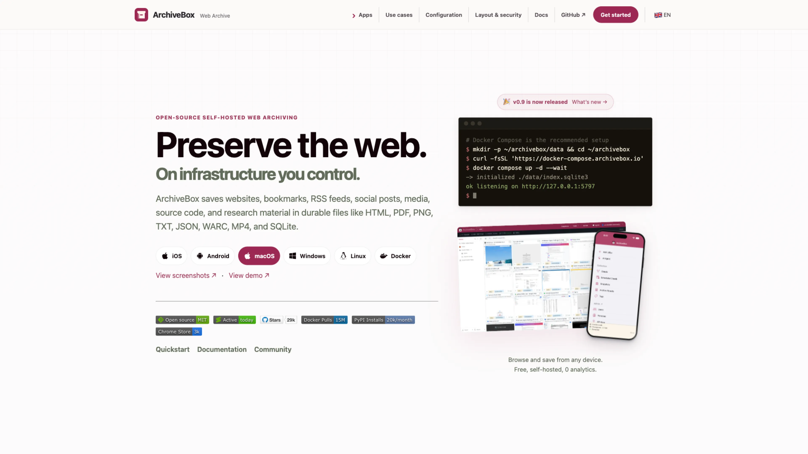

# 在 Sealos 上部署和托管 ArchiveBox

ArchiveBox 是一个自托管网页归档工具，把页面、书签、RSS、社交帖子、媒体、源码和研究资料保存为持久文件。本 Sealos 模板运行 ArchiveBox 0.9.77，提供持久化存储、Chrome 专用共享内存卷，并在部署时设置管理员凭据。

## 关于 ArchiveBox 托管

ArchiveBox 使用多个提取器抓取每个 URL，并把结果保存为 HTML、PDF、PNG、TXT、JSON、WARC、SQLite 和媒体文件。Web 界面提供可搜索的快照索引、全文和元数据搜索、爬取管理、标签以及单快照权限，同时提供 REST API 和管理命令用于自动化。

本模板以单个 StatefulSet 运行官方 `archivebox/archivebox:0.9.77` 镜像。Web 服务监听端口 `5797`，1Gi 持久卷挂载到 `/data`，保存 SQLite 数据库、配置、Persona 和归档快照。第二个 1Gi 卷挂载到 `/dev/shm`，因为无头 Chrome 需要大于 Kubernetes 默认值的共享内存。容器还获得 5Gi 临时存储，用于浏览器和提取过程的临时文件。

部署在首次初始化时使用 `ADMIN_USERNAME` 和 `ADMIN_PASSWORD` 创建管理员账户。`BASE_URL` 固定为公网 HTTPS 地址，`SERVER_SECURITY_MODE` 使用单域名 `auto` 模式，公开索引和公开添加视图保持关闭，访问者必须先登录。

## 常见使用场景

- **个人网页归档**：在文章、文档和研究资料失效前保存副本。
- **团队知识库**：维护可搜索的共享参考资料归档，并支持标签和全文搜索。
- **内容留存**：把社交帖子、RSS 条目和媒体保存为本地持久格式。
- **合规与证据**：以多种输出格式保存带时间戳的页面副本。
- **自动化**：通过 REST API、导入器或浏览器扩展提交 URL。

## ArchiveBox 托管依赖

模板包含 ArchiveBox StatefulSet、两个持久卷、数据准备初始化容器、Service、HTTPS Ingress 和 Sealos 应用入口。首次访问需要浏览器和管理员凭据。

### 部署依赖

- [ArchiveBox 官网](https://archivebox.io/) - 产品概览和功能列表
- [ArchiveBox 文档](https://github.com/ArchiveBox/ArchiveBox/wiki) - 安装、配置和使用指南
- [ArchiveBox 仓库](https://github.com/ArchiveBox/ArchiveBox) - 源码和发布说明
- [ArchiveBox 容器镜像](https://hub.docker.com/r/archivebox/archivebox) - 本模板使用的官方镜像
- [ArchiveBox REST API](https://archivebox.github.io/ArchiveBox/api/) - 自动化接口参考

## 实现细节

**架构组件：**

- **ArchiveBox StatefulSet**：单副本运行 `archivebox/archivebox:0.9.77`，Web 服务监听端口 `5797`。
- **数据准备初始化容器**：BusyBox 容器设置两个挂载卷的属主，使归档进程以 UID `911` 运行。
- **数据卷**：1Gi 持久卷挂载到 `/data`，保存数据库、配置、Persona 和归档输出。
- **共享内存卷**：1Gi 持久卷挂载到 `/dev/shm`，满足 Chrome 的共享内存需求。
- **临时存储**：5Gi，用于持久卷之外的浏览器配置和提取临时文件。
- **Service**：ClusterIP 端口 `80` 转发到 Web 服务。
- **Ingress**：Sealos 托管 HTTPS 域名，使用标准 32Mi 请求体、300 秒代理超时和静态资源缓存。
- **应用入口**：从 Sealos 桌面打开 ArchiveBox 登录页。

**配置：**

- **镜像**：`archivebox/archivebox:0.9.77`
- **Web 端口**：`5797`
- **管理员用户名**：部署输入 `admin_username`，默认 `admin`
- **管理员密码**：部署输入 `admin_password`
- **规范地址**：`BASE_URL=https://<生成的域名>`
- **安全模式**：`auto`，单公网域名并启用管理后台
- **公开索引**：关闭
- **公开添加视图**：关闭
- **持久化**：`/data` 上的 1Gi 卷
- **共享内存**：`/dev/shm` 上的 1Gi 卷
- **健康检查**：针对 `/health/` 的 HTTP 启动、就绪和存活探针

**资源分配：**

| 组件 | CPU 请求 | CPU 上限 | 内存请求 | 内存上限 | 存储 |
| --- | ---: | ---: | ---: | ---: | ---: |
| ArchiveBox | 200m | 2 | 204Mi | 2048Mi | 1Gi 数据 + 1Gi 共享内存 + 5Gi 临时存储 |
| 数据准备初始化 | 10m | 100m | 12Mi | 128Mi | 共享挂载卷 |

该配置通过冷启动、管理员登录、创建爬取任务和完整归档 example.com 验证，重启次数为零。Chrome 和提取器运行期间内存约为 880Mi。

## 为什么在 Sealos 上部署 ArchiveBox？

Sealos 是基于 Kubernetes 的 AI 辅助云操作系统，把部署、网络、存储和运维集中在一个界面。在 Sealos 上部署 ArchiveBox 可以获得：

- **一键部署**：无需手动拼装 StatefulSet、Service、Ingress 和 Chrome 共享内存资源。
- **自动 HTTPS**：为归档和管理界面提供托管公网域名与 TLS 证书。
- **持久化快照**：数据库、配置和归档文件保存在独立数据卷。
- **Chrome 就绪运行环境**：提供 1Gi 共享内存卷和 5Gi 临时存储用于浏览器抓取。
- **Sealos 运维能力**：从 Canvas 或 Sealos AI 对话查看 Pod、日志、存储和资源用量。
- **可预期凭据**：首次启动时使用部署输入创建管理员账户。

## 部署指南

1. 打开 [ArchiveBox 模板](https://sealos.io/products/app-store/archivebox) 并点击 **Deploy Now**。
2. 输入管理员用户名和密码，确认生成的应用名称、域名和存储方案。
3. 等待部署完成，通常需要 2-3 分钟。首次启动会初始化数据库并创建管理员用户。
4. 打开公网地址，使用管理员凭据登录。
5. 在 **ADD** 页面添加 URL 创建爬取任务，跟踪快照直到进入 **SEALED** 状态。
6. 打开快照查看各格式结果，或在 **Snapshots** 页面搜索和打标签。

## 使用 ArchiveBox

- **Add**：提交一个或多个 URL、导入书签或 RSS，并选择抓取深度和提取设置。
- **Snapshots**：浏览归档、按标签或日期过滤，并打开 HTML、PDF、截图、WARC 和媒体结果。
- **Crawls**：跟踪排队、进行中和已完成的爬取任务，并重试失败快照。
- **Importers**：导入浏览器书签、Pocket、Readwise 等导出格式。
- **标签与搜索**：组织快照，并在归档中执行元数据、全文或深度搜索。
- **Admin**：在 Django 管理后台管理用户、Persona、计划任务、API 令牌和认证提供商。
- **API**：使用 `/api/v1/` 和 API 令牌执行自动提交与状态查询。

## 存储与低磁盘提示

当 `/data` 可用空间低于 1GiB 时，ArchiveBox 会显示低磁盘提示。新建的 1Gi 卷可用空间约为 0.93GiB，因此新部署会出现该提示，归档任务仍然可以运行。模板使用 1Gi 作为起步容量，以保持默认资源占用较低。

正式归档大量内容前，建议先扩大数据卷：

1. 在 Sealos 资源视图或使用 `kubectl patch` 把数据 PVC 调整为 5Gi 或更大。
2. 重启 ArchiveBox Pod，完成文件系统扩容。
3. 确认 `/data` 可用空间超过 1GiB，提示随之消失。

验证过程中，模板使用的存储类成功执行了扩容；PVC 在 Pod 重启前保持 `FileSystemResizePending` 状态。

## 扩缩容

ArchiveBox 以单副本运行。SQLite 数据库和 ReadWriteOnce 卷对应单个写入者，多副本会产生互相独立的归档。需要更高吞吐时，提高 CPU 和内存上限，并在单个实例中并行归档更大的批次。不同集合或团队可以使用独立实例，各自维护数据卷和凭据。

## 故障排查

### Pod 因临时存储被驱逐

Chrome 和提取器会在 `/data` 之外写入临时文件。保留 5Gi 临时存储上限，抓取大型页面时可以提高。接近 100Mi 的上限会在首次爬取时反复触发驱逐。

### Chrome 无法启动或页面缺少截图

确认 `/dev/shm` 挂载了 1Gi 卷，并确保容器内存上限为 Chrome 留出空间。包含大量框架或大 PDF 的页面可以把内存提高到 4Gi。

### 管理员账户没有创建

`ADMIN_USERNAME` 和 `ADMIN_PASSWORD` 仅在用户表为空时生效。如果账户已存在，使用原凭据登录，或在 Pod 中执行 `archivebox manage createsuperuser` 创建新的超级用户。

### 登录后跳转到错误的主机

`BASE_URL` 必须与公网 HTTPS 地址完全一致。地址不匹配会产生提示和错误跳转。修改域名后更新部署值并重启 Pod。

### 爬取任务一直排队

检查 Pod 日志中的 CPU 准入限流、Chrome 启动失败或磁盘错误。CPU 配额饱和时 ArchiveBox 会延后抓取；提高 CPU 上限或等待当前爬取完成。

### 数据卷被写满

扩大数据 PVC，然后重启 Pod 完成文件系统扩容。卷已满时，先在管理界面删除不需要的快照。

### 获取帮助

- [ArchiveBox 文档](https://github.com/ArchiveBox/ArchiveBox/wiki)
- [ArchiveBox GitHub 讨论区](https://github.com/ArchiveBox/ArchiveBox/discussions)
- [Sealos 文档](https://sealos.io/docs)

## 许可证

ArchiveBox 基于 [MIT License](https://github.com/ArchiveBox/ArchiveBox/blob/dev/LICENSE) 发布。本 Sealos 模板遵循 templates 仓库许可证。
