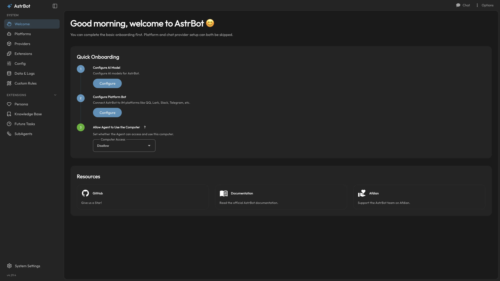

# Deploy and Host AstrBot on Sealos

AstrBot is an open-source AI agent assistant and development framework for connecting large language models with messaging platforms, plugins, knowledge bases, and automation workflows. This template deploys AstrBot 4.29.4 as a persistent single-instance application on Sealos Cloud.

## About Hosting AstrBot

AstrBot provides a browser-based dashboard for configuring AI model providers, connecting IM platforms, managing plugins and MCP servers, building knowledge bases, inspecting conversations, and monitoring runtime activity. The dashboard includes a built-in ChatUI for testing configured models directly.

This template runs one AstrBot StatefulSet with a 1Gi persistent volume mounted at `/AstrBot/data`. The official 4.29.4 release stores its configuration, conversations, plugin data, knowledge-base files, and logs in this directory through SQLite. The persistent volume keeps that state across Pod restarts.

Sealos provisions the public HTTPS endpoint, TLS certificate, application URL, and storage claim automatically. After deployment, the dashboard is ready for account setup and provider configuration from any modern browser.

## Common Use Cases

- **Personal AI Assistant**: Connect AstrBot to an IM account and use one agent across private chats, group chats, and the built-in ChatUI.
- **Multi-Model Workbench**: Configure multiple AI providers, models, personas, and routing rules from one dashboard.
- **Knowledge-Grounded Conversations**: Build knowledge bases for retrieval-augmented answers and document-aware chat.
- **Plugin and MCP Development**: Install plugins, expose MCP servers, build skills, and develop custom agent capabilities.
- **Operations Visibility**: Review conversations, runtime logs, traces, token usage, and model statistics in one place.

## Dependencies for AstrBot Hosting

The Sealos template includes the AstrBot application, its runtime, bundled dashboard, SQLite storage, and a persistent data volume.

### Deployment Dependencies

- [Official AstrBot website](https://astrbot.app/)
- [Docker deployment guide](https://docs.astrbot.app/en/deploy/astrbot/docker.html)
- [WebUI guide](https://docs.astrbot.app/en/use/webui.html)
- [GitHub repository](https://github.com/AstrBotDevs/AstrBot)
- [Community support](https://docs.astrbot.app/en/community.html)

## Implementation Details

**Architecture Components:**

- **AstrBot application**: A single-replica StatefulSet serving the dashboard and API on port `6185`.
- **Persistent data volume**: A 1Gi read-write volume mounted at `/AstrBot/data`.
- **Sealos Ingress**: HTTPS access to the dashboard through an automatically managed domain.
- **Bundled SQLite storage**: AstrBot 4.29.4 maintains its application data inside the persistent volume.

**Configuration:**

- **Initial dashboard password**: Set during deployment as `dashboard_password`. Use at least 8 characters with uppercase, lowercase, and numeric characters.
- **Initial dashboard username**: `astrbot`.
- **Timezone**: `Asia/Shanghai`.
- **Application port**: `6185`.

**License Information:**

AstrBot is licensed under the GNU Affero General Public License v3.0. Review the upstream license and end-user agreement before production use.

## Why Deploy AstrBot on Sealos?

Sealos is an AI-assisted cloud operating system built on Kubernetes that unifies application deployment, networking, storage, and operations. Deploying AstrBot on Sealos gives you:

- **One-Click Deployment**: Provision the application, HTTPS endpoint, and persistent storage from a single template.
- **Persistent State**: Keep AstrBot configuration, conversations, plugins, and knowledge-base data across restarts.
- **Automatic HTTPS**: Reach the dashboard through a managed public URL and TLS certificate.
- **Pay-as-You-Go Resources**: Start with a light `100m` CPU and `512Mi` memory limit and adjust resources through Canvas.
- **Canvas Operations**: Inspect resources, logs, and storage, then modify the deployment with the AI dialog or resource cards.
- **Kubernetes Reliability**: Benefit from health probes, automated recovery, service discovery, and declarative resource management.

## Deployment Guide

1. Open the [AstrBot template](https://sealos.io/products/app-store/astrbot) and click **Deploy Now**.
2. Enter an **Initial Dashboard Password** that contains at least 8 characters, including uppercase, lowercase, and numeric characters.
3. Wait for deployment to complete, typically in 2-3 minutes. After deployment, Sealos opens the Canvas. For later changes, use the AI dialog or click the relevant resource cards.
4. Open the AstrBot URL shown by the application.
5. Log in with username `astrbot` and the initial password from step 2.
6. AstrBot opens **Set Up Account** on the first login. Choose the final administrator username and password, confirm the password, and click **Complete Setup**.
7. Open **Providers** to add an AI model provider, or open **Platforms** to connect an IM platform. The ChatGPT-style ChatUI is available after a provider is configured.

## Login and Account Setup

The `dashboard_password` input creates AstrBot's initial administrator password for the `astrbot` account. AstrBot requires a one-time account setup after the first login. The final username and password entered on the setup page become the credentials for later sessions.

The initial password applies to the first boot. Changes to the template input after initialization leave the existing account password unchanged. Use the dashboard security settings to change the final password, or the upstream `astrbot password` command for recovery.

## Configuration

After deployment, use the AstrBot dashboard to:

- Add model providers and API keys under **Providers**.
- Connect messaging platforms under **Platforms**.
- Install plugins, MCP servers, and skills under **Extensions**.
- Build knowledge bases, personas, and scheduled tasks from the sidebar.
- Review conversations, logs, traces, and usage statistics under **Data & Logs**.
- Manage network settings, appearance, security, backups, and diagnostics under **System Settings**.

Your model provider API keys and messaging-platform credentials are entered inside AstrBot after login. They are stored in the persistent application data volume.

## Scaling

AstrBot 4.29.4 uses SQLite and follows the official single-instance deployment model. Keep the StatefulSet at one replica and adjust CPU and memory through the resource card when the workload grows. The template starts with `100m` CPU and `512Mi` memory limits.

## Troubleshooting

### The initial password is rejected

Confirm the password contains at least 8 characters, including one uppercase letter, one lowercase letter, and one digit. The username is `astrbot`.

### The setup page appears after login

This is the expected first-login flow. Create the final administrator account on that page, then use the new credentials for future sessions.

### A model provider is unavailable

Add or verify the provider under **Providers**, then test the connection from the provider settings. AstrBot starts with an empty provider list, so ChatUI becomes active after a model provider is configured.

### Getting Help

- [AstrBot documentation](https://docs.astrbot.app/)
- [GitHub issues](https://github.com/AstrBotDevs/AstrBot/issues)
- [Sealos Discord](https://discord.gg/wdUn538zVP)

## Additional Resources

- [AstrBot quick start](https://docs.astrbot.app/en/use/webui.html)
- [Plugin development](https://docs.astrbot.app/en/dev/star/guides/)
- [AstrBot releases](https://github.com/AstrBotDevs/AstrBot/releases)

## License

This Sealos template is provided under the repository's template license. AstrBot itself is licensed under AGPL-3.0.
