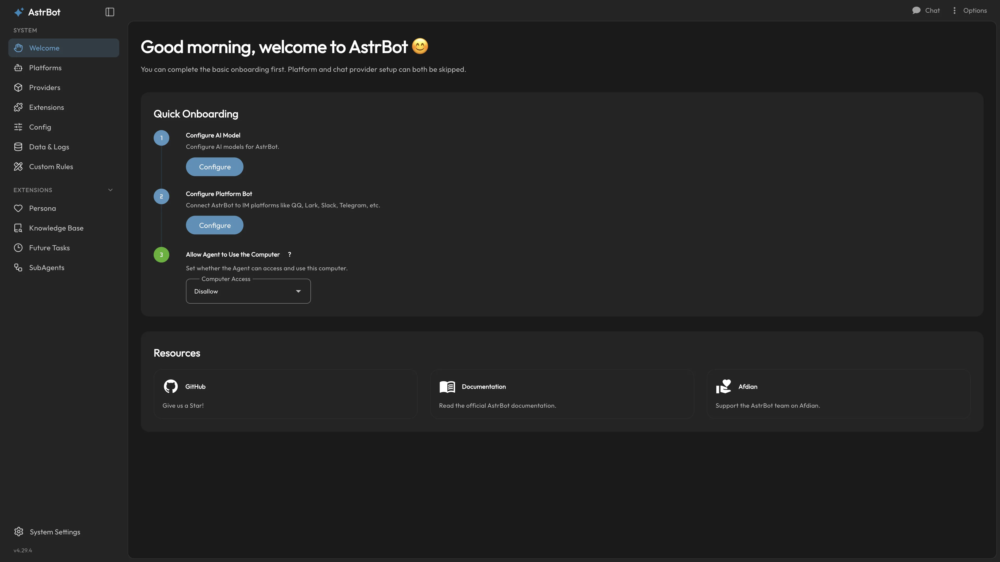

# 在 Sealos 上部署并托管 AstrBot

AstrBot 是开源 AI Agent 助手与开发框架，可将大语言模型（LLM）与即时通讯平台、插件、知识库和自动化工作流连接起来。本模板在 Sealos Cloud 上部署 AstrBot 4.29.4，采用单实例持久化架构。

## 托管 AstrBot

AstrBot 提供浏览器控制台，用于配置 AI 模型提供商、接入即时通讯平台、管理插件和 MCP 服务、构建知识库、查看会话以及监控运行状态。控制台内置 ChatUI，可在配置模型后直接测试对话。

本模板运行一个 AstrBot StatefulSet，并挂载 1Gi 持久卷到 `/AstrBot/data`。官方 4.29.4 版本通过 SQLite 将配置、会话、插件数据、知识库文件和日志保存在该目录，Pod 重启后数据仍会保留。

Sealos 会自动提供公网 HTTPS 地址、TLS 证书、应用入口和存储卷。部署完成后，可直接在浏览器中完成账户设置和模型配置。

## 常见场景

- **个人 AI 助手**：连接即时通讯账号，在私聊、群聊和内置 ChatUI 中使用同一个智能体。
- **多模型工作台**：在一个控制台管理多家 AI 提供商、模型、人格和路由规则。
- **知识库问答**：构建检索增强生成（RAG）知识库，实现文档感知的对话体验。
- **插件与 MCP 开发**：安装插件、接入 MCP 服务、创建技能并扩展 Agent 能力。
- **运行观测**：集中查看会话、日志、链路、Token 用量和模型调用统计。

## AstrBot 托管依赖

Sealos 模板包含 AstrBot 应用、运行时、内置控制台、SQLite 数据存储和持久化数据卷。

### 部署依赖

- [AstrBot 官方网站](https://astrbot.app/)
- [Docker 部署指南](https://docs.astrbot.app/deploy/astrbot/docker.html)
- [WebUI 使用指南](https://docs.astrbot.app/use/webui.html)
- [GitHub 仓库](https://github.com/AstrBotDevs/AstrBot)
- [社区支持](https://docs.astrbot.app/community.html)

## 实现细节

**架构组件：**

- **AstrBot 应用**：单副本 StatefulSet，在 `6185` 端口提供控制台和 API。
- **持久化数据卷**：1Gi 读写卷，挂载到 `/AstrBot/data`。
- **Sealos Ingress**：通过自动管理的域名提供 HTTPS 控制台入口。
- **内置 SQLite 存储**：AstrBot 4.29.4 将应用数据保存在持久卷内。

**配置说明：**

- **初始控制台密码**：部署时通过 `dashboard_password` 设置，至少 8 位，并包含大写字母、小写字母和数字。
- **初始控制台用户名**：`astrbot`。
- **时区**：`Asia/Shanghai`。
- **应用端口**：`6185`。

**许可证信息：**

AstrBot 使用 GNU Affero 通用公共许可证 v3.0。生产使用前，请阅读上游许可证和最终用户协议。

## 在 Sealos 上部署 AstrBot 的优势

Sealos 是基于 Kubernetes 的 AI 辅助云操作系统，将应用部署、网络、存储和运维整合在统一界面中。通过 Sealos 部署 AstrBot 可获得：

- **一键部署**：从单个模板创建应用、HTTPS 入口和持久化存储。
- **数据持久保存**：AstrBot 配置、会话、插件和知识库数据可跨重启保留。
- **自动 HTTPS**：通过平台托管的公网域名和 TLS 证书访问控制台。
- **按量使用资源**：以 `100m` CPU、`512Mi` 内存的资源上限起步，可在 Canvas 中调整。
- **Canvas 运维**：查看资源、日志和存储，并通过 AI 对话框或资源卡片修改部署。
- **Kubernetes 可靠性**：使用健康检查、自动恢复、服务发现和声明式资源管理。

## 部署指南

1. 打开 [AstrBot 模板](https://sealos.io/products/app-store/astrbot)，点击 **Deploy Now**。
2. 输入 **Initial Dashboard Password**，密码至少 8 位，并包含大写字母、小写字母和数字。
3. 等待部署完成，通常需要 2-3 分钟。部署完成后会进入 Canvas；后续变更可通过 AI 对话框或相关资源卡片完成。
4. 打开应用展示的 AstrBot 地址。
5. 使用用户名 `astrbot` 和第 2 步输入的初始密码登录。
6. 首次登录会进入 **Set Up Account** 页面。设置最终管理员用户名和密码，确认后点击 **Complete Setup**。
7. 打开 **Providers** 添加 AI 模型提供商，或打开 **Platforms** 连接即时通讯平台。配置提供商后即可使用内置 ChatUI。

## 登录与账户设置

`dashboard_password` 用于创建 `astrbot` 账户的初始控制台密码。AstrBot 会在首次登录后要求完成一次性账户设置，页面中填写的最终用户名和密码将作为后续登录凭据。

初始密码仅作用于首次启动。初始化完成后修改模板输入，现有账户密码保持不变。后续可通过控制台安全设置修改最终密码，也可使用上游 `astrbot password` 命令恢复。

## 配置

部署完成后，可在 AstrBot 控制台中完成以下配置：

- 在 **Providers** 中添加模型提供商和 API Key。
- 在 **Platforms** 中连接即时通讯平台。
- 在 **Extensions** 中安装插件、MCP 服务和技能。
- 在侧边栏中管理知识库、人格和定时任务。
- 在 **Data & Logs** 中查看会话、日志、链路和用量统计。
- 在 **System Settings** 中管理网络、外观、安全、备份和诊断。

模型提供商 API Key 和即时通讯平台凭据在登录后录入 AstrBot，并保存到持久化应用数据卷。

## 扩缩容

AstrBot 4.29.4 使用 SQLite，并采用官方单实例部署模式。请将 StatefulSet 保持为一个副本，在负载增长时通过资源卡片调整 CPU 和内存。模板以 `100m` CPU、`512Mi` 内存的资源上限起步。

## 故障排查

### 初始密码被拒绝

确认密码至少 8 位，并包含一个大写字母、一个小写字母和一个数字。用户名为 `astrbot`。

### 登录后出现账户设置页面

这是首次登录的标准流程。在该页面创建最终管理员账户，后续使用新的用户名和密码登录。

### 模型提供商不可用

在 **Providers** 中添加或检查提供商配置，然后测试连接。AstrBot 初始提供商列表为空，配置模型提供商后 ChatUI 即可使用。

### 获取帮助

- [AstrBot 文档](https://docs.astrbot.app/)
- [GitHub Issues](https://github.com/AstrBotDevs/AstrBot/issues)
- [Sealos Discord](https://discord.gg/wdUn538zVP)

## 更多资源

- [AstrBot 快速开始](https://docs.astrbot.app/use/webui.html)
- [插件开发](https://docs.astrbot.app/dev/star/guides/)
- [AstrBot 版本发布](https://github.com/AstrBotDevs/AstrBot/releases)

## 许可证

本 Sealos 模板遵循模板仓库的许可证。AstrBot 本身采用 AGPL-3.0 许可证。
