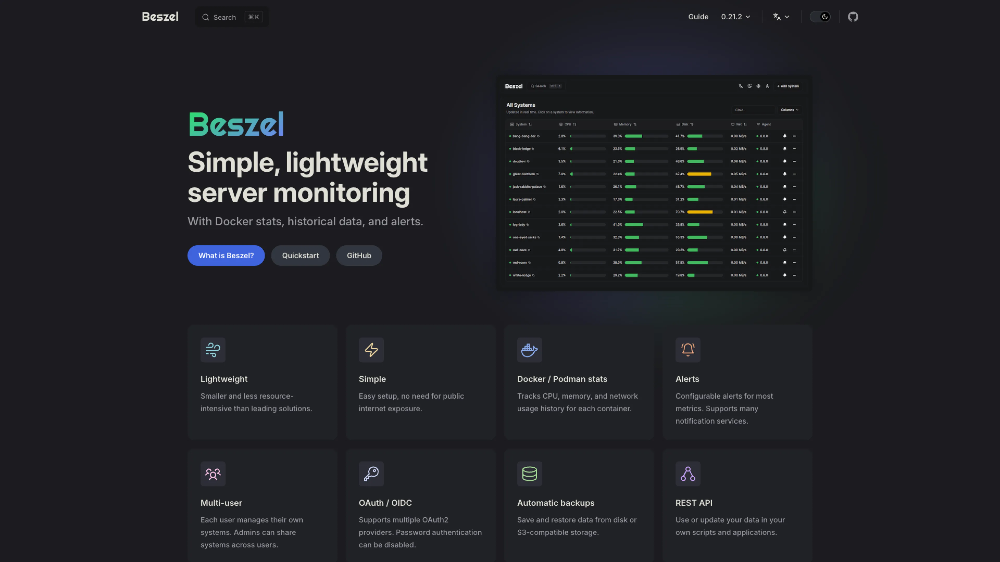

# Deploy and Host Beszel on Sealos

Beszel is a lightweight server monitoring hub with historical metrics, container statistics, alerts, and multi-user dashboards. This Sealos template runs Beszel 0.21.2 with a persistent data volume, a public HTTPS dashboard, and a REST API for automation.

## About Hosting Beszel

Beszel collects CPU, memory, disk, network, temperature, GPU, and container metrics from small agents installed on monitored systems. The hub stores samples in SQLite, renders per-system charts over selectable time ranges, and evaluates alert rules against thresholds and offline conditions. Users can share individual systems with other accounts, and administrators can manage global settings from the same dashboard.

This template runs one StatefulSet with the official `henrygd/beszel:0.21.2` image. The hub listens on port `8090`, and a 1Gi persistent volume at `/beszel_data` stores the SQLite database, user accounts, system records, alert rules, and metric history. A ClusterIP Service publishes the hub internally, while a Sealos Ingress provides the public HTTPS address.

The first account registered through the public URL becomes the administrator. After sign-in, the dashboard links to system management, container statistics, S.M.A.R.T. data, network monitors, and settings for notifications, tokens, and backups. The REST API under `/api/` supports read and write operations for scripts and external integrations.

## Common Use Cases

- **Personal Server Monitoring**: Track uptime and resource usage for home labs, VPS instances, and small clusters.
- **Team Infrastructure Dashboard**: Share selected systems with teammates while keeping administrative settings restricted.
- **Container Visibility**: Collect Docker and Podman statistics for every host that runs the agent.
- **Threshold Alerting**: Send notifications when CPU, memory, disk, temperature, or connectivity crosses a configured boundary.
- **Capacity Planning**: Retain historical samples and compare weekly or monthly trends before resizing hosts.

## Dependencies for Beszel Hosting

The template includes the Beszel Hub StatefulSet, persistent data volume, Service, HTTPS Ingress, and Sealos App entry. Each monitored machine runs a separate Beszel agent that connects outbound to the hub over HTTPS.

### Deployment Dependencies

- [Beszel official site](https://beszel.dev/) - Product overview and feature list
- [Beszel documentation](https://beszel.dev/guide/what-is-beszel) - Concepts, configuration, and guides
- [Beszel repository](https://github.com/henrygd/beszel) - Source code and release notes
- [Beszel container image](https://github.com/henrygd/beszel/pkgs/container/beszel) - Official image used by this template
- [Beszel agent guide](https://beszel.dev/guide/getting-started) - Agent installation on monitored systems

## Implementation Details

**Architecture Components:**

- **Beszel Hub StatefulSet**: One replica running `henrygd/beszel:0.21.2` with the web dashboard on port `8090`.
- **Data volume**: A 1Gi volume mounted at `/beszel_data` for the SQLite database, credentials, systems, and metric history.
- **Service**: ClusterIP port `80` forwarding to the hub HTTP port.
- **Ingress**: Sealos-managed HTTPS host with 32Mi request bodies, 300-second proxy timeouts, and 30-day caching for static assets.
- **App entry**: Opens the monitoring dashboard from the Sealos desktop.

**Configuration:**

- **Image**: `henrygd/beszel:0.21.2`
- **Hub port**: `8090`
- **Public URL**: Injected through `APP_URL` so generated links and agent instructions use the Sealos domain
- **Timezone**: `Asia/Shanghai`
- **First account**: The first registered user becomes the administrator
- **PocketBase console**: `/_/` for collections, logs, and backup settings
- **REST API**: `/api/` for systems, containers, and metric queries
- **Persistence**: `/beszel_data` on a 1Gi volume
- **Health checks**: HTTP startup, readiness, and liveness probes against `/api/health`

**Resource Allocation:**

| Component | CPU Request | CPU Limit | Memory Request | Memory Limit | Storage |
| --- | ---: | ---: | ---: | ---: | ---: |
| Beszel Hub | 20m | 200m | 25Mi | 256Mi | 1Gi |

The profile passed a cold start, first-user registration, logout and password login, dashboard load, and settings page load with zero restarts. Idle process memory measured approximately 12Mi during validation.

## Why Deploy Beszel on Sealos?

Sealos is an AI-assisted cloud operating system built on Kubernetes that combines deployment, networking, storage, and operations in one interface. Deploying Beszel on Sealos gives you:

- **One-Click Deployment**: Launch the hub without assembling StatefulSet, Service, and Ingress resources.
- **Automatic HTTPS**: Receive a managed public domain and TLS certificate for the dashboard and API.
- **Persistent Monitoring History**: Keep users, systems, alert rules, and metric samples on a dedicated volume.
- **Low Baseline Cost**: Run the hub with a tested 20m CPU and 25Mi memory request profile.
- **Sealos Operations**: Inspect the StatefulSet, logs, storage, and resource usage from Canvas or the Sealos AI dialog.
- **Simple Upgrades**: Change the image tag in the template and roll the StatefulSet while the data volume remains attached.

## Deployment Guide

1. Open the [Beszel template](https://sealos.io/products/app-store/beszel) and click **Deploy Now**.
2. Keep the generated application name or set your own, review the host, and confirm the 1Gi storage plan.
3. Wait for deployment to complete, typically in 2-3 minutes. Use Canvas to follow the StatefulSet, Pod, and volume status.
4. Open the public URL and register the first administrator account with an email and password.
5. Open **Settings** to choose the interface language, time range defaults, units, notifications, and authentication options.
6. Add a monitored system, install the agent on that host with the generated key, and confirm that metrics appear in the dashboard.

## Using Beszel

- Review all systems, filters, and sorting options from **All Systems**.
- Open a system to inspect CPU, memory, disk, network, load, temperature, GPU, and uptime charts.
- Use **Containers** to compare per-container CPU, memory, and network usage across hosts.
- Use **S.M.A.R.T.** and **Network Monitors** for disk health and endpoint checks.
- Configure notification channels and alert rules from **Settings → Notifications**.
- Create API tokens and OAuth or OIDC providers from the settings pages when automation or single sign-on is required.
- Review and download backups from the PocketBase console under **Settings → Backups**.

## Connecting Monitored Systems

The template publishes the Beszel Hub. Each monitored machine runs its own agent process, which sends metrics to the hub over HTTPS. The dashboard generates the installation command and public key when a system is added.

1. Open **Add System**, enter a name and host, and copy the generated key.
2. Install `beszel-agent` on the monitored host as a service or container.
3. Set the hub URL to the public HTTPS address and provide the generated key.
4. Start the agent and confirm that the system leaves the pending state.
5. Repeat for additional hosts, or share the system with another hub user.

Systems behind a firewall can push metrics outbound to the hub; no inbound port on the monitored host is required.

## Scaling

Run Beszel Hub as a single replica. The SQLite database and ReadWriteOnce volume serve one writer, and multiple replicas would create independent state. For larger fleets, raise CPU and memory limits, expand the data volume, and reduce the retention window when storage becomes the limiting factor. Separate hubs can monitor independent environments with their own accounts and alert policies.

## Troubleshooting

### The Pod stays Pending

Check that the namespace has 1Gi of available storage for the data volume. Review Pod events in Canvas for volume-binding or scheduling errors.

### The public URL returns a gateway error during startup

The hub needs a few seconds to initialize SQLite and the PocketBase collections. Wait for the readiness probe to pass and reload the page. If the error persists, inspect the Pod logs for database permission or volume mount failures.

### The first account form does not appear

The registration form is available only while the user collection is empty. If an account already exists, open the login page and use the administrator credentials. Reset a forgotten password from the PocketBase console or through the documented recovery flow.

### An agent stays in pending state

Confirm that the agent can reach the public HTTPS hub URL, that the key matches the system entry, and that the host clock is accurate. Review the agent logs on the monitored machine and the hub logs under `/_/` for connection errors.

### Metrics stop after a period of activity

Check the volume usage and the retention settings. A full volume prevents new samples from being written. Expand the PVC or shorten retention, then restart the StatefulSet.

### Memory usage grows with the number of systems

Raise the memory limit to 512Mi or higher for large fleets with frequent sampling. Watch the resource card in Canvas after adding systems, and adjust limits before the container approaches its ceiling.

### Getting Help

- [Beszel documentation](https://beszel.dev/guide/what-is-beszel)
- [Beszel GitHub discussions](https://github.com/henrygd/beszel/discussions)
- [Sealos documentation](https://sealos.io/docs)

## License

Beszel is released under the [MIT License](https://github.com/henrygd/beszel/blob/main/LICENSE). This Sealos template is distributed under the templates repository license.
