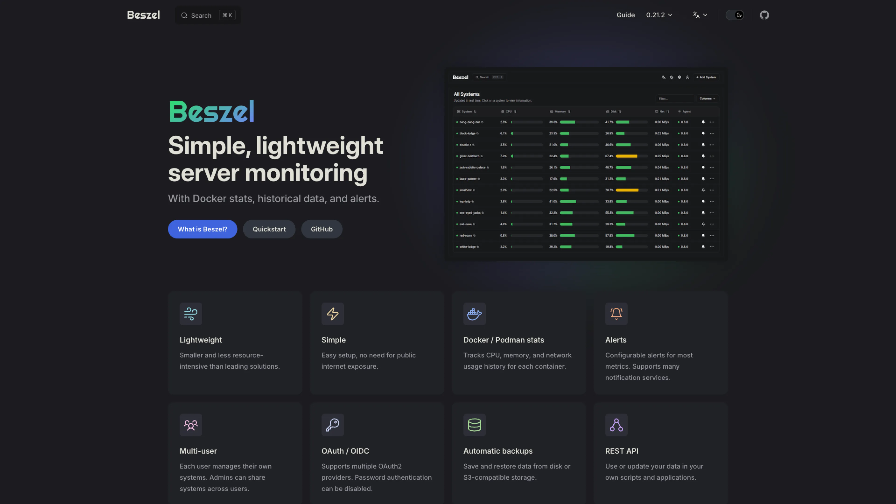

# 在 Sealos 上部署和托管 Beszel

Beszel 是一个轻量级服务器监控平台，提供历史指标、容器统计、告警和多用户仪表盘。本 Sealos 模板运行 Beszel 0.21.2，包含持久化数据卷、HTTPS 公网仪表盘和用于自动化的 REST API。

## 关于 Beszel 托管

Beszel 通过安装在被监控系统上的轻量 Agent 采集 CPU、内存、磁盘、网络、温度、GPU 和容器指标。Hub 将采样数据存入 SQLite，按可选时间范围绘制每台系统的图表，并根据阈值和离线状态评估告警规则。用户可以把单台系统共享给其他账户，管理员可以在同一仪表盘管理全局设置。

本模板以单个 StatefulSet 运行官方 `henrygd/beszel:0.21.2` 镜像。Hub 监听端口 `8090`，1Gi 持久卷挂载到 `/beszel_data`，保存 SQLite 数据库、用户账户、系统记录、告警规则和指标历史。ClusterIP Service 在集群内发布 Hub，Sealos Ingress 提供公网 HTTPS 地址。

通过公网地址注册的第一个账户即为管理员。登录后可以在仪表盘访问系统管理、容器统计、S.M.A.R.T. 数据、网络监控，以及通知、令牌和备份设置。`/api/` 下的 REST API 支持脚本和外部集成进行读写操作。

## 常见使用场景

- **个人服务器监控**：跟踪家庭实验室、VPS 和小型集群的在线状态与资源使用。
- **团队基础设施看板**：把选定系统共享给团队成员，同时保留管理员设置权限。
- **容器可视化**：为每台运行 Agent 的主机采集 Docker 和 Podman 统计。
- **阈值告警**：当 CPU、内存、磁盘、温度或连通性越过设定边界时发送通知。
- **容量规划**：保留历史采样，在扩容主机前对比周度和月度趋势。

## Beszel 托管依赖

模板包含 Beszel Hub StatefulSet、持久化数据卷、Service、HTTPS Ingress 和 Sealos 应用入口。每台被监控主机运行独立的 Beszel Agent，通过 HTTPS 主动连接 Hub。

### 部署依赖

- [Beszel 官网](https://beszel.dev/) - 产品概览和功能列表
- [Beszel 文档](https://beszel.dev/zh/guide/what-is-beszel) - 概念、配置和指南
- [Beszel 仓库](https://github.com/henrygd/beszel) - 源码和发布说明
- [Beszel 容器镜像](https://github.com/henrygd/beszel/pkgs/container/beszel) - 本模板使用的官方镜像
- [Beszel Agent 指南](https://beszel.dev/zh/guide/getting-started) - 在被监控系统上安装 Agent

## 实现细节

**架构组件：**

- **Beszel Hub StatefulSet**：单副本运行 `henrygd/beszel:0.21.2`，Web 仪表盘监听端口 `8090`。
- **数据卷**：1Gi 持久卷挂载到 `/beszel_data`，保存 SQLite 数据库、凭据、系统和指标历史。
- **Service**：ClusterIP 端口 `80` 转发到 Hub HTTP 端口。
- **Ingress**：Sealos 托管 HTTPS 域名，支持 32Mi 请求体、300 秒代理超时和静态资源 30 天缓存。
- **应用入口**：从 Sealos 桌面打开监控仪表盘。

**配置：**

- **镜像**：`henrygd/beszel:0.21.2`
- **Hub 端口**：`8090`
- **公网地址**：通过 `APP_URL` 注入，使生成的链接和 Agent 指引使用 Sealos 域名
- **时区**：`Asia/Shanghai`
- **首个账户**：第一个注册用户成为管理员
- **PocketBase 控制台**：`/_/`，管理集合、日志和备份设置
- **REST API**：`/api/`，查询系统、容器和指标
- **持久化**：`/beszel_data` 上的 1Gi 卷
- **健康检查**：针对 `/api/health` 的 HTTP 启动、就绪和存活探针

**资源分配：**

| 组件 | CPU 请求 | CPU 上限 | 内存请求 | 内存上限 | 存储 |
| --- | ---: | ---: | ---: | ---: | ---: |
| Beszel Hub | 20m | 200m | 25Mi | 256Mi | 1Gi |

该配置通过冷启动、首用户注册、登出与密码登录、仪表盘加载和设置页加载验证，重启次数为零。验证期间空闲进程内存约为 12Mi。

## 为什么在 Sealos 上部署 Beszel？

Sealos 是基于 Kubernetes 的 AI 辅助云操作系统，把部署、网络、存储和运维集中在一个界面。在 Sealos 上部署 Beszel 可以获得：

- **一键部署**：无需手动拼装 StatefulSet、Service 和 Ingress。
- **自动 HTTPS**：为仪表盘和 API 提供托管公网域名与 TLS 证书。
- **持久化监控历史**：用户、系统、告警规则和指标采样保存在独立数据卷。
- **低基线成本**：以经过验证的 20m CPU 和 25Mi 内存请求运行 Hub。
- **Sealos 运维能力**：从 Canvas 或 Sealos AI 对话查看 StatefulSet、日志、存储和资源用量。
- **简单升级**：修改模板中的镜像标签并滚动更新 StatefulSet，数据卷保持挂载。

## 部署指南

1. 打开 [Beszel 模板](https://sealos.io/products/app-store/beszel) 并点击 **Deploy Now**。
2. 保留自动生成的应用名称或自定义名称，确认域名和 1Gi 存储方案。
3. 等待部署完成，通常需要 2-3 分钟。使用 Canvas 跟踪 StatefulSet、Pod 和存储卷状态。
4. 打开公网地址，使用邮箱和密码注册第一个管理员账户。
5. 进入 **设置**，选择界面语言、默认时间范围、单位、通知和认证选项。
6. 添加被监控系统，使用生成的密钥在该主机安装 Agent，确认指标出现在仪表盘。

## 使用 Beszel

- 在 **所有客户端** 页面查看系统列表、过滤和排序。
- 打开单台系统，查看 CPU、内存、磁盘、网络、负载、温度、GPU 和运行时间图表。
- 使用 **容器** 页面跨主机对比每个容器的 CPU、内存和网络用量。
- 使用 **S.M.A.R.T.** 和 **网络监控** 检查磁盘健康和端点可用性。
- 在 **设置 → 通知** 配置通知渠道和告警规则。
- 在设置页创建 API 令牌和 OAuth 或 OIDC 提供商，用于自动化或单点登录。
- 在 PocketBase 控制台的 **设置 → 备份** 中查看和下载备份。

## 接入被监控系统

本模板对外发布 Beszel Hub。每台被监控主机运行独立的 Agent 进程，通过 HTTPS 将指标推送到 Hub。添加系统时，仪表盘会生成安装命令和公钥。

1. 打开 **添加系统**，填写名称和主机地址，复制生成的密钥。
2. 在被监控主机上以服务或容器方式安装 `beszel-agent`。
3. 把 Hub 地址设置为公网 HTTPS 地址，并填入生成的密钥。
4. 启动 Agent，确认系统离开待连接状态。
5. 对其他主机重复上述步骤，或把该系统共享给 Hub 的其他用户。

位于防火墙后的主机只需出站访问 Hub，无需在受监控主机开放入站端口。

## 扩缩容

Beszel Hub 以单副本运行。SQLite 数据库和 ReadWriteOnce 卷对应单个写入者，多副本会产生互相独立的状态。面对更大规模的主机集群，可以提高 CPU 和内存上限、扩大数据卷，并在存储成为瓶颈时缩短保留窗口。不同环境可以使用独立 Hub，各自维护账户和告警策略。

## 故障排查

### Pod 一直处于 Pending

检查命名空间是否有 1Gi 可用存储。在 Canvas 中查看 Pod 事件，确认存储卷绑定和调度是否报错。

### 启动期间公网地址返回网关错误

Hub 需要几秒钟初始化 SQLite 和 PocketBase 集合。等待就绪探针通过后刷新页面。如果错误持续出现，检查 Pod 日志中的数据库权限或卷挂载问题。

### 首账户注册表单没有出现

注册表单仅在用户集合为空时提供。如果已有账户，请打开登录页并使用管理员凭据。忘记密码时，可以通过 PocketBase 控制台或文档中的恢复流程重置。

### Agent 一直停留在待连接状态

确认 Agent 能访问公网 HTTPS Hub 地址、密钥与系统记录一致、主机时钟准确。查看被监控主机上的 Agent 日志，以及 Hub 的 `/_/` 日志中的连接错误。

### 运行一段时间后指标停止更新

检查数据卷用量和保留设置。卷满后无法写入新采样。可以扩大 PVC 或缩短保留窗口，然后重启 StatefulSet。

### 系统数量增加后内存持续增长

对于采样频繁、系统数量较多的场景，把内存上限提高到 512Mi 或更高。添加系统后持续观察 Canvas 中的资源卡片，在容器接近上限前调整限额。

### 获取帮助

- [Beszel 文档](https://beszel.dev/zh/guide/what-is-beszel)
- [Beszel GitHub 讨论区](https://github.com/henrygd/beszel/discussions)
- [Sealos 文档](https://sealos.io/docs)

## 许可证

Beszel 基于 [MIT License](https://github.com/henrygd/beszel/blob/main/LICENSE) 发布。本 Sealos 模板遵循 templates 仓库许可证。
