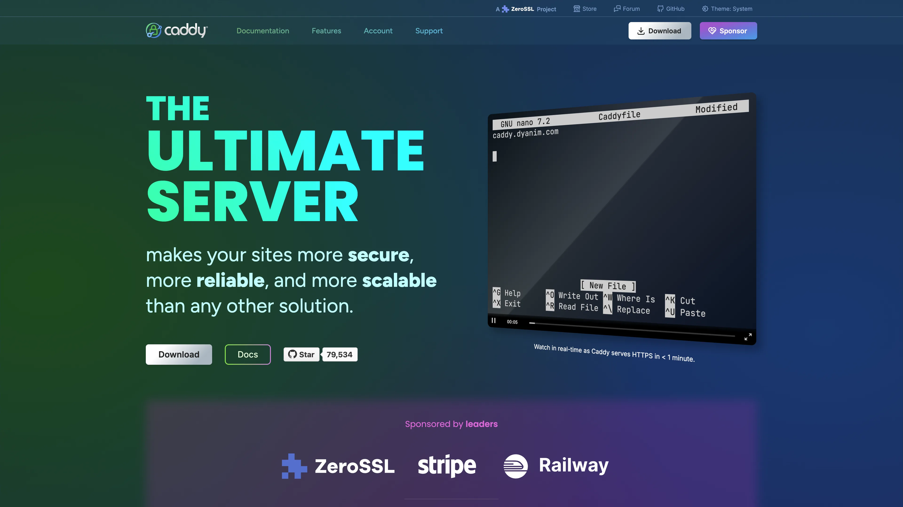

# Deploy and Host Caddy on Sealos

Caddy is a production-ready web server and reverse proxy written in Go. It serves static sites, terminates TLS elsewhere in the stack, and applies compact Caddyfile configuration. This Sealos template runs Caddy 2.11.9 as a non-root container behind a managed HTTPS Ingress with an editable welcome page.



## About Hosting Caddy

This template runs one Deployment with the official `caddy:2.11.9-alpine` image. Caddy listens on port `8080` as UID `1000`, reads `/etc/caddy/Caddyfile`, and serves `/srv` with the built-in static file server. A ConfigMap supplies both the Caddyfile and an `index.html` welcome page, so the site content lives in Kubernetes configuration that you can edit from Canvas.

Sealos Ingress terminates public TLS and forwards HTTP to the Service on port `80`. Caddy therefore runs plain HTTP inside the cluster, and the public host receives a managed certificate automatically. The App card opens the served page directly.

The image writes its autosave file and TLS storage under `/tmp/caddy`, keeping the container filesystem writable for UID `1000` while the deployment stays stateless. A restart rebuilds the running configuration from the ConfigMap.

## Common Use Cases

- **Static Site Hosting**: Publish a landing page, documentation bundle, or single-page application from a ConfigMap or an added volume.
- **Reverse Proxy Front End**: Route paths to internal Services with `reverse_proxy` while Sealos handles the public certificate.
- **Request Normalization**: Add headers, redirects, compression, and path rewrites close to the workload.
- **Development Preview**: Serve build artifacts for review without provisioning a separate web server.
- **Edge Prototyping**: Validate Caddyfile syntax and routing rules before rolling them into a larger deployment.

## Dependencies for Hosting Caddy

- A Sealos workspace with CPU and memory quota.
- A browser or HTTP client to reach the public URL.
- Site content, either in the bundled ConfigMap or in a volume you add to the Deployment.
- No database, Redis, or object storage is required.

### Deployment Dependencies

- [Caddy official site](https://caddyserver.com/) - Product overview and downloads
- [Caddy documentation](https://caddyserver.com/docs/) - Caddyfile syntax and directives
- [Caddy quick start](https://caddyserver.com/docs/quick-starts) - Common serving and proxying patterns
- [Caddy reverse proxy guide](https://caddyserver.com/docs/caddyfile/directives/reverse_proxy) - Upstream and header options
- [Caddy repository](https://github.com/caddyserver/caddy) - Source code and release notes
- [Caddy container image](https://hub.docker.com/_/caddy) - Official image used by this template

## Implementation Details

**Architecture Components:**

- **Caddy Deployment**: One replica running `caddy:2.11.9-alpine` as UID and GID `1000` on port `8080`.
- **ConfigMap**: Stores the Caddyfile and welcome page under path-derived keys, mounted as individual files.
- **Service**: ClusterIP port `80` forwarding to the Caddy HTTP port.
- **Ingress**: Sealos-managed HTTPS host with a 32Mi request body limit and 300-second proxy timeouts.
- **App entry**: Opens the Caddy-served page from the Sealos desktop.

**Configuration:**

- **Image**: `caddy:2.11.9-alpine`
- **Listen address**: `:8080` in the Caddyfile
- **Document root**: `/srv`
- **Welcome page**: Mounted from the `vn-srvvn-indexvn-html` ConfigMap key
- **Caddyfile**: Mounted from the `vn-etcvn-caddyvn-caddyfile` ConfigMap key
- **Runtime user**: UID `1000`, GID `1000`
- **XDG directories**: `/tmp/caddy/config` and `/tmp/caddy/data`
- **Timezone**: `Asia/Shanghai`
- **Health checks**: Startup, readiness, and liveness probes request `GET /` on port `8080`
- **Security context**: Non-root execution, no privilege escalation, all capabilities dropped, `RuntimeDefault` seccomp profile

**Resource Allocation:**

| Component | CPU Request | CPU Limit | Memory Request | Memory Limit | Storage |
| --- | ---: | ---: | ---: | ---: | ---: |
| Caddy | 10m | 100m | 12Mi | 128Mi | None |

The values are the lowest Sealos resource ladder tiers and passed a live cold start, page request, missing-asset request, and a 60-second stability window with zero restarts. Larger response bodies and many concurrent connections benefit from a higher memory limit.

## Why Deploy Caddy on Sealos?

Sealos is an AI-assisted cloud operating system built on Kubernetes. It supplies the runtime, networking, and operations layer around Caddy:

- **One-Click Deployment**: Create the Deployment, ConfigMap, Service, Ingress, and App entry from a single template.
- **Automatic HTTPS**: Let the platform issue and renew the public certificate while Caddy serves plain HTTP internally.
- **Editable Site Content**: Change the welcome page or routing rules by editing the ConfigMap and restarting the Pod.
- **Minimal Footprint**: Run the web tier with a `100m` CPU limit and a `128Mi` memory limit.
- **Operational Visibility**: Inspect logs, probes, and resource usage from Canvas or the Sealos AI dialog.
- **Pay-As-You-Go**: Keep a small preview deployment running and raise resources when traffic grows.

## Deployment Guide

1. Open the [Caddy template](https://sealos.io/products/app-store/caddy) and click **Deploy Now**.
2. Confirm the generated application name and host, then submit the deployment.
3. Wait 2-3 minutes for the Pod to become ready and the public certificate to be issued.
4. Open the App card and confirm the page displays **Caddy is running**.
5. Edit the ConfigMap from Canvas when you want to replace the welcome page or add proxy routes.

## Configuring Sites and Proxies

The ConfigMap `vn-etcvn-caddyvn-caddyfile` key holds the active Caddyfile. A reverse proxy entry that forwards `/api` to an internal Service looks like this:

```caddyfile
:8080 {
	handle /api/* {
		reverse_proxy http://my-api.default.svc.cluster.local:8080
	}
	handle {
		root * /srv
		file_server
	}
}
```

Replace the host, port, and path with the Service in your namespace. After saving the ConfigMap, restart the Deployment from Canvas so Caddy reloads the file. The Ingress keeps public TLS termination in front of Caddy, so use `http://` upstreams inside the cluster.

The welcome page lives in the `vn-srvvn-indexvn-html` key. Replace its HTML to publish a static landing page. For a larger site, add a persistent volume at `/srv` and remove the `index.html` mount so Caddy serves the volume contents.

## Scaling

Caddy is stateless in this template, so you can raise the Deployment replica count when you need more concurrent connections. All replicas read the same ConfigMap and serve identical content. Keep session state and uploads in a shared service or persistent volume when you scale beyond one replica.

Vertical scaling is usually sufficient for static sites. Raise the CPU limit for TLS handshakes and compression, and raise the memory limit when serving large files or many concurrent streams.

## Troubleshooting

### The public URL returns 503

The Ingress can return 503 while the certificate or Service endpoints are still being created. Wait for the Pod to report Ready, confirm the Service has endpoints, and retry after the certificate is issued.

### Caddy exits with a Caddyfile parse error

Check the Pod logs for the reported line number. Keep tabs for Caddyfile indentation, close every block, and confirm that the file mounts at `/etc/caddy/Caddyfile`. A malformed ConfigMap prevents Caddy from starting.

### The page shows the default image content

Confirm both ConfigMap keys are mounted with the expected `subPath` values. The template serves `/srv/index.html`; a different document root needs a matching Caddyfile change.

### Permission denied on startup

The container runs as UID `1000`. Confirm that mounted files are world-readable and that writable paths point to `/tmp/caddy`. A volume owned by another UID needs `fsGroup` alignment.

### Reverse proxy returns 502

Use the Kubernetes Service FQDN and the container port of the upstream. Confirm the upstream Service has ready endpoints and that NetworkPolicy or authentication does not block traffic from the Caddy Pod.

### Getting Help

- [Caddy documentation](https://caddyserver.com/docs/)
- [Caddy community forum](https://caddy.community/)
- [Sealos documentation](https://sealos.io/docs)

## License

Caddy is released under the [Apache License 2.0](https://github.com/caddyserver/caddy/blob/master/LICENSE). This Sealos template is distributed under the templates repository license.
