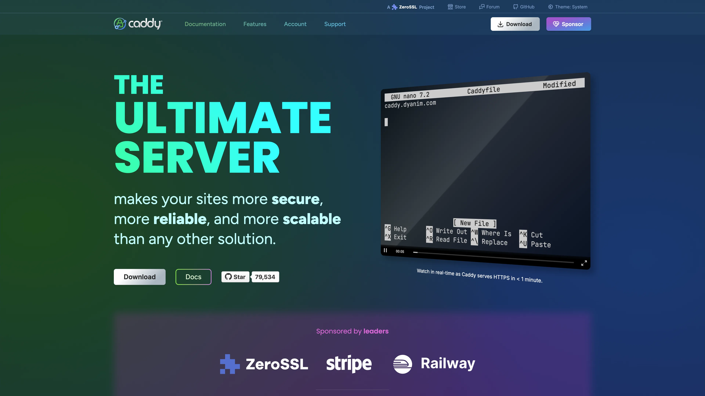

# 在 Sealos 上部署和托管 Caddy

Caddy 是用 Go 编写的生产级 Web 服务器与反向代理，可托管静态站点、在服务栈内部处理 TLS，并通过简洁的 Caddyfile 表达配置。本 Sealos 模板以非 root 容器运行 Caddy 2.11.9，前置 Sealos 管理的 HTTPS Ingress，并提供可编辑的欢迎页。



## Caddy 托管说明

本模板以单个 Deployment 运行官方 `caddy:2.11.9-alpine` 镜像。Caddy 以 UID `1000` 监听 `8080` 端口，读取 `/etc/caddy/Caddyfile`，并使用内置静态文件服务器提供 `/srv` 内容。ConfigMap 提供 Caddyfile 和 `index.html` 欢迎页，站点内容保存在 Kubernetes 配置中，可直接在 Canvas 中编辑。

Sealos Ingress 负责公网 TLS 终止，并将 HTTP 请求转发到 Service 的 `80` 端口。Caddy 在集群内部使用明文 HTTP，公网域名自动获得托管证书。App 卡片直接打开 Caddy 提供的页面。

镜像将自动保存文件和 TLS 存储写入 `/tmp/caddy`，让 UID `1000` 拥有可写目录，同时保持 Deployment 无状态。Pod 重启后会根据 ConfigMap 重新构建运行配置。

## 常见使用场景

- **静态站点托管**：从 ConfigMap 或新增数据卷发布落地页、文档站或单页应用。
- **反向代理前端**：通过 `reverse_proxy` 将路径转发到内部 Service，公网证书由 Sealos 统一管理。
- **请求规范化**：在业务附近添加请求头、重定向、压缩和路径重写规则。
- **开发预览**：直接提供构建产物，用于评审和验证。
- **边缘方案验证**：在更大规模部署前验证 Caddyfile 语法与路由规则。

## Caddy 托管依赖

- 具备 CPU 和内存配额的 Sealos 工作空间。
- 用于访问公网地址的浏览器或 HTTP 客户端。
- 站点内容，可放在模板自带的 ConfigMap 或自行添加的数据卷中。
- 本模板无需数据库、Redis 或对象存储。

### 部署依赖

- [Caddy 官网](https://caddyserver.com/) - 产品介绍与下载入口
- [Caddy 文档](https://caddyserver.com/docs/) - Caddyfile 语法与指令说明
- [Caddy 快速入门](https://caddyserver.com/docs/quick-starts) - 常见托管与代理模式
- [Caddy 反向代理指南](https://caddyserver.com/docs/caddyfile/directives/reverse_proxy) - 上游与请求头配置
- [Caddy 代码仓库](https://github.com/caddyserver/caddy) - 源码与版本说明
- [Caddy 容器镜像](https://hub.docker.com/_/caddy) - 本模板使用的官方镜像

## 实现细节

**架构组件：**

- **Caddy Deployment**：单副本运行 `caddy:2.11.9-alpine`，以 UID 和 GID `1000` 监听 `8080` 端口。
- **ConfigMap**：按路径命名规则保存 Caddyfile 和欢迎页，并以独立文件挂载。
- **Service**：ClusterIP 的 `80` 端口转发到 Caddy HTTP 端口。
- **Ingress**：Sealos 管理的 HTTPS 域名，请求体上限 32Mi，代理超时 300 秒。
- **App 入口**：从 Sealos 桌面打开 Caddy 提供的页面。

**配置说明：**

- **镜像**：`caddy:2.11.9-alpine`
- **监听地址**：Caddyfile 中的 `:8080`
- **文档根目录**：`/srv`
- **欢迎页**：从 ConfigMap 键 `vn-srvvn-indexvn-html` 挂载
- **Caddyfile**：从 ConfigMap 键 `vn-etcvn-caddyvn-caddyfile` 挂载
- **运行用户**：UID `1000`，GID `1000`
- **XDG 目录**：`/tmp/caddy/config` 与 `/tmp/caddy/data`
- **时区**：`Asia/Shanghai`
- **健康检查**：启动、就绪和存活探针请求 `8080` 端口的 `GET /`
- **安全上下文**：非 root 运行，禁用权限提升，丢弃全部 capabilities，启用 `RuntimeDefault` seccomp 配置

**资源分配：**

| 组件 | CPU 请求 | CPU 上限 | 内存请求 | 内存上限 | 存储 |
| --- | ---: | ---: | ---: | ---: | ---: |
| Caddy | 10m | 100m | 12Mi | 128Mi | 无 |

以上数值是 Sealos 资源阶梯的最低档位，已通过线上冷启动、页面请求、缺失资源请求和 60 秒稳定性观察，重启次数为 0。更大的响应体和更多并发连接建议提高内存上限。

## 为什么在 Sealos 上部署 Caddy？

Sealos 是基于 Kubernetes 的 AI 辅助云操作系统，为 Caddy 提供运行时、网络和运维能力：

- **一键部署**：通过一个模板创建 Deployment、ConfigMap、Service、Ingress 和 App 入口。
- **自动 HTTPS**：平台签发并续期公网证书，Caddy 在集群内部提供明文 HTTP。
- **站点内容可编辑**：修改 ConfigMap 并重启 Pod，即可替换欢迎页或路由规则。
- **资源占用小**：以 `100m` CPU 上限和 `128Mi` 内存上限承载 Web 层。
- **运维可视**：通过 Canvas 或 Sealos AI 对话查看日志、探针和资源使用情况。
- **按量计费**：保持小型预览部署，流量增长后再提升资源。

## 部署指南

1. 打开 [Caddy 模板](https://sealos.io/products/app-store/caddy)，点击 **Deploy Now**。
2. 确认自动生成的应用名和域名后提交部署。
3. 等待 2-3 分钟，Pod 进入 Ready 且公网证书签发完成。
4. 打开 App 卡片，确认页面显示 **Caddy is running**。
5. 需要替换欢迎页或增加代理路由时，在 Canvas 中编辑 ConfigMap。

## 配置站点与反向代理

ConfigMap 的 `vn-etcvn-caddyvn-caddyfile` 键保存当前 Caddyfile。将 `/api` 转发到内部 Service 的配置如下：

```caddyfile
:8080 {
	handle /api/* {
		reverse_proxy http://my-api.default.svc.cluster.local:8080
	}
	handle {
		root * /srv
		file_server
	}
}
```

将主机、端口和路径替换为当前命名空间中的 Service。保存 ConfigMap 后，在 Canvas 中重启 Deployment，让 Caddy 重新加载文件。公网 TLS 终止由 Ingress 负责，集群内部的上游地址使用 `http://`。

欢迎页位于 `vn-srvvn-indexvn-html` 键。替换其中的 HTML 即可发布静态落地页。更大规模的站点可在 `/srv` 添加持久卷，并移除 `index.html` 挂载，让 Caddy 直接提供卷内内容。

## 扩缩容

本模板中的 Caddy 无状态，可通过提高 Deployment 副本数承载更多并发连接。所有副本读取同一 ConfigMap，内容保持一致。需要多副本时，将会话状态和上传文件放到共享服务或持久卷中。

静态站点通常纵向扩容即可。TLS 握手和压缩负载较高时提高 CPU 上限，提供大文件或大量并发流时提高内存上限。

## 故障排查

### 公网地址返回 503

证书或 Service 端点创建期间，Ingress 可能返回 503。等待 Pod 进入 Ready，确认 Service 已产生端点，并在证书签发后重试。

### Caddy 因 Caddyfile 解析错误退出

查看 Pod 日志中的行号。Caddyfile 缩进使用制表符，确保所有块已闭合，并确认文件挂载在 `/etc/caddy/Caddyfile`。ConfigMap 格式错误会导致 Caddy 无法启动。

### 页面显示镜像默认内容

确认两个 ConfigMap 键都以正确的 `subPath` 挂载。模板提供 `/srv/index.html`；修改文档根目录时需要同步修改 Caddyfile。

### 启动时报权限错误

容器以 UID `1000` 运行。确认挂载文件可被所有用户读取，可写路径指向 `/tmp/caddy`。由其他 UID 拥有的数据卷需要调整 `fsGroup`。

### 反向代理返回 502

使用上游的 Kubernetes Service FQDN 和容器端口，确认上游 Service 存在 Ready 端点，并检查 NetworkPolicy 或认证配置是否阻断 Caddy Pod 的请求。

### 获取帮助

- [Caddy 文档](https://caddyserver.com/docs/)
- [Caddy 社区论坛](https://caddy.community/)
- [Sealos 文档](https://sealos.io/docs)

## 许可证

Caddy 采用 [Apache License 2.0](https://github.com/caddyserver/caddy/blob/master/LICENSE)。本 Sealos 模板遵循 templates 仓库许可证。
