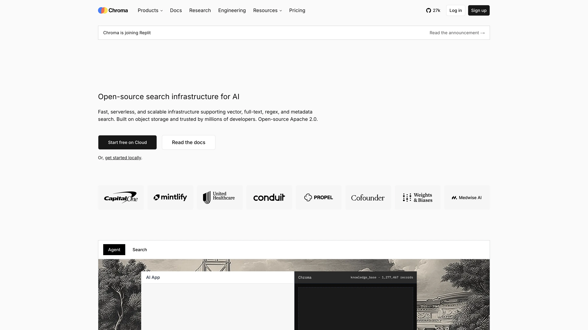

# Deploy and Host Chroma on Sealos

Chroma is an open-source vector database for AI applications. It stores embeddings, documents, and metadata, then serves similarity search, metadata filters, and full-text search through an HTTP API. This Sealos template runs Chroma 1.5.9 as a single-node server with persistent storage and a public HTTPS endpoint.



## About Hosting Chroma

Chroma runs as one StatefulSet with the official `chromadb/chroma:1.5.9` image. The server exposes the v2 REST API on port `8000`, keeps collections in an embedded storage engine, and writes all data to `/data`. A 1Gi persistent volume backs that path, so collections survive Pod restarts and rescheduling.

The container is intentionally small: the tested profile runs with a `100m` CPU limit and a `128Mi` memory limit. A cold start reaches readiness in about 30 seconds, and the heartbeat endpoint responds on the first probe. The template exposes the interactive OpenAPI page at `/docs/`, which is also the URL opened by the App card.

Chroma 1.5.9 has no built-in authentication layer. The deployed API is reachable by anyone who knows the public hostname, so treat it as a service for a trusted network or place an authenticating proxy in front of it before storing sensitive data.

## Common Use Cases

- **Retrieval-Augmented Generation**: Store document chunks and embeddings for a RAG pipeline that answers questions from private knowledge.
- **Semantic Search**: Search product catalogs, support articles, or internal documentation by meaning instead of exact keywords.
- **Recommendation Features**: Keep item embeddings and retrieve nearest neighbors for related-content and similarity blocks.
- **Agent Memory**: Persist long-term memories from AI agents with metadata filters for user, session, and source.
- **Prototyping Vector Workloads**: Validate chunking, embedding models, and retrieval quality before moving to a managed cluster.

## Dependencies for Hosting Chroma

- A Sealos workspace with CPU, memory, and storage quota.
- An HTTP client, the Python `chromadb` package, or the JavaScript `chromadb` package.
- An embedding model or embedding API when you want Chroma to store generated vectors.
- A browser for the OpenAPI page at `/docs/`.
- No PostgreSQL, Redis, or object storage is required by this single-node profile.

### Deployment Dependencies

- [Chroma official site](https://www.trychroma.com/) - Product overview and cloud offering
- [Chroma documentation](https://docs.trychroma.com/) - Guides for collections, queries, and integrations
- [Chroma deployment guide](https://docs.trychroma.com/deployment) - Server deployment and persistence notes
- [Chroma API reference](https://docs.trychroma.com/reference) - REST and client API details
- [Chroma repository](https://github.com/chroma-core/chroma) - Source code and release notes
- [Chroma container image](https://hub.docker.com/r/chromadb/chroma) - Official image used by this template

## Implementation Details

**Architecture Components:**

- **Chroma StatefulSet**: One replica running `chromadb/chroma:1.5.9` with the v2 API on port `8000`.
- **Data volume**: A 1Gi volume at `/data` holding the collection metadata, documents, and vector index.
- **Service**: ClusterIP port `80` forwarding to the Chroma HTTP port.
- **Ingress**: Sealos-managed HTTPS host with a 32Mi request body limit, 300-second proxy timeouts, and static asset caching.
- **App entry**: Opens the Swagger UI at `/docs/` from the Sealos desktop.

**Configuration:**

- **Image**: `chromadb/chroma:1.5.9`
- **HTTP port**: `8000` through `CHROMA_SERVER_HTTP_PORT`
- **Persistence path**: `/data`
- **API version**: v2 under `/api/v2`
- **Timezone**: `Asia/Shanghai`
- **Health checks**: Startup, readiness, and liveness probes call `GET /api/v2/heartbeat`
- **Security context**: The container drops all Linux capabilities, disables privilege escalation, and applies the `RuntimeDefault` seccomp profile

**Resource Allocation:**

| Component | CPU Request | CPU Limit | Memory Request | Memory Limit | Storage |
| --- | ---: | ---: | ---: | ---: | ---: |
| Chroma | 10m | 100m | 12Mi | 128Mi | 1Gi |

The resource values are live-tested minimums. A cold start, collection creation, document insertion, a nearest-neighbor query, and a 60-second stability window all passed at this tier with zero restarts. Larger embedding batches and high query concurrency benefit from a higher memory limit.

## Why Deploy Chroma on Sealos?

Sealos is an AI-assisted cloud operating system built on Kubernetes. It provides the deployment, networking, storage, and operations layer for Chroma in one interface:

- **One-Click Deployment**: Create the StatefulSet, persistent volume, Service, Ingress, and App entry from a single template.
- **Automatic HTTPS**: Receive a managed public domain and TLS certificate for the API.
- **Persistent Collections**: Keep vectors and metadata on a dedicated volume across restarts.
- **Resource Control**: Adjust CPU and memory from the resource card while the platform handles scheduling and health checks.
- **Operational Visibility**: Inspect Pods, logs, events, and resource usage from Canvas or the Sealos AI dialog.
- **Pay-As-You-Go**: Start with a small footprint and raise limits when the collection grows.

## Deployment Guide

1. Open the [Chroma template](https://sealos.io/products/app-store/chroma) and click **Deploy Now**.
2. Confirm the generated application name and host, review the 1Gi storage request, and submit the deployment.
3. Wait 2-3 minutes for the Pod to become ready and the certificate to be issued.
4. Open the App card to reach the Swagger UI at `/docs/`.
5. Call `GET /api/v2/heartbeat` from the same host to confirm the service responds with HTTP 200.

## Using the Chroma API

The base URL is `https://<your-app-host>`. The examples below create a collection, insert a document with a three-dimensional vector, and run a query.

```bash
BASE=https://<your-app-host>

curl -X POST "$BASE/api/v2/tenants/default_tenant/databases/default_database/collections" \
  -H 'Content-Type: application/json' \
  -d '{"name":"docs","metadata":{"owner":"sealos"}}'
```

The response contains an `id`. Use it in the next two calls:

```bash
COLLECTION_ID=<collection-id>

curl -X POST "$BASE/api/v2/tenants/default_tenant/databases/default_database/collections/$COLLECTION_ID/add" \
  -H 'Content-Type: application/json' \
  -d '{"ids":["doc1"],"documents":["Sealos runs Chroma"],"embeddings":[[0.1,0.2,0.3]]}'

curl -X POST "$BASE/api/v2/tenants/default_tenant/databases/default_database/collections/$COLLECTION_ID/query" \
  -H 'Content-Type: application/json' \
  -d '{"query_embeddings":[[0.1,0.2,0.3]],"n_results":1}'
```

The Python client connects with the public host and port `443`:

```python
import chromadb

client = chromadb.HttpClient(host="<your-app-host>", port=443, ssl=True)
collection = client.get_or_create_collection("docs")
collection.add(ids=["doc1"], documents=["Sealos runs Chroma"], embeddings=[[0.1, 0.2, 0.3]])
print(collection.query(query_embeddings=[[0.1, 0.2, 0.3]], n_results=1))
```

## Storage and Persistence

Chroma writes its embedded index to `/data`. The StatefulSet uses a `volumeClaimTemplates` entry named `vn-data`, mapped to that path. The first PVC request is 1Gi; expand it from the Sealos storage view when the collection outgrows the initial size.

The server owns the volume, so attach only one writer. Stop the Pod before copying the volume or restoring a backup, and keep the volume bound for the lifetime of the data you want to retain.

## Scaling

This template runs one replica because Chroma's single-node mode keeps a local index and a local write path. Scale vertically by raising the memory limit for larger collections and the CPU limit for heavier indexing and query workloads. For horizontal scale, deploy multiple independent instances and shard collections at the application layer, or move to Chroma Cloud or a distributed deployment.

After changing resources in Canvas, wait for the new Pod to become ready and run a query before sending production traffic. A memory limit below `128Mi` is outside the tested profile.

## Troubleshooting

### The Pod restarts during startup

Check the Pod events and logs for `OOMKilled`. The tested floor is `128Mi`; raise the memory limit to `256Mi` for larger batches, then restart the Pod and confirm the heartbeat endpoint returns HTTP 200.

### `/` returns 404

The Chroma API has no landing page. Open `/docs/` for Swagger UI or call `/api/v2/heartbeat` directly. The App card already points to `/docs/`.

### Collection requests return 500

Confirm the collection name is unique inside the default tenant and database, and that the request body uses the v2 path. The v1 heartbeat path returns HTTP 410 on this release.

### Data disappears after a restart

Verify that `vn-data` is mounted at `/data` and that the PVC is bound. Chroma writes to `/data`; a different mount path leaves the embedded index outside the persistent volume.

### Queries are slow or time out

Reduce `n_results`, raise the CPU and memory limits, and check the Ingress proxy timeouts. The template sets 300-second read and send timeouts, which suit large indexing calls.

### The public endpoint is reachable by anyone

Chroma 1.5.9 has no built-in authentication. Keep the deployment on a trusted network, add an authenticating reverse proxy, or delete the instance when the data is no longer needed.

### Getting Help

- [Chroma documentation](https://docs.trychroma.com/)
- [Chroma GitHub issues](https://github.com/chroma-core/chroma/issues)
- [Sealos documentation](https://sealos.io/docs)

## License

Chroma is released under the [Apache License 2.0](https://github.com/chroma-core/chroma/blob/main/LICENSE). This Sealos template is distributed under the templates repository license.
