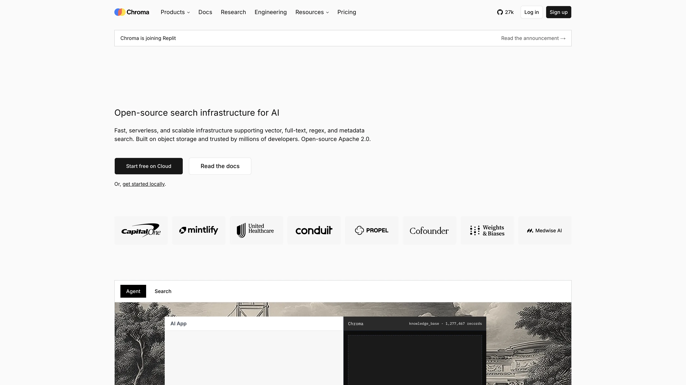

# 在 Sealos 上部署和托管 Chroma

Chroma 是面向 AI 应用的开源向量数据库。它存储嵌入向量、文档与元数据，并通过 HTTP API 提供相似度检索、元数据过滤和全文检索。本 Sealos 模板以单节点方式运行 Chroma 1.5.9，配置持久化存储和公网 HTTPS 入口。



## Chroma 托管说明

Chroma 以单个 StatefulSet 运行官方 `chromadb/chroma:1.5.9` 镜像。服务在 `8000` 端口提供 v2 REST API，使用内嵌存储引擎保存集合，并将全部数据写入 `/data`。1Gi 持久卷挂载到该路径，集合数据在 Pod 重启和重新调度后仍然保留。

容器资源占用较低：实测配置为 `100m` CPU 上限和 `128Mi` 内存上限。冷启动约 30 秒进入 Ready，心跳接口在首次探测时即可返回。模板在 `/docs/` 暴露交互式 OpenAPI 页面，App 卡片也指向该地址。

Chroma 1.5.9 未内置认证层。部署后的 API 对知道公网域名的访问者开放，建议仅在可信网络中使用，或在存储敏感数据前增加一层认证代理。

## 常见使用场景

- **检索增强生成**：保存文档分块与嵌入向量，为 RAG 流程提供私有知识检索。
- **语义搜索**：按语义检索商品、帮助文档或内部资料，替代纯关键词匹配。
- **推荐能力**：保存条目向量并检索最近邻，用于相关内容与相似推荐。
- **Agent 记忆**：持久化 AI Agent 的长期记忆，并按用户、会话和来源做元数据过滤。
- **向量方案验证**：在迁移到托管集群前验证分块策略、嵌入模型和检索质量。

## Chroma 托管依赖

- 具备 CPU、内存和存储配额的 Sealos 工作空间。
- HTTP 客户端、Python `chromadb` 包或 JavaScript `chromadb` 包。
- 生成向量所需的嵌入模型或嵌入 API。
- 用于访问 `/docs/` 的浏览器。
- 本单节点方案无需 PostgreSQL、Redis 或对象存储。

### 部署依赖

- [Chroma 官网](https://www.trychroma.com/) - 产品介绍与云服务入口
- [Chroma 文档](https://docs.trychroma.com/) - 集合、查询与集成指南
- [Chroma 部署指南](https://docs.trychroma.com/deployment) - 服务端部署与持久化说明
- [Chroma API 参考](https://docs.trychroma.com/reference) - REST 与客户端 API 细节
- [Chroma 代码仓库](https://github.com/chroma-core/chroma) - 源码与版本说明
- [Chroma 容器镜像](https://hub.docker.com/r/chromadb/chroma) - 本模板使用的官方镜像

## 实现细节

**架构组件：**

- **Chroma StatefulSet**：单副本运行 `chromadb/chroma:1.5.9`，在 `8000` 端口提供 v2 API。
- **数据卷**：1Gi 卷挂载到 `/data`，保存集合元数据、文档和向量索引。
- **Service**：ClusterIP 的 `80` 端口转发到 Chroma HTTP 端口。
- **Ingress**：Sealos 管理的 HTTPS 域名，请求体上限 32Mi，代理超时 300 秒，并启用静态资源缓存。
- **App 入口**：从 Sealos 桌面打开 `/docs/` 的 Swagger UI。

**配置说明：**

- **镜像**：`chromadb/chroma:1.5.9`
- **HTTP 端口**：通过 `CHROMA_SERVER_HTTP_PORT` 设置为 `8000`
- **持久化路径**：`/data`
- **API 版本**：`/api/v2` 下的 v2 接口
- **时区**：`Asia/Shanghai`
- **健康检查**：启动、就绪和存活探针均请求 `GET /api/v2/heartbeat`
- **安全上下文**：容器丢弃全部 Linux capabilities，禁用权限提升，并启用 `RuntimeDefault` seccomp 配置

**资源分配：**

| 组件 | CPU 请求 | CPU 上限 | 内存请求 | 内存上限 | 存储 |
| --- | ---: | ---: | ---: | ---: | ---: |
| Chroma | 10m | 100m | 12Mi | 128Mi | 1Gi |

以上数值为线上实测的最小可用档。该档位完成了冷启动、创建集合、写入文档、最近邻查询和 60 秒稳定性观察，重启次数为 0。更大的嵌入批量和更高查询并发建议提高内存上限。

## 为什么在 Sealos 上部署 Chroma？

Sealos 是基于 Kubernetes 的 AI 辅助云操作系统，将部署、网络、存储和运维集中在同一界面：

- **一键部署**：通过一个模板创建 StatefulSet、持久卷、Service、Ingress 和 App 入口。
- **自动 HTTPS**：获得托管公网域名和 TLS 证书，直接提供 API 服务。
- **集合持久化**：向量与元数据保存在专用数据卷，重启后继续可用。
- **资源可控**：在资源卡片中调整 CPU 和内存，调度与健康检查由平台负责。
- **运维可视**：通过 Canvas 或 Sealos AI 对话查看 Pod、日志、事件和资源使用情况。
- **按量计费**：以较小规格起步，集合增长后再提升上限。

## 部署指南

1. 打开 [Chroma 模板](https://sealos.io/products/app-store/chroma)，点击 **Deploy Now**。
2. 确认自动生成的应用名和域名，检查 1Gi 存储申请后提交部署。
3. 等待 2-3 分钟，Pod 进入 Ready 且证书签发完成。
4. 打开 App 卡片，进入 `/docs/` 的 Swagger UI。
5. 在同一域名调用 `GET /api/v2/heartbeat`，确认返回 HTTP 200。

## 使用 Chroma API

服务基地址为 `https://<your-app-host>`。以下示例创建集合、写入一条带三维向量的文档，并执行查询。

```bash
BASE=https://<your-app-host>

curl -X POST "$BASE/api/v2/tenants/default_tenant/databases/default_database/collections" \
  -H 'Content-Type: application/json' \
  -d '{"name":"docs","metadata":{"owner":"sealos"}}'
```

响应中包含集合 `id`，在后续两个请求中使用：

```bash
COLLECTION_ID=<collection-id>

curl -X POST "$BASE/api/v2/tenants/default_tenant/databases/default_database/collections/$COLLECTION_ID/add" \
  -H 'Content-Type: application/json' \
  -d '{"ids":["doc1"],"documents":["Sealos runs Chroma"],"embeddings":[[0.1,0.2,0.3]]}'

curl -X POST "$BASE/api/v2/tenants/default_tenant/databases/default_database/collections/$COLLECTION_ID/query" \
  -H 'Content-Type: application/json' \
  -d '{"query_embeddings":[[0.1,0.2,0.3]],"n_results":1}'
```

Python 客户端通过公网域名和 `443` 端口连接：

```python
import chromadb

client = chromadb.HttpClient(host="<your-app-host>", port=443, ssl=True)
collection = client.get_or_create_collection("docs")
collection.add(ids=["doc1"], documents=["Sealos runs Chroma"], embeddings=[[0.1, 0.2, 0.3]])
print(collection.query(query_embeddings=[[0.1, 0.2, 0.3]], n_results=1))
```

## 存储与持久化

Chroma 将内嵌索引写入 `/data`。StatefulSet 通过名为 `vn-data` 的 `volumeClaimTemplates` 挂载该路径，初始申请 1Gi。集合增长后，可在 Sealos 存储视图中扩容 PVC。

数据卷由服务独占写入。复制卷或恢复备份前先停止 Pod，并保留卷绑定直到数据不再需要。

## 扩缩容

本模板保持单副本，因为 Chroma 单节点模式使用本地索引和本地写入路径。纵向扩容时，为更大的集合提高内存上限，为更重的索引和查询负载提高 CPU 上限。需要横向扩展时，可部署多个独立实例并在应用层分片集合，或迁移到 Chroma Cloud 或分布式部署。

在 Canvas 中调整资源后，等待新 Pod 进入 Ready 并执行一次查询，再切换生产流量。低于 `128Mi` 的内存上限不在已测试范围内。

## 故障排查

### Pod 在启动阶段反复重启

查看 Pod 事件和日志中的 `OOMKilled`。实测下限为 `128Mi`；更大批量写入可将内存上限提升到 `256Mi`，然后重启 Pod 并确认心跳接口返回 HTTP 200。

### 访问 `/` 返回 404

Chroma API 没有首页。打开 `/docs/` 查看 Swagger UI，或直接调用 `/api/v2/heartbeat`。App 卡片已经指向 `/docs/`。

### 集合请求返回 500

确认集合名在默认租户和数据库内唯一，并确认请求使用 v2 路径。该版本的 v1 心跳路径返回 HTTP 410。

### 重启后数据丢失

确认 `vn-data` 挂载在 `/data` 且 PVC 已绑定。Chroma 写入 `/data`；挂载路径不一致时，内嵌索引会落在持久卷之外。

### 查询缓慢或超时

降低 `n_results`，提高 CPU 和内存上限，并检查 Ingress 代理超时。模板设置的读写超时为 300 秒，可覆盖较大的索引请求。

### 公网接口可被任意访问

Chroma 1.5.9 未内置认证。将部署放在可信网络中，增加认证反向代理，或在数据不再需要时删除实例。

### 获取帮助

- [Chroma 文档](https://docs.trychroma.com/)
- [Chroma GitHub Issues](https://github.com/chroma-core/chroma/issues)
- [Sealos 文档](https://sealos.io/docs)

## 许可证

Chroma 采用 [Apache License 2.0](https://github.com/chroma-core/chroma/blob/main/LICENSE)。本 Sealos 模板遵循 templates 仓库许可证。
