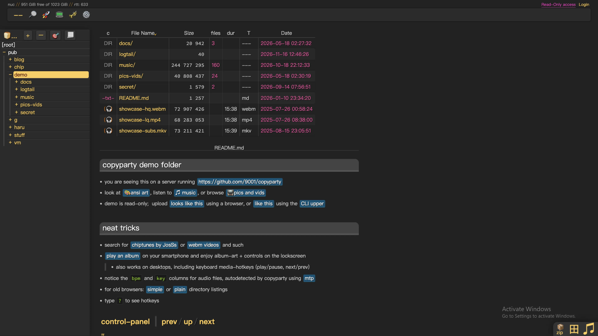

# Deploy and Host copyparty on Sealos

copyparty is a portable file server with resumable uploads, media indexing, WebDAV access, and a browser file manager. This Sealos template runs copyparty 1.20.28 as a single-replica StatefulSet with a 1Gi storage volume and a public HTTPS endpoint.

## About Hosting copyparty

copyparty serves directories through a browser interface and supports drag-and-drop uploads, resumable transfers, media thumbnails, text previews, search, and per-directory permissions. The same share can be mounted by WebDAV clients for desktop file access.

This template runs one StatefulSet with `copyparty/ac:1.20.28` on port `3923`. The startup arguments create an administrator named `admin` from the required `admin_password` input, grant read-write access to `/w`, enable upload history under `/w/.hist`, and trust forwarded headers from the cluster proxy.

A 1Gi volume at `/w` stores uploads and history. The Service maps port `80` to `3923`, and a Sealos Ingress publishes the browser and WebDAV endpoints over HTTPS. The Ingress accepts request bodies up to 32Mi per request.

## Common Use Cases

- **Large File Sharing**: Publish and collect files through a private browser interface.
- **Collaborative Uploads**: Let collaborators upload with resumable transfers and per-file history.
- **Media Library**: Browse photos, audio, and video with thumbnails and previews.
- **Desktop Mount**: Connect a WebDAV client to the same share for file-manager access.
- **Lab File Drop**: Provide a lightweight drop box for a team or test environment.

## Dependencies for copyparty Hosting

The template includes the copyparty StatefulSet, a 1Gi persistent volume, a Service, an HTTPS Ingress, and the Sealos App entry. copyparty needs no database, cache, or external storage service.

Clients need a modern browser for the file manager. Desktop mounting requires a WebDAV client. Large single requests are bounded by the 32Mi Ingress body limit; raise the annotation when uploads need larger chunks.

### Deployment Dependencies

- [copyparty repository](https://github.com/9001/copyparty) - Source code, feature list, and configuration reference
- [copyparty documentation](https://github.com/9001/copyparty/tree/hovudstraum/docs) - Upload, WebDAV, and permission guides
- [copyparty container image](https://hub.docker.com/r/copyparty/ac) - Image used by this template
- [copyparty releases](https://github.com/9001/copyparty/releases) - Version history and changelogs
- [copyparty demo](https://a.ocv.me/pub/demo/) - Public demo instance

## Implementation Details

**Architecture Components:**

- **copyparty StatefulSet**: One replica running `copyparty/ac:1.20.28` on port `3923`.
- **Persistent volume**: A 1Gi volume at `/w` for files and `.hist` upload history.
- **Service**: ClusterIP port `80` forwarding to the HTTP interface.
- **Ingress**: Sealos-managed HTTPS host with a 32Mi request-body limit.
- **App entry**: Opens the browser file manager from the Sealos desktop.

**Configuration:**

- **Image**: `copyparty/ac:1.20.28`
- **HTTP port**: `3923`
- **Administrator**: `admin`, password from the required `admin_password` input
- **Share**: `/w`, read-write for `admin`
- **History**: `/w/.hist`
- **Proxy handling**: `--no-crt` and `--xff-src=lan` for the Sealos ingress
- **Persistence**: 1Gi ReadWriteOnce volume at `/w`
- **Replicas**: `1`

**Resource Allocation:**

| Component | CPU Request | CPU Limit | Memory Request | Memory Limit | Storage |
| --- | ---: | ---: | ---: | ---: | ---: |
| copyparty | 10m | 100m | 12Mi | 128Mi | 1Gi |

The profile passed a cold start, administrator login, file upload, file listing, and a stability window with zero restarts.

## Why Deploy copyparty on Sealos?

Sealos is an AI-assisted cloud operating system built on Kubernetes that unifies deployment, networking, storage, and operations. Deploying copyparty on Sealos gives you:

- **One-Click File Server**: Provision the application, storage, and HTTPS endpoint from one template.
- **Persistent Files**: Keep uploads and history across Pod restarts.
- **Compact Runtime**: Serve files with a validated 100m CPU and 128Mi memory limit.
- **Browser and WebDAV Access**: Reach the same share from a browser or desktop file manager.
- **Canvas and AI Dialog**: Inspect the StatefulSet, Service, Ingress, PVC, logs, and resource cards, and adjust the deployment through the Sealos AI dialog.
- **Kubernetes Reliability**: Use health probes, automated recovery, and declarative resource management.

## Deployment Guide

1. Open the [copyparty template](https://sealos.io/products/app-store/copyparty) and click **Deploy Now**.
2. Enter the administrator password, review the generated application name, and confirm the 1Gi storage plan.
3. Wait for deployment to complete, typically in 2-3 minutes. Sealos opens the Canvas after the resources are created.
4. Open the public URL from the Canvas or the App Store entry.
5. Sign in as `admin` with the password from step 2.
6. Upload a small test file and confirm that it appears in `/w` with its history entry.

## Login and Access

copyparty uses the `admin` account created from the deployment input. Open the public URL, choose the login control, and enter username `admin` with the exact `admin_password` value. Browser sessions keep the authenticated cookie for the tab.

The same credentials authorize WebDAV clients and read-write access to `/w`. Use the HTTPS endpoint as the WebDAV server address; consult the upstream WebDAV guide for the client-specific mount path.

## Configuration

- **Write access**: `-v /w::rw,admin` grants read-write access to `admin`.
- **Upload history**: `--hist /w/.hist` records upload events under the data volume.
- **Proxy headers**: `--xff-src=lan` trusts forwarded client addresses from the cluster network.
- **TLS**: `--no-crt` disables copyparty's own certificate because Sealos terminates HTTPS at the Ingress.
- **Large files**: Raise `nginx.ingress.kubernetes.io/proxy-body-size` above 32m for larger upload chunks.
- **Persistence**: Files and history stay on the `/w` volume.

## Scaling

Keep the template at one replica because the file share is a ReadWriteOnce volume. Increase CPU and memory limits for many concurrent uploads, thumbnail generation, or media indexing. Expand the 1Gi volume from the StatefulSet resource card as files and history grow. Concurrent writers can share the same volume; large multi-replica deployments need shared storage.

## Troubleshooting

### Uploads fail with HTTP 413

The Ingress body limit is 32Mi. Raise `nginx.ingress.kubernetes.io/proxy-body-size` on the Ingress and retry the upload. Resumable clients can split large files into smaller requests.

### The administrator login is rejected

Use username `admin` and the exact `admin_password` value from the deployment form. The account is created from the container arguments at startup; changing the input requires a restart or redeployment to take effect.

### WebDAV mounting fails

Use the public HTTPS URL and the `admin` credentials. Verify that the client supports HTTPS WebDAV and that the request path matches the upstream copyparty WebDAV convention.

### Media thumbnails are missing

Thumbnail generation depends on file type and available CPU. Check the Pod logs for decoding errors and raise the CPU limit when indexing large media libraries.

### Getting Help

- [copyparty documentation](https://github.com/9001/copyparty/tree/hovudstraum/docs)
- [copyparty issues](https://github.com/9001/copyparty/issues)
- [Sealos documentation](https://sealos.io/docs)

## License

copyparty is licensed under the [MIT License](https://github.com/9001/copyparty/blob/hovudstraum/LICENSE). This Sealos template is distributed under the templates repository license.
