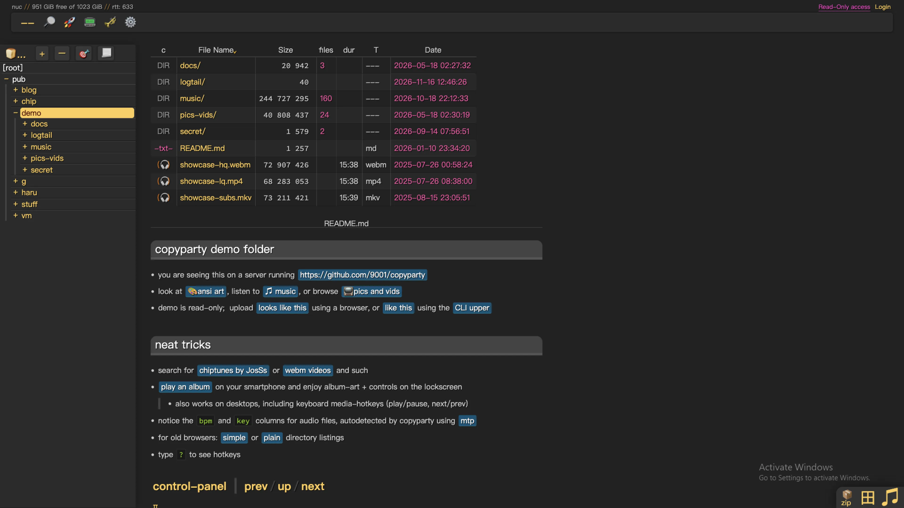

# 在 Sealos 上部署和托管 copyparty

copyparty 是便携式文件服务器，支持断点续传、媒体索引、WebDAV 访问和浏览器文件管理。本 Sealos 模板以单副本 StatefulSet 运行 copyparty 1.20.28，提供 1Gi 存储卷和公网 HTTPS 入口。

## 关于 copyparty 托管

copyparty 通过浏览器界面提供目录访问，支持拖放上传、断点续传、媒体缩略图、文本预览、搜索和目录级权限。同一共享也可以挂载到 WebDAV 客户端，在桌面文件管理器中访问。

本模板运行一个 StatefulSet，使用 `copyparty/ac:1.20.28` 镜像并监听 `3923` 端口。启动参数使用必填的 `admin_password` 输入创建名为 `admin` 的管理员，授予 `/w` 读写权限，将上传历史保存到 `/w/.hist`，并信任集群代理转发的请求头。

1Gi 卷挂载到 `/w`，保存上传文件和历史记录。Service 将 `80` 端口映射到 `3923`，Sealos Ingress 通过 HTTPS 发布浏览器和 WebDAV 端点。Ingress 单次请求体上限为 32Mi。

## 常见使用场景

- **大文件共享**：通过私有浏览器界面上传和分发文件。
- **协作上传**：让协作者使用断点续传并保留文件历史。
- **媒体库**：通过缩略图和预览浏览照片、音频和视频。
- **桌面挂载**：使用 WebDAV 客户端连接同一共享。
- **实验中转**：为团队或测试环境提供轻量文件投递区。

## copyparty 托管依赖

模板包含 copyparty StatefulSet、1Gi 持久卷、Service、HTTPS Ingress 和 Sealos App 入口。copyparty 不需要数据库、缓存或外部存储服务。

浏览器文件管理器需要现代浏览器，桌面挂载需要 WebDAV 客户端。大单请求受 Ingress 32Mi 请求体限制，需要更大分块时提高注解值。

### 部署依赖

- [copyparty 仓库](https://github.com/9001/copyparty) - 源代码、功能列表与配置参考
- [copyparty 文档](https://github.com/9001/copyparty/tree/hovudstraum/docs) - 上传、WebDAV 与权限指南
- [copyparty 容器镜像](https://hub.docker.com/r/copyparty/ac) - 本模板使用的镜像
- [copyparty 发布记录](https://github.com/9001/copyparty/releases) - 版本历史与变更日志
- [copyparty 演示](https://a.ocv.me/pub/demo/) - 公开演示实例

## 实现细节

**架构组件：**

- **copyparty StatefulSet**：单副本运行 `copyparty/ac:1.20.28`，监听 `3923` 端口。
- **持久卷**：1Gi 卷挂载到 `/w`，保存文件与 `.hist` 上传历史。
- **Service**：ClusterIP 的 `80` 端口转发到 HTTP 接口。
- **Ingress**：Sealos 管理的 HTTPS 域名，请求体上限 32Mi。
- **App 入口**：从 Sealos 桌面打开浏览器文件管理器。

**配置：**

- **镜像**：`copyparty/ac:1.20.28`
- **HTTP 端口**：`3923`
- **管理员**：`admin`，密码来自必填输入 `admin_password`
- **共享目录**：`/w`，`admin` 拥有读写权限
- **历史记录**：`/w/.hist`
- **代理处理**：使用 `--no-crt` 与 `--xff-src=lan` 适配 Sealos Ingress
- **持久化**：1Gi ReadWriteOnce 卷，挂载到 `/w`
- **副本数**：`1`

**资源分配：**

| 组件 | CPU 请求 | CPU 限制 | 内存请求 | 内存限制 | 存储 |
| --- | ---: | ---: | ---: | ---: | ---: |
| copyparty | 10m | 100m | 12Mi | 128Mi | 1Gi |

该规格通过了冷启动、管理员登录、文件上传、文件列表和稳定性验证，Pod 重启次数为 0。

## 为什么在 Sealos 上部署 copyparty？

Sealos 是构建在 Kubernetes 之上的 AI 辅助云操作系统，将部署、网络、存储和运维统一在一个界面中。在 Sealos 上部署 copyparty 可以带来：

- **一键文件服务器**：通过一个模板创建应用、存储和 HTTPS 入口。
- **文件持久化**：在 Pod 重启后保留上传文件和历史。
- **紧凑运行**：以经验证的 100m CPU 和 128Mi 内存限制提供文件服务。
- **浏览器与 WebDAV**：同一共享可从浏览器或桌面文件管理器访问。
- **Canvas 与 AI 对话**：在一个视图中查看 StatefulSet、Service、Ingress、PVC、日志和资源卡，并通过 Sealos AI 对话调整部署。
- **Kubernetes 可靠性**：使用健康探针、自动恢复和声明式资源管理。

## 部署指南

1. 打开 [copyparty 模板](https://sealos.io/products/app-store/copyparty)，点击 **Deploy Now**。
2. 输入管理员密码，检查自动生成的应用名称，确认 1Gi 存储规格。
3. 等待部署完成，通常需要 2-3 分钟。资源创建完成后 Sealos 会打开 Canvas。
4. 从 Canvas 或应用商店入口打开公网地址。
5. 使用 `admin` 和第 2 步的密码登录。
6. 上传一个小文件，确认它出现在 `/w` 中并生成历史记录。

## 登录与访问

copyparty 使用部署输入创建的 `admin` 账号。打开公网地址，选择登录控件，输入用户名 `admin` 和原始 `admin_password`。浏览器会为当前标签页保留认证 Cookie。

同一凭据也用于 WebDAV 客户端和 `/w` 的读写访问。WebDAV 服务器地址使用公网 HTTPS 端点，具体挂载路径参考上游 WebDAV 指南。

## 配置

- **写权限**：`-v /w::rw,admin` 为 `admin` 授予读写权限。
- **上传历史**：`--hist /w/.hist` 在数据卷中记录上传事件。
- **代理头**：`--xff-src=lan` 信任集群网络转发的客户端地址。
- **TLS**：`--no-crt` 关闭 copyparty 自带证书，因为 Sealos 在 Ingress 终止 HTTPS。
- **大文件**：需要更大上传分块时，将 `nginx.ingress.kubernetes.io/proxy-body-size` 提高到 32m 以上。
- **持久化**：文件与历史保存在 `/w` 卷。

## 扩缩容

模板保持单副本，因为文件共享使用 ReadWriteOnce 卷。大量并发上传、缩略图生成或媒体索引需要更多资源时，提高 CPU 和内存限制。文件和历史增长时，从 StatefulSet 资源卡扩展 1Gi 卷。并发写入可以共享同一卷；多副本部署需要共享存储。

## 故障排查

### 上传返回 HTTP 413

Ingress 请求体上限为 32Mi。提高 Ingress 的 `nginx.ingress.kubernetes.io/proxy-body-size` 后重试。支持断点续传的客户端可以把大文件拆分为更小请求。

### 管理员登录被拒

使用用户名 `admin` 和部署表单中的原始 `admin_password`。账号由容器启动参数创建；修改输入后需要重启或重新部署才能生效。

### WebDAV 挂载失败

使用公网 HTTPS 地址和 `admin` 凭据，确认客户端支持 HTTPS WebDAV，并按照上游 copyparty WebDAV 约定填写请求路径。

### 媒体缩略图缺失

缩略图生成取决于文件类型和可用 CPU。查看 Pod 日志中的解码错误，索引大型媒体库时提高 CPU 限制。

### 获取帮助

- [copyparty 文档](https://github.com/9001/copyparty/tree/hovudstraum/docs)
- [copyparty Issues](https://github.com/9001/copyparty/issues)
- [Sealos 文档](https://sealos.io/docs)

## 许可证

copyparty 使用 [MIT License](https://github.com/9001/copyparty/blob/hovudstraum/LICENSE) 许可证。本 Sealos 模板遵循 templates 仓库许可证。
