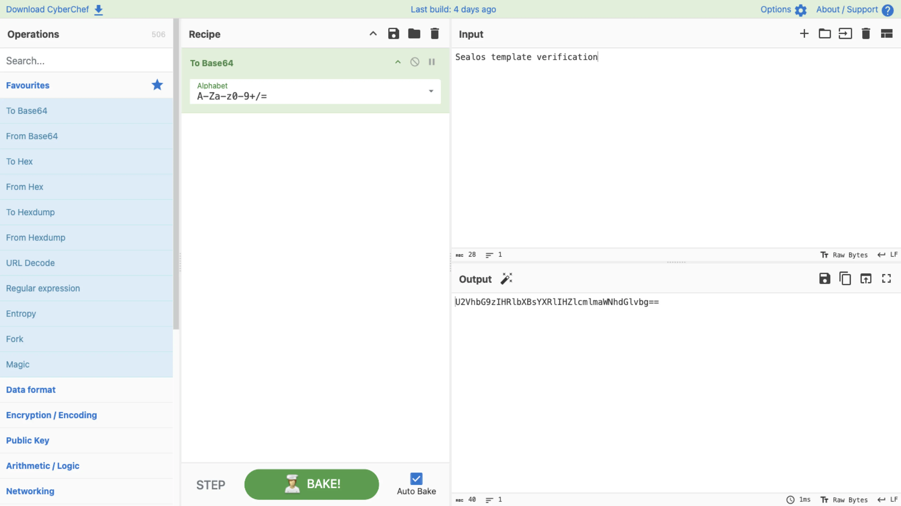

# Deploy and Host CyberChef on Sealos

CyberChef is a browser-based data workbench from GCHQ for encoding, decoding, encrypting, compressing, and analyzing data in a single visual recipe.

## About Hosting CyberChef

This template runs the official CyberChef image on Sealos with a public HTTPS endpoint and a single replica. CyberChef executes every operation inside the browser, so the server only delivers static assets and the deployment stays lightweight.

The App card opens the workbench directly. Drag operations into the recipe area, paste input in the upper pane, and inspect the output in the lower pane. Recipes can be saved as URLs or bookmarked for repeatable analysis.

## Common Use Cases

- Decode Base64, hex, URL, JWT, or binary payloads during incident response.
- Run repeatable encoding, hashing, and compression recipes for data pipelines.
- Analyze malware samples and obfuscated scripts in an isolated browser tab.
- Teach cryptography and data encoding with live input and output panes.
- Convert timestamps, character sets, and structured formats such as JSON and CSV.

## Dependencies for CyberChef Hosting

- A Sealos workspace with available CPU and memory quota.
- A modern browser with JavaScript enabled.
- No database, object storage, or external service is required.
- Public HTTPS access is provided by the template Ingress.

## Why Deploy CyberChef on Sealos?

- One-click deployment from the Sealos App Store with no server configuration.
- Kubernetes scheduling, health probes, and automatic restarts managed by the platform.
- Pay-as-you-go resource cards that keep the idle footprint small.
- Public HTTPS with a generated domain and managed certificate.
- Canvas view for inspecting the workload, Service, and Ingress.
- AI dialog in the Sealos desktop for operational questions about the deployment.

## Deployment Guide

1. Open the [CyberChef template](https://sealos.io/products/app-store/cyberchef) and click **Deploy Now**.
2. Keep the generated application name or set your own, confirm the resource plan, and submit the deployment.
3. Wait 2-3 minutes for the pod to become ready, then open the public URL from the App card.
4. Paste a sample value such as `SGVsbG8sIFNlYWxvcyE=` and apply the **From Base64** operation to confirm the workbench works.
5. Open Canvas from the App card to review the StatefulSet or Deployment, Service, and Ingress created for this release.

## License

CyberChef is released under the [Apache License 2.0](https://github.com/gchq/CyberChef/blob/master/LICENSE).
