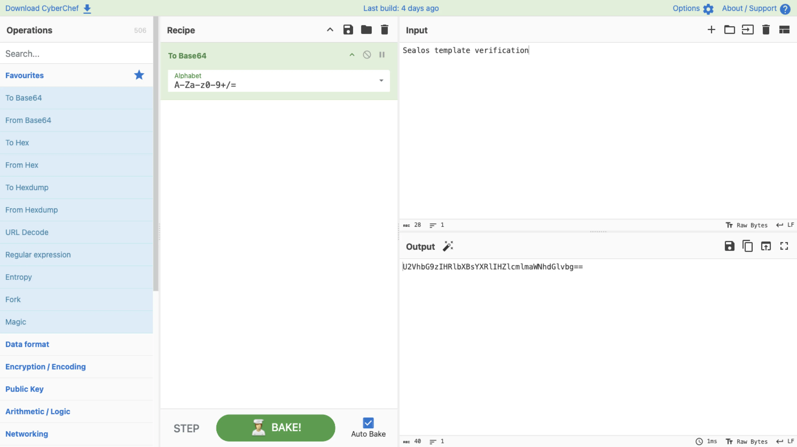

# 在 Sealos 上部署和托管 CyberChef

CyberChef 是 GCHQ 开源的浏览器端数据处理工作台，支持编码、解码、加密、压缩、哈希与取证分析。本 Sealos 模板以无状态 Deployment 运行 CyberChef 11.6.0，并提供公网 HTTPS 入口。

## 关于 CyberChef 托管

CyberChef 提供三栏工作台：左侧是操作列表，中间是 Recipe，右侧是输入与输出面板。多个操作可以串联为可重复执行的 Recipe，通过拖拽调整顺序，并保存为 URL 以便复用。点击 **Bake** 会对当前输入执行完整 Recipe。

本模板运行一个 Deployment，使用官方 `ghcr.io/gchq/cyberchef:11.6.0` 镜像并监听 `8080` 端口。ClusterIP Service 将 `80` 端口转发到容器，Sealos Ingress 通过 HTTPS 发布工作台。该工作负载无状态，不依赖数据库、持久卷或服务端会话存储。

数据处理全部在浏览器内完成，服务端只分发静态应用资源，因此复杂 Recipe 主要消耗浏览器内存，Pod 资源占用很低。Recipe、输入和输出默认保留在当前浏览器标签页，可通过导出结果或保存 Recipe URL 留存。

## 常见使用场景

- **应急响应**：在分析过程中快速解码 Base64、十六进制、URL 编码、JWT 和二进制载荷。
- **恶意样本分析**：在隔离标签页中检查混淆脚本、提取字符串并还原多层编码。
- **数据工程**：构建可重复使用的哈希、压缩、字符集转换和格式转换 Recipe。
- **安全培训**：通过实时输入输出面板演示密码学、编码和数据变换。
- **日常调试**：在任意浏览器中转换时间戳、解析 JSON、比对文本和检查文件签名。

## CyberChef 托管依赖

模板包含 CyberChef Deployment、Service、HTTPS Ingress 和 Sealos App 入口。客户端需要支持 JavaScript 的现代浏览器。该应用不需要数据库、对象存储、缓存或外部 API。

### 部署依赖

- [CyberChef 官网](https://gchq.github.io/CyberChef/) - 在线应用与操作参考
- [CyberChef 仓库](https://github.com/gchq/CyberChef) - 源代码、发布版本与文档
- [CyberChef 容器镜像](https://github.com/gchq/CyberChef/pkgs/container/cyberchef) - 本模板使用的官方镜像
- [CyberChef Wiki](https://github.com/gchq/CyberChef/wiki) - 操作指南与 Recipe 示例
- [CyberChef 发布记录](https://github.com/gchq/CyberChef/releases) - 版本历史与变更日志

## 实现细节

**架构组件：**

- **CyberChef Deployment**：单副本运行 `ghcr.io/gchq/cyberchef:11.6.0`，监听 `8080` 端口。
- **Service**：ClusterIP 的 `80` 端口转发到容器 HTTP 端口。
- **Ingress**：由 Sealos 管理的 HTTPS 域名，请求体上限 32Mi，静态资源缓存 30 天。
- **App 入口**：从 Sealos 桌面直接打开公网工作台。

**配置：**

- **镜像**：`ghcr.io/gchq/cyberchef:11.6.0`
- **容器端口**：`8080`
- **Service 端口**：`80`
- **副本数**：`1`
- **更新策略**：`RollingUpdate`，`maxUnavailable: 1`，`maxSurge: 0`
- **持久化**：无，Recipe 与数据保存在浏览器
- **健康检查**：对 `/` 执行 HTTP 启动、就绪和存活探针

**资源分配：**

| 组件 | CPU 请求 | CPU 限制 | 内存请求 | 内存限制 | 存储 |
| --- | ---: | ---: | ---: | ---: | ---: |
| CyberChef | 10m | 100m | 12Mi | 128Mi | 无 |

该规格通过了冷启动、公网页面加载、Base64 解码和稳定性验证，Pod 重启次数为 0。

## 为什么在 Sealos 上部署 CyberChef？

Sealos 是构建在 Kubernetes 之上的 AI 辅助云操作系统，将部署、网络、存储和运维统一在一个界面中。在 Sealos 上部署 CyberChef 可以带来：

- **一键部署**：从应用商店启动工作台，无需编写 Kubernetes YAML。
- **自动 HTTPS**：自动获得公网域名和 TLS 证书。
- **轻量运行**：以经验证的 100m CPU 和 128Mi 内存限制运行无状态服务。
- **Canvas 与 AI 对话**：在一个视图中查看 Deployment、Service、Ingress、日志和资源卡，并通过 Sealos AI 对话调整部署。
- **按量计费**：从紧凑规格起步，Recipe 负载增加时再提高限制。
- **Kubernetes 可靠性**：使用健康探针、自动恢复和声明式资源管理。

## 部署指南

1. 打开 [CyberChef 模板](https://sealos.io/products/app-store/cyberchef)，点击 **Deploy Now**。
2. 检查自动生成的应用名称和域名，确认资源规格后开始部署。
3. 等待部署完成，通常需要 2-3 分钟。资源创建完成后 Sealos 会打开 Canvas。
4. 从 Canvas 或应用商店入口打开公网地址。
5. 在输入面板粘贴 `SGVsbG8sIFNlYWxvcyE=`，添加 **From Base64** 操作，确认输出面板显示 `Hello, Sealos!`。
6. 打开 Canvas 查看 Deployment、Service、Ingress 和实时日志。

## 使用 CyberChef

- 通过名称搜索操作列表，然后将操作拖入 Recipe 区域。
- 调整操作顺序以匹配处理流程，CyberChef 会从上到下依次执行。
- 使用 **Save recipe** 或复制浏览器 URL 保存 Recipe，便于后续复用。
- 编辑 Recipe 时开启 **Auto Bake** 可实时查看输出。
- 敏感输入保留在浏览器内，分析结束后清理标签页。

## 扩缩容

CyberChef 是无状态服务，可通过增加副本数和 CPU、内存限制来服务更多浏览器会话。默认单副本规格适合个人分析员和小型团队。大文件、大量并发 Recipe 或长时间操作会优先消耗浏览器资源；当静态资源请求量增加时，提高 Pod 限制即可。

## 故障排查

### 页面可以打开但没有操作列表

清理浏览器缓存后重新加载公网地址，并确认 Deployment 处于 Ready 状态、Ingress 的 `/` 返回 HTTP 200。

### Recipe 输出与预期不符

检查操作顺序和每个操作的选项。CyberChef 从上到下执行 Recipe，部分操作依赖其设置中选择的输入格式。

### 浏览器无响应

大文件和复杂 Recipe 的 Auto Bake 会消耗浏览器内存。关闭 **Auto Bake**、分块处理数据，或在内存更充足的桌面浏览器中运行。

### Recipe URL 被截断

长 Recipe 会生成很长的 URL。分享时可保存为文件，或在链接长度受限的聊天工具中使用更短的 Recipe。

### 获取帮助

- [CyberChef Wiki](https://github.com/gchq/CyberChef/wiki)
- [CyberChef Issues](https://github.com/gchq/CyberChef/issues)
- [Sealos 文档](https://sealos.io/docs)

## 许可证

CyberChef 使用 [Apache License 2.0](https://github.com/gchq/CyberChef/blob/master/LICENSE) 许可证。本 Sealos 模板遵循 templates 仓库许可证。
