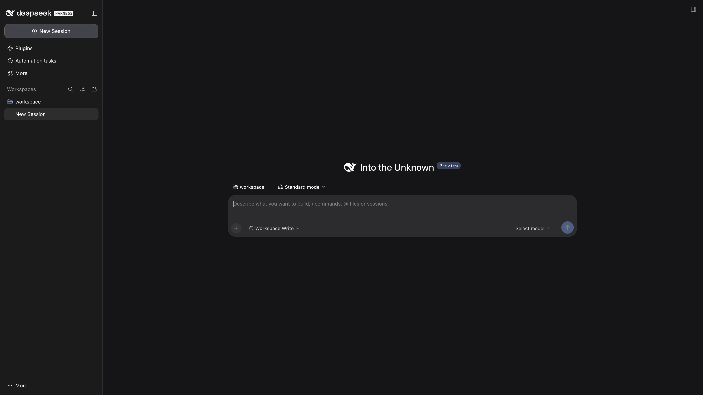

# Deploy and Host DeepSeek Harness on Sealos

DeepSeek Harness is an open-source coding-agent workspace with a browser interface for chat, tools, sessions, and model configuration. This template deploys DeepSeek Harness 0.2.2-rc.5 as a single StatefulSet with persistent storage on Sealos Cloud.



## About Hosting DeepSeek Harness

DeepSeek Harness runs one web process on port `3080`. The browser UI provides interactive coding sessions, model settings, tool execution, plugins, automation tasks, and session history. The agent can read and edit files, run shell commands, and work inside the project directory selected in the UI.

The template mounts two persistent volumes: `/data` stores DSH profiles, credentials, settings, and session data, while `/workspace` stores the project files used by the agent. Both volumes survive Pod restarts and template updates.

Authentication uses a launch token printed by the server. Opening the tokenized URL once creates a signed browser cookie that remains valid for 30 days. The launch token is reissued whenever the container starts.

## Common Use Cases

- **Repository Assistance**: Inspect a codebase, explain architecture, and implement focused changes.
- **Coding Automation**: Run shell commands, edit files, and iterate on tests inside a persistent workspace.
- **AI Agent Evaluation**: Compare models and providers through one coding-agent interface.
- **Personal Development Workspace**: Keep sessions, configuration, and project files together in one deployment.
- **Tool and Plugin Prototyping**: Test DeepSeek Harness plugins, skills, and agent presets.

## Dependencies for DeepSeek Harness Hosting

The Sealos template includes the DeepSeek Harness web service, a Service, an HTTPS Ingress, and two 1Gi persistent volumes. Application state stays inside the PVCs created by the template.

A DeepSeek API key is required to run model requests. You can add it after deployment from **Settings → Models**, or configure another OpenAI-compatible, Anthropic-compatible, or Gemini-compatible provider from the same page.

### Deployment Dependencies

- [DeepSeek Harness Repository](https://github.com/deepseek-ai/deepseek-harness) - Upstream source and documentation
- [DeepSeek Harness Docker](https://github.com/yangchuansheng/deepseek-harness-docker) - Container image used by this template
- [DeepSeek Platform](https://platform.deepseek.com/) - API key management
- [Model Configuration Guide](https://github.com/deepseek-ai/deepseek-harness/blob/master/docs/user/guide/providers.md) - Provider and model setup
- [Public Deployment Guide](https://github.com/deepseek-ai/deepseek-harness/blob/master/docs/user/guide/public-deployments.md) - Reverse proxy and authentication behavior

## Implementation Details

### Architecture Components

This template deploys:

- **DeepSeek Harness StatefulSet**: Runs the web UI and agent runtime as UID/GID `1000`.
- **Service and Ingress**: Expose port `3080` through the Sealos HTTPS entry.
- **`/data` PVC**: Stores `$DSH_HOME`, profiles, credentials, settings, and session data.
- **`/workspace` PVC**: Stores the project directory available to agent sessions.

The upstream Docker Compose file defines one web service. This template keeps that single-service topology and uses a StatefulSet because the application requires persistent per-instance storage.

### Resource Allocation

| Component | CPU Request | CPU Limit | Memory Request | Memory Limit | Storage |
|-----------|-------------|-----------|----------------|--------------|---------|
| DeepSeek Harness | 20m | 200m | 51Mi | 512Mi | 2 × 1Gi |

The 512Mi memory tier passed cold start, token login, model configuration, session creation, message exchange, and shell-tool execution during template validation. Raise memory to `1024Mi` or `2048Mi` for large repositories or long agent sessions.

### Configuration

- **Image**: `ghcr.io/yangchuansheng/deepseek-harness:v0.2.2-rc.5`
- **Port**: `3080`
- **Public URL**: `https://<app-host>.<region-domain>/`
- **Trusted host**: The generated Ingress host
- **Telemetry**: Disabled with `DSH_TELEMETRY_DISABLED=1`
- **Persistence**: `/data` and `/workspace` PVCs
- **Replicas**: `1`

### License Information

DeepSeek Harness is licensed under the [MIT License](https://github.com/deepseek-ai/deepseek-harness/blob/master/LICENSE). This Sealos template is provided under the repository license for Sealos templates.

## Why Deploy DeepSeek Harness on Sealos?

Sealos is an AI-assisted cloud operating system built on Kubernetes. It combines deployment, operations, networking, storage, and scaling in one interface. By deploying DeepSeek Harness on Sealos, you get:

- **One-Click Deployment**: Open the template page and launch the application without writing Kubernetes YAML.
- **Persistent Storage Included**: Session history, credentials, settings, and project files survive restarts.
- **Automatic HTTPS Access**: Sealos provisions the public Ingress and certificate for the web UI.
- **Canvas Operations**: Inspect logs, adjust resources, and manage storage from resource cards.
- **Pay-as-You-Go Resources**: Start with the tested 200m CPU and 512Mi memory profile.
- **Simple Model Setup**: Add DeepSeek or third-party providers directly in the browser UI.

## Deployment Guide

1. Open the [DeepSeek Harness template](https://sealos.io/products/app-store/deepseek-harness) and click **Deploy Now**.
2. Review the generated application name and host, then confirm the deployment.
3. Wait for deployment to complete, typically 2-3 minutes. Sealos redirects you to the Canvas after the resources are created.
4. Open the application URL shown in the Canvas.
5. Follow [Login and Registration](#login-and-registration) to authenticate the browser.

## Login and Registration

DeepSeek Harness uses launch-token authentication. Each container start prints a fresh login URL to the application log.

1. Open the deployment in Sealos Canvas.
2. Open the DeepSeek Harness StatefulSet or Pod resource card and view its logs.
3. Find the latest line that starts with `dsh web:`:

   ```text
   dsh web: https://<app-host>.<region-domain>/?token=<launch-token>
   ```

4. Open the complete URL in the browser once. DeepSeek Harness sets a signed session cookie and redirects to the clean application root.
5. Use the clean application URL for later visits. The cookie remains valid for 30 days.

The token changes after every Pod or container restart. Return to the logs and open the newest `dsh web:` URL when access expires or the container restarts.

Treat the tokenized URL as a password. It grants access to the deployment, including stored credentials and workspace files.

### Select a Workspace

On first use, select the persistent workspace:

1. Click **Choose workspace**.
2. Open **Edit path**.
3. Enter `/workspace`.
4. Click **Open**.

The new session can then read and edit project files stored on the workspace volume.

### Configure a Model

1. Open **Settings → Models**.
2. Enter a DeepSeek API key in the DeepSeek card and click **Apply**, or choose **Add model provider** for a compatible third-party endpoint.
3. Return to the session and choose the model from the model selector.

The API key is stored under `/data/.dsh/.credentials.yaml` on the persistent data volume. It survives Pod restarts and template updates.

## Configuration

After deployment, manage DeepSeek Harness from:

- **Canvas AI Dialog**: Describe resource, storage, or environment changes and let Sealos apply them.
- **Resource Cards**: Open the StatefulSet, Service, Ingress, or PVC cards for direct changes.
- **Model Settings**: Add providers, enter credentials, and manage model catalogs from **Settings → Models**.
- **Workspace Files**: Upload project files or work with files already present in `/workspace`.
- **Logs**: Retrieve the current launch URL after a restart.

## Scaling

Increase CPU or memory from the DeepSeek Harness StatefulSet resource card when sessions need more capacity:

| Workload | Suggested Memory |
|----------|------------------|
| UI, configuration, short conversations | 512Mi |
| Medium repositories and tool-heavy sessions | 1024Mi |
| Large repositories or long-running agent tasks | 2048Mi |

Keep the StatefulSet at one replica. The application uses a single shared browser session and ReadWriteOnce volumes for `/data` and `/workspace`.

## Troubleshooting

### The application returns 401

The browser has no valid session cookie. Open the latest `dsh web:` token URL from the Pod logs. After a Pod restart, fetch the new token.

### The workspace cannot be created automatically

Choose the persistent workspace manually: **Choose workspace → Edit path → `/workspace` → Open**.

### No models are available

Open **Settings → Models** and add a DeepSeek API key or a custom model provider.

### The login URL no longer works

The launch token is bound to the current container process. Copy the newest `dsh web:` line from the Pod logs.

### The UI becomes slow during large tasks

Raise the StatefulSet memory limit to `1024Mi` or `2048Mi`. Keep the replica count at one.

## Additional Resources

- [DeepSeek Harness Documentation](https://github.com/deepseek-ai/deepseek-harness/tree/master/docs)
- [DeepSeek Harness Web UI Guide](https://github.com/deepseek-ai/deepseek-harness/blob/master/docs/user/guide/index.md)
- [DeepSeek Harness Model Providers](https://github.com/deepseek-ai/deepseek-harness/blob/master/docs/user/guide/providers.md)
- [DeepSeek Platform](https://platform.deepseek.com/)
- [Sealos Discord](https://discord.gg/wdUn538zVP)

## License

This Sealos template is provided under the repository license for Sealos templates. DeepSeek Harness is licensed under the [MIT License](https://github.com/deepseek-ai/deepseek-harness/blob/master/LICENSE).
