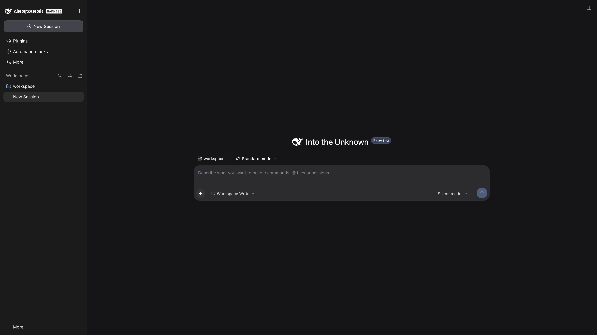

# 在 Sealos 上部署并托管 DeepSeek Harness

DeepSeek Harness 是开源编码智能体工作台，提供浏览器聊天、工具调用、会话管理和模型配置。本模板在 Sealos Cloud 上以单个有状态副本集（StatefulSet）部署 DeepSeek Harness 0.2.2-rc.5，并挂载持久化存储。



## 关于 DeepSeek Harness 托管

DeepSeek Harness 在端口 `3080` 上运行一个 Web 进程。浏览器界面提供交互式编码会话、模型设置、工具执行、插件、自动化任务和会话历史。智能体可以读取和修改文件、执行 Shell 命令，并在界面中选择的项目目录内工作。

模板挂载两个持久卷：`/data` 保存 DSH Profile、凭据、设置和会话数据，`/workspace` 保存智能体使用的项目文件。Pod 重启或模板更新后，两份数据都会保留。

应用采用启动令牌（Launch Token）认证。首次打开带令牌的 URL 会签发一个有效期为 30 天的浏览器 Cookie，容器每次启动都会生成新的启动令牌。

## 常见使用场景

- **代码库辅助**：浏览代码结构、解释架构并完成聚焦的代码修改。
- **编码自动化**：在持久工作区内执行 Shell 命令、编辑文件并反复验证测试。
- **AI 智能体评估**：通过统一界面比较不同模型和模型提供方。
- **个人开发工作台**：把会话、配置和项目文件集中保存在一个部署中。
- **插件与技能原型**：验证 DeepSeek Harness 插件、技能和智能体预设。

## DeepSeek Harness 托管依赖

Sealos 模板包含 DeepSeek Harness Web 服务、Service、HTTPS Ingress 和两个 1Gi 持久卷。应用状态全部保存在模板创建的 PVC 中。

执行模型请求需要一个 DeepSeek API Key。部署完成后可在 **Settings → Models** 中填写密钥，也可以在同一页面添加 OpenAI、Anthropic 或 Gemini 兼容的第三方模型提供方。

### 部署依赖

- [DeepSeek Harness 仓库](https://github.com/deepseek-ai/deepseek-harness) - 上游源码与文档
- [DeepSeek Harness Docker](https://github.com/yangchuansheng/deepseek-harness-docker) - 本模板使用的容器镜像
- [DeepSeek 开放平台](https://platform.deepseek.com/) - API Key 管理
- [模型配置指南](https://github.com/deepseek-ai/deepseek-harness/blob/master/docs/user/guide/providers.md) - 模型提供方配置
- [公开部署指南](https://github.com/deepseek-ai/deepseek-harness/blob/master/docs/user/guide/public-deployments.md) - 反向代理与认证行为

## 实现细节

### 架构组件

本模板部署以下资源：

- **DeepSeek Harness 有状态副本集**：以 UID/GID `1000` 运行 Web UI 和智能体运行时。
- **Service 和 Ingress**：通过 Sealos HTTPS 入口暴露端口 `3080`。
- **`/data` PVC**：保存 `$DSH_HOME`、Profile、凭据、设置和会话数据。
- **`/workspace` PVC**：保存智能体会话使用的项目目录。

上游 Docker Compose 文件定义一个 Web 服务。本模板保留单服务拓扑，并使用 StatefulSet 承载需要持久化存储的实例。

### 资源配置

| 组件 | CPU 请求 | CPU 限制 | 内存请求 | 内存限制 | 存储 |
|------|----------|----------|----------|----------|------|
| DeepSeek Harness | 20m | 200m | 51Mi | 512Mi | 2 × 1Gi |

512Mi 内存档位已通过冷启动、令牌登录、模型配置、会话创建、消息交互和 Shell 工具执行验证。处理大型仓库或长时间智能体会话时，可将内存提升到 `1024Mi` 或 `2048Mi`。

### 配置说明

- **镜像**：`ghcr.io/yangchuansheng/deepseek-harness:v0.2.2-rc.5`
- **端口**：`3080`
- **公网地址**：`https://<应用主机名>.<区域域名>/`
- **可信主机**：自动生成的 Ingress 主机名
- **遥测**：通过 `DSH_TELEMETRY_DISABLED=1` 关闭
- **持久化**：`/data` 和 `/workspace` 两个 PVC
- **副本数**：`1`

### 许可信息

DeepSeek Harness 使用 [MIT License](https://github.com/deepseek-ai/deepseek-harness/blob/master/LICENSE)。本 Sealos 模板遵循 Sealos 模板仓库的许可协议。

## 为什么在 Sealos 上部署 DeepSeek Harness？

Sealos 是构建在 Kubernetes 上的 AI 辅助云操作系统，将部署、运维、网络、存储和扩缩容集中在统一界面中。在 Sealos 上部署 DeepSeek Harness 可以获得：

- **一键部署**：打开模板页面即可启动应用，无需编写 Kubernetes YAML。
- **持久化存储**：会话历史、凭据、设置和项目文件在重启后继续保留。
- **自动 HTTPS 访问**：Sealos 自动提供公网 Ingress 和证书。
- **Canvas 运维**：通过资源卡片查看日志、调整资源和管理存储。
- **按量使用资源**：从已验证的 200m CPU、512Mi 内存规格起步。
- **模型配置简单**：在浏览器界面中添加 DeepSeek 或第三方模型提供方。

## 部署指南

1. 打开 [DeepSeek Harness 模板](https://sealos.io/products/app-store/deepseek-harness)，点击 **Deploy Now**。
2. 检查自动生成的应用名称和主机名，然后确认部署。
3. 等待部署完成，通常需要 2-3 分钟。资源创建完成后，Sealos 会跳转到 Canvas。
4. 打开 Canvas 中显示的应用地址。
5. 按照[登录与注册](#登录与注册)完成浏览器认证。

## 登录与注册

DeepSeek Harness 使用启动令牌认证。每次容器启动都会在应用日志中输出新的登录 URL。

1. 在 Sealos Canvas 中打开本次部署。
2. 打开 DeepSeek Harness 有状态副本集或 Pod 的资源卡片，查看日志。
3. 找到最新一条以 `dsh web:` 开头的日志：

   ```text
   dsh web: https://<应用主机名>.<区域域名>/?token=<启动令牌>
   ```

4. 在浏览器中完整打开该 URL。DeepSeek Harness 会签发会话 Cookie，并跳转到不带令牌的应用根地址。
5. 后续访问使用干净的应用根地址即可。Cookie 有效期为 30 天。

Pod 或容器每次重启后，启动令牌都会变化。访问失效时，请回到日志中获取最新的 `dsh web:` URL。

启动令牌等同于部署密码，可访问已保存的凭据和工作区文件。请只向可信人员共享。

### 选择工作区

首次使用时，请选择持久化工作区：

1. 点击 **Choose workspace**。
2. 打开 **Edit path**。
3. 输入 `/workspace`。
4. 点击 **Open**。

新建会话后，智能体即可读取和修改工作区卷中的项目文件。

### 配置模型

1. 打开 **Settings → Models**。
2. 在 DeepSeek 卡片中填写 DeepSeek API Key 并点击 **Apply**，或者点击 **Add model provider** 添加兼容的第三方端点。
3. 返回会话，在模型选择器中选择要使用的模型。

API Key 保存在持久化数据卷的 `/data/.dsh/.credentials.yaml` 中，Pod 重启和模板更新后继续保留。

## 配置管理

部署完成后，可以通过以下入口管理 DeepSeek Harness：

- **Canvas AI 对话框**：描述资源、存储或环境变量调整，由 Sealos 执行变更。
- **资源卡片**：打开 StatefulSet、Service、Ingress 或 PVC 卡片进行直接调整。
- **模型设置**：在 **Settings → Models** 中添加提供方、填写凭据和管理模型目录。
- **工作区文件**：上传项目文件，或直接使用 `/workspace` 中已有的文件。
- **日志**：Pod 重启后获取当前启动 URL。

## 扩缩容

会话负载升高时，可在 DeepSeek Harness StatefulSet 资源卡片中提升 CPU 或内存：

| 使用场景 | 建议内存 |
|----------|----------|
| UI、配置、短会话 | 512Mi |
| 中型仓库、频繁工具调用 | 1024Mi |
| 大型仓库、长时间智能体任务 | 2048Mi |

请将 StatefulSet 保持在一个副本。应用使用共享浏览器会话，`/data` 和 `/workspace` 采用 ReadWriteOnce 持久卷。

## 故障排查

### 应用返回 401

浏览器缺少有效会话 Cookie。请打开 Pod 日志中最新的 `dsh web:` 令牌 URL。Pod 重启后需要获取新令牌。

### 无法自动创建工作区

手动选择持久工作区：**Choose workspace → Edit path → `/workspace` → Open**。

### 没有可用模型

打开 **Settings → Models**，添加 DeepSeek API Key 或自定义模型提供方。

### 登录 URL 失效

启动令牌绑定当前容器进程。请从 Pod 日志中复制最新的 `dsh web:` 行。

### 大型任务期间界面变慢

将 StatefulSet 内存限制提升到 `1024Mi` 或 `2048Mi`，并保持单副本运行。

## 更多资源

- [DeepSeek Harness 文档](https://github.com/deepseek-ai/deepseek-harness/tree/master/docs)
- [DeepSeek Harness Web UI 指南](https://github.com/deepseek-ai/deepseek-harness/blob/master/docs/user/guide/index.md)
- [DeepSeek Harness 模型提供方](https://github.com/deepseek-ai/deepseek-harness/blob/master/docs/user/guide/providers.md)
- [DeepSeek 开放平台](https://platform.deepseek.com/)
- [Sealos Discord](https://discord.gg/wdUn538zVP)

## 许可证

本 Sealos 模板遵循 Sealos 模板仓库的许可协议。DeepSeek Harness 使用 [MIT License](https://github.com/deepseek-ai/deepseek-harness/blob/master/LICENSE)。
