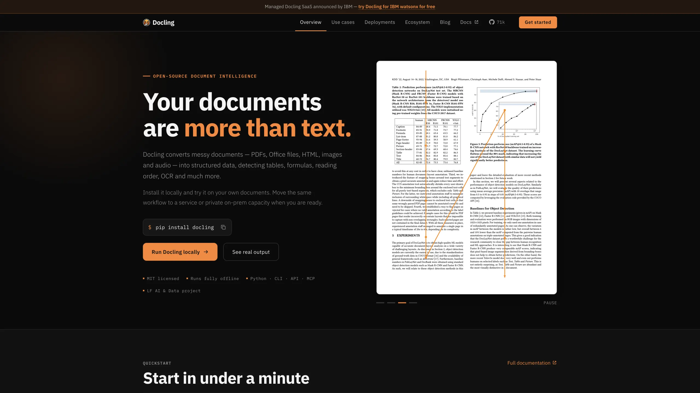

# Deploy and Host Docling on Sealos

Docling Serve is the HTTP service and web playground for Docling, an open-source document conversion toolkit from IBM Research. It turns PDFs, Office files, images, HTML, and structured text formats into clean Markdown, JSON, or HTML for retrieval, analysis, and downstream AI pipelines. This Sealos template runs Docling Serve 1.39.0 on the CPU image with a persistent model cache and a public HTTPS endpoint.



## About Hosting Docling

Docling Serve runs as one StatefulSet with the official `ghcr.io/docling-project/docling-serve-cpu:v1.39.0` image. The HTTP server listens on port `5001`, serves the interactive playground at `/ui`, publishes its OpenAPI page at `/docs`, and exposes synchronous conversion endpoints at `/v1/convert/file` and `/v1/convert/source`. The App card opens the playground directly.

Document models are cached on a 1Gi volume mounted at `/models`. `DOCLING_SERVE_LOAD_MODELS_AT_BOOT=true` loads the layout, table-structure, and OCR models during startup, so the first boot downloads model weights from Hugging Face and later restarts reuse the volume. A warm server converts a small HTML page in about two seconds; a 37,000-character arXiv PDF completed in about 112 seconds at the tested CPU tier.

Memory is the binding resource. The service uses about 988Mi at idle after model load, and a `1024Mi` limit was killed while converting a complex PDF. The tested profile uses a `2048Mi` limit. Docling Serve has no authentication layer, so the public endpoint accepts conversion requests from anyone who knows the hostname.

## Common Use Cases

- **RAG Ingestion**: Convert contracts, manuals, papers, and reports into Markdown with reading order and table structure preserved.
- **Document Digitization**: Turn scanned PDFs and images into searchable text with OCR enabled by default.
- **Structured Extraction**: Produce JSON representations of documents for downstream parsing, classification, and metadata pipelines.
- **Batch Conversion**: Submit multiple HTTP or file sources and collect Markdown, HTML, or JSON results from one API.
- **Agent Tooling**: Give an AI agent a self-hosted conversion endpoint for user-uploaded documents.
- **Content Migration**: Normalize a mixed archive of Office files, HTML pages, and PDFs into one Markdown corpus.

## Dependencies for Hosting Docling

- A Sealos workspace with at least 2Gi of available memory and 1Gi of persistent storage.
- Outbound network access to Hugging Face on the first boot so the models can be downloaded into `/models`.
- Outbound network access to any URL submitted through `/v1/convert/source`, or a local file for `/v1/convert/file`.
- A browser for the `/ui` playground, or `curl` and an HTTP client for the API.
- No external database, cache, or object storage is required by this single-node profile.

### Deployment Dependencies

- [Docling official site](https://www.docling.ai/) - Product overview and hosted offering
- [Docling documentation](https://docling-project.github.io/docling/) - Formats, conversion options, and Python API
- [Docling Serve repository](https://github.com/docling-project/docling-serve) - Server source, configuration, and API usage
- [Docling Serve API usage](https://github.com/docling-project/docling-serve/blob/main/docs/usage.md) - Endpoint examples and request bodies
- [Docling Serve CPU image](https://github.com/docling-project/docling-serve/pkgs/container/docling-serve-cpu) - Container image used by this template
- [Docling models](https://huggingface.co/ds4sd/docling-models) - Layout and table-structure model weights

## Implementation Details

**Architecture Components:**

- **Docling Serve StatefulSet**: One replica running the CPU image with the HTTP API and web playground on port `5001`.
- **Model volume**: A 1Gi volume at `/models` holding the Hugging Face cache, downloaded models, and runtime cache files.
- **Service**: ClusterIP port `80` forwarding to the Docling HTTP port.
- **Ingress**: Sealos-managed HTTPS host with a 32Mi request body limit, 300-second proxy timeouts, and static asset caching.
- **App entry**: Opens `https://<your-app-host>/ui` from the Sealos desktop.

**Configuration:**

- **Image**: `ghcr.io/docling-project/docling-serve-cpu:v1.39.0`
- **HTTP port**: `5001`
- **Web UI**: `/ui`
- **API documentation**: `/docs`
- **Conversion endpoints**: `POST /v1/convert/file` and `POST /v1/convert/source`
- **Model cache**: `/models` through `HF_HOME` and `XDG_CACHE_HOME`
- **Boot behavior**: `DOCLING_SERVE_LOAD_MODELS_AT_BOOT=true`
- **Timezone**: `Asia/Shanghai`
- **Health checks**: Startup and liveness call `GET /health`; readiness calls `GET /ready`
- **Upload limit**: 32Mi at the Ingress
- **Security context**: Runs as UID `1001`, drops all Linux capabilities, disables privilege escalation, and applies the `RuntimeDefault` seccomp profile

**Resource Allocation:**

| Component | CPU Request | CPU Limit | Memory Request | Memory Limit | Storage |
| --- | ---: | ---: | ---: | ---: | ---: |
| Docling Serve | 10m | 100m | 204Mi | 2048Mi | 1Gi |

The values above are live-tested minimums for the model-cache profile. A `1024Mi` memory limit was OOMKilled during a full PDF conversion, and the service settled near 988Mi after model load. A `100m` CPU limit completed a small HTML conversion and stayed stable for 60 seconds with zero restarts; large PDFs finish faster with a `500m` to `1` CPU limit.

## Why Deploy Docling on Sealos?

Sealos is an AI-assisted cloud operating system built on Kubernetes. It provides the compute, storage, networking, and operations layer for Docling Serve in one interface:

- **One-Click Deployment**: Create the StatefulSet, model volume, Service, Ingress, and App entry from a single template.
- **Automatic HTTPS**: Receive a managed public domain and TLS certificate for the playground and API.
- **Persistent Model Cache**: Keep downloaded models on a dedicated volume so restarts skip the download.
- **Resource Control**: Raise CPU for large PDFs and memory for OCR-heavy pages from the resource card without changing the template.
- **Operational Visibility**: Inspect Pods, logs, events, and memory usage from Canvas or the Sealos AI dialog.
- **Pay-As-You-Go**: Start with a small CPU footprint and keep the memory headroom that document conversion requires.

## Deployment Guide

1. Open the [Docling template](https://sealos.io/products/app-store/docling) and click **Deploy Now**.
2. Confirm the generated application name and host, keep the 1Gi model volume, and submit the deployment.
3. Wait 2-3 minutes for the Pod to become ready and the certificate to be issued. The first boot also downloads the model weights, which can extend startup beyond the certificate window.
4. Open the App card to reach the playground at `/ui`.
5. Upload a small PDF and choose Markdown as the output format.
6. Call `GET /health` on the same host and confirm it returns HTTP 200.

## Using the Web Playground

Open `https://<your-app-host>/ui` and use the upload panel. The playground sends files to `/v1/convert/file`, shows the conversion progress, and renders the Markdown, JSON, or HTML result. OCR is enabled by default, so a scanned PDF produces text without extra configuration. The OpenAPI page at `/docs` lists every option, including page ranges, table mode, and OCR presets.

## Using the Conversion API

The base URL is `https://<your-app-host>`. Convert a public document by URL:

```bash
BASE=https://<your-app-host>

curl -sS -X POST "$BASE/v1/convert/source" \
  -H 'Content-Type: application/json' \
  -d '{
    "sources": [
      {"kind": "http", "url": "https://arxiv.org/pdf/2501.17887"}
    ],
    "options": {"to_formats": ["md"]}
  }' > result.json
```

The response contains a `document.md_content` field with the converted Markdown, plus timing and confidence metadata. Convert an uploaded file with the multipart endpoint:

```bash
curl -sS -X POST "$BASE/v1/convert/file" \
  -F "files=@./manual.pdf" \
  -F "to_formats=md" > manual.json
```

For long jobs, use the asynchronous endpoints `/v1/convert/source/async` and `/v1/convert/file/async`, then poll `/v1/status/poll/{task_id}` and fetch `/v1/result/{task_id}`. The Ingress allows 300-second read and send timeouts, which cover most synchronous conversions at the tested resource tier.

## Storage and Persistence

Docling writes its Hugging Face cache to `/models/huggingface` and its runtime cache to `/models/cache`. The StatefulSet maps a `volumeClaimTemplates` entry named `vn-models` to `/models`, with a 1Gi request. Keep the volume bound for the lifetime of the deployment; a fresh volume triggers the full model download again.

The volume holds model weights and cache files. Converted documents are returned in the HTTP response and are not persisted by the service, so store results in your application, object storage, or a database.

## Scaling

This template runs one replica because Docling Serve loads models into process memory and writes a shared cache. Scale vertically by raising the CPU limit for large or image-heavy PDFs and the memory limit for OCR-heavy pages. The tested profile is `100m` CPU and `2048Mi` memory; a `500m` CPU limit reduces conversion time for document batches.

For higher throughput, deploy multiple independent instances and distribute work at the client, or queue jobs through the asynchronous endpoints. Horizontal replicas that share one ReadWriteOnce volume are not supported.

## Troubleshooting

### The Pod stays in startup

Check the logs for model download progress. The first boot pulls layout, table-structure, and OCR weights into `/models`; on a slow link this can take several minutes. The startup probe allows up to 10 minutes before the first restart.

### The Pod is OOMKilled

A `1024Mi` limit was killed while converting a complex PDF. Keep the `2048Mi` limit for general use, and raise it to `4096Mi` for very large scans or high-resolution OCR. Confirm the kill reason in the Pod events.

### Uploads return HTTP 413

The Ingress caps request bodies at 32Mi. Compress the PDF, split it by page range, or raise the `nginx.ingress.kubernetes.io/proxy-body-size` annotation for your deployment.

### `/ui` returns a redirect or 404

Use the trailing slash: `/ui/`. The App card already points to the correct path. The bare `/ui` path returns a redirect on this release.

### Conversion is slow

The tested CPU limit is `100m`, which suits light HTML and single-page documents. Raise the CPU limit to `500m` or `1` for multi-hundred-page PDFs, and keep memory at `2048Mi` or above. A warm server avoids repeated model loading; the first request after a restart is always slower.

### The public endpoint is reachable by anyone

Docling Serve has no built-in authentication. Keep the deployment on a trusted network, add an authenticating reverse proxy, restrict the Ingress with an allowlist, or delete the instance when the conversion work is complete.

### Getting Help

- [Docling documentation](https://docling-project.github.io/docling/)
- [Docling Serve issues](https://github.com/docling-project/docling-serve/issues)
- [Sealos documentation](https://sealos.io/docs)

## License

Docling and Docling Serve are released under the [MIT License](https://github.com/docling-project/docling-serve/blob/main/LICENSE). This Sealos template is distributed under the templates repository license.
