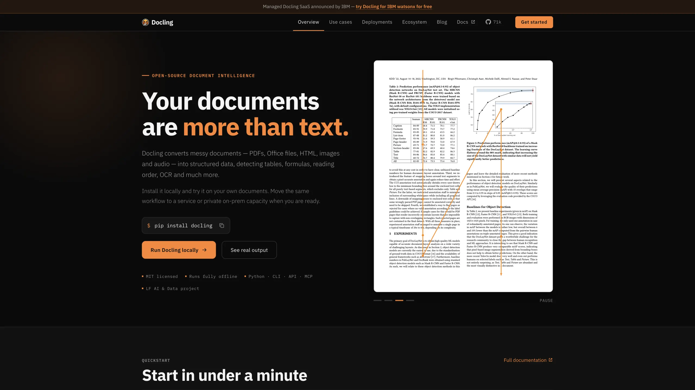

# 在 Sealos 上部署和托管 Docling

Docling Serve 是 Docling 的 HTTP 服务和网页调试台。Docling 是 IBM Research 开源的文件转换工具集，可将 PDF、Office 文件、图片、HTML 和结构化文本转换为整洁的 Markdown、JSON 或 HTML，供检索、分析和下游 AI 流程使用。本 Sealos 模板使用 CPU 镜像运行 Docling Serve 1.39.0，提供持久化模型缓存和公网 HTTPS 入口。



## 托管说明

Docling Serve 以单个 StatefulSet 运行官方镜像 `ghcr.io/docling-project/docling-serve-cpu:v1.39.0`。HTTP 服务监听 `5001` 端口，在 `/ui` 提供交互式调试台，在 `/docs` 发布 OpenAPI 页面，并提供同步转换接口 `/v1/convert/file` 与 `/v1/convert/source`。应用卡片直接打开调试台。

文档模型缓存在挂载到 `/models` 的 1Gi 卷上。`DOCLING_SERVE_LOAD_MODELS_AT_BOOT=true` 会在启动阶段加载版面分析、表格结构和 OCR 模型，因此首次启动需要从 Hugging Face 下载模型权重，后续重启复用该卷。服务预热后转换一个小型 HTML 页面约需 2 秒；在测试的 CPU 档位下，一个约 37000 字符的 arXiv PDF 转换耗时约 112 秒。

内存是主要限制。模型加载完成后服务空闲占用约 988Mi，`1024Mi` 上限在转换复杂 PDF 时被 OOMKilled。测试采用的配置为 `2048Mi` 上限。Docling Serve 没有内置认证，公网接口会接受任何知道主机名的用户的转换请求。

## 常见使用场景

- **RAG 数据入库**：把合同、手册、论文和报告转换为保留阅读顺序与表格结构的 Markdown。
- **文档数字化**：借助默认开启的 OCR 将扫描版 PDF 和图片转换为可检索文本。
- **结构化抽取**：生成文档的 JSON 表示，供后续解析、分类和元数据处理。
- **批量转换**：一次提交多个 HTTP 或文件来源，通过同一套 API 收集 Markdown、HTML 或 JSON 结果。
- **Agent 工具**：为 AI Agent 提供自托管的用户文档转换接口。
- **内容迁移**：把 Office 文件、HTML 页面和 PDF 混合归档统一为 Markdown 语料库。

## 部署依赖

- 具备至少 2Gi 可用内存和 1Gi 持久化存储的 Sealos 工作区。
- 首次启动时访问 Hugging Face 的出网能力，用于把模型下载到 `/models`。
- 通过 `/v1/convert/source` 提交 URL 时访问目标地址的出网能力，或通过 `/v1/convert/file` 提交本地文件。
- 用于 `/ui` 调试台的浏览器，以及用于 API 的 `curl` 或任意 HTTP 客户端。
- 该单节点配置不需要外部数据库、缓存或对象存储。

### 部署相关链接

- [Docling 官网](https://www.docling.ai/)：产品介绍与托管服务
- [Docling 文档](https://docling-project.github.io/docling/)：支持格式、转换选项与 Python API
- [Docling Serve 仓库](https://github.com/docling-project/docling-serve)：服务源码、配置与 API 用法
- [Docling Serve API 用法](https://github.com/docling-project/docling-serve/blob/main/docs/usage.md)：接口示例与请求体
- [Docling Serve CPU 镜像](https://github.com/docling-project/docling-serve/pkgs/container/docling-serve-cpu)：模板使用的容器镜像
- [Docling 模型](https://huggingface.co/ds4sd/docling-models)：版面分析与表格结构模型权重

## 实现细节

**架构组件：**

- **Docling Serve StatefulSet**：单副本运行 CPU 镜像，在 `5001` 端口提供 HTTP API 与网页调试台。
- **模型卷**：挂载到 `/models` 的 1Gi 卷，保存 Hugging Face 缓存、已下载模型和运行时缓存文件。
- **Service**：ClusterIP 的 `80` 端口转发到 Docling HTTP 端口。
- **Ingress**：由 Sealos 管理的 HTTPS 域名，配置 32Mi 请求体上限、300 秒代理超时和静态资源缓存。
- **应用入口**：从 Sealos 桌面打开 `https://<应用域名>/ui`。

**配置：**

- **镜像**：`ghcr.io/docling-project/docling-serve-cpu:v1.39.0`
- **HTTP 端口**：`5001`
- **网页调试台**：`/ui`
- **API 文档**：`/docs`
- **转换接口**：`POST /v1/convert/file` 与 `POST /v1/convert/source`
- **模型缓存**：通过 `HF_HOME` 和 `XDG_CACHE_HOME` 指向 `/models`
- **启动行为**：`DOCLING_SERVE_LOAD_MODELS_AT_BOOT=true`
- **时区**：`Asia/Shanghai`
- **健康检查**：启动与存活探针调用 `GET /health`，就绪探针调用 `GET /ready`
- **上传上限**：Ingress 限制为 32Mi
- **安全上下文**：以 UID `1001` 运行，移除全部 Linux capabilities，禁用提权并启用 `RuntimeDefault` seccomp 配置

**资源分配：**

| 组件 | CPU 请求 | CPU 上限 | 内存请求 | 内存上限 | 存储 |
| --- | ---: | ---: | ---: | ---: | ---: |
| Docling Serve | 10m | 100m | 204Mi | 2048Mi | 1Gi |

以上数值为带模型缓存的实测最低档。`1024Mi` 内存上限在完整 PDF 转换过程中被 OOMKilled，服务在模型加载后稳定在约 988Mi。`100m` CPU 上限可完成小型 HTML 转换，并保持 60 秒稳定、零重启；大体量 PDF 使用 `500m` 到 `1` CPU 上限时转换更快。

## 为什么在 Sealos 上部署 Docling？

Sealos 是基于 Kubernetes 的 AI 辅助云操作系统，用一个界面提供 Docling Serve 所需的计算、存储、网络和运维能力：

- **一键部署**：通过一个模板创建 StatefulSet、模型卷、Service、Ingress 和应用入口。
- **自动 HTTPS**：获得由平台管理的公网域名和 TLS 证书，调试台与 API 共用该入口。
- **持久化模型缓存**：把已下载模型保存在独立卷上，重启后跳过重复下载。
- **资源可控**：在资源卡片上为大 PDF 提高 CPU、为 OCR 页面提高内存，无需修改模板。
- **运维可见**：在 Canvas 或 Sealos AI 对话中查看 Pod、日志、事件和内存使用。
- **按量付费**：以较低 CPU 起步，同时保留文档转换所需的内存余量。

## 部署指南

1. 打开 [Docling 模板](https://sealos.io/products/app-store/docling) 并点击 **Deploy Now**。
2. 确认自动生成的应用名和域名，保留 1Gi 模型卷，提交部署。
3. 等待 2-3 分钟让 Pod 就绪并完成证书签发。首次启动还需要下载模型权重，启动时间可能超过证书签发时间。
4. 打开应用卡片进入 `/ui` 调试台。
5. 上传一个小型 PDF，选择 Markdown 作为输出格式。
6. 在同一域名调用 `GET /health`，确认返回 HTTP 200。

## 使用网页调试台

打开 `https://<应用域名>/ui` 并使用上传面板。调试台把文件发送到 `/v1/convert/file`，显示转换进度，并渲染 Markdown、JSON 或 HTML 结果。OCR 默认开启，扫描版 PDF 无需额外配置即可得到文本。`/docs` 的 OpenAPI 页面列出全部选项，包括页码范围、表格模式和 OCR 预设。

## 使用转换 API

基础地址为 `https://<应用域名>`。通过 URL 转换公开文档：

```bash
BASE=https://<应用域名>

curl -sS -X POST "$BASE/v1/convert/source" \
  -H 'Content-Type: application/json' \
  -d '{
    "sources": [
      {"kind": "http", "url": "https://arxiv.org/pdf/2501.17887"}
    ],
    "options": {"to_formats": ["md"]}
  }' > result.json
```

响应中的 `document.md_content` 字段包含转换后的 Markdown，同时返回耗时与置信度信息。通过 multipart 接口转换上传文件：

```bash
curl -sS -X POST "$BASE/v1/convert/file" \
  -F "files=@./manual.pdf" \
  -F "to_formats=md" > manual.json
```

长任务可改用异步接口 `/v1/convert/source/async` 和 `/v1/convert/file/async`，轮询 `/v1/status/poll/{task_id}` 并读取 `/v1/result/{task_id}`。Ingress 的读写超时为 300 秒，覆盖当前资源档位下的大部分同步转换。

## 存储与持久化

Docling 把 Hugging Face 缓存写入 `/models/huggingface`，把运行时缓存写入 `/models/cache`。StatefulSet 通过名为 `vn-models` 的 `volumeClaimTemplates` 条目把 1Gi 卷挂载到 `/models`。该卷应在部署生命周期内保持绑定；新建空卷会触发完整的模型重新下载。

该卷保存模型权重和缓存文件。转换结果通过 HTTP 响应返回，服务本身不持久化文档，结果应保存到业务应用、对象存储或数据库。

## 扩缩容

本模板运行单副本，因为 Docling Serve 将模型加载到进程内存并写入共享缓存。可通过提高 CPU 上限加快大体积或图片型 PDF 的转换，通过提高内存上限处理 OCR 密集的页面。测试档位为 `100m` CPU 和 `2048Mi` 内存；`500m` CPU 上限可缩短文档批次转换时间。

需要更高吞吐时，可部署多个独立实例并在客户端分发任务，或通过异步接口排队。多个副本共享一个 ReadWriteOnce 卷的部署方式不受支持。

## 排障

### Pod 长时间停留在启动阶段

查看日志中的模型下载进度。首次启动会把版面分析、表格结构和 OCR 权重下载到 `/models`，网络较慢时需要数分钟。启动探针允许最多 10 分钟，之后才会触发首次重启。

### Pod 被 OOMKilled

`1024Mi` 上限在转换复杂 PDF 时被终止。日常使用保留 `2048Mi` 上限，超大扫描件或高分辨率 OCR 可提高到 `4096Mi`。在 Pod 事件中确认终止原因。

### 上传返回 HTTP 413

Ingress 将请求体限制为 32Mi。可压缩 PDF、按页码范围拆分，或为当前部署提高 `nginx.ingress.kubernetes.io/proxy-body-size` 注解。

### `/ui` 返回重定向或 404

使用带斜杠的路径 `/ui/`。应用卡片已指向正确路径；此版本的裸路径 `/ui` 会返回重定向。

### 转换速度慢

测试的 CPU 上限为 `100m`，适合轻量 HTML 和单页文档。数百页 PDF 可把 CPU 上限提高到 `500m` 或 `1`，内存保持 `2048Mi` 以上。服务预热后可避免重复加载模型；重启后的首次请求总会更慢。

### 公网接口可被任何人访问

Docling Serve 没有内置认证。可把部署放在可信网络中、在前面增加认证反向代理、通过白名单限制 Ingress，或在转换任务完成后删除实例。

### 获取帮助

- [Docling 文档](https://docling-project.github.io/docling/)
- [Docling Serve 问题反馈](https://github.com/docling-project/docling-serve/issues)
- [Sealos 文档](https://sealos.io/docs)

## 许可证

Docling 与 Docling Serve 采用 [MIT 许可证](https://github.com/docling-project/docling-serve/blob/main/LICENSE)。本 Sealos 模板遵循 templates 仓库的许可证。
