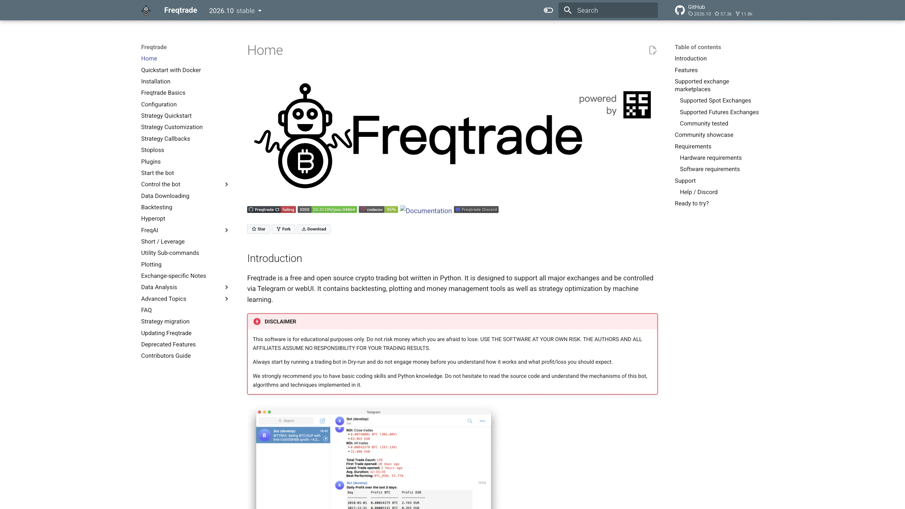

# Deploy and Host Freqtrade on Sealos

Freqtrade is an open-source crypto trading bot written in Python. It provides strategy development, backtesting, dry-run trading, a web UI, and a REST API. This Sealos template runs Freqtrade 2026.10 in `trade` mode with a persistent user-data volume, a preloaded momentum strategy, and dry-run trading enabled by default.



## About Hosting Freqtrade

Freqtrade runs as one StatefulSet with the official `freqtradeorg/freqtrade:2026.10` image. The container starts the `trade` command, which runs the bot and the REST API server together on port `8080`. FreqUI is served at `/`, the OpenAPI page at `/docs`, and the REST API under `/api/v1`. A 1Gi volume mounted at `/freqtrade/user_data` keeps the SQLite trade database, logs, and downloaded market data across restarts.

The bundled configuration is a complete dry-run setup: Gate as the exchange, `BTC/USDT` as the pair, a 5-minute timeframe, 100 USDT per trade, three open trades maximum, and the `SealosMomentumStrategy` moving-average strategy. The bot starts in the `running` state, so it begins simulated trading after the first market load. The web UI and API use the username `freqtrader` and the password supplied at deployment time.

The tested profile uses `20m` CPU and `51Mi` memory as requests, with `200m` CPU and `512Mi` memory as limits. The running bot settled near 335Mi of memory and around 100m of CPU while tracking 6,271 Gate markets. Gate is the default exchange because Binance was unreachable from the test cluster; the `exchange_name` input accepts any CCXT exchange id supported by Freqtrade.

## Common Use Cases

- **Strategy Development**: Iterate on entry and exit rules with live market data in a safe dry-run environment.
- **Dry-Run Validation**: Confirm order sizing, pair lists, stoploss, and ROI settings before committing real capital.
- **Exchange Migration**: Test the same strategy against Gate and other CCXT exchanges.
- **Bot Operations**: Monitor open trades, balances, and logs from FreqUI or the REST API.
- **Backtesting Companion**: Keep a persistent user-data volume for downloaded candles and trade history.
- **Education**: Learn how automated trading works with simulated orders and a visible trade lifecycle.

## Dependencies for Hosting Freqtrade

- A Sealos workspace with at least 512Mi of memory and 1Gi of persistent storage.
- Outbound network access to the selected exchange API. Gate works from the tested cluster.
- A password of at least 8 characters for the FreqUI and REST API user.
- Exchange API keys for live trading; dry-run market data uses public endpoints.
- A browser for FreqUI, or `curl` for the REST API.

### Deployment Dependencies

- [Freqtrade documentation](https://www.freqtrade.io/en/stable/) - Official documentation home
- [Docker quickstart](https://www.freqtrade.io/en/stable/docker_quickstart/) - Container setup and user-data layout
- [Configuration reference](https://www.freqtrade.io/en/stable/configuration/) - Exchange, pair list, and dry-run settings
- [Strategy customization](https://www.freqtrade.io/en/stable/strategy-customization/) - Strategy interface and indicators
- [REST API reference](https://www.freqtrade.io/en/stable/rest-api/) - Authentication and endpoint reference
- [Supported exchanges](https://www.freqtrade.io/en/stable/exchanges/) - CCXT exchange coverage
- [Freqtrade repository](https://github.com/freqtrade/freqtrade) - Source code and release notes
- [Freqtrade container image](https://hub.docker.com/r/freqtradeorg/freqtrade) - Official image used by this template

## Implementation Details

**Architecture Components:**

- **Freqtrade StatefulSet**: One replica running the official image in `trade` mode with the bot and API server on port `8080`.
- **User-data volume**: A 1Gi volume at `/freqtrade/user_data` holding the SQLite trade database, logs, and market data.
- **Configuration**: A ConfigMap provides `config.json` and the `SealosMomentumStrategy.py` strategy file.
- **Service**: ClusterIP port `80` forwarding to the Freqtrade HTTP port.
- **Ingress**: Sealos-managed HTTPS host with a 32Mi request body limit and 300-second proxy timeouts.
- **App entry**: Opens FreqUI at the root path from the Sealos desktop.

**Configuration:**

- **Image**: `freqtradeorg/freqtrade:2026.10`
- **Run mode**: `trade`
- **HTTP port**: `8080`
- **Web UI**: `/`
- **API**: `/api/v1`
- **OpenAPI page**: `/docs`
- **Exchange**: Gate by default, configurable through the `exchange_name` input
- **Pair**: `BTC/USDT`
- **Timeframe**: `5m`
- **Dry-run**: Enabled
- **Stake**: 100 USDT per trade, three open trades maximum
- **Strategy**: `SealosMomentumStrategy`, a 10/30 SMA crossover on 5-minute candles
- **Database**: `sqlite:////freqtrade/user_data/tradesv3.dryrun.sqlite`
- **Username**: `freqtrader`
- **Password**: Required `api_password` input
- **Health checks**: Startup, readiness, and liveness call `GET /api/v1/ping`
- **Security context**: Runs as UID `1000`, drops all Linux capabilities, disables privilege escalation, and applies the `RuntimeDefault` seccomp profile

**Resource Allocation:**

| Component | CPU Request | CPU Limit | Memory Request | Memory Limit | Storage |
| --- | ---: | ---: | ---: | ---: | ---: |
| Freqtrade | 20m | 200m | 51Mi | 512Mi | 1Gi |

The resource values are the live-tested profile. A cold start loads the exchange market list, which took about two minutes at `200m` CPU. The bot then held a stable `RUNNING` state, opened and filled a dry-run `BTC/USDT` trade, and served API requests with zero restarts. Raise the CPU limit to `500m` for faster restarts and more responsive market refreshes.

## Why Deploy Freqtrade on Sealos?

Sealos is an AI-assisted cloud operating system built on Kubernetes. It provides the compute, storage, networking, and operations layer for Freqtrade in one interface:

- **One-Click Deployment**: Create the StatefulSet, user-data volume, Service, Ingress, and App entry from a single template.
- **Automatic HTTPS**: Receive a managed public domain and TLS certificate for FreqUI and the API.
- **Persistent Trade History**: Keep the SQLite database and downloaded candles on a dedicated volume.
- **Resource Control**: Raise CPU for larger market lists and memory for bigger pair lists from the resource card.
- **Operational Visibility**: Inspect Pods, logs, events, and resource usage from Canvas or the Sealos AI dialog.
- **Pay-As-You-Go**: Start with a small dry-run bot and scale the profile when the strategy set grows.

## Deployment Guide

1. Open the [Freqtrade template](https://sealos.io/products/app-store/freqtrade) and click **Deploy Now**.
2. Set the API password, confirm the exchange id and generated application name, and submit the deployment.
3. Wait 2-3 minutes for the Pod to become ready and the certificate to be issued. The first market load can extend startup.
4. Open the App card to reach FreqUI.
5. Click **Login**, enter a bot name, keep the prefilled API URL, use `freqtrader` as the username, and enter the deployment password.
6. Open the **Trade** tab and confirm the pair list shows `BTC/USDT` and the strategy name.

## Using FreqUI

FreqUI is served at `https://<your-app-host>/`. After login, the **Trade** tab shows the open-trades table, the pair list, and the strategy chart. The switch next to the bot name controls auto-refresh; use the top switch to pause or resume the bot. The **Dashboard** tab summarizes balances and profit, and the **Logs** tab shows the bot log without opening a terminal.

The bot starts in the `running` state, so a dry-run entry can appear on the first candle after startup. This is expected behavior for the bundled strategy. Pause the bot from the UI when you want a clean slate.

## Using the REST API

The API uses JWT authentication. Request a token with the same credentials as FreqUI:

```bash
BASE=https://<your-app-host>
curl -u 'freqtrader:<api-password>' -X POST "$BASE/api/v1/token/login" > token.json
```

Read the access token and call the bot endpoints:

```bash
TOKEN=$(python3 -c 'import json;print(json.load(open("token.json"))["access_token"])')
curl -H "Authorization: Bearer $TOKEN" "$BASE/api/v1/status"
curl -H "Authorization: Bearer $TOKEN" "$BASE/api/v1/whitelist"
curl -H "Authorization: Bearer $TOKEN" "$BASE/api/v1/balance"
```

`GET /api/v1/ping` needs no token and returns `{"status":"pong"}`. Use `/api/v1/show_config` for the active configuration, `/api/v1/profit` for profit summaries, and `/api/v1/logs` for recent log lines. The OpenAPI page at `/docs` lists every endpoint.

## Dry-Run and Live Trading

The template ships with `dry_run: true` and no exchange API keys. Simulated orders use public market data, so the bot can run without granting trading permissions. Keep this mode while you validate strategies, pair lists, and risk settings.

Live trading requires exchange API keys with spot trading permission and `dry_run: false`. The bundled ConfigMap has empty `key` and `secret` fields; add credentials through a Secret-backed environment variable or a customized configuration. Start with small stakes and review the exchange-specific requirements before enabling real funds.

## Storage and Persistence

The `vn-freqtradevn-uservn-data` volume holds `/freqtrade/user_data`. The SQLite database lives at `/freqtrade/user_data/tradesv3.dryrun.sqlite`, logs at `/freqtrade/user_data/logs/freqtrade.log`, and downloaded candles under `/freqtrade/user_data/data/<exchange>`. The volume request is 1Gi; expand it from the Sealos storage view as the trade history and candle archive grow.

The configuration and strategy are mounted from a ConfigMap and are read-only inside the container. Change them in the template or recreate the ConfigMap, then restart the Pod. The database and logs stay on the persistent volume across restarts.

## Scaling

This template runs one replica because the bot keeps in-process state, a local SQLite database, and a single exchange connection. Scale vertically by raising the CPU limit for faster market loads and the memory limit for larger pair lists or additional strategies.

Horizontal scaling requires an external database, separate bot instances with distinct exchange credentials, and a shared configuration strategy. Run those instances as separate Sealos apps and keep each bot on its own user-data volume.

## Troubleshooting

### The API returns 503 "Bot is not in the correct state"

The API server is up while the bot is still initializing or has exited. Check the logs for `No strategy set`, an exchange connection error, or a missing strategy file. The template mounts `SealosMomentumStrategy.py` from the ConfigMap and passes `--strategy-path /freqtrade/user_data`.

### Binance is unreachable

The test cluster could not reach `api.binance.com`, so the template defaults to Gate. Keep `gate` or set `exchange_name` to another reachable CCXT exchange. Confirm the exchange supports the `BTC/USDT` pair and public market data from your network.

### Startup takes several minutes

Gate returns more than 6,000 markets, and the bot loads them at startup. At `200m` CPU the first load took about two minutes. Raise the CPU limit to `500m` or `1` for a faster start, and keep the readiness probe window in mind.

### FreqUI shows the welcome page after login

Click **Trade** in the top navigation. The welcome page appears until a bot is selected; the bot list and the trade view are separate routes.

### Login fails

Use the username `freqtrader` and the exact `api_password` value from deployment. The JWT secret is generated separately, so changing the password requires a Pod restart. Check the Pod environment variables if the login still fails.

### The Pod is OOMKilled

The tested limit is `512Mi` with about 335Mi in use. Large pair lists, additional strategies, or FreqAI features need a higher limit. Raise it to `1Gi` and restart the Pod.

### The public endpoint is reachable by anyone

FreqUI and the API require the configured password, and the Ingress is public. Use a long password, rotate it when needed, and delete the instance when the bot is no longer in use. Add an authenticating proxy or an Ingress allowlist for stricter access control.

### Getting Help

- [Freqtrade documentation](https://www.freqtrade.io/en/stable/)
- [Freqtrade GitHub issues](https://github.com/freqtrade/freqtrade/issues)
- [Sealos documentation](https://sealos.io/docs)

## License

Freqtrade is released under the [GNU General Public License v3.0](https://github.com/freqtrade/freqtrade/blob/develop/LICENSE). This Sealos template is distributed under the templates repository license.
