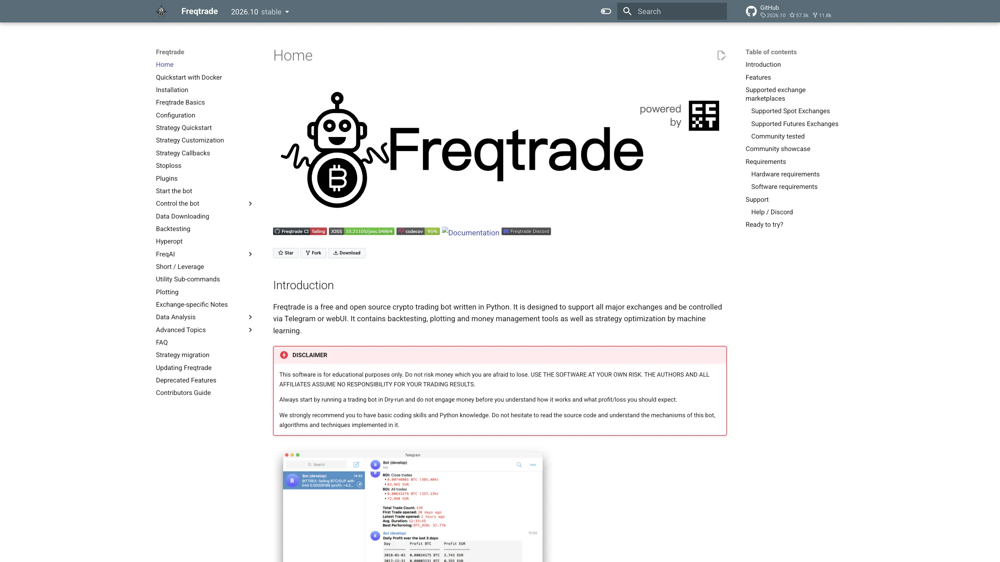

# 在 Sealos 上部署和托管 Freqtrade

Freqtrade 是用 Python 编写的开源加密货币交易机器人，提供策略开发、回测、模拟交易、Web UI 和 REST API。本 Sealos 模板以 `trade` 模式运行 Freqtrade 2026.10，提供持久化用户数据卷、预置动量策略和默认开启的模拟交易。



## 托管说明

Freqtrade 以单个 StatefulSet 运行官方镜像 `freqtradeorg/freqtrade:2026.10`。容器启动 `trade` 命令，在 `8080` 端口同时运行交易机器人和 REST API 服务。FreqUI 位于 `/`，OpenAPI 页面位于 `/docs`，REST API 位于 `/api/v1`。挂载到 `/freqtrade/user_data` 的 1Gi 卷保存 SQLite 交易数据库、日志和行情数据，重启后继续使用。

模板内置一套完整的模拟交易配置：交易所为 Gate，交易对为 `BTC/USDT`，时间周期为 5 分钟，每笔 100 USDT，最多同时持有 3 笔交易，策略为 `SealosMomentumStrategy` 均线策略。机器人以 `running` 状态启动，在首次加载行情后开始模拟交易。Web UI 与 API 使用用户名 `freqtrader` 和部署时输入的密码。

测试档位使用 `20m` CPU、`51Mi` 内存请求，`200m` CPU、`512Mi` 内存上限。运行中的机器人稳定占用约 335Mi 内存和约 100m CPU，跟踪 6,271 个 Gate 市场。默认交易所选择 Gate，原因是测试集群无法访问 Binance；`exchange_name` 输入支持 Freqtrade 支持的任何 CCXT 交易所 ID。

## 常见使用场景

- **策略开发**：在安全的模拟交易环境中用实时行情迭代入场和出场规则。
- **模拟验证**：在投入真实资金前确认下单金额、交易对列表、止损和 ROI 设置。
- **交易所迁移**：用同一套策略在 Gate 和其他 CCXT 交易所之间验证表现。
- **机器人运维**：通过 FreqUI 或 REST API 查看持仓、余额和日志。
- **回测配套**：用持久化用户数据卷保存下载的 K 线和交易历史。
- **学习自动化交易**：通过模拟订单和完整交易生命周期理解交易机器人的工作方式。

## 部署依赖

- 至少 512Mi 内存和 1Gi 持久化存储的 Sealos 工作区。
- 访问所选交易所 API 的出网能力；测试集群可访问 Gate。
- 至少 8 个字符的 FreqUI 与 REST API 用户密码。
- 实盘交易需要交易所 API Key；模拟交易使用公开行情接口。
- 用于 FreqUI 的浏览器，或用于 REST API 的 `curl`。

### 部署相关链接

- [Freqtrade 文档](https://www.freqtrade.io/en/stable/)：官方文档首页
- [Docker 快速开始](https://www.freqtrade.io/en/stable/docker_quickstart/)：容器配置与用户数据目录
- [配置参考](https://www.freqtrade.io/en/stable/configuration/)：交易所、交易对列表和模拟交易设置
- [策略定制](https://www.freqtrade.io/en/stable/strategy-customization/)：策略接口与指标
- [REST API 参考](https://www.freqtrade.io/en/stable/rest-api/)：认证与接口说明
- [支持的交易所](https://www.freqtrade.io/en/stable/exchanges/)：CCXT 交易所覆盖范围
- [Freqtrade 仓库](https://github.com/freqtrade/freqtrade)：源码与发布说明
- [Freqtrade 容器镜像](https://hub.docker.com/r/freqtradeorg/freqtrade)：模板使用的官方镜像

## 实现细节

**架构组件：**

- **Freqtrade StatefulSet**：单副本运行官方镜像，以 `trade` 模式在 `8080` 端口提供机器人与 API 服务。
- **用户数据卷**：挂载到 `/freqtrade/user_data` 的 1Gi 卷，保存 SQLite 交易数据库、日志和行情数据。
- **配置**：ConfigMap 提供 `config.json` 与 `SealosMomentumStrategy.py` 策略文件。
- **Service**：ClusterIP 的 `80` 端口转发到 Freqtrade HTTP 端口。
- **Ingress**：由 Sealos 管理的 HTTPS 域名，配置 32Mi 请求体上限和 300 秒代理超时。
- **应用入口**：从 Sealos 桌面打开根路径的 FreqUI。

**配置：**

- **镜像**：`freqtradeorg/freqtrade:2026.10`
- **运行模式**：`trade`
- **HTTP 端口**：`8080`
- **Web UI**：`/`
- **API**：`/api/v1`
- **OpenAPI 页面**：`/docs`
- **交易所**：默认 Gate，可通过 `exchange_name` 输入修改
- **交易对**：`BTC/USDT`
- **时间周期**：`5m`
- **模拟交易**：开启
- **下单金额**：每笔 100 USDT，最多 3 笔持仓
- **策略**：`SealosMomentumStrategy`，在 5 分钟 K 线上使用 10/30 均线交叉
- **数据库**：`sqlite:////freqtrade/user_data/tradesv3.dryrun.sqlite`
- **用户名**：`freqtrader`
- **密码**：必填的 `api_password` 输入
- **健康检查**：启动、就绪和存活探针调用 `GET /api/v1/ping`
- **安全上下文**：以 UID `1000` 运行，移除全部 Linux capabilities，禁用提权并启用 `RuntimeDefault` seccomp 配置

**资源分配：**

| 组件 | CPU 请求 | CPU 上限 | 内存请求 | 内存上限 | 存储 |
| --- | ---: | ---: | ---: | ---: | ---: |
| Freqtrade | 20m | 200m | 51Mi | 512Mi | 1Gi |

以上数值为实测档位。冷启动需要加载交易所市场列表，在 `200m` CPU 下约需两分钟。机器人随后保持稳定的 `RUNNING` 状态，开仓并成交了一笔 `BTC/USDT` 模拟交易，API 请求正常且零重启。需要更快启动和更及时刷新行情时，可把 CPU 上限提高到 `500m`。

## 为什么在 Sealos 上部署 Freqtrade？

Sealos 是基于 Kubernetes 的 AI 辅助云操作系统，用一个界面提供 Freqtrade 所需的计算、存储、网络和运维能力：

- **一键部署**：通过一个模板创建 StatefulSet、用户数据卷、Service、Ingress 和应用入口。
- **自动 HTTPS**：获得由平台管理的公网域名和 TLS 证书，FreqUI 与 API 共用该入口。
- **持久化交易历史**：把 SQLite 数据库和下载的 K 线保存在独立卷上。
- **资源可控**：在资源卡片上为更大的市场列表提高 CPU、为更大的交易对列表提高内存。
- **运维可见**：在 Canvas 或 Sealos AI 对话中查看 Pod、日志、事件和资源使用。
- **按量付费**：以小规模模拟交易起步，策略增加后再提升资源档位。

## 部署指南

1. 打开 [Freqtrade 模板](https://sealos.io/products/app-store/freqtrade) 并点击 **Deploy Now**。
2. 设置 API 密码，确认交易所 ID 和自动生成的应用名，提交部署。
3. 等待 2-3 分钟让 Pod 就绪并完成证书签发。首次加载行情可能延长启动时间。
4. 打开应用卡片进入 FreqUI。
5. 点击 **Login**，输入机器人名称，保留预填的 API 地址，用户名填写 `freqtrader`，密码填写部署时设置的值。
6. 打开 **Trade** 标签页，确认交易对列表显示 `BTC/USDT` 和策略名称。

## 使用 FreqUI

FreqUI 位于 `https://<应用域名>/`。登录后，**Trade** 标签页显示持仓表、交易对列表和策略图表。机器人名称旁的开关控制自动刷新，顶部开关用于暂停或恢复机器人。**Dashboard** 标签页汇总余额和收益，**Logs** 标签页无需终端即可查看机器人日志。

机器人以 `running` 状态启动，启动后的第一根 K 线可能触发一笔模拟开仓。这是内置策略的正常行为；需要干净状态时可在 UI 中暂停机器人。

## 使用 REST API

API 使用 JWT 认证。用与 FreqUI 相同的凭据获取令牌：

```bash
BASE=https://<应用域名>
curl -u 'freqtrader:<api-password>' -X POST "$BASE/api/v1/token/login" > token.json
```

读取访问令牌并调用机器人接口：

```bash
TOKEN=$(python3 -c 'import json;print(json.load(open("token.json"))["access_token"])')
curl -H "Authorization: Bearer $TOKEN" "$BASE/api/v1/status"
curl -H "Authorization: Bearer $TOKEN" "$BASE/api/v1/whitelist"
curl -H "Authorization: Bearer $TOKEN" "$BASE/api/v1/balance"
```

`GET /api/v1/ping` 无需令牌，返回 `{"status":"pong"}`。`/api/v1/show_config` 返回当前配置，`/api/v1/profit` 返回收益汇总，`/api/v1/logs` 返回最近日志。`/docs` 的 OpenAPI 页面列出全部接口。

## 模拟交易与实盘交易

模板默认 `dry_run: true`，且不包含交易所 API Key。模拟订单使用公开行情数据，机器人无需交易权限即可运行。验证策略、交易对列表和风险设置期间保持该模式。

实盘交易需要具备现货交易权限的交易所 API Key，并设置 `dry_run: false`。内置 ConfigMap 的 `key` 与 `secret` 字段为空；可通过 Secret 挂载的环境变量或自定义配置填入凭据。启用真实资金前先使用小额资金，并核对交易所的具体要求。

## 存储与持久化

`vn-freqtradevn-uservn-data` 卷保存 `/freqtrade/user_data`。SQLite 数据库位于 `/freqtrade/user_data/tradesv3.dryrun.sqlite`，日志位于 `/freqtrade/user_data/logs/freqtrade.log`，下载的 K 线位于 `/freqtrade/user_data/data/<exchange>`。卷请求为 1Gi；交易历史和 K 线归档增长后可在 Sealos 存储页面扩容。

配置与策略从 ConfigMap 挂载，在容器内为只读。修改时请编辑模板或重建 ConfigMap，然后重启 Pod。数据库与日志保存在持久卷上，重启后继续保留。

## 扩缩容

本模板运行单副本，因为机器人维护进程内状态、本地 SQLite 数据库和单条交易所连接。可通过提高 CPU 上限加快行情加载，通过提高内存上限支持更大的交易对列表或更多策略。

水平扩展需要外部数据库、使用不同交易所凭据的独立机器人实例，以及共享的配置策略。把这些实例作为独立的 Sealos 应用运行，并为每个机器人保留独立的用户数据卷。

## 排障

### API 返回 503 "Bot is not in the correct state"

API 服务已启动，而机器人仍在初始化或已经退出。检查日志中的 `No strategy set`、交易所连接错误或策略文件缺失。模板从 ConfigMap 挂载 `SealosMomentumStrategy.py`，并传入 `--strategy-path /freqtrade/user_data`。

### Binance 无法访问

测试集群无法访问 `api.binance.com`，因此模板默认使用 Gate。保持 `gate`，或把 `exchange_name` 设置为其他可访问的 CCXT 交易所。确认该交易所支持 `BTC/USDT` 交易对和公开行情。

### 启动耗时数分钟

Gate 返回超过 6,000 个市场，机器人会在启动时全部加载。`200m` CPU 下首次加载约需两分钟。可把 CPU 上限提高到 `500m` 或 `1` 加快启动，同时留意启动探针的时间窗口。

### 登录后 FreqUI 仍显示欢迎页

点击顶部导航的 **Trade**。选择机器人之前会显示欢迎页；机器人列表和交易视图属于不同路由。

### 登录失败

用户名使用 `freqtrader`，密码使用部署时的 `api_password` 原值。JWT 密钥单独生成，修改密码需要重启 Pod。问题持续时检查 Pod 环境变量。

### Pod 被 OOMKilled

测试上限为 `512Mi`，实际占用约 335Mi。更大的交易对列表、更多策略或 FreqAI 功能需要更高上限。可提高到 `1Gi` 并重启 Pod。

### 公网入口可被任何人访问

FreqUI 和 API 需要配置的密码，Ingress 本身是公网入口。使用长密码、按需轮换，并在机器人不再使用时删除实例。需要更严格的访问控制时，可增加认证反向代理或 Ingress 白名单。

### 获取帮助

- [Freqtrade 文档](https://www.freqtrade.io/en/stable/)
- [Freqtrade GitHub 问题反馈](https://github.com/freqtrade/freqtrade/issues)
- [Sealos 文档](https://sealos.io/docs)

## 许可证

Freqtrade 采用 [GNU General Public License v3.0](https://github.com/freqtrade/freqtrade/blob/develop/LICENSE)。本 Sealos 模板遵循 templates 仓库的许可证。
