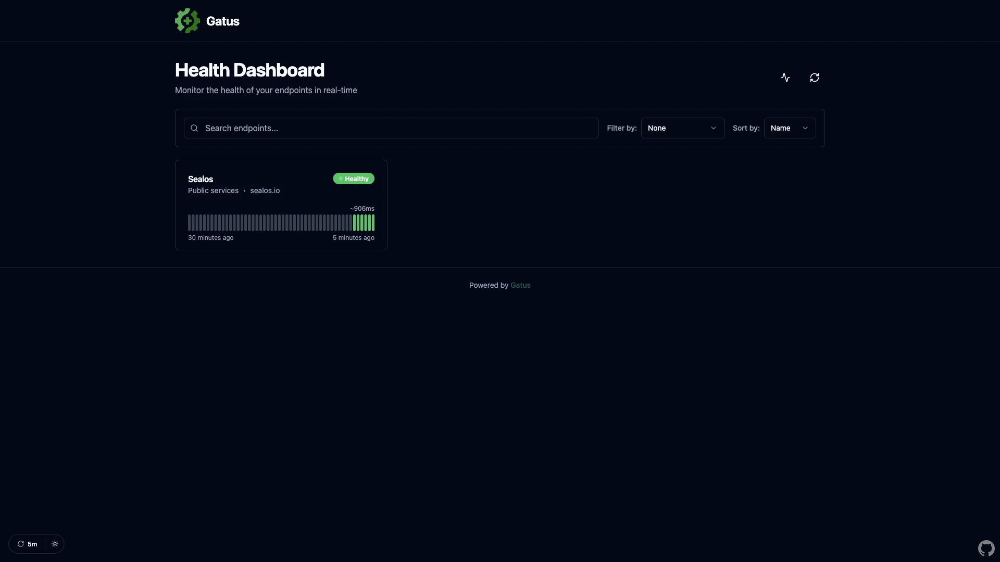

# Deploy and Host Gatus on Sealos

Gatus is a lightweight, self-hosted status page and service monitor. This template deploys Gatus v5.38.0 as a single Deployment with a ConfigMap-managed endpoint list, a managed HTTPS URL, and built-in health probes.

## About Hosting Gatus

Gatus runs as one Go process that checks HTTP, TCP, DNS, SSH, and other endpoint types on a schedule, evaluates response conditions, and renders the results as a status dashboard. The process listens on port `8080` and exposes `/health` for Kubernetes probes. Results live in memory by default, so the dashboard reflects the checks performed by the current Pod.

The template mounts a ConfigMap at `/config/config.yaml`. The default configuration checks `https://sealos.io` every five minutes and expects HTTP status `200`. Sealos provisions the Deployment, ClusterIP Service, Ingress, TLS certificate, and App card. Configuration changes take effect after the Pod restarts, which keeps the running configuration predictable.

The dashboard is public and has no built-in login. Use endpoint names and URLs that are safe to display, and add ingress authentication when the monitor list contains internal infrastructure details.

## Common Use Cases

- **Public status page**: Publish the availability of your website, API, and customer-facing services.
- **API health monitoring**: Track status codes, response bodies, latency, and TLS certificate expiry.
- **Dependency tracking**: Watch third-party APIs, DNS records, and upstream services that your product relies on.
- **Homelab and internal service checks**: Monitor routers, storage, and internal HTTP endpoints from one dashboard.
- **Incident evidence**: Keep a visible response-time and uptime history during an incident review.

## Dependencies for Gatus Hosting

- A Sealos workspace with at least 256Mi of available memory.
- Outbound HTTPS access from the Pod to every monitored endpoint.
- A browser for the dashboard and the Sealos Canvas for configuration changes.
- No database and no persistent volume.

### Deployment Dependencies

- [Gatus website](https://gatus.io) - Product overview and feature list
- [Gatus documentation](https://gatus.io/docs) - Endpoint, condition, storage, and alerting reference
- [Gatus GitHub repository](https://github.com/TwiN/gatus) - Source code and releases
- [Gatus container image](https://github.com/TwiN/gatus/pkgs/container/gatus) - Published image used by this template
- [Sealos documentation](https://sealos.io/docs) - Platform concepts and operations

## Implementation Details

**Architecture Components:**

- **Gatus Deployment**: One replica running `ghcr.io/twin/gatus:v5.38.0` on port `8080`.
- **Configuration ConfigMap**: `config.yaml` mounted at `/config/config.yaml`, containing the default Sealos endpoint and group.
- **Service**: ClusterIP port `80` forwarding to the Gatus HTTP port.
- **Ingress**: Sealos-managed HTTPS host with a 32Mi request body limit and 300-second proxy timeouts.
- **App entry**: Opens the Gatus dashboard at the generated public URL.

**Configuration:**

- **Image**: `ghcr.io/twin/gatus:v5.38.0`
- **HTTP port**: `8080`
- **Service port**: `80`
- **Configuration path**: `/config/config.yaml`
- **Public URL**: `https://${{ defaults.app_host }}.${{ SEALOS_CLOUD_DOMAIN }}/`
- **Health probe**: `GET /health`
- **Default endpoint**: `https://sealos.io`, group `Public services`, interval `5m`, condition `[STATUS] == 200`
- **Authentication**: None in the template; the dashboard is public
- **Runtime user**: UID `1000`, GID `1000`, with all Linux capabilities dropped and the `RuntimeDefault` seccomp profile
- **Storage**: None; results use the in-memory store

**Resource Allocation:**

| Component | CPU Request | CPU Limit | Memory Request | Memory Limit | Storage |
| --- | ---: | ---: | ---: | ---: | ---: |
| Gatus | 50m | 500m | 25Mi | 256Mi | None |

The live Sealos test returned HTTP `200` from `/health`, rendered the dashboard with a `Healthy` result for the Sealos endpoint, and kept the Pod at zero restarts with this profile. The template records the tested profile in the workload annotation so later resource changes stay traceable.

## Why Deploy Gatus on Sealos?

Sealos is an AI-assisted cloud operating system built on Kubernetes. It supplies the compute, storage, networking, and operations layer for Gatus through one interface:

- **One-click deployment**: Create the Deployment, ConfigMap, Service, Ingress, and App card from one template.
- **Managed HTTPS**: Receive a public domain and TLS certificate without configuring a reverse proxy.
- **Declarative monitoring**: Keep endpoint definitions in a ConfigMap that can be reviewed and versioned.
- **Resource control**: Adjust CPU and memory from the resource card as the endpoint list grows.
- **Operational visibility**: Inspect Pods, logs, events, and resource usage from Canvas or the Sealos AI dialog.
- **Pay-as-you-go footprint**: Start with a small allocation and increase it only when the check volume grows.

## Deployment Guide

1. Open the [Gatus template](https://sealos.io/products/app-store/gatus) and click **Deploy Now**.
2. Confirm the generated application name and submit the deployment.
3. Wait 2-3 minutes for the Pod to become ready and for the HTTPS certificate to be issued.
4. Open the App card. The dashboard lists the Sealos endpoint under **Public services**.
5. To add checks, open the ConfigMap in Canvas, extend `config.yaml`, and save the change.
6. Restart the Gatus Deployment so the new configuration loads, then reload the dashboard.

## Using Gatus

The dashboard groups endpoints by the `group` field and shows the latest status, response time, and condition results. Click an endpoint to see its recent response history and the condition that produced the current state. The `/health` endpoint reports the process health for Kubernetes probes and load balancers.

The default configuration checks `https://sealos.io` every five minutes. Add your own endpoints with conditions such as `[STATUS] == 200`, `[BODY] == pat(*healthy*)`, `[CERTIFICATE_EXPIRATION] > 720h`, or `[RESPONSE_TIME] < 500`. Gatus evaluates each condition after every check and marks the endpoint unhealthy when a condition fails.

## Scaling

Gatus runs one replica by default. The in-memory result store belongs to each Pod, so multiple replicas would publish independent histories behind the same Service. Keep one replica for a consistent status page, and scale vertically when you add hundreds of checks or enable frequent intervals.

Raise the CPU and memory limits from the Gatus Deployment resource card. Memory use grows with the number of endpoints, result history, and response body conditions. The template keeps no persistent volume; a Pod restart starts a fresh in-memory history.

## Troubleshooting

### An endpoint shows UNHEALTHY

- Cause: The Pod cannot reach the target, DNS resolution fails, a TLS certificate is invalid, or the configured condition does not match the response.
- Solution: Open the endpoint detail, read the condition failure, and test the same URL from a Pod in the namespace. Confirm that cluster egress allows the target host and port.

### Configuration changes have no effect

- Cause: Gatus reads `config.yaml` at startup, and a ConfigMap update leaves the running Pod unchanged.
- Solution: Restart the Deployment from Canvas after saving the ConfigMap, then confirm the new endpoint appears in the dashboard.

### The dashboard returns 404 or 502

- Cause: The Pod is not ready, the Service selector does not match, or the Ingress cannot reach the backend.
- Solution: Check the Pod status and the `/health` probe result, then inspect the Service endpoints and Ingress events.

### Response history disappears after a restart

- Cause: The template uses the in-memory result store.
- Solution: Keep the Pod running for long-term history, or configure a SQLite or PostgreSQL storage block in `config.yaml` and mount a volume for SQLite.

### Getting Help

- [Gatus documentation](https://gatus.io/docs)
- [Gatus GitHub issues](https://github.com/TwiN/gatus/issues)
- [Sealos documentation](https://sealos.io/docs)

## License

Gatus is released under the [Apache License 2.0](https://github.com/TwiN/gatus/blob/master/LICENSE). This Sealos template is an independent deployment definition and is distributed under the templates repository license.
