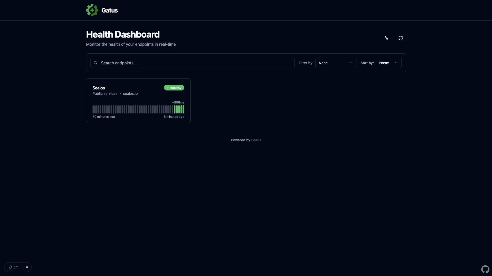

# 在 Sealos 上部署和托管 Gatus

Gatus 是一款轻量级自托管状态页和服务监控工具。本模板将 Gatus v5.38.0 部署为单个 Deployment，通过 ConfigMap 管理监控端点，并提供托管 HTTPS 地址和健康检查。

## 关于托管 Gatus

Gatus 以单个 Go 进程运行，按计划检查 HTTP、TCP、DNS、SSH 等类型的端点，执行响应条件判断，并将结果渲染为状态仪表盘。进程监听 `8080` 端口，并提供 `/health` 供 Kubernetes 探针使用。结果默认保存在内存中，仪表盘展示当前 Pod 执行的检查记录。

模板将 ConfigMap 挂载到 `/config/config.yaml`。默认配置每五分钟检查一次 `https://sealos.io`，要求返回 HTTP `200`。Sealos 负责创建 Deployment、ClusterIP Service、Ingress、TLS 证书和应用卡片。修改配置后重启 Pod 即可加载新内容。

仪表盘默认公开访问，模板未内置登录。请使用可以公开展示的端点名称和 URL；监控列表包含内部基础设施信息时，在 Ingress 层增加身份认证。

## 常见使用场景

- **公开状态页**：发布网站、API 和面向客户服务的可用性。
- **API 健康监控**：跟踪状态码、响应内容、延迟和 TLS 证书到期时间。
- **依赖服务跟踪**：监控产品依赖的第三方 API、DNS 记录和上游服务。
- **家庭实验室巡检**：在一个仪表盘中查看路由器、存储和内部 HTTP 服务。
- **故障复盘证据**：保留事件期间的响应时间和在线率历史。

## Gatus 托管依赖

- 一个 Sealos 工作空间，至少提供 256Mi 可用内存。
- Pod 到所有被监控端点的出站 HTTPS 访问。
- 用于访问仪表盘的浏览器，以及用于修改配置的 Sealos Canvas。
- 无需数据库和持久卷。

### 部署依赖

- [Gatus 官网](https://gatus.io) - 产品介绍和功能列表
- [Gatus 文档](https://gatus.io/docs) - 端点、条件、存储和告警配置参考
- [Gatus GitHub 仓库](https://github.com/TwiN/gatus) - 源码和版本发布
- [Gatus 容器镜像](https://github.com/TwiN/gatus/pkgs/container/gatus) - 本模板使用的镜像
- [Sealos 文档](https://sealos.io/docs) - 平台概念和操作说明

## 实现细节

**架构组件：**

- **Gatus Deployment**：一个副本，运行 `ghcr.io/twin/gatus:v5.38.0`，监听 `8080` 端口。
- **配置 ConfigMap**：将 `config.yaml` 挂载到 `/config/config.yaml`，包含默认的 Sealos 端点和服务分组。
- **Service**：ClusterIP 端口 `80`，转发到 Gatus 的 HTTP 端口。
- **Ingress**：Sealos 托管的 HTTPS 域名，请求体上限 32Mi，代理超时 300 秒。
- **应用入口**：通过生成的公网地址打开 Gatus 仪表盘。

**配置：**

- **镜像**：`ghcr.io/twin/gatus:v5.38.0`
- **HTTP 端口**：`8080`
- **Service 端口**：`80`
- **配置文件路径**：`/config/config.yaml`
- **公网地址**：`https://${{ defaults.app_host }}.${{ SEALOS_CLOUD_DOMAIN }}/`
- **健康检查**：`GET /health`
- **默认端点**：`https://sealos.io`，分组 `Public services`，间隔 `5m`，条件 `[STATUS] == 200`
- **身份认证**：模板未启用，仪表盘公开访问
- **运行用户**：UID `1000`、GID `1000`，移除全部 Linux capabilities，启用 `RuntimeDefault` seccomp 配置
- **存储**：无，使用内存结果存储

**资源分配：**

| 组件 | CPU 请求 | CPU 限制 | 内存请求 | 内存限制 | 存储 |
| --- | ---: | ---: | ---: | ---: | ---: |
| Gatus | 50m | 500m | 25Mi | 256Mi | 无 |

Sealos 实测中，`/health` 返回 HTTP `200`，仪表盘显示 Sealos 端点 `Healthy`，Pod 保持零重启。模板将实测资源配置写入工作负载注解，便于后续追踪调整依据。

## 为什么在 Sealos 上部署 Gatus？

Sealos 是构建在 Kubernetes 上的 AI 辅助云操作系统，通过统一界面提供 Gatus 所需的计算、存储、网络和运维能力：

- **一键部署**：用一个模板创建 Deployment、ConfigMap、Service、Ingress 和应用卡片。
- **托管 HTTPS**：自动获得公网域名和 TLS 证书，无需单独配置反向代理。
- **声明式监控**：端点定义保存在 ConfigMap 中，便于审查和版本管理。
- **资源可控**：端点数量增长时，通过资源卡片调整 CPU 和内存。
- **运维可见**：在 Canvas 或 Sealos AI 对话框中查看 Pod、日志、事件和资源使用情况。
- **按量使用**：从小规格起步，检查规模增长后再提高配置。

## 部署指南

1. 打开 [Gatus 模板](https://sealos.io/products/app-store/gatus)，点击 **Deploy Now**。
2. 确认自动生成的应用名称并提交部署。
3. 等待 2-3 分钟，Pod 进入就绪状态并完成 HTTPS 证书签发。
4. 打开应用卡片，仪表盘会在 **Public services** 分组中列出 Sealos 端点。
5. 如需增加检查项，在 Canvas 中打开 ConfigMap，扩展 `config.yaml` 并保存。
6. 重启 Gatus Deployment 加载新配置，然后刷新仪表盘。

## 使用 Gatus

仪表盘按 `group` 字段对端点分组，展示最新状态、响应时间和条件结果。点击端点可以查看近期响应历史和当前状态对应的条件。`/health` 端点用于 Kubernetes 探针和负载均衡器判断进程健康。

默认配置每五分钟检查一次 `https://sealos.io`。可以添加 `[STATUS] == 200`、`[BODY] == pat(*healthy*)`、`[CERTIFICATE_EXPIRATION] > 720h`、`[RESPONSE_TIME] < 500` 等条件。Gatus 在每次检查后执行条件判断，条件失败时将端点标记为异常。

## 扩缩容

Gatus 默认运行一个副本。内存结果存储属于每个 Pod，多副本会在同一 Service 后展示各自独立的历史记录。需要一致的状态页时保持单副本，在检查项达到数百个或缩短检查间隔时纵向扩容。

在 Gatus Deployment 的资源卡片中提高 CPU 和内存限制。内存占用随端点数量、结果历史和响应体条件增长。模板未配置持久卷，Pod 重启后会从新的内存历史开始记录。

## 故障排查

### 端点显示 UNHEALTHY

- 原因：Pod 无法访问目标、DNS 解析失败、TLS 证书无效，或者配置条件与响应不匹配。
- 处理：打开端点详情查看失败条件，在命名空间内的 Pod 中测试同一 URL，并确认集群出站访问允许目标主机和端口。

### 修改配置后没有生效

- 原因：Gatus 在启动时读取 `config.yaml`，更新 ConfigMap 不会改变正在运行的 Pod。
- 处理：保存 ConfigMap 后，在 Canvas 中重启 Deployment，确认新端点出现在仪表盘。

### 仪表盘返回 404 或 502

- 原因：Pod 未就绪、Service 选择器不匹配，或者 Ingress 无法访问后端。
- 处理：检查 Pod 状态和 `/health` 探针结果，然后查看 Service Endpoints 和 Ingress 事件。

### 重启后响应历史消失

- 原因：模板使用内存结果存储。
- 处理：保持 Pod 持续运行以保留长期历史，或者在 `config.yaml` 中配置 SQLite 或 PostgreSQL 存储，并为 SQLite 挂载持久卷。

### 获取帮助

- [Gatus 文档](https://gatus.io/docs)
- [Gatus GitHub Issues](https://github.com/TwiN/gatus/issues)
- [Sealos 文档](https://sealos.io/docs)

## 许可证

Gatus 使用 [Apache License 2.0](https://github.com/TwiN/gatus/blob/master/LICENSE) 发布。本 Sealos 模板是独立部署定义，遵循 templates 仓库许可证。
