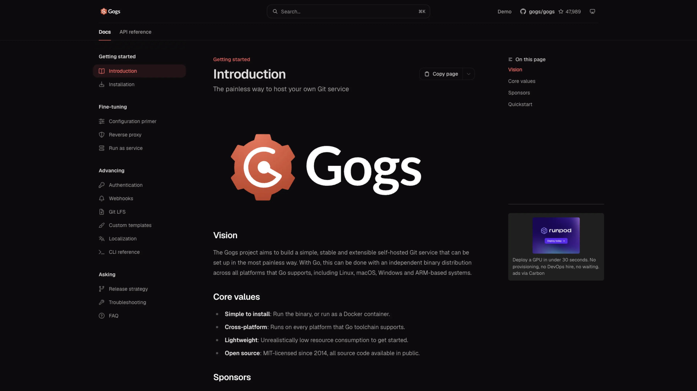

# Deploy and Host Gogs on Sealos

Gogs is a lightweight self-hosted Git service with repositories, issues, pull requests, webhooks, and a browser interface. This Sealos template runs Gogs 0.14.4 as a single-replica StatefulSet with SQLite storage and a public HTTPS Git endpoint.

## About Hosting Gogs

Gogs provides a complete Git forge in a compact package: repository browsing, code review through pull requests, issue tracking, organizations, webhooks, and user administration. The web interface is served on port `3000`.

This template runs one StatefulSet with `gogs/gogs:0.14.4`. A 1Gi volume at `/data` stores the SQLite database at `/data/gogs/data/gogs.db`, repositories under `/data/git/gogs-repositories`, attachments, and application state. A ConfigMap supplies `/data/gogs/conf/app.ini` with `INSTALL_LOCK=true`, HTTPS `EXTERNAL_URL`, SQLite settings, and a generated `SECRET_KEY`.

The Service maps port `80` to Gogs on `3000`, and a Sealos Ingress publishes the UI over HTTPS. SSH access is disabled in this template. Registration is open, and the first registered account becomes the site administrator.

## Common Use Cases

- **Private Repositories**: Host source code for personal projects or a small team.
- **Code Review**: Use issues and pull requests with inline comments for lightweight review.
- **Webhook Automation**: Trigger CI jobs and deployment scripts from repository events.
- **Internal Mirroring**: Keep copies of upstream repositories inside a private network.
- **Lab Git Forge**: Provide a self-contained Git service for demos, classes, and experiments.

## Dependencies for Gogs Hosting

The template includes the Gogs StatefulSet, a ConfigMap, a 1Gi persistent volume, a Service, an HTTPS Ingress, and the Sealos App entry. Gogs uses embedded SQLite and needs no external database.

Users need a modern browser and a Git client that supports HTTPS remotes. Email delivery is disabled in the template, so password recovery through email is unavailable until SMTP is configured.

### Deployment Dependencies

- [Gogs website](https://gogs.io/) - Product overview and downloads
- [Gogs documentation](https://gogs.io/getting-started/introduction) - Installation, configuration, and administration guides
- [Gogs repository](https://github.com/gogs/gogs) - Source code and issue tracker
- [Gogs Docker image](https://hub.docker.com/r/gogs/gogs) - Official image used by this template
- [Gogs configuration reference](https://github.com/gogs/gogs/blob/main/conf/app.ini) - Annotated `app.ini` settings

## Implementation Details

**Architecture Components:**

- **Gogs StatefulSet**: One replica running `gogs/gogs:0.14.4` on port `3000`.
- **ConfigMap**: Supplies `/data/gogs/conf/app.ini` through a `subPath` mount.
- **Persistent volume**: A 1Gi volume at `/data` for SQLite, repositories, and attachments.
- **Service and Ingress**: Publish the web UI over public HTTPS.
- **App entry**: Opens the Gogs dashboard from the Sealos desktop.

**Configuration:**

- **Image**: `gogs/gogs:0.14.4`
- **Web port**: `3000`
- **Database**: SQLite at `/data/gogs/data/gogs.db`
- **Repository root**: `/data/git/gogs-repositories`
- **External URL**: Generated Sealos HTTPS host
- **Installer**: Locked with `INSTALL_LOCK=true`
- **Secret key**: Generated at deployment through `GOGS_SECURITY_SECRET_KEY`
- **Registration**: Open; email confirmation disabled
- **SSH**: Disabled
- **Replicas**: `1`

**Resource Allocation:**

| Component | CPU Request | CPU Limit | Memory Request | Memory Limit | Storage |
| --- | ---: | ---: | ---: | ---: | ---: |
| Gogs | 10m | 100m | 12Mi | 128Mi | 1Gi |

The profile passed a cold start, first-user registration, administrator login, repository creation, and a stability window with zero restarts.

## Why Deploy Gogs on Sealos?

Sealos is an AI-assisted cloud operating system built on Kubernetes that unifies deployment, networking, storage, and operations. Deploying Gogs on Sealos gives you:

- **One-Click Git Service**: Provision the forge, database, storage, and HTTPS endpoint from one template.
- **Persistent Repositories**: Keep code, issues, and attachments across Pod restarts.
- **Compact Footprint**: Run a small team forge with a validated 100m CPU and 128Mi memory limit.
- **Canvas and AI Dialog**: Inspect the StatefulSet, ConfigMap, Service, Ingress, PVC, and logs, and adjust the deployment through the Sealos AI dialog.
- **Automatic HTTPS**: Clone and browse repositories through a managed TLS certificate.
- **Kubernetes Reliability**: Use health probes, automated recovery, and declarative resource management.

## Deployment Guide

1. Open the [Gogs template](https://sealos.io/products/app-store/gogs) and click **Deploy Now**.
2. Review the generated application name, confirm the 1Gi storage plan, and start the deployment.
3. Wait for deployment to complete, typically in 2-3 minutes. Sealos opens the Canvas after the resources are created.
4. Open the public URL from the Canvas or the App Store entry.
5. Register the first account; Gogs grants this account site administrator rights.
6. Create a repository and confirm that the repository page and HTTPS clone URL load correctly.

## Login and Account Setup

Gogs has no pre-seeded administrator. The first account registered on a fresh instance becomes the site administrator. Open the public URL, choose **Register**, and create the initial account with a username, email address, and password.

After registration, sign in and open **Site Administration** from the avatar menu to manage users, repositories, authentication sources, and site settings. Registration stays open in the template; close it under **Site Administration → Users** or by editing `DISABLE_REGISTRATION` in `app.ini` after the initial accounts are created.

## Configuration

- **Registration**: Controlled by `DISABLE_REGISTRATION` in the `[auth]` section of `app.ini`.
- **Email**: Disabled in `[email]`; configure SMTP before enabling email confirmation or password recovery.
- **Repositories**: Stored under `/data/git/gogs-repositories`.
- **Database**: SQLite at `/data/gogs/data/gogs.db`.
- **SSH**: Disabled by `DISABLE_SSH=true` and `START_SSH_SERVER=false`.
- **External URL**: Set from the generated Sealos host so clone links and webhooks use the public address.
- **Persistence**: All state lives on the `/data` volume.

## Scaling

Keep the template at one replica because SQLite and the repository directory use a ReadWriteOnce volume. Increase CPU and memory limits when repository browsing, webhook delivery, or concurrent Git operations need more headroom. Expand the 1Gi volume from the StatefulSet resource card as repositories, issues, and attachments grow. For a larger forge, migrate to an external database and shared storage before adding replicas.

## Troubleshooting

### The first account is not an administrator

The first registered account on a fresh database becomes the administrator. If an earlier account exists, sign in with that account and grant administrator rights from **Site Administration → Users**.

### Git clone over SSH fails

SSH is disabled in this template. Use the HTTPS clone URL shown on the repository page. Add a personal access token or account password when the repository is private.

### Password recovery email does not arrive

Email delivery is disabled. An administrator can reset the password from **Site Administration → Users**, or SMTP can be configured in `app.ini` and the Pod restarted.

### The repository page returns HTTP 500

Check the Pod logs and confirm that the `/data` volume is writable. The SQLite database and repository root must both remain on the persistent volume.

### Getting Help

- [Gogs documentation](https://gogs.io/getting-started/introduction)
- [Gogs issues](https://github.com/gogs/gogs/issues)
- [Sealos documentation](https://sealos.io/docs)

## License

Gogs is licensed under the [MIT License](https://github.com/gogs/gogs/blob/main/LICENSE). This Sealos template is distributed under the templates repository license.
