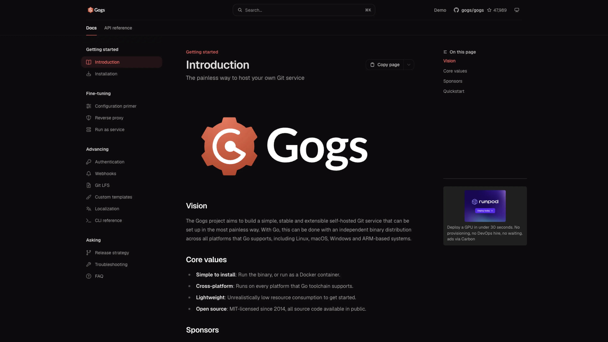

# 在 Sealos 上部署和托管 Gogs

Gogs 是轻量级自托管 Git 服务，支持仓库、Issue、合并请求、Webhook 和浏览器界面。本 Sealos 模板以单副本 StatefulSet 运行 Gogs 0.14.4，使用 SQLite 存储并提供公网 HTTPS Git 入口。

## 关于 Gogs 托管

Gogs 在紧凑的软件包中提供完整 Git 平台：仓库浏览、通过合并请求进行代码评审、Issue 跟踪、组织、Webhook 和用户管理。Web 界面监听 `3000` 端口。

本模板运行一个 StatefulSet，使用 `gogs/gogs:0.14.4` 镜像。1Gi 卷挂载到 `/data`，保存 `/data/gogs/data/gogs.db` 的 SQLite 数据库、`/data/git/gogs-repositories` 下的仓库、附件和应用状态。ConfigMap 提供 `/data/gogs/conf/app.ini`，包含 `INSTALL_LOCK=true`、HTTPS `EXTERNAL_URL`、SQLite 设置和自动生成的 `SECRET_KEY`。

Service 将 `80` 端口映射到 Gogs 的 `3000` 端口，Sealos Ingress 通过 HTTPS 发布 Web UI。本模板关闭 SSH 访问，注册保持开放，首个注册账号成为站点管理员。

## 常见使用场景

- **私有仓库**：为个人项目或小团队托管源代码。
- **代码评审**：使用 Issue 和合并请求的行内评论进行轻量评审。
- **Webhook 自动化**：通过仓库事件触发 CI 任务和部署脚本。
- **内部镜像**：在私有网络内保存上游仓库副本。
- **实验 Git 平台**：为演示、课程和实验提供独立 Git 服务。

## Gogs 托管依赖

模板包含 Gogs StatefulSet、ConfigMap、1Gi 持久卷、Service、HTTPS Ingress 和 Sealos App 入口。Gogs 使用内置 SQLite，不需要外部数据库。

用户需要现代浏览器和支持 HTTPS 远程地址的 Git 客户端。模板关闭邮件投递，配置 SMTP 前无法通过邮件找回密码。

### 部署依赖

- [Gogs 官网](https://gogs.io/) - 产品介绍与下载
- [Gogs 文档](https://gogs.io/getting-started/introduction) - 安装、配置与管理指南
- [Gogs 仓库](https://github.com/gogs/gogs) - 源代码与 Issue
- [Gogs Docker 镜像](https://hub.docker.com/r/gogs/gogs) - 本模板使用的官方镜像
- [Gogs 配置参考](https://github.com/gogs/gogs/blob/main/conf/app.ini) - 带注释的 `app.ini` 设置

## 实现细节

**架构组件：**

- **Gogs StatefulSet**：单副本运行 `gogs/gogs:0.14.4`，监听 `3000` 端口。
- **ConfigMap**：通过 `subPath` 挂载提供 `/data/gogs/conf/app.ini`。
- **持久卷**：1Gi 卷挂载到 `/data`，保存 SQLite、仓库和附件。
- **Service 与 Ingress**：通过公网 HTTPS 发布 Web UI。
- **App 入口**：从 Sealos 桌面打开 Gogs 仪表盘。

**配置：**

- **镜像**：`gogs/gogs:0.14.4`
- **Web 端口**：`3000`
- **数据库**：SQLite，路径 `/data/gogs/data/gogs.db`
- **仓库根目录**：`/data/git/gogs-repositories`
- **外部地址**：自动生成的 Sealos HTTPS 域名
- **安装器**：通过 `INSTALL_LOCK=true` 锁定
- **密钥**：部署时通过 `GOGS_SECURITY_SECRET_KEY` 自动生成
- **注册**：开放，关闭邮件确认
- **SSH**：关闭
- **副本数**：`1`

**资源分配：**

| 组件 | CPU 请求 | CPU 限制 | 内存请求 | 内存限制 | 存储 |
| --- | ---: | ---: | ---: | ---: | ---: |
| Gogs | 10m | 100m | 12Mi | 128Mi | 1Gi |

该规格通过了冷启动、首个用户注册、管理员登录、仓库创建和稳定性验证，Pod 重启次数为 0。

## 为什么在 Sealos 上部署 Gogs？

Sealos 是构建在 Kubernetes 之上的 AI 辅助云操作系统，将部署、网络、存储和运维统一在一个界面中。在 Sealos 上部署 Gogs 可以带来：

- **一键 Git 服务**：通过一个模板创建 Git 平台、数据库、存储和 HTTPS 入口。
- **仓库持久化**：在 Pod 重启后保留代码、Issue 和附件。
- **紧凑资源**：以经验证的 100m CPU 和 128Mi 内存限制运行小团队 Git 服务。
- **Canvas 与 AI 对话**：在一个视图中查看 StatefulSet、ConfigMap、Service、Ingress、PVC 和日志，并通过 Sealos AI 对话调整部署。
- **自动 HTTPS**：通过托管 TLS 证书克隆和浏览仓库。
- **Kubernetes 可靠性**：使用健康探针、自动恢复和声明式资源管理。

## 部署指南

1. 打开 [Gogs 模板](https://sealos.io/products/app-store/gogs)，点击 **Deploy Now**。
2. 检查自动生成的应用名称，确认 1Gi 存储规格后开始部署。
3. 等待部署完成，通常需要 2-3 分钟。资源创建完成后 Sealos 会打开 Canvas。
4. 从 Canvas 或应用商店入口打开公网地址。
5. 注册第一个账号，Gogs 会将该账号设为站点管理员。
6. 创建一个仓库，确认仓库页面和 HTTPS 克隆地址可正常加载。

## 登录与账号设置

Gogs 没有预置管理员。全新实例上注册的第一个账号会成为站点管理员。打开公网地址，选择 **Register**，使用用户名、邮箱和密码创建初始账号。

注册完成后登录，从头像菜单打开 **Site Administration** 管理用户、仓库、认证源和站点设置。模板保持注册开放；初始账号创建完成后，可在 **Site Administration → Users** 关闭注册，或修改 `app.ini` 中的 `DISABLE_REGISTRATION`。

## 配置

- **注册**：由 `app.ini` 的 `[auth]` 段中 `DISABLE_REGISTRATION` 控制。
- **邮件**：`[email]` 段默认关闭；启用邮件确认或密码找回前需配置 SMTP。
- **仓库**：保存在 `/data/git/gogs-repositories`。
- **数据库**：SQLite，路径 `/data/gogs/data/gogs.db`。
- **SSH**：通过 `DISABLE_SSH=true` 和 `START_SSH_SERVER=false` 关闭。
- **外部地址**：使用自动生成的 Sealos 域名，确保克隆链接和 Webhook 指向公网地址。
- **持久化**：全部状态保存在 `/data` 卷。

## 扩缩容

模板保持单副本，因为 SQLite 和仓库目录使用 ReadWriteOnce 卷。仓库浏览、Webhook 投递或并发 Git 操作需要更多余量时，提高 CPU 和内存限制。仓库、Issue 和附件增长时，从 StatefulSet 资源卡扩展 1Gi 卷。更大规模时，先迁移到外部数据库和共享存储，再增加副本。

## 故障排查

### 首个账号没有管理员权限

全新数据库上首个注册账号会成为管理员。若已存在更早的账号，使用该账号登录，并在 **Site Administration → Users** 授予管理员权限。

### SSH 克隆失败

本模板关闭 SSH。使用仓库页面显示的 HTTPS 克隆地址；私有仓库需要个人访问令牌或账号密码。

### 收不到密码找回邮件

模板关闭邮件投递。管理员可在 **Site Administration → Users** 重置密码，或在 `app.ini` 配置 SMTP 后重启 Pod。

### 仓库页面返回 HTTP 500

检查 Pod 日志，确认 `/data` 卷可写。SQLite 数据库和仓库根目录都必须位于持久卷上。

### 获取帮助

- [Gogs 文档](https://gogs.io/getting-started/introduction)
- [Gogs Issues](https://github.com/gogs/gogs/issues)
- [Sealos 文档](https://sealos.io/docs)

## 许可证

Gogs 使用 [MIT License](https://github.com/gogs/gogs/blob/main/LICENSE) 许可证。本 Sealos 模板遵循 templates 仓库许可证。
