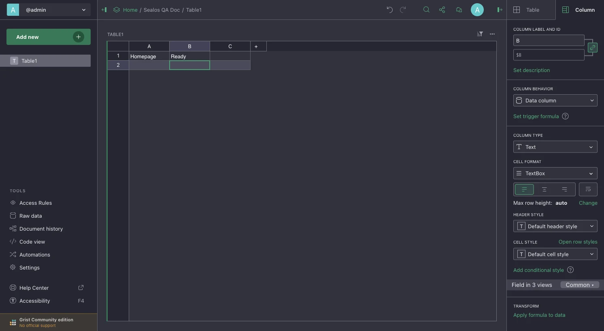

# Deploy and Host Grist on Sealos

Grist is a self-hosted relational spreadsheet that combines spreadsheet cells with linked tables, formulas, charts, document history, and API access. This template deploys Grist 1.7.22 as a single StatefulSet with a 1Gi persistent volume and a protected first-run setup.

## About Hosting Grist

Grist runs as one Node.js service on port `8484`. Documents and metadata live in a persistent volume mounted at `/persist`: the SQLite database is stored at `/persist/home.sqlite3`, and document data is stored under `/persist/docs`. The template enables SQLite WAL mode, same-origin serving, organization paths, and the Pyodide formula sandbox.

The deployment requires a boot key from the deployment form. The first administrator uses this key to initialize the instance, then signs in with the account created during setup. A generated session secret keeps browser sessions valid across Pod restarts while the template defaults remain unchanged.

Sealos provisions the StatefulSet, persistent volume, ClusterIP Service, Ingress, TLS certificate, and App card. Grist handles its own user accounts and document permissions, so the platform URL can stay public while access remains controlled inside the application.

## Common Use Cases

- **Relational spreadsheets**: Build tables with references, formulas, and summaries that plain spreadsheets cannot express.
- **Project and operations trackers**: Manage tasks, vendors, inventory, and budgets in one shared document.
- **Lightweight CRM**: Track customers, deals, and follow-ups with linked tables and access rules.
- **Data collection and review**: Combine forms, charts, and document history for team workflows.
- **Internal tools**: Expose document data through the Grist API and connect it to scripts or dashboards.

## Dependencies for Grist Hosting

- A Sealos workspace with at least 2Gi of available memory and 1Gi of persistent storage.
- A browser for the setup wizard, document editor, and admin pages.
- A saved boot key for first-run initialization.
- Outbound HTTPS access for optional webhooks, integrations, and external data sources.

### Deployment Dependencies

- [Grist website](https://www.getgrist.com) - Product overview and hosted service
- [Grist documentation](https://support.getgrist.com) - Formulas, references, charts, and API guides
- [Self-managed Grist documentation](https://support.getgrist.com/self-managed/) - Installation and environment variables
- [Grist GitHub repository](https://github.com/gristlabs/grist-core) - Source code and releases
- [Grist container image](https://hub.docker.com/r/gristlabs/grist) - Image used by this template
- [Sealos documentation](https://sealos.io/docs) - Platform concepts and operations

## Implementation Details

**Architecture Components:**

- **Grist StatefulSet**: One replica running `gristlabs/grist:1.7.22` on port `8484`.
- **Persistent volume**: A 1Gi volume mounted at `/persist` for the SQLite database, document files, and instance state.
- **Service**: ClusterIP port `80` forwarding to the Grist HTTP port.
- **Ingress**: Sealos-managed HTTPS host with a 32Mi request body limit and 300-second proxy timeouts.
- **App entry**: Opens the Grist home page at the generated public URL.

**Configuration:**

- **Image**: `gristlabs/grist:1.7.22`
- **HTTP port**: `8484`
- **Data directory**: `/persist`
- **Document directory**: `/persist/docs`
- **Metadata database**: SQLite at `/persist/home.sqlite3` with WAL mode
- **Boot key**: Required input `boot_key`, passed as `GRIST_BOOT_KEY`
- **Session secret**: Generated `session_secret`, passed as `GRIST_SESSION_SECRET`
- **Cookie name**: `grist_core`
- **URL behavior**: Same-origin serving with organization paths enabled
- **Formula sandbox**: `pyodide`
- **Version checks**: Automatic update checks disabled
- **Health probe**: `GET /`
- **Public URL**: `https://${{ defaults.app_host }}.${{ SEALOS_CLOUD_DOMAIN }}/`
- **Runtime user**: UID `1000`, GID `1000`, with all Linux capabilities dropped and the `RuntimeDefault` seccomp profile

**Resource Allocation:**

| Component | CPU Request | CPU Limit | Memory Request | Memory Limit | Storage |
| --- | ---: | ---: | ---: | ---: | ---: |
| Grist | 100m | 1 | 204Mi | 2048Mi | 1Gi |

The live Sealos test completed boot-key initialization, created the `Sealos QA Doc` document, and reopened the document and administrator session after a Pod restart. The Pod stayed ready with this profile, and the tested values are recorded in the workload annotation.

## Why Deploy Grist on Sealos?

Sealos is an AI-assisted cloud operating system built on Kubernetes. It supplies the compute, storage, networking, and operations layer for Grist through one interface:

- **One-click deployment**: Create the StatefulSet, persistent volume, Service, Ingress, and App card from one template.
- **Persistent documents**: Keep the SQLite database and document files on a dedicated volume.
- **Managed HTTPS**: Receive a public domain and TLS certificate for the team workspace.
- **Protected setup**: Require a boot key before the first administrator can initialize the instance.
- **Resource control**: Adjust CPU and memory from the resource card as documents and users grow.
- **Operational visibility**: Inspect Pods, logs, events, and resource usage from Canvas or the Sealos AI dialog.

## Deployment Guide

1. Open the [Grist template](https://sealos.io/products/app-store/grist) and click **Deploy Now**.
2. Enter a strong boot key, save it in a password manager, and confirm the generated application name.
3. Submit the deployment and wait 2-3 minutes for the Pod to become ready and for the HTTPS certificate to be issued.
4. Open the App card. The first visit shows the Grist setup flow.
5. Enter the boot key and create the administrator account.
6. Create a document, add a table, and link a second table to confirm the workspace is ready.
7. Open **Admin** to review users, documents, and instance settings.

## Login and Access

The public URL opens the Grist workspace at `/`. The first administrator is created through the boot-key setup flow. Later visits use the Grist sign-in page with the account created during setup.

The boot key is stored in the Deployment environment as `GRIST_BOOT_KEY`. Retrieve it from the resource card when the setup key is missing. Keep the same `session_secret` and persistent volume across redeploys so existing sessions and documents remain valid.

## Data and Persistence

All instance state lives on the `/persist` volume. The SQLite database stores users, document metadata, and sharing rules; the `/persist/docs` directory stores document data and attachment files. The volume must stay bound for the lifetime of the deployment.

Deleting the Instance removes the StatefulSet, Service, Ingress, and PVC, along with every document. For a portable backup, use the Grist document export or copy the complete `/persist` directory while the Pod is stopped.

## Scaling

Grist runs one replica because the template uses a single SQLite database file. Scale vertically by raising the CPU and memory limits for large documents, heavy formula use, and many concurrent editors.

The 1Gi volume suits small and medium teams. Expand the PVC from the resource card when document attachments or history outgrow the volume, provided the storage class supports expansion. Horizontal scaling requires an external database and shared document storage, which this single-node template does not configure.

## Troubleshooting

### The boot key is rejected

- Cause: The entered value differs from `GRIST_BOOT_KEY`, or the key belongs to an earlier deployment.
- Solution: Copy the current `GRIST_BOOT_KEY` value from the Deployment environment and enter it exactly. Create a new deployment when the original key is unavailable.

### The administrator session ends after a redeploy

- Cause: Grist signs session cookies with `GRIST_SESSION_SECRET`; a new secret invalidates existing sessions.
- Solution: Keep the same secret value across updates and sign in again after the change.

### Documents disappear after an update

- Cause: The new deployment uses a different PVC, or the Pod cannot write to `/persist`.
- Solution: Confirm that the PVC is `Bound` and attached to the current StatefulSet. Inspect the Pod log for permission errors on `/persist`.

### Python formulas are slow or fail

- Cause: Grist runs Python formulas in the browser through the Pyodide sandbox, so client memory and document size affect performance.
- Solution: Reduce the formula range, split very large tables, and test in a current Chromium or Firefox browser with sufficient memory.

### The page returns 502 after deployment

- Cause: Grist is still starting, or the readiness probe has not passed.
- Solution: Wait for the startup probe to finish, then inspect Pod events and logs. The first start can take longer while the image unpacks.

### Getting Help

- [Grist documentation](https://support.getgrist.com)
- [Grist self-managed guide](https://support.getgrist.com/self-managed/)
- [Grist GitHub issues](https://github.com/gristlabs/grist-core/issues)
- [Sealos documentation](https://sealos.io/docs)

## License

Grist Core is released under the [Apache License 2.0](https://github.com/gristlabs/grist-core/blob/main/LICENSE). This Sealos template is an independent deployment definition and is distributed under the templates repository license.
