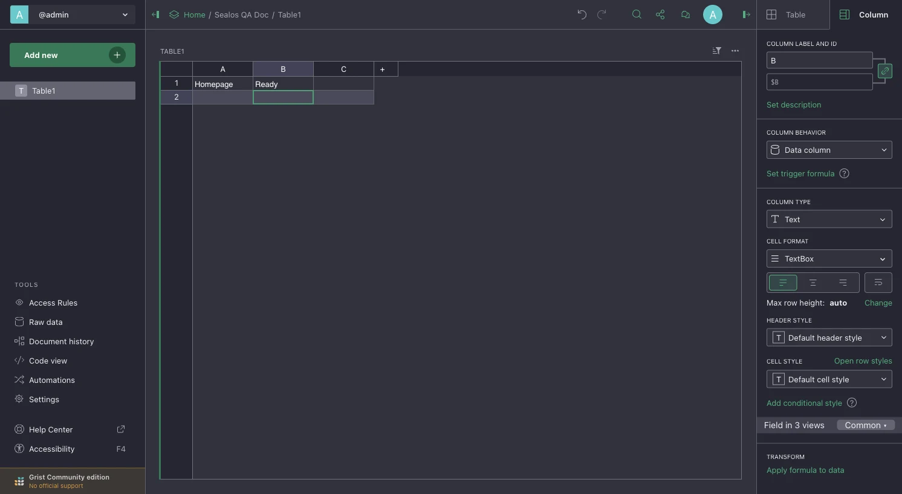

# 在 Sealos 上部署和托管 Grist

Grist 是一款自托管关系型电子表格，将电子表格单元格与关联表、公式、图表、文档历史和 API 访问结合在一起。本模板将 Grist 1.7.22 部署为单个 StatefulSet，配置 1Gi 持久卷和受保护的首次设置流程。

## 关于托管 Grist

Grist 以单个 Node.js 服务运行，监听 `8484` 端口。文档和元数据保存在挂载到 `/persist` 的持久卷中：SQLite 数据库位于 `/persist/home.sqlite3`，文档数据位于 `/persist/docs`。模板启用 SQLite WAL 模式、同源访问、组织路径和 Pyodide 公式沙箱。

部署时需要填写引导密钥。首位管理员使用该密钥初始化实例，然后使用设置过程中创建的账号登录。生成的会话密钥确保模板默认值保持不变时，浏览器会话在 Pod 重启后继续有效。

Sealos 负责创建 StatefulSet、持久卷、ClusterIP Service、Ingress、TLS 证书和应用卡片。Grist 自行管理用户账号和文档权限，平台地址可以公开，访问控制留在应用内部。

## 常见使用场景

- **关系型电子表格**：创建带引用、公式和汇总的表，表达普通电子表格难以描述的数据关系。
- **项目和运营跟踪**：在一个共享文档中管理任务、供应商、库存和预算。
- **轻量 CRM**：通过关联表和访问规则跟踪客户、商机和跟进记录。
- **数据收集与审核**：结合表单、图表和文档历史支持团队流程。
- **内部工具**：通过 Grist API 暴露文档数据，连接脚本或仪表盘。

## Grist 托管依赖

- 一个 Sealos 工作空间，至少提供 2Gi 可用内存和 1Gi 持久存储。
- 用于设置向导、文档编辑和管理页面的浏览器。
- 妥善保存的引导密钥，用于首次初始化。
- 可选出站 HTTPS 访问，用于 Webhook、集成和外部数据源。

### 部署依赖

- [Grist 官网](https://www.getgrist.com) - 产品介绍和托管服务
- [Grist 文档](https://support.getgrist.com) - 公式、引用、图表和 API 指南
- [Grist 自托管文档](https://support.getgrist.com/self-managed/) - 安装和环境变量参考
- [Grist GitHub 仓库](https://github.com/gristlabs/grist-core) - 源码和版本发布
- [Grist 容器镜像](https://hub.docker.com/r/gristlabs/grist) - 本模板使用的镜像
- [Sealos 文档](https://sealos.io/docs) - 平台概念和操作说明

## 实现细节

**架构组件：**

- **Grist StatefulSet**：一个副本，运行 `gristlabs/grist:1.7.22`，监听 `8484` 端口。
- **持久卷**：1Gi，挂载到 `/persist`，保存 SQLite 数据库、文档文件和实例状态。
- **Service**：ClusterIP 端口 `80`，转发到 Grist 的 HTTP 端口。
- **Ingress**：Sealos 托管的 HTTPS 域名，请求体上限 32Mi，代理超时 300 秒。
- **应用入口**：通过生成的公网地址打开 Grist 首页。

**配置：**

- **镜像**：`gristlabs/grist:1.7.22`
- **HTTP 端口**：`8484`
- **数据目录**：`/persist`
- **文档目录**：`/persist/docs`
- **元数据数据库**：SQLite，位于 `/persist/home.sqlite3`，启用 WAL 模式
- **引导密钥**：必填输入 `boot_key`，写入 `GRIST_BOOT_KEY`
- **会话密钥**：生成的 `session_secret`，写入 `GRIST_SESSION_SECRET`
- **Cookie 名称**：`grist_core`
- **URL 行为**：同源访问，启用组织路径
- **公式沙箱**：`pyodide`
- **版本检查**：关闭自动更新检查
- **健康检查**：`GET /`
- **公网地址**：`https://${{ defaults.app_host }}.${{ SEALOS_CLOUD_DOMAIN }}/`
- **运行用户**：UID `1000`、GID `1000`，移除全部 Linux capabilities，启用 `RuntimeDefault` seccomp 配置

**资源分配：**

| 组件 | CPU 请求 | CPU 限制 | 内存请求 | 内存限制 | 存储 |
| --- | ---: | ---: | ---: | ---: | ---: |
| Grist | 100m | 1 | 204Mi | 2048Mi | 1Gi |

Sealos 实测完成了引导密钥初始化，创建 `Sealos QA Doc` 文档，并在 Pod 重启后重新打开文档和管理员会话。Pod 使用该配置保持就绪，实测数值已写入工作负载注解。

## 为什么在 Sealos 上部署 Grist？

Sealos 是构建在 Kubernetes 上的 AI 辅助云操作系统，通过统一界面提供 Grist 所需的计算、存储、网络和运维能力：

- **一键部署**：用一个模板创建 StatefulSet、持久卷、Service、Ingress 和应用卡片。
- **文档持久化**：将 SQLite 数据库和文档文件保存在独立持久卷中。
- **托管 HTTPS**：为团队工作空间提供公网域名和 TLS 证书。
- **受保护的初始化**：首位管理员需要引导密钥才能完成实例设置。
- **资源可控**：文档和用户增长时，通过资源卡片调整 CPU 和内存。
- **运维可见**：在 Canvas 或 Sealos AI 对话框中查看 Pod、日志、事件和资源使用情况。

## 部署指南

1. 打开 [Grist 模板](https://sealos.io/products/app-store/grist)，点击 **Deploy Now**。
2. 输入强引导密钥并保存到密码管理器，确认自动生成的应用名称。
3. 提交部署，等待 2-3 分钟，Pod 进入就绪状态并完成 HTTPS 证书签发。
4. 打开应用卡片，首次访问会显示 Grist 设置流程。
5. 输入引导密钥并创建管理员账号。
6. 创建文档、添加表格并关联第二张表，确认工作空间可用。
7. 打开 **Admin** 查看用户、文档和实例设置。

## 登录与访问

公网地址 `/` 打开 Grist 工作空间。首位管理员通过引导密钥设置流程创建，后续访问使用设置时创建的账号登录。

引导密钥保存在 Deployment 环境变量 `GRIST_BOOT_KEY` 中。设置密钥遗失时，可以从资源卡片读取当前值。跨版本更新时保持相同的 `session_secret` 和持久卷，现有会话和文档即可继续使用。

## 数据与持久化

全部实例状态保存在 `/persist` 卷中。SQLite 数据库保存用户、文档元数据和共享规则，`/persist/docs` 保存文档数据和附件文件。部署生命周期内需要保持该卷绑定。

删除 Instance 会同时移除 StatefulSet、Service、Ingress 和 PVC，以及全部文档。需要可移植备份时，使用 Grist 文档导出功能，或者在 Pod 停止后复制完整的 `/persist` 目录。

## 扩缩容

模板使用单个 SQLite 数据库文件，因此 Grist 运行一个副本。文档较大、公式计算繁忙或并发编辑用户较多时，通过提高 CPU 和内存限制纵向扩容。

1Gi 卷适合中小团队。文档附件或历史记录增长后，可以从资源卡片扩展 PVC，前提是存储类支持扩容。水平扩容需要外部数据库和共享文档存储，本单节点模板未配置这些组件。

## 故障排查

### 引导密钥被拒绝

- 原因：输入值与 `GRIST_BOOT_KEY` 不一致，或者密钥属于更早的部署。
- 处理：从 Deployment 环境变量复制当前 `GRIST_BOOT_KEY` 值并准确输入。原始密钥不可用时，创建新的部署。

### 重新部署后管理员会话失效

- 原因：Grist 使用 `GRIST_SESSION_SECRET` 签名会话 Cookie，新密钥会使现有会话失效。
- 处理：更新时保持相同密钥值，修改后重新登录。

### 更新后文档消失

- 原因：新部署使用了不同的 PVC，或者 Pod 无法写入 `/persist`。
- 处理：确认 PVC 处于 `Bound` 状态并挂载到当前 StatefulSet，检查 Pod 日志中的 `/persist` 权限错误。

### Python 公式缓慢或失败

- 原因：Grist 通过 Pyodide 沙箱在浏览器中运行 Python 公式，客户端内存和文档规模会影响性能。
- 处理：缩小公式范围、拆分超大表格，并使用内存充足的现代 Chromium 或 Firefox 浏览器。

### 部署后页面返回 502

- 原因：Grist 仍在启动，或者就绪探针尚未通过。
- 处理：等待启动探针完成，然后检查 Pod 事件和日志。镜像首次解包时启动时间会更长。

### 获取帮助

- [Grist 文档](https://support.getgrist.com)
- [Grist 自托管指南](https://support.getgrist.com/self-managed/)
- [Grist GitHub Issues](https://github.com/gristlabs/grist-core/issues)
- [Sealos 文档](https://sealos.io/docs)

## 许可证

Grist Core 使用 [Apache License 2.0](https://github.com/gristlabs/grist-core/blob/main/LICENSE) 发布。本 Sealos 模板是独立部署定义，遵循 templates 仓库许可证。
