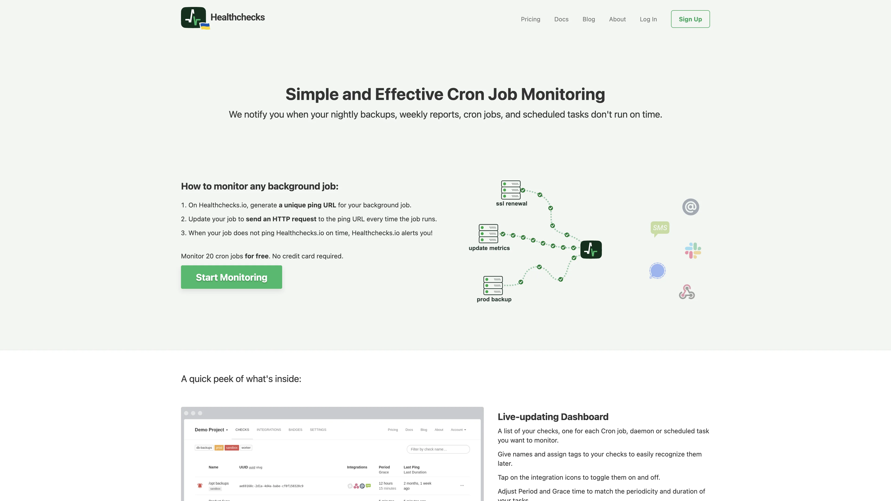

# Deploy and Host Healthchecks on Sealos

Healthchecks is an open-source cron job and background task monitor. Every scheduled job receives a unique ping URL, sends an HTTP request after each run, and Healthchecks alerts you when a ping is late or missing. This Sealos template runs Healthchecks 5.0.3 with SQLite on persistent storage and creates the administrator account from deployment inputs.



## About Hosting Healthchecks

Healthchecks is a Django application served by Gunicorn. Projects group related checks, and each check defines a schedule, a grace period, integrations, and status-page visibility. The dashboard shows current status, last ping time, and upcoming alerts, while every project can publish status pages and badges.

This template runs one StatefulSet with the official `healthchecks/healthchecks:v5.0.3` image on port `8000`. The SQLite database lives at `/data/hc.sqlite` on a 1Gi persistent volume, so projects, checks, ping history, and integrations survive Pod restarts and redeployments.

An init container applies Django migrations and creates the superuser from `admin_email` and `admin_password`. The template closes public registration, disables debug mode, pins `SITE_ROOT` and `ALLOWED_HOSTS` to the generated HTTPS host, and runs two Gunicorn workers.

## Common Use Cases

- **Cron Monitoring**: Detect missed nightly backups, report jobs, and scheduled maintenance scripts.
- **Background Workers**: Track queue consumers, sync daemons, and batch pipelines with heartbeat pings.
- **Distributed Devices**: Receive an alert when an edge device or on-premise agent stops reporting.
- **Team Status Pages**: Publish per-project status pages and badges for internal or public audiences.
- **Incident Routing**: Forward failures to Slack, Discord, Telegram, PagerDuty, ntfy, or custom webhooks.

## Dependencies for Hosting Healthchecks

The template includes the Healthchecks StatefulSet, a 1Gi persistent volume, a database preparation init container, a Service, an HTTPS Ingress, and a Sealos App entry. A browser and the administrator credentials are the only client-side requirements.

### Deployment Dependencies

- [Healthchecks official site](https://healthchecks.io/) - Product overview and hosted service
- [Healthchecks documentation](https://healthchecks.io/docs/) - Configuration and usage guides
- [Healthchecks Docker guide](https://healthchecks.io/docs/self_hosted_docker/) - Container deployment and environment variables
- [Healthchecks repository](https://github.com/healthchecks/healthchecks) - Source code and release notes
- [Healthchecks container image](https://hub.docker.com/r/healthchecks/healthchecks) - Official image used by this template

## Implementation Details

**Architecture Components:**

- **Healthchecks StatefulSet**: One replica running `healthchecks/healthchecks:v5.0.3` with Gunicorn on port `8000`.
- **Database preparation init container**: Runs `manage.py migrate` and creates the superuser from the deployment inputs when the account is missing.
- **Data volume**: A 1Gi volume at `/data` holding `hc.sqlite`, which stores users, projects, checks, ping history, and integration settings.
- **Service**: ClusterIP port `80` forwarding to the Gunicorn port.
- **Ingress**: Sealos-managed HTTPS host with a 32Mi request body limit, 300-second proxy timeouts, and 30-day static asset caching.
- **App entry**: Opens the Healthchecks dashboard from the Sealos desktop.

**Configuration:**

- **Image**: `healthchecks/healthchecks:v5.0.3`
- **Web port**: `8000`
- **Administrator email**: Deployment input `admin_email`, default `admin@example.com`
- **Administrator password**: Deployment input `admin_password`
- **Canonical URL**: `SITE_ROOT=https://<generated-host>`
- **Allowed hosts**: `ALLOWED_HOSTS=<generated-host>`
- **Registration**: Closed with `REGISTRATION_OPEN=False`
- **Debug mode**: Disabled with `DEBUG=False`
- **Workers**: Two Gunicorn workers
- **Timezone**: `Asia/Shanghai`
- **Persistence**: `/data` on a 1Gi volume
- **Health checks**: HTTP startup, readiness, and liveness probes against `/` with the public host header

**Resource Allocation:**

| Component | CPU Request | CPU Limit | Memory Request | Memory Limit | Storage |
| --- | ---: | ---: | ---: | ---: | ---: |
| Healthchecks | 20m | 200m | 51Mi | 512Mi | 1Gi data |
| Database preparation init | 20m | 200m | 51Mi | 512Mi | Shared volume |

The profile passed a cold start, administrator login, project creation, check creation, and a live ping with zero restarts. Memory settled near 270Mi with two Gunicorn workers after the dashboard loaded.

## Why Deploy Healthchecks on Sealos?

Sealos is an AI-assisted cloud operating system built on Kubernetes that combines deployment, networking, storage, and operations in one interface. Deploying Healthchecks on Sealos gives you:

- **One-Click Deployment**: Launch the monitor without assembling StatefulSet, Service, Ingress, and persistent storage.
- **Automatic HTTPS**: Receive a managed public domain and TLS certificate for the dashboard, ping endpoints, and status pages.
- **Persistent History**: Keep users, checks, ping history, and integrations on a dedicated volume.
- **Predictable Credentials**: Create the administrator account from deployment inputs on first start.
- **Managed Runtime**: Run Django, Gunicorn, and SQLite on a Kubernetes foundation with health probes and restart handling.
- **Sealos Operations**: Inspect Pods, logs, storage, and resource usage from Canvas or the Sealos AI dialog.

## Deployment Guide

1. Open the [Healthchecks template](https://sealos.io/products/app-store/healthchecks) and click **Deploy Now**.
2. Enter the administrator email and password, then review the generated application name and host.
3. Wait for deployment to complete, typically in 2-3 minutes. The first start applies migrations and creates the admin user.
4. Open the public URL and sign in with the administrator credentials.
5. Create a project, click **Add Check**, and set the schedule and grace period for the job.
6. Copy the generated ping URL and call it from the job after each run, then confirm that **Last Ping** updates on the dashboard.

## Using Healthchecks

- **Projects**: Group checks by application, team, or environment and manage project members and integrations.
- **Checks**: Define simple or cron schedules, grace periods, tags, descriptions, and manual pause or resume.
- **Ping Signals**: Use `/ping/<uuid>` for success, `/ping/<uuid>/start` for job start, `/ping/<uuid>/fail` for explicit failure, and `/ping/<uuid>/<exit-status>` with a numeric exit code.
- **Integrations**: Add Slack, Discord, Telegram, PagerDuty, ntfy, Pushover, Opsgenie, or webhook channels per project.
- **Status Pages**: Publish project status pages, add custom domains, and embed status badges in dashboards or README files.
- **API**: Manage checks, channels, and pings with the REST API and per-project API keys.
- **Administration**: Manage users, projects, and authentication from `/admin/`.

## Email Alerts and SMTP

Email integrations require an SMTP server. Add `EMAIL_HOST`, `EMAIL_PORT`, `EMAIL_USE_TLS` or `EMAIL_USE_SSL`, `EMAIL_HOST_USER`, `EMAIL_HOST_PASSWORD`, and `DEFAULT_FROM_EMAIL` to the StatefulSet environment, then restart the Pod. Healthchecks verifies recipient addresses by default through `EMAIL_USE_VERIFICATION=True`; complete the verification link before relying on email alerts.

Webhook, chat, and push integrations work without SMTP and cover most incident-routing workflows.

## Scaling

Run Healthchecks as a single replica. SQLite and the ReadWriteOnce volume serve one writer, and multiple replicas would create independent databases. Raise the CPU and memory limits for larger ping volumes, or deploy separate instances for independent teams and environments.

## Troubleshooting

### The Pod stays unready and probe requests return HTTP 400

`ALLOWED_HOSTS` rejects requests whose Host header is absent from the list. The template pins the public host and sends it in the HTTP probes. When you change the app host, update `SITE_ROOT` and `ALLOWED_HOSTS` together and restart the Pod.

### Login redirects to an internal address

`SITE_ROOT` must match the public HTTPS URL exactly. Correct the value and restart the Pod.

### The administrator account is missing

The init container creates the account only when the email does not exist yet. Create another superuser from the Pod:

```bash
cd /opt/healthchecks
./manage.py shell -c "from django.contrib.auth.models import User; User.objects.create_superuser('admin@example.com', 'admin@example.com', 'new-password')"
```

### Email alerts never arrive

Confirm the SMTP environment variables, check the Pod logs for connection or authentication errors, and complete the address verification link. Chat and webhook integrations provide an independent delivery path.

### The dashboard shows stale check status

The dashboard refreshes status periodically. Reload the page, then confirm that the ping URL responds with HTTP 200 and that the check period and grace time match the job cadence.

### The data volume fills up

Ping history grows with every check. Expand the PVC from the Sealos resource view, restart the Pod, and remove unneeded projects or checks when the volume is already full.

### Getting Help

- [Healthchecks documentation](https://healthchecks.io/docs/)
- [Healthchecks GitHub discussions](https://github.com/healthchecks/healthchecks/discussions)
- [Sealos documentation](https://sealos.io/docs)

## License

Healthchecks is released under the [BSD 3-Clause License](https://github.com/healthchecks/healthchecks/blob/master/LICENSE). This Sealos template is distributed under the templates repository license.
