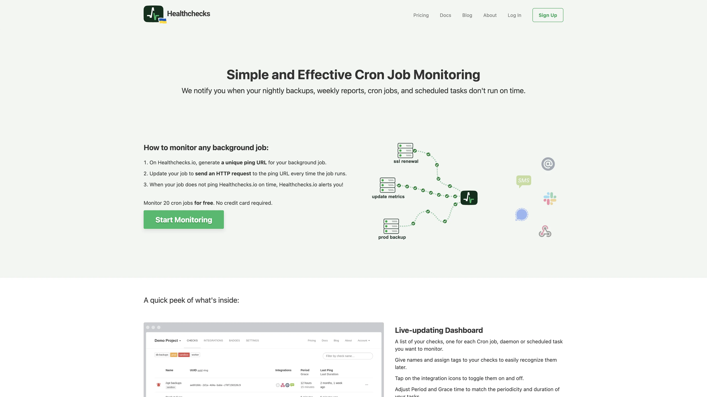

# 在 Sealos 上部署和托管 Healthchecks

Healthchecks 是一个开源的定时任务和后台任务监控平台。每个计划任务都会获得独立的 Ping URL，任务运行结束后发送一次 HTTP 请求；当 Ping 延迟或缺失时，Healthchecks 会发出告警。本 Sealos 模板运行 Healthchecks 5.0.3，使用持久化存储保存 SQLite 数据库，并根据部署输入创建管理员账户。



## 托管 Healthchecks 简介

Healthchecks 是一个由 Gunicorn 提供服务的 Django 应用。项目用于组织相关检查，每个检查定义计划、宽限期、集成方式和状态页可见性。仪表盘展示当前状态、最近一次 Ping 时间和即将触发的告警，每个项目都可以发布状态页和徽章。

本模板运行一个 StatefulSet，使用官方 `healthchecks/healthchecks:v5.0.3` 镜像并监听 `8000` 端口。SQLite 数据库位于持久卷上的 `/data/hc.sqlite`，因此项目、检查、Ping 历史和集成配置在 Pod 重启与重新部署后保持不变。

初始化容器负责执行 Django 数据库迁移，并根据 `admin_email` 和 `admin_password` 创建超级用户。模板关闭公开注册和调试模式，将 `SITE_ROOT` 与 `ALLOWED_HOSTS` 固定为生成的 HTTPS 域名，并启动两个 Gunicorn Worker。

## 常见使用场景

- **定时任务监控**：发现遗漏的夜间备份、报表任务和计划维护脚本。
- **后台任务心跳**：通过心跳 Ping 跟踪队列消费者、同步守护进程和批处理流水线。
- **分布式设备**：边缘设备或本地 Agent 停止上报时及时收到告警。
- **团队状态页**：为内部或公网受众发布项目状态页和徽章。
- **故障通知路由**：将失败事件转发到 Slack、Discord、Telegram、PagerDuty、ntfy 或自定义 Webhook。

## 托管 Healthchecks 的依赖

模板包含 Healthchecks StatefulSet、1Gi 持久卷、数据库初始化容器、Service、HTTPS Ingress 和 Sealos 应用入口。客户端只需要浏览器和管理员凭据。

### 部署依赖

- [Healthchecks 官网](https://healthchecks.io/) - 产品介绍和托管服务
- [Healthchecks 文档](https://healthchecks.io/docs/) - 配置和使用指南
- [Healthchecks Docker 指南](https://healthchecks.io/docs/self_hosted_docker/) - 容器部署和环境变量
- [Healthchecks 代码仓库](https://github.com/healthchecks/healthchecks) - 源代码和版本说明
- [Healthchecks 容器镜像](https://hub.docker.com/r/healthchecks/healthchecks) - 模板使用的官方镜像

## 实现细节

**架构组件：**

- **Healthchecks StatefulSet**：单副本运行 `healthchecks/healthchecks:v5.0.3`，Gunicorn 监听 `8000` 端口。
- **数据库初始化容器**：执行 `manage.py migrate`，并在账户不存在时根据部署输入创建超级用户。
- **数据卷**：1Gi 持久卷挂载到 `/data`，保存 `hc.sqlite`，包含用户、项目、检查、Ping 历史和集成配置。
- **Service**：ClusterIP `80` 端口转发到 Gunicorn 端口。
- **Ingress**：Sealos 管理的 HTTPS 域名，配置 32Mi 请求体上限、300 秒代理超时和 30 天静态资源缓存。
- **应用入口**：从 Sealos 桌面打开 Healthchecks 仪表盘。

**配置：**

- **镜像**：`healthchecks/healthchecks:v5.0.3`
- **Web 端口**：`8000`
- **管理员邮箱**：部署输入 `admin_email`，默认 `admin@example.com`
- **管理员密码**：部署输入 `admin_password`
- **规范地址**：`SITE_ROOT=https://<生成的域名>`
- **允许主机**：`ALLOWED_HOSTS=<生成的域名>`
- **注册开关**：通过 `REGISTRATION_OPEN=False` 关闭
- **调试模式**：通过 `DEBUG=False` 关闭
- **Worker 数量**：两个 Gunicorn Worker
- **时区**：`Asia/Shanghai`
- **持久化**：1Gi 数据卷挂载到 `/data`
- **健康检查**：对 `/` 发起 HTTP 启动、就绪和存活探针，并携带公网 Host 头

**资源分配：**

| 组件 | CPU 请求 | CPU 上限 | 内存请求 | 内存上限 | 存储 |
| --- | ---: | ---: | ---: | ---: | ---: |
| Healthchecks | 20m | 200m | 51Mi | 512Mi | 1Gi 数据卷 |
| 数据库初始化容器 | 20m | 200m | 51Mi | 512Mi | 共享数据卷 |

该配置通过冷启动、管理员登录、创建项目、创建检查和实时 Ping 验证，重启次数为零。仪表盘加载后，两个 Gunicorn Worker 的内存占用稳定在约 270Mi。

## 为什么在 Sealos 上部署 Healthchecks

Sealos 是构建在 Kubernetes 之上的 AI 辅助云操作系统，将部署、网络、存储和运维整合在一个界面中。在 Sealos 上部署 Healthchecks 可以获得：

- **一键部署**：无需手工组装 StatefulSet、Service、Ingress 和持久化存储。
- **自动 HTTPS**：为仪表盘、Ping 端点和状态页提供托管域名和 TLS 证书。
- **持久化历史**：用户、检查、Ping 历史和集成配置保存在独立数据卷中。
- **凭据可预期**：首次启动时根据部署输入创建管理员账户。
- **托管运行时**：Django、Gunicorn 和 SQLite 运行在具备健康探针和重启处理的 Kubernetes 基础上。
- **Sealos 运维能力**：通过 Canvas 或 Sealos AI 对话查看 Pod、日志、存储和资源使用情况。

## 部署指南

1. 打开 [Healthchecks 模板](https://sealos.io/products/app-store/healthchecks)，点击 **Deploy Now**。
2. 输入管理员邮箱和密码，确认生成的应用名称和域名。
3. 等待部署完成，通常需要 2-3 分钟。首次启动会执行数据库迁移并创建管理员用户。
4. 打开公网地址，使用管理员凭据登录。
5. 创建项目，点击 **Add Check**，为任务设置计划和宽限期。
6. 复制生成的 Ping URL，在任务每次运行结束后调用，并确认仪表盘上的 **Last Ping** 已更新。

## 使用 Healthchecks

- **项目**：按应用、团队或环境组织检查，并管理项目成员和集成。
- **检查**：设置简单计划或 Cron 计划、宽限期、标签、描述，并支持手动暂停和恢复。
- **Ping 信号**：使用 `/ping/<uuid>` 表示成功，`/ping/<uuid>/start` 表示任务开始，`/ping/<uuid>/fail` 表示显式失败，`/ping/<uuid>/<exit-status>` 传递数字退出码。
- **集成**：为每个项目添加 Slack、Discord、Telegram、PagerDuty、ntfy、Pushover、Opsgenie 或 Webhook 通知渠道。
- **状态页**：发布项目状态页、绑定自定义域名，并在仪表盘或 README 中嵌入状态徽章。
- **API**：通过 REST API 和项目 API Key 管理检查、通知渠道和 Ping。
- **后台管理**：通过 `/admin/` 管理用户、项目和认证方式。

## 邮件告警与 SMTP

邮件集成需要 SMTP 服务器。在 StatefulSet 环境中添加 `EMAIL_HOST`、`EMAIL_PORT`、`EMAIL_USE_TLS` 或 `EMAIL_USE_SSL`、`EMAIL_HOST_USER`、`EMAIL_HOST_PASSWORD` 和 `DEFAULT_FROM_EMAIL`，然后重启 Pod。Healthchecks 默认通过 `EMAIL_USE_VERIFICATION=True` 验证收件地址，依赖邮件告警前需要完成验证链接。

Webhook、聊天和推送集成无需 SMTP，可以覆盖大多数故障通知场景。

## 扩缩容

Healthchecks 以单副本运行。SQLite 和 ReadWriteOnce 数据卷对应单一写入者，多副本会产生彼此独立的数据库。Ping 数量增长时可以提升 CPU 和内存上限，独立团队和独立环境可以部署各自实例。

## 故障排查

### Pod 持续未就绪且探针请求返回 HTTP 400

`ALLOWED_HOSTS` 会拒绝 Host 头不在列表中的请求。模板固定公网域名，并在 HTTP 探针中携带该 Host 头。修改应用域名时，需要同时更新 `SITE_ROOT` 和 `ALLOWED_HOSTS`，然后重启 Pod。

### 登录后跳转到内部地址

`SITE_ROOT` 需要与公网 HTTPS 地址完全一致。修正该值并重启 Pod。

### 管理员账户未创建

初始化容器仅在邮箱不存在时创建账户。可以从 Pod 内创建新的超级用户：

```bash
cd /opt/healthchecks
./manage.py shell -c "from django.contrib.auth.models import User; User.objects.create_superuser('admin@example.com', 'admin@example.com', 'new-password')"
```

### 邮件告警一直未送达

检查 SMTP 环境变量，查看 Pod 日志中的连接或认证错误，并完成地址验证链接。聊天和 Webhook 集成提供独立的投递通道。

### 仪表盘显示过期的检查状态

仪表盘会周期性刷新状态。刷新页面，确认 Ping URL 返回 HTTP 200，并核对检查的计划和宽限期与任务执行频率一致。

### 数据卷被写满

Ping 历史会随着每次检查持续增长。在 Sealos 资源视图中扩容 PVC，重启 Pod；数据卷已满时，先删除不再使用的项目或检查。

### 获取帮助

- [Healthchecks 文档](https://healthchecks.io/docs/)
- [Healthchecks GitHub 讨论区](https://github.com/healthchecks/healthchecks/discussions)
- [Sealos 文档](https://sealos.io/docs)

## 许可证

Healthchecks 基于 [BSD 3-Clause 许可证](https://github.com/healthchecks/healthchecks/blob/master/LICENSE)发布。本 Sealos 模板遵循 templates 仓库的许可证。
