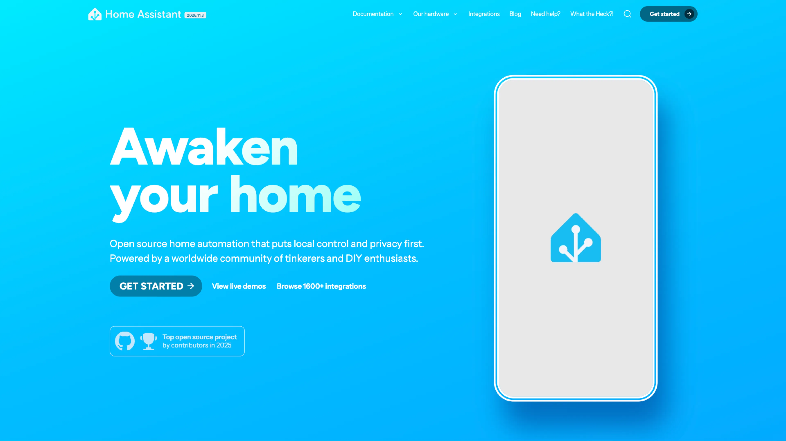

# Deploy and Host Home Assistant on Sealos

Home Assistant is an open-source home automation platform that keeps device control and automation on your own infrastructure. This Sealos template runs Home Assistant 2026.11.3 with a persistent configuration volume and a public HTTPS endpoint.

## About Hosting Home Assistant

Home Assistant provides a dashboard for lights, switches, sensors, climate devices, media players, and other smart-home entities. Automations, scripts, scenes, helpers, and dashboards are managed from the same interface. Integrations connect to local protocols and cloud services.

This template runs one StatefulSet with the official `ghcr.io/home-assistant/home-assistant:2026.11.3` image. Configuration, the SQLite recorder database, and onboarding state live on a 1Gi volume mounted at `/config`. A ClusterIP Service maps port `80` to the container port `8123`, and a Sealos Ingress publishes the interface over HTTPS.

Home Assistant rejects requests from an untrusted reverse proxy. An init container creates `configuration.yaml` with `default_config` and the private address ranges used by the Sealos network, so onboarding and normal access work through the Ingress. The container runs with the root user that the official s6-based image requires.

## Common Use Cases

- **Smart Home Dashboard**: Control lights, climate, media, and sensors from one responsive interface.
- **Local Automation**: Run schedules and device-to-device automations on your own cluster.
- **Protocol Bridges**: Connect Zigbee, Z-Wave, MQTT, Matter, and other integrations through network-attached gateways.
- **Energy Monitoring**: Track consumption from supported meters, inverters, and smart plugs.
- **Remote Access**: Publish a private instance through a managed HTTPS endpoint.

## Dependencies for Home Assistant Hosting

The template includes the Home Assistant StatefulSet, configuration volume, Service, HTTPS Ingress, and Sealos App entry. Smart-home devices and protocol gateways remain external dependencies and are connected from the Home Assistant integrations page.

### Deployment Dependencies

- [Home Assistant official site](https://www.home-assistant.io/) - Product overview and documentation
- [Home Assistant repository](https://github.com/home-assistant/core) - Source code and release notes
- [Home Assistant container image](https://github.com/home-assistant/core/pkgs/container/home-assistant) - Official image used by this template
- [Container installation guide](https://www.home-assistant.io/installation/alternative) - Supported container deployment model
- [Home Assistant integrations](https://www.home-assistant.io/integrations/) - Device and service integration catalog

## Implementation Details

**Architecture Components:**

- **Home Assistant StatefulSet**: One replica running `ghcr.io/home-assistant/home-assistant:2026.11.3` on port `8123`.
- **Configuration volume**: A 1Gi volume mounted at `/config` for YAML, the recorder database, and onboarding state.
- **Proxy configuration init container**: Creates `configuration.yaml` with trusted proxy ranges on first start.
- **Service**: ClusterIP port `80` forwarding to the Home Assistant HTTP port.
- **Ingress**: Sealos-managed HTTPS host with a 32Mi request-body limit and 300-second proxy timeouts.
- **App entry**: Opens the Home Assistant interface from the Sealos desktop.

**Configuration:**

- **Image**: `ghcr.io/home-assistant/home-assistant:2026.11.3`
- **Container port**: `8123`
- **Timezone**: `Asia/Shanghai`
- **Reverse proxy trust**: `10.0.0.0/8`, `172.16.0.0/12`, `192.168.0.0/16`
- **Persistence**: `/config` on a 1Gi volume
- **Health checks**: HTTP startup, readiness, and liveness probes against `/manifest.json`

**Resource Allocation:**

| Component | CPU Request | CPU Limit | Memory Request | Memory Limit | Storage |
| --- | ---: | ---: | ---: | ---: | ---: |
| Home Assistant | 50m | 500m | 102Mi | 1024Mi | 1Gi |
| Proxy init | 10m | 100m | 12Mi | 128Mi | None |

The profile passed a cold start, onboarding, dashboard load, and the HTTP configuration confirmation with 381Mi memory and zero restarts.

## Why Deploy Home Assistant on Sealos?

Sealos is an AI-assisted cloud operating system built on Kubernetes that combines deployment, networking, storage, and operations in one interface. Deploying Home Assistant on Sealos gives you:

- **One-Click Deployment**: Launch Home Assistant without assembling Kubernetes manifests.
- **Automatic HTTPS**: Receive a managed public domain and TLS certificate.
- **Persistent Configuration**: Keep onboarding, dashboards, and the recorder database on a dedicated volume.
- **Reverse Proxy Ready**: Trusted-proxy settings are created automatically for the Sealos network.
- **Validated Runtime**: Use a tested 500m CPU and 1Gi memory profile for a personal smart home.
- **Sealos Operations**: Inspect the StatefulSet, logs, and resource usage from Canvas or the Sealos AI dialog.

## Deployment Guide

1. Open the [Home Assistant template](https://sealos.io/products/app-store/home-assistant) and click **Deploy Now**.
2. Review the generated application name and host, confirm the resource plan, and start the deployment.
3. Wait for deployment to complete, typically in 2-3 minutes. The first image pull can take longer than later starts.
4. Open the public URL. Home Assistant redirects to the onboarding wizard.
5. Create the owner account, set the home location, and choose analytics preferences.
6. Confirm the HTTP server configuration dialog to keep the reverse-proxy settings, then open the dashboard.

## Using Home Assistant

- Add devices from **Settings > Devices & services** and select an integration.
- Create automations from **Settings > Automations & scenes**, with triggers, conditions, and actions.
- Build dashboards from the overview page with **Edit dashboard**.
- Add helpers, scripts, and scenes from the settings pages.
- Review history and logbook entries for entity state changes.
- Back up the configuration volume before major upgrades or integration changes.

## Scaling

Run Home Assistant as a single replica. The configuration volume uses ReadWriteOnce access, and multiple instances would maintain independent state. For larger installations, raise CPU and memory limits, expand the configuration volume, and keep recorder data pruned through the `recorder` integration settings.

## Troubleshooting

### The page returns 400 Bad Request

Home Assistant received a reverse-proxy request without trusted-proxy configuration. Confirm that `/config/configuration.yaml` contains the `http` block with `use_x_forwarded_for: true` and the Sealos private ranges. The init container recreates this file only when it is absent.

### The HTTP configuration dialog appears after onboarding

Confirm the dialog to keep the trusted-proxy settings written by the init container. Selecting **Revert** restores the previous empty configuration and breaks access through the Ingress.

### The dashboard is slow after startup

The first start initializes the recorder database and loads integrations. Wait for the startup probe to pass and check the Pod logs for integration setup progress.

### A device integration cannot be added

Confirm that the device or gateway is reachable from the cluster network. Cloud integrations require outbound internet access; local protocols require a reachable gateway address and open ports.

### The Pod stays Pending

Check that the namespace has 1Gi of available storage for the configuration volume. Review Pod events in Canvas for volume-binding or scheduling errors.

### Getting Help

- [Home Assistant documentation](https://www.home-assistant.io/docs/)
- [Home Assistant community](https://community.home-assistant.io/)
- [Sealos documentation](https://sealos.io/docs)

## License

Home Assistant is licensed under the [Apache License 2.0](https://github.com/home-assistant/core/blob/dev/LICENSE.md). This Sealos template is distributed under the templates repository license.
