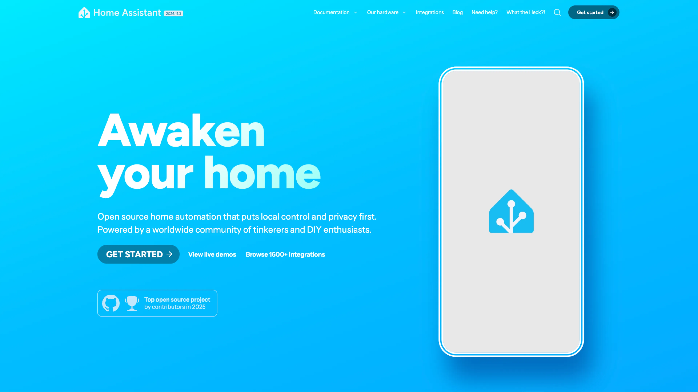

# 在 Sealos 上部署和托管 Home Assistant

Home Assistant 是开源家庭自动化平台，将设备控制和自动化运行在自有基础设施上。本 Sealos 模板运行 Home Assistant 2026.11.3，提供持久化配置卷和公网 HTTPS 入口。

## 关于 Home Assistant 托管

Home Assistant 提供统一仪表盘，用于管理灯光、开关、传感器、空调、媒体播放器等智能家居实体。自动化、脚本、场景、辅助元素和仪表盘都在同一界面中配置。集成可以连接本地协议与云服务。

本模板运行一个 StatefulSet，使用官方 `ghcr.io/home-assistant/home-assistant:2026.11.3` 镜像。配置、SQLite 记录数据库和 onboarding 状态保存在挂载到 `/config` 的 1Gi 卷上。ClusterIP Service 将 `80` 端口映射到容器 `8123` 端口，Sealos Ingress 通过 HTTPS 发布界面。

Home Assistant 会拒绝来自未信任反向代理的请求。初始化容器会创建包含 `default_config` 和 Sealos 网络私有地址段的 `configuration.yaml`，确保 onboarding 与日常访问可以通过 Ingress 工作。容器使用官方 s6 镜像要求的 root 用户运行。

## 常见使用场景

- **智能家居仪表盘**：在一个响应式界面中控制灯光、空调、媒体和传感器。
- **本地自动化**：在自有集群上运行定时任务和设备联动。
- **协议桥接**：通过网络网关接入 Zigbee、Z-Wave、MQTT、Matter 等集成。
- **能耗监测**：跟踪支持的电表、逆变器和智能插座数据。
- **远程访问**：通过托管 HTTPS 地址访问私有实例。

## Home Assistant 托管依赖

模板包含 Home Assistant StatefulSet、配置卷、Service、HTTPS Ingress 和 Sealos App 入口。智能家居设备与协议网关属于外部依赖，通过 Home Assistant 集成页面连接。

### 部署依赖

- [Home Assistant 官网](https://www.home-assistant.io/) - 产品介绍与文档
- [Home Assistant 仓库](https://github.com/home-assistant/core) - 源代码与发布记录
- [Home Assistant 容器镜像](https://github.com/home-assistant/core/pkgs/container/home-assistant) - 本模板使用的官方镜像
- [容器安装指南](https://www.home-assistant.io/installation/alternative) - 支持的容器部署方式
- [Home Assistant 集成列表](https://www.home-assistant.io/integrations/) - 设备与服务集成目录

## 实现细节

**架构组件：**

- **Home Assistant StatefulSet**：单副本运行 `ghcr.io/home-assistant/home-assistant:2026.11.3`，监听 `8123` 端口。
- **配置卷**：1Gi 卷挂载到 `/config`，保存 YAML、记录数据库和 onboarding 状态。
- **代理配置初始化容器**：首次启动时创建包含可信代理地址段的 `configuration.yaml`。
- **Service**：ClusterIP 的 `80` 端口转发到 Home Assistant HTTP 端口。
- **Ingress**：Sealos 管理的 HTTPS 域名，请求体上限 32Mi，代理超时 300 秒。
- **App 入口**：从 Sealos 桌面直接打开 Home Assistant 界面。

**配置：**

- **镜像**：`ghcr.io/home-assistant/home-assistant:2026.11.3`
- **容器端口**：`8123`
- **时区**：`Asia/Shanghai`
- **反向代理信任**：`10.0.0.0/8`、`172.16.0.0/12`、`192.168.0.0/16`
- **持久化**：`/config` 挂载 1Gi 卷
- **健康检查**：对 `/manifest.json` 执行 HTTP 启动、就绪和存活探针

**资源分配：**

| 组件 | CPU 请求 | CPU 限制 | 内存请求 | 内存限制 | 存储 |
| --- | ---: | ---: | ---: | ---: | ---: |
| Home Assistant | 50m | 500m | 102Mi | 1024Mi | 1Gi |
| 代理初始化容器 | 10m | 100m | 12Mi | 128Mi | 无 |

该规格通过了冷启动、onboarding、仪表盘加载和 HTTP 配置确认。内存峰值为 381Mi，Pod 重启次数为 0。

## 为什么在 Sealos 上部署 Home Assistant？

Sealos 是构建在 Kubernetes 之上的 AI 辅助云操作系统，将部署、网络、存储和运维统一在一个界面中。在 Sealos 上部署 Home Assistant 可以带来：

- **一键部署**：无需组装 Kubernetes 清单即可启动 Home Assistant。
- **自动 HTTPS**：自动获得公网域名和 TLS 证书。
- **持久化配置**：onboarding、仪表盘和记录数据库保存在独立卷上。
- **反向代理就绪**：自动为 Sealos 网络创建可信代理设置。
- **经验证的运行规格**：使用经过测试的 500m CPU 与 1Gi 内存配置运行个人智能家居。
- **Sealos 运维**：在 Canvas 或 Sealos AI 对话中查看 StatefulSet、日志和资源用量。

## 部署指南

1. 打开 [Home Assistant 模板](https://sealos.io/products/app-store/home-assistant)，点击 **Deploy Now**。
2. 检查自动生成的应用名称和域名，确认资源规格后开始部署。
3. 等待部署完成，通常需要 2-3 分钟。首次拉取镜像可能比后续启动更久。
4. 打开公网地址，Home Assistant 会跳转到 onboarding 向导。
5. 创建 owner 账号，设置家庭位置，并选择分析数据偏好。
6. 在 HTTP 服务器配置对话框中点击确认以保留反向代理设置，然后进入仪表盘。

## 使用 Home Assistant

- 在 **设置 > 设备与服务** 中添加设备并选择集成。
- 在 **设置 > 自动化与场景** 中创建包含触发器、条件和动作的自动化。
- 在概览页面通过 **编辑仪表盘** 构建卡片布局。
- 在设置页面添加辅助元素、脚本和场景。
- 通过历史与活动页面查看实体状态变化。
- 重大升级或集成调整前备份配置卷。

## 扩缩容

Home Assistant 以单副本运行。配置卷使用 ReadWriteOnce 访问模式，多实例会维护彼此独立的状态。规模增长时提高 CPU 和内存限制、扩大配置卷，并通过 `recorder` 集成设置控制记录数据保留周期。

## 故障排查

### 页面返回 400 Bad Request

Home Assistant 收到反向代理请求但缺少可信代理配置。确认 `/config/configuration.yaml` 包含 `http` 段，并设置 `use_x_forwarded_for: true` 与 Sealos 私有地址段。初始化容器仅在文件不存在时重新创建该文件。

### onboarding 后出现 HTTP 配置对话框

点击确认以保留初始化容器写入的可信代理设置。选择 **还原** 会恢复之前的空配置，并导致 Ingress 访问失败。

### 启动后仪表盘响应缓慢

首次启动会初始化记录数据库并加载集成。等待启动探针通过，并在 Pod 日志中查看集成初始化进度。

### 无法添加设备集成

确认设备或网关可以从集群网络访问。云集成需要出站互联网访问；本地协议需要可达的网关地址和开放端口。

### Pod 一直处于 Pending

确认命名空间有 1Gi 可用存储供配置卷使用。在 Canvas 中查看 Pod 事件中的卷绑定或调度错误。

### 获取帮助

- [Home Assistant 文档](https://www.home-assistant.io/docs/)
- [Home Assistant 社区](https://community.home-assistant.io/)
- [Sealos 文档](https://sealos.io/docs)

## 许可证

Home Assistant 使用 [Apache License 2.0](https://github.com/home-assistant/core/blob/dev/LICENSE.md) 许可证。本 Sealos 模板遵循 templates 仓库许可证。
