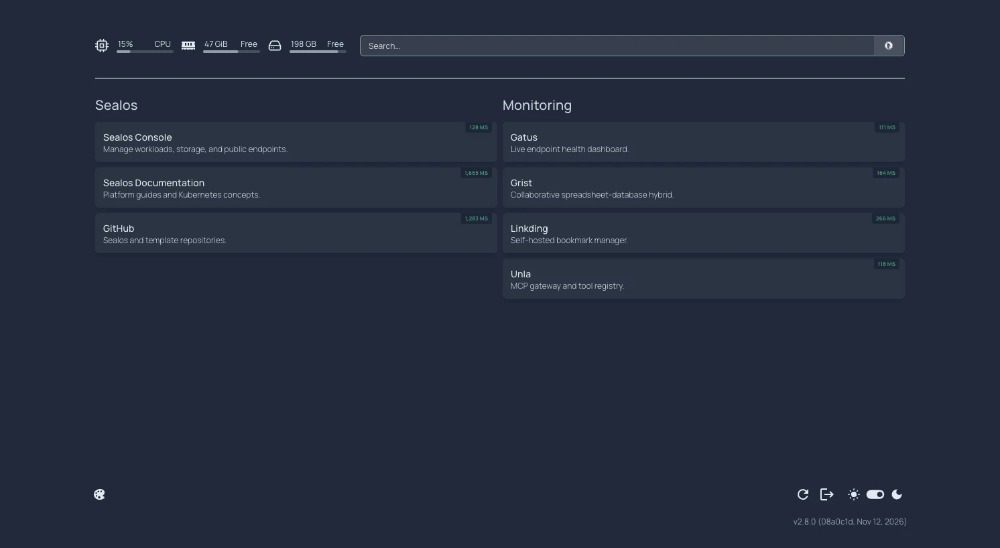

# Deploy and Host Homepage on Sealos

Homepage is a customizable, self-hosted dashboard for services, bookmarks, infrastructure widgets, and homelab operations. This template deploys Homepage v2.8.0 as a single StatefulSet with password-protected access, seeded service groups, and a 1Gi configuration volume.

## About Hosting Homepage

Homepage runs as one Node.js service on port `3000`. The interface is built from YAML files under `/app/config`: `settings.yaml`, `services.yaml`, `bookmarks.yaml`, `widgets.yaml`, `docker.yaml`, `kubernetes.yaml`, and `proxmox.yaml`. The template seeds these files on first boot and leaves later edits untouched.

The template enables the built-in login page with a generated authentication secret and a password supplied during deployment. `HOMEPAGE_ALLOWED_HOSTS` is pinned to the generated public host so the health check and browser requests pass the host validation.

Sealos provisions the StatefulSet, 1Gi configuration volume, ClusterIP Service, Ingress, TLS certificate, and App card. The default dashboard includes Sealos and Monitor groups with links to the Sealos console, documentation, website, and GitHub organization.

## Common Use Cases

- **Homelab launchpad**: Put every self-hosted service, admin panel, and bookmark on one page.
- **Service status board**: Use `siteMonitor` entries to show whether linked services respond.
- **Team resource hub**: Group internal tools, documentation, and dashboards by project or department.
- **Infrastructure overview**: Add widgets for CPU, memory, disks, containers, and Kubernetes clusters.
- **Personal start page**: Keep frequently used links and bookmarks in a fast, themeable interface.

## Dependencies for Homepage Hosting

- A Sealos workspace with at least 512Mi of available memory and 1Gi of persistent storage.
- A browser for the dashboard and the generated login page.
- Outbound HTTPS access for `siteMonitor` checks, remote icons, and external widgets.
- Optional API credentials for widgets that query third-party services.

### Deployment Dependencies

- [Homepage website](https://gethomepage.dev) - Product overview and widget catalog
- [Homepage documentation](https://gethomepage.dev/configs/) - Configuration file reference
- [Homepage services guide](https://gethomepage.dev/configs/services/) - Service and group syntax
- [Homepage authentication guide](https://gethomepage.dev/configs/authentication/) - Password and secret settings
- [Homepage GitHub repository](https://github.com/gethomepage/homepage) - Source code and releases
- [Homepage container image](https://github.com/gethomepage/homepage/pkgs/container/homepage) - Image used by this template
- [Sealos documentation](https://sealos.io/docs) - Platform concepts and operations

## Implementation Details

**Architecture Components:**

- **Homepage StatefulSet**: One replica running `ghcr.io/gethomepage/homepage:v2.8.0` on port `3000`.
- **Configuration volume**: A 1Gi volume mounted at `/app/config` for settings, services, bookmarks, widgets, and integration files.
- **Bootstrap ConfigMap and init container**: The `bootstrap-config` init container runs `/bootstrap/bootstrap.sh` and copies each of the seven configuration files only when it is missing.
- **Service**: ClusterIP port `80` forwarding to the Homepage HTTP port.
- **Ingress**: Sealos-managed HTTPS host with a 32Mi request body limit and 300-second proxy timeouts.
- **App entry**: Opens the authenticated Homepage dashboard.

**Configuration:**

- **Image**: `ghcr.io/gethomepage/homepage:v2.8.0`
- **HTTP port**: `3000`
- **Configuration path**: `/app/config`
- **Public URL**: `https://${{ defaults.app_host }}.${{ SEALOS_CLOUD_DOMAIN }}/`
- **Allowed host**: `${{ defaults.app_host }}.${{ SEALOS_CLOUD_DOMAIN }}`
- **Authentication**: Enabled with `HOMEPAGE_AUTH_ENABLED=true`
- **Password**: Required input `admin_password`, passed as `HOMEPAGE_AUTH_PASSWORD`
- **Session secret**: Generated `auth_secret`, passed as `HOMEPAGE_AUTH_SECRET`
- **Health probe**: `GET /api/healthcheck` with the configured Host header
- **Default groups**: `Sealos` and `Monitor`
- **Runtime user**: UID `1000`, GID `1000`, with all Linux capabilities dropped and the `RuntimeDefault` seccomp profile
- **Timezone**: `Asia/Shanghai`

**Resource Allocation:**

| Component | CPU Request | CPU Limit | Memory Request | Memory Limit | Storage |
| --- | ---: | ---: | ---: | ---: | ---: |
| Homepage | 50m | 500m | 51Mi | 512Mi | 1Gi |
| Homepage bootstrap init container | 50m | 500m | 12Mi | 128Mi | Shared 1Gi |

The live Sealos test signed in with the configured password, rendered the seeded service groups and `siteMonitor` results, and kept the session valid after a Pod restart. The Pod stayed ready with this profile, and the tested values are recorded in the workload annotation.

## Why Deploy Homepage on Sealos?

Sealos is an AI-assisted cloud operating system built on Kubernetes. It supplies the compute, storage, networking, and operations layer for Homepage through one interface:

- **One-click deployment**: Create the StatefulSet, configuration volume, Service, Ingress, and App card from one template.
- **Persistent configuration**: Keep dashboard YAML files on a dedicated volume across restarts and updates.
- **Managed HTTPS**: Receive a public domain and TLS certificate for the dashboard.
- **Password protection**: Gate the dashboard with a deployment password and a generated session secret.
- **Seeded content**: Start with working Sealos and Monitor groups, then extend them for your services.
- **Operational visibility**: Inspect Pods, logs, events, and resource usage from Canvas or the Sealos AI dialog.

## Deployment Guide

1. Open the [Homepage template](https://sealos.io/products/app-store/homepage) and click **Deploy Now**.
2. Enter a strong dashboard password, save it, and confirm the generated application name.
3. Submit the deployment and wait 2-3 minutes for the Pod to become ready and for the HTTPS certificate to be issued.
4. Open the App card and sign in with the configured password.
5. Confirm that the **Sealos** and **Monitor** groups render with their links and `siteMonitor` status.
6. Edit the YAML files from the resource card or a terminal to add your own groups, services, and widgets.
7. Restart the StatefulSet after configuration changes so Homepage reloads the files.

## Using Homepage

The top-level layout comes from `settings.yaml`, and each group in `services.yaml` becomes a section of cards. A card supports `href`, `description`, `icon`, and `siteMonitor`; Homepage probes the monitor URL and colors the card status. Bookmarks live in `bookmarks.yaml`, and widgets are declared per service or in `widgets.yaml`.

The default dashboard links to the Sealos console, documentation, website, and GitHub organization. Replace those entries with your own services, or add new groups while keeping the existing list structure.

## Login and Access

The public URL opens the Homepage login page. Enter the password supplied during deployment; the template uses one shared password for the dashboard. The session secret is generated once and stored in the Deployment environment.

Changing `HOMEPAGE_AUTH_PASSWORD` or `HOMEPAGE_AUTH_SECRET` from the resource card requires a Pod restart. Existing browser sessions end when the secret changes, so sign in again after the restart.

## Scaling

Homepage runs one replica because it reads a ReadWriteOnce configuration volume. Scale vertically by raising the CPU and memory limits when you add many widgets, large icon sets, or frequent health checks.

The 1Gi volume holds YAML configuration and cached assets from widgets. Expand the PVC when the volume fills, provided the storage class supports expansion. Horizontal scaling needs a shared read-write-many volume and a shared authentication secret, which this single-replica template does not configure.

## Troubleshooting

### The dashboard page is blank

- Cause: `services.yaml` uses an object at the top level, and Homepage expects a list of group mappings.
- Solution: Keep the top level as a YAML list with entries such as `- Sealos:` and `- Monitor:`, then restart the StatefulSet.

### The browser shows 403 Forbidden or a host error

- Cause: The request Host header differs from `HOMEPAGE_ALLOWED_HOSTS`, often after a custom domain change.
- Solution: Update `HOMEPAGE_ALLOWED_HOSTS` and `HOMEPAGE_EXTERNAL_URL` to the new host, then restart the Pod.

### Widgets or site monitors stay offline

- Cause: The Pod cannot reach the target URL, or a widget credential is missing or expired.
- Solution: Test the URL from a Pod in the namespace, confirm cluster egress, and verify the widget API key and endpoint.

### Configuration edits disappear after a redeploy

- Cause: The bootstrap script copies a default file only when the target file is missing.
- Solution: Edit the files on the `/app/config` volume through the resource card or a terminal, and keep the same PVC across updates.

### The login page rejects the password

- Cause: The Deployment still uses an earlier password, or the Pod has not restarted after an environment change.
- Solution: Compare `HOMEPAGE_AUTH_PASSWORD` with the value you saved, update it, and restart the StatefulSet.

### Getting Help

- [Homepage documentation](https://gethomepage.dev/configs/)
- [Homepage GitHub issues](https://github.com/gethomepage/homepage/issues)
- [Homepage Discord](https://discord.gg/CkD5QKheF5)
- [Sealos documentation](https://sealos.io/docs)

## License

Homepage is released under the [GNU General Public License v3.0](https://github.com/gethomepage/homepage/blob/main/LICENSE). This Sealos template is an independent deployment definition and is distributed under the templates repository license.
