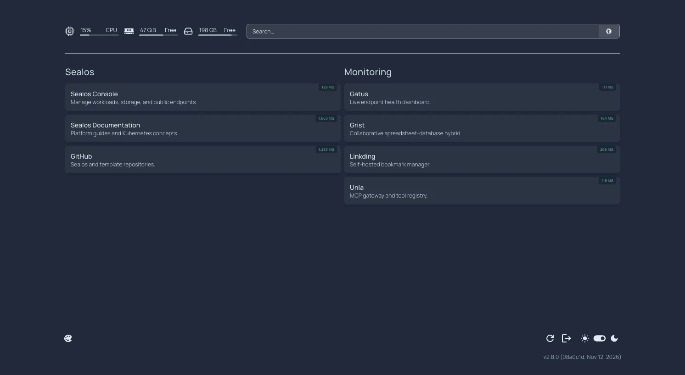

# 在 Sealos 上部署和托管 Homepage

Homepage 是一款可定制的自托管服务导航面板，用于聚合服务、书签、基础设施组件和家庭实验室运维信息。本模板将 Homepage v2.8.0 部署为单个 StatefulSet，提供密码保护、预置服务分组和 1Gi 配置卷。

## 关于托管 Homepage

Homepage 以单个 Node.js 服务运行，监听 `3000` 端口。界面由 `/app/config` 下的 YAML 文件构建：`settings.yaml`、`services.yaml`、`bookmarks.yaml`、`widgets.yaml`、`docker.yaml`、`kubernetes.yaml` 和 `proxmox.yaml`。模板在首次启动时写入这些文件，后续编辑会保留。

模板启用内置登录页，使用生成的认证密钥和部署时填写的密码。`HOMEPAGE_ALLOWED_HOSTS` 固定为生成的公网主机名，健康检查和浏览器请求可以通过主机校验。

Sealos 负责创建 StatefulSet、1Gi 配置卷、ClusterIP Service、Ingress、TLS 证书和应用卡片。默认面板包含 Sealos 和 Monitor 分组，链接到 Sealos 控制台、文档、官网和 GitHub 组织。

## 常见使用场景

- **家庭实验室入口**：将全部自托管服务、管理面板和书签放在一个页面。
- **服务状态面板**：通过 `siteMonitor` 显示关联服务是否可访问。
- **团队资源中心**：按项目或部门组织内部工具、文档和仪表盘。
- **基础设施概览**：添加 CPU、内存、磁盘、容器和 Kubernetes 集群组件。
- **个人起始页**：在快速、可换主题的界面中保存常用链接和书签。

## Homepage 托管依赖

- 一个 Sealos 工作空间，至少提供 512Mi 可用内存和 1Gi 持久存储。
- 用于面板和登录页的浏览器。
- 可选出站 HTTPS 访问，用于 `siteMonitor` 检查、远程图标和外部组件。
- 可选的第三方服务 API 凭据，用于查询数据的组件。

### 部署依赖

- [Homepage 官网](https://gethomepage.dev) - 产品介绍和组件目录
- [Homepage 配置文档](https://gethomepage.dev/configs/) - 配置文件参考
- [Homepage 服务配置指南](https://gethomepage.dev/configs/services/) - 服务和分组语法
- [Homepage 认证指南](https://gethomepage.dev/configs/authentication/) - 密码和密钥设置
- [Homepage GitHub 仓库](https://github.com/gethomepage/homepage) - 源码和版本发布
- [Homepage 容器镜像](https://github.com/gethomepage/homepage/pkgs/container/homepage) - 本模板使用的镜像
- [Sealos 文档](https://sealos.io/docs) - 平台概念和操作说明

## 实现细节

**架构组件：**

- **Homepage StatefulSet**：一个副本，运行 `ghcr.io/gethomepage/homepage:v2.8.0`，监听 `3000` 端口。
- **配置卷**：1Gi，挂载到 `/app/config`，保存设置、服务、书签、组件和集成配置。
- **启动 ConfigMap 和初始化容器**：`bootstrap-config` 初始化容器运行 `/bootstrap/bootstrap.sh`，仅在目标文件缺失时复制七个配置文件。
- **Service**：ClusterIP 端口 `80`，转发到 Homepage 的 HTTP 端口。
- **Ingress**：Sealos 托管的 HTTPS 域名，请求体上限 32Mi，代理超时 300 秒。
- **应用入口**：打开受密码保护的 Homepage 仪表盘。

**配置：**

- **镜像**：`ghcr.io/gethomepage/homepage:v2.8.0`
- **HTTP 端口**：`3000`
- **配置路径**：`/app/config`
- **公网地址**：`https://${{ defaults.app_host }}.${{ SEALOS_CLOUD_DOMAIN }}/`
- **允许的主机**：`${{ defaults.app_host }}.${{ SEALOS_CLOUD_DOMAIN }}`
- **身份认证**：通过 `HOMEPAGE_AUTH_ENABLED=true` 启用
- **密码**：必填输入 `admin_password`，写入 `HOMEPAGE_AUTH_PASSWORD`
- **会话密钥**：生成的 `auth_secret`，写入 `HOMEPAGE_AUTH_SECRET`
- **健康检查**：`GET /api/healthcheck`，携带配置的主机头
- **默认分组**：`Sealos` 和 `Monitor`
- **运行用户**：UID `1000`、GID `1000`，移除全部 Linux capabilities，启用 `RuntimeDefault` seccomp 配置
- **时区**：`Asia/Shanghai`

**资源分配：**

| 组件 | CPU 请求 | CPU 限制 | 内存请求 | 内存限制 | 存储 |
| --- | ---: | ---: | ---: | ---: | ---: |
| Homepage | 50m | 500m | 51Mi | 512Mi | 1Gi |
| Homepage 启动初始化容器 | 50m | 500m | 12Mi | 128Mi | 共享 1Gi |

Sealos 实测使用配置的密码登录，渲染出预置服务分组和 `siteMonitor` 结果，Pod 重启后会话仍有效。Pod 使用该配置保持就绪，实测数值已写入工作负载注解。

## 为什么在 Sealos 上部署 Homepage？

Sealos 是构建在 Kubernetes 上的 AI 辅助云操作系统，通过统一界面提供 Homepage 所需的计算、存储、网络和运维能力：

- **一键部署**：用一个模板创建 StatefulSet、配置卷、Service、Ingress 和应用卡片。
- **配置持久化**：面板 YAML 文件保存在独立持久卷中，跨重启和更新保留。
- **托管 HTTPS**：为仪表盘提供公网域名和 TLS 证书。
- **密码保护**：使用部署密码和生成的会话密钥保护面板。
- **预置内容**：从可用的 Sealos 和 Monitor 分组开始，再扩展自己的服务。
- **运维可见**：在 Canvas 或 Sealos AI 对话框中查看 Pod、日志、事件和资源使用情况。

## 部署指南

1. 打开 [Homepage 模板](https://sealos.io/products/app-store/homepage)，点击 **Deploy Now**。
2. 输入强密码并保存，确认自动生成的应用名称。
3. 提交部署，等待 2-3 分钟，Pod 进入就绪状态并完成 HTTPS 证书签发。
4. 打开应用卡片，使用配置的密码登录。
5. 确认 **Sealos** 和 **Monitor** 分组正常显示链接和 `siteMonitor` 状态。
6. 通过资源卡片或终端编辑 YAML 文件，添加自己的分组、服务和组件。
7. 修改配置后重启 StatefulSet，让 Homepage 重新加载文件。

## 使用 Homepage

顶层布局由 `settings.yaml` 定义，`services.yaml` 中的每个分组会变成一组服务卡片。卡片支持 `href`、`description`、`icon` 和 `siteMonitor`，Homepage 会探测监控地址并用颜色显示状态。书签保存在 `bookmarks.yaml`，组件可以在服务条目中或 `widgets.yaml` 中声明。

默认面板链接到 Sealos 控制台、文档、官网和 GitHub 组织。可以替换为自有服务，或者保留现有列表结构并添加新分组。

## 登录与访问

公网地址打开 Homepage 登录页。输入部署时填写的密码即可进入面板，模板使用一个共享密码。会话密钥在部署时生成并保存在 Deployment 环境变量中。

在资源卡片中修改 `HOMEPAGE_AUTH_PASSWORD` 或 `HOMEPAGE_AUTH_SECRET` 后需要重启 Pod。密钥变化会使现有浏览器会话失效，重启后重新登录即可。

## 扩缩容

Homepage 读取 ReadWriteOnce 配置卷，因此运行一个副本。添加大量组件、图标集或高频健康检查时，通过提高 CPU 和内存限制纵向扩容。

1Gi 卷保存 YAML 配置和组件缓存资源。卷容量不足时可以扩展 PVC，前提是存储类支持扩容。水平扩容需要共享的 ReadWriteMany 卷和共享认证密钥，本单副本模板未配置这些组件。

## 故障排查

### 面板页面空白

- 原因：`services.yaml` 顶层使用了对象结构，Homepage 需要分组映射组成的列表。
- 处理：保持顶层为 YAML 列表，条目形如 `- Sealos:` 和 `- Monitor:`，然后重启 StatefulSet。

### 浏览器显示 403 Forbidden 或主机错误

- 原因：请求的 Host 头与 `HOMEPAGE_ALLOWED_HOSTS` 不一致，常见于更换自定义域名之后。
- 处理：将 `HOMEPAGE_ALLOWED_HOSTS` 和 `HOMEPAGE_EXTERNAL_URL` 更新为新主机名，然后重启 Pod。

### 组件或站点监控持续离线

- 原因：Pod 无法访问目标地址，或者组件凭据缺失、过期。
- 处理：在命名空间内的 Pod 中测试目标地址，确认集群出站访问，并核对组件 API 密钥和端点。

### 重新部署后配置修改丢失

- 原因：启动脚本仅在目标文件缺失时复制默认文件。
- 处理：通过资源卡片或终端编辑 `/app/config` 卷中的文件，并在更新时保持同一个 PVC。

### 登录页拒绝密码

- 原因：Deployment 仍使用旧密码，或者环境变量修改后 Pod 尚未重启。
- 处理：核对 `HOMEPAGE_AUTH_PASSWORD` 与保存的密码，更新后重启 StatefulSet。

### 获取帮助

- [Homepage 配置文档](https://gethomepage.dev/configs/)
- [Homepage GitHub Issues](https://github.com/gethomepage/homepage/issues)
- [Homepage Discord](https://discord.gg/CkD5QKheF5)
- [Sealos 文档](https://sealos.io/docs)

## 许可证

Homepage 使用 [GNU General Public License v3.0](https://github.com/gethomepage/homepage/blob/main/LICENSE) 发布。本 Sealos 模板是独立部署定义，遵循 templates 仓库许可证。
