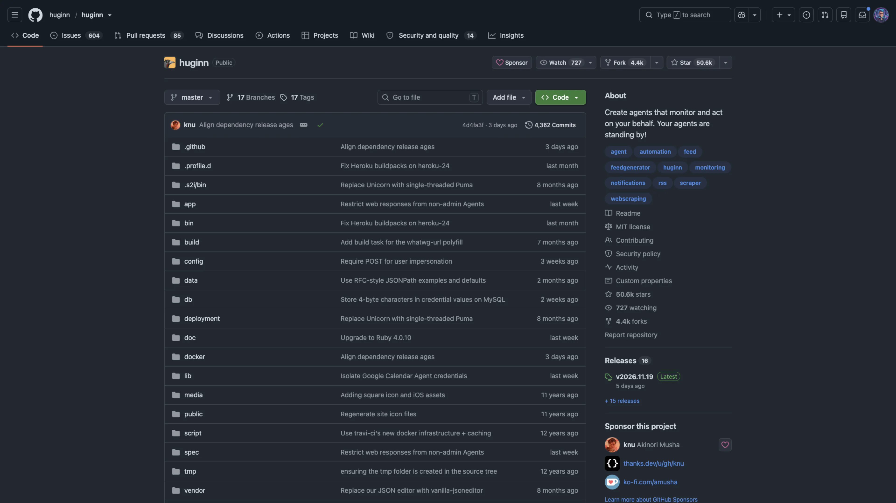

# Deploy and Host Huginn on Sealos

Huginn is a self-hosted automation platform for monitoring events, transforming data, and triggering agent workflows. This Sealos template runs Huginn 2026.11.19 as a single-replica StatefulSet with an embedded MariaDB database, persistent storage, and a public HTTPS interface.

## About Hosting Huginn

Huginn organizes automation around agents. Each agent watches a source, emits events, or consumes events from other agents. Common agents cover websites, RSS feeds, APIs, email, scheduling, JavaScript transformation, and webhook delivery. Events and agent logs are visible in the web interface.

This template runs one StatefulSet with `ghcr.io/huginn/huginn:v2026.11.19` on port `3000`. MariaDB runs inside the same container and stores its data in a 1Gi volume mounted at `/var/lib/mysql`. The template generates `APP_SECRET_TOKEN`, sets the public `DOMAIN`, and seeds an administrator named `admin` with the required `seed_password` input.

The first boot runs Rails database migrations and can take several minutes on a cold volume. The startup probe allows up to 10 minutes. After the Pod is Ready, the Service maps port `80` to the web interface and a Sealos Ingress publishes it over HTTPS.

## Common Use Cases

- **Website and Feed Monitoring**: Watch pages, RSS feeds, and APIs for new content or changes.
- **Alert Routing**: Filter events and forward them to email, chat, or webhook endpoints.
- **Scheduled Data Collection**: Run recurring agents that fetch, transform, and store data.
- **Event Pipelines**: Chain agents so one agent's events become another agent's input.
- **Personal Automation**: Build private monitoring jobs and internal notification flows.

## Dependencies for Huginn Hosting

The template includes the Huginn StatefulSet, an embedded MariaDB database, a 1Gi persistent volume, a Service, an HTTPS Ingress, and the Sealos App entry. No external database or cache is required.

Agents that call external services need outbound network access. Email delivery requires an SMTP provider configured inside Huginn. Webhook targets must be reachable from the Pod.

### Deployment Dependencies

- [Huginn repository](https://github.com/huginn/huginn) - Source code, agent documentation, and examples
- [Huginn Docker guide](https://github.com/huginn/huginn/blob/master/doc/docker/install.md) - Official container deployment reference
- [Huginn container image](https://github.com/huginn/huginn/pkgs/container/huginn) - Image used by this template
- [Huginn wiki](https://github.com/huginn/huginn/wiki) - Agent recipes and operational guides
- [Huginn releases](https://github.com/huginn/huginn/releases) - Version history and changelogs

## Implementation Details

**Architecture Components:**

- **Huginn StatefulSet**: One replica running `ghcr.io/huginn/huginn:v2026.11.19` on port `3000`.
- **Embedded MariaDB**: Runs in the same container and stores data under `/var/lib/mysql`.
- **Persistent volume**: A 1Gi volume at `/var/lib/mysql` for users, agents, events, and credentials.
- **Service and Ingress**: Expose the web interface over public HTTPS.
- **Seed account**: `SEED_USERNAME=admin` and `SEED_PASSWORD` from the required input.

**Configuration:**

- **Image**: `ghcr.io/huginn/huginn:v2026.11.19`
- **Web port**: `3000`
- **Environment**: `RAILS_ENV=production`, generated `APP_SECRET_TOKEN`, public `DOMAIN`
- **Seed credentials**: `admin` plus the `seed_password` input
- **Persistence**: 1Gi ReadWriteOnce volume at `/var/lib/mysql`
- **Startup window**: Up to 10 minutes for first-run migrations
- **Replicas**: `1`

**Resource Allocation:**

| Component | CPU Request | CPU Limit | Memory Request | Memory Limit | Storage |
| --- | ---: | ---: | ---: | ---: | ---: |
| Huginn | 20m | 200m | 204Mi | 2048Mi | 1Gi |

The profile passed a cold start through database migrations, administrator login, Agents page load, and a stability window with zero restarts.

## Why Deploy Huginn on Sealos?

Sealos is an AI-assisted cloud operating system built on Kubernetes that unifies deployment, networking, storage, and operations. Deploying Huginn on Sealos gives you:

- **One-Click Deployment**: Provision the application, embedded database, storage, and HTTPS endpoint from one template.
- **Deterministic Administrator**: Seed the `admin` account with a password supplied at deployment time.
- **Persistent Automation State**: Keep users, agents, events, and credentials across Pod restarts.
- **Canvas and AI Dialog**: Inspect the StatefulSet, Service, Ingress, PVC, logs, and resource cards, and adjust the deployment through the Sealos AI dialog.
- **Pay-as-You-Go Resources**: Start with a validated profile and raise limits as agent volume grows.
- **Kubernetes Reliability**: Use health probes, automated recovery, and declarative resource management.

## Deployment Guide

1. Open the [Huginn template](https://sealos.io/products/app-store/huginn) and click **Deploy Now**.
2. Enter the initial administrator password, review the generated application name, and confirm the resource plan.
3. Wait for deployment to complete, typically in 2-3 minutes after migrations finish. Sealos opens the Canvas after the resources are created.
4. Open the public URL from the Canvas or the App Store entry; the sign-in page is at `/users/sign_in`.
5. Sign in with username `admin` and the password from step 2.
6. Open **Agents**, create a test agent, and confirm that it appears in the agent list.

## Login and Account Setup

Huginn seeds one administrator account at first initialization. The username is `admin`; the password is the exact `seed_password` value from the deployment form. The login field accepts the username, and the sign-in page is `/users/sign_in`.

The seed task applies when the database has no administrator account. Changing the input after initialization leaves the existing password unchanged. Use the account settings to change the password later, or redeploy with a fresh volume for a new seeded account.

## Configuration

- **Agents**: Create agents from **Agents → New Agent**, then connect them through event propagation.
- **Schedules**: Set agent schedules in the agent configuration; the default `0 * * * *` runs hourly.
- **Credentials**: Store API keys and SMTP credentials under **Credentials**.
- **Scenarios**: Group agents into scenarios for bulk control and import/export.
- **Jobs**: Review scheduled and background jobs under **Jobs**.
- **Logs**: Open an agent and inspect its recent events and error log.
- **Persistence**: All state lives in the MariaDB volume at `/var/lib/mysql`.

## Scaling

Keep the template at one replica because MariaDB runs inside the Pod and uses a ReadWriteOnce volume. Increase CPU and memory limits when many agents run frequently, when large event payloads are processed, or when the Rails UI needs more headroom. Expand the 1Gi volume from the StatefulSet resource card when event history and agent logs grow.

## Troubleshooting

### The Pod stays in startup for several minutes

The first boot runs Rails migrations against a new MariaDB volume. Check the Pod logs for migration progress and allow up to the 10-minute startup window. Later restarts are faster.

### The seeded password is rejected

Use the exact `seed_password` value from the deployment form and the username `admin`. The seed applies on first initialization; changing the input later does not reset an existing account.

### An agent does not fire

Check the agent schedule, the **Jobs** page, and the agent log. Confirm that the Pod can reach the external website or API and that credentials are present under **Credentials**.

### Events accumulate without delivery

Review downstream agent configuration and target connectivity. Webhook and email agents report delivery errors in their event logs; fix the endpoint or credentials and retry the event.

### Getting Help

- [Huginn wiki](https://github.com/huginn/huginn/wiki)
- [Huginn issues](https://github.com/huginn/huginn/issues)
- [Sealos documentation](https://sealos.io/docs)

## License

Huginn is licensed under the [MIT License](https://github.com/huginn/huginn/blob/master/LICENSE). This Sealos template is distributed under the templates repository license.
