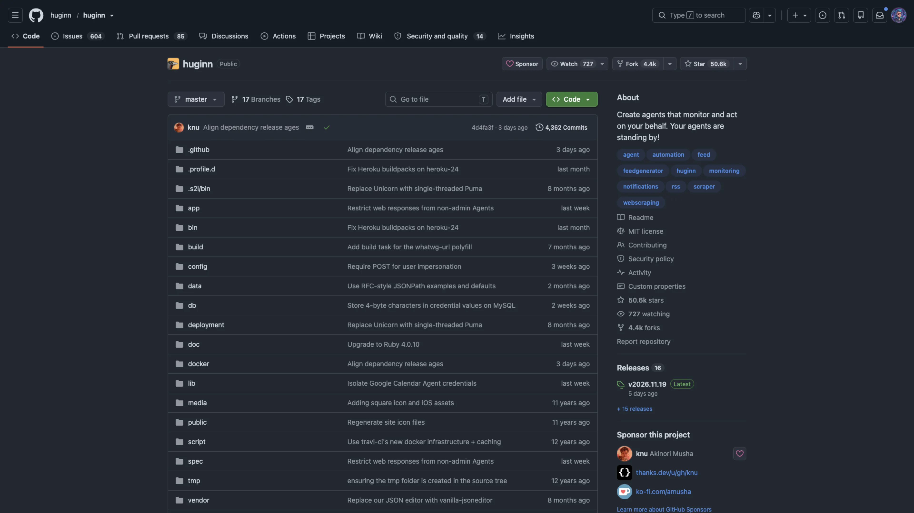

# 在 Sealos 上部署和托管 Huginn

Huginn 是自托管自动化平台，可监控事件、转换数据并触发 Agent 工作流。本 Sealos 模板以单副本 StatefulSet 运行 Huginn 2026.11.19，内置 MariaDB、持久化存储和公网 HTTPS 界面。

## 关于 Huginn 托管

Huginn 以 Agent 组织自动化任务。每个 Agent 可以监控来源、产生事件，或消费其他 Agent 的事件。常见 Agent 覆盖网站、RSS、API、邮件、定时任务、JavaScript 转换和 Webhook 推送。事件与 Agent 日志都可以在 Web 界面查看。

本模板运行一个 StatefulSet，使用 `ghcr.io/huginn/huginn:v2026.11.19` 镜像并监听 `3000` 端口。MariaDB 在同一容器内运行，数据保存在挂载到 `/var/lib/mysql` 的 1Gi 卷。模板自动生成 `APP_SECRET_TOKEN`，设置公网 `DOMAIN`，并通过必填的 `seed_password` 输入创建名为 `admin` 的管理员。

首次启动会执行 Rails 数据库迁移，冷卷下可能需要数分钟，启动探针允许最长 10 分钟。Pod 就绪后，Service 将 `80` 端口映射到 Web 界面，Sealos Ingress 通过 HTTPS 发布。

## 常见使用场景

- **网站与订阅监控**：监控页面、RSS 和 API 的新内容或变更。
- **告警路由**：筛选事件并转发到邮件、聊天或 Webhook 端点。
- **定时数据采集**：运行周期性 Agent，抓取、转换并保存数据。
- **事件流水线**：串联多个 Agent，让一个 Agent 的事件成为另一个 Agent 的输入。
- **个人自动化**：构建私有监控任务和内部通知流程。

## Huginn 托管依赖

模板包含 Huginn StatefulSet、内置 MariaDB、1Gi 持久卷、Service、HTTPS Ingress 和 Sealos App 入口。该应用不需要外部数据库或缓存。

调用外部服务的 Agent 需要出站网络访问。邮件投递需要在 Huginn 内配置 SMTP 服务，Webhook 目标需要能从 Pod 网络访问。

### 部署依赖

- [Huginn 仓库](https://github.com/huginn/huginn) - 源代码、Agent 文档与示例
- [Huginn Docker 指南](https://github.com/huginn/huginn/blob/master/doc/docker/install.md) - 官方容器部署参考
- [Huginn 容器镜像](https://github.com/huginn/huginn/pkgs/container/huginn) - 本模板使用的镜像
- [Huginn Wiki](https://github.com/huginn/huginn/wiki) - Agent 配方与运维指南
- [Huginn 发布记录](https://github.com/huginn/huginn/releases) - 版本历史与变更日志

## 实现细节

**架构组件：**

- **Huginn StatefulSet**：单副本运行 `ghcr.io/huginn/huginn:v2026.11.19`，监听 `3000` 端口。
- **内置 MariaDB**：在同一容器内运行，数据保存在 `/var/lib/mysql`。
- **持久卷**：1Gi 卷挂载到 `/var/lib/mysql`，保存用户、Agent、事件和凭据。
- **Service 与 Ingress**：通过公网 HTTPS 发布 Web 界面。
- **种子账号**：`SEED_USERNAME=admin`，`SEED_PASSWORD` 来自必填输入。

**配置：**

- **镜像**：`ghcr.io/huginn/huginn:v2026.11.19`
- **Web 端口**：`3000`
- **环境变量**：`RAILS_ENV=production`、自动生成的 `APP_SECRET_TOKEN`、公网 `DOMAIN`
- **种子凭据**：用户名 `admin`，密码来自 `seed_password` 输入
- **持久化**：1Gi ReadWriteOnce 卷，挂载到 `/var/lib/mysql`
- **启动窗口**：首次迁移最长 10 分钟
- **副本数**：`1`

**资源分配：**

| 组件 | CPU 请求 | CPU 限制 | 内存请求 | 内存限制 | 存储 |
| --- | ---: | ---: | ---: | ---: | ---: |
| Huginn | 20m | 200m | 204Mi | 2048Mi | 1Gi |

该规格通过了包含数据库迁移的冷启动、管理员登录、Agents 页面加载和稳定性验证，Pod 重启次数为 0。

## 为什么在 Sealos 上部署 Huginn？

Sealos 是构建在 Kubernetes 之上的 AI 辅助云操作系统，将部署、网络、存储和运维统一在一个界面中。在 Sealos 上部署 Huginn 可以带来：

- **一键部署**：通过一个模板创建应用、内置数据库、存储和 HTTPS 入口。
- **确定的初始管理员**：使用部署时提供的密码创建 `admin` 账号。
- **自动化状态持久化**：在 Pod 重启后保留用户、Agent、事件和凭据。
- **Canvas 与 AI 对话**：在一个视图中查看 StatefulSet、Service、Ingress、PVC、日志和资源卡，并通过 Sealos AI 对话调整部署。
- **按量计费**：从经验证的规格起步，Agent 数量增长后再提高限制。
- **Kubernetes 可靠性**：使用健康探针、自动恢复和声明式资源管理。

## 部署指南

1. 打开 [Huginn 模板](https://sealos.io/products/app-store/huginn)，点击 **Deploy Now**。
2. 输入初始管理员密码，检查自动生成的应用名称，确认资源规格。
3. 等待部署完成，通常需要 2-3 分钟，迁移完成后 Sealos 会打开 Canvas。
4. 从 Canvas 或应用商店入口打开公网地址，登录页面位于 `/users/sign_in`。
5. 使用用户名 `admin` 和第 2 步的密码登录。
6. 打开 **Agents**，创建一个测试 Agent 并确认它出现在列表中。

## 登录与账号设置

Huginn 在首次初始化时创建一个管理员账号。用户名固定为 `admin`，密码为部署表单中填写的 `seed_password` 原始值。登录字段接受用户名，登录页面位于 `/users/sign_in`。

种子任务在数据库中没有管理员账号时执行。初始化完成后修改输入不会改变已有密码。后续可在账号设置中修改密码，或使用新卷重新部署以生成新的种子账号。

## 配置

- **Agent**：在 **Agents → New Agent** 创建 Agent，并通过事件传播连接。
- **调度**：在 Agent 配置中设置执行计划，默认 `0 * * * *` 表示每小时运行。
- **凭据**：在 **Credentials** 保存 API Key 和 SMTP 凭据。
- **场景**：将 Agent 归入 **Scenarios**，便于批量控制和导入导出。
- **任务**：在 **Jobs** 查看定时任务和后台任务。
- **日志**：打开 Agent 查看最近事件和错误日志。
- **持久化**：全部状态保存在 `/var/lib/mysql` 的 MariaDB 卷。

## 扩缩容

模板保持单副本，因为 MariaDB 在 Pod 内运行并使用 ReadWriteOnce 卷。大量 Agent 高频执行、大事件负载或 Rails UI 需要更多余量时，提高 CPU 和内存限制。事件历史和 Agent 日志增长时，从 StatefulSet 资源卡扩展 1Gi 卷。

## 故障排查

### Pod 长时间停留在启动阶段

首次启动会针对新的 MariaDB 卷执行 Rails 迁移。查看 Pod 日志中的迁移进度，并允许使用完整的 10 分钟启动窗口；后续重启会更快。

### 种子密码被拒

使用部署表单中的原始 `seed_password` 和用户名 `admin`。种子任务只在首次初始化时生效，后续修改输入不会重置已有账号。

### Agent 没有触发

检查 Agent 调度、**Jobs** 页面和 Agent 日志，并确认 Pod 能访问外部网站或 API、**Credentials** 中存在所需凭据。

### 事件堆积但没有投递

检查下游 Agent 配置和目标连通性。Webhook 与邮件 Agent 会在事件日志中报告投递错误；修复端点或凭据后重试事件。

### 获取帮助

- [Huginn Wiki](https://github.com/huginn/huginn/wiki)
- [Huginn Issues](https://github.com/huginn/huginn/issues)
- [Sealos 文档](https://sealos.io/docs)

## 许可证

Huginn 使用 [MIT License](https://github.com/huginn/huginn/blob/master/LICENSE) 许可证。本 Sealos 模板遵循 templates 仓库许可证。
