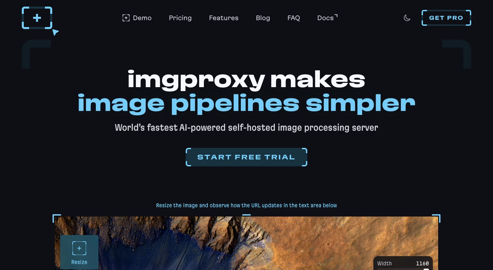

# Deploy and Host imgproxy on Sealos

imgproxy is a fast, secure image processing server that resizes, crops, and converts images on the fly through signed URLs. This template deploys imgproxy v3.31.4 as a stateless Deployment with a managed HTTPS endpoint and deployment-generated signing credentials.



## About Hosting imgproxy

imgproxy runs as one Go service on port `8080`. It accepts a signed URL, downloads the source image, applies the requested processing options, and returns the result in the requested format. The template enables WebP and AVIF conversion through the upstream image codecs and validates every request with the configured key and salt.

The deployment is stateless. Sealos provisions the Deployment, ClusterIP Service, Ingress, TLS certificate, and App card; the App entry opens `/health` so the public URL confirms that the service is running. Source images can live on any HTTP or HTTPS origin reachable from the Pod.

The signing key and salt are deployment inputs. Generate both with `openssl rand -hex 32` and keep them consistent across every client that builds image URLs. Changing either value invalidates previously issued URLs.

## Common Use Cases

- **Responsive images**: Generate width-specific variants for web and mobile clients without pre-rendering every size.
- **Thumbnail service**: Create square or aspect-ratio thumbnails for product catalogs and media libraries.
- **Format conversion**: Serve WebP or AVIF versions of JPEG and PNG sources to reduce bandwidth.
- **Signed image delivery**: Protect image transformations with HMAC signatures and expiring URLs.
- **CDN origin**: Place imgproxy behind a CDN to cache processed variants close to users.
- **User-generated content**: Normalize uploaded images before storing or displaying them.

## Dependencies for imgproxy Hosting

- A Sealos workspace with at least 1Gi of available memory.
- A hex-encoded signing key and salt, generated before deployment.
- Outbound HTTP or HTTPS access from the Pod to every source image origin.
- A client, backend service, or CDN that generates signed imgproxy URLs.

### Deployment Dependencies

- [imgproxy website](https://imgproxy.net) - Product overview and feature comparison
- [imgproxy documentation](https://docs.imgproxy.net) - URL format, signing, and processing options
- [Signing URL guide](https://docs.imgproxy.net/usage/signing_url) - Key, salt, and signature algorithm
- [imgproxy GitHub repository](https://github.com/imgproxy/imgproxy) - Source code and releases
- [imgproxy container image](https://github.com/imgproxy/imgproxy/pkgs/container/imgproxy) - Image used by this template
- [Sealos documentation](https://sealos.io/docs) - Platform concepts and operations

## Implementation Details

**Architecture Components:**

- **imgproxy Deployment**: One replica running `ghcr.io/imgproxy/imgproxy:v3.31.4` on port `8080`.
- **Service**: ClusterIP port `80` forwarding to the imgproxy HTTP port.
- **Ingress**: Sealos-managed HTTPS host with a 32Mi request body limit and 300-second proxy timeouts.
- **App entry**: Opens the `/health` endpoint at the generated public URL.
- **Storage**: None; every request is processed from the source image and returned directly.

**Configuration:**

- **Image**: `ghcr.io/imgproxy/imgproxy:v3.31.4`
- **HTTP port**: `8080`
- **Bind address**: `:8080`
- **Signing key**: Required input `signing_key`, passed as `IMGPROXY_KEY`
- **Signing salt**: Required input `signing_salt`, passed as `IMGPROXY_SALT`
- **Public URL**: `https://${{ defaults.app_host }}.${{ SEALOS_CLOUD_DOMAIN }}/health`
- **Health probe**: `GET /health`
- **URL validation**: HMAC signature on every processing path
- **Runtime user**: UID `999`, GID `999`, with all Linux capabilities dropped and the `RuntimeDefault` seccomp profile
- **Timezone**: `Asia/Shanghai`
- **Storage**: None

**Resource Allocation:**

| Component | CPU Request | CPU Limit | Memory Request | Memory Limit | Storage |
| --- | ---: | ---: | ---: | ---: | ---: |
| imgproxy | 100m | 1 | 102Mi | 1024Mi | None |

The live Sealos test generated two signed URLs and received HTTP `200` with `image/webp` for both. The Pod stayed ready with this profile, and the tested values are recorded in the workload annotation.

## Why Deploy imgproxy on Sealos?

Sealos is an AI-assisted cloud operating system built on Kubernetes. It supplies the compute, networking, and operations layer for imgproxy through one interface:

- **One-click deployment**: Create the Deployment, Service, Ingress, and App card from one template.
- **Managed HTTPS**: Receive a public domain and TLS certificate for image URLs.
- **Signed access**: Validate every transformation with a key and salt from the deployment form.
- **Stateless scaling**: Add replicas with the same signing credentials as traffic grows.
- **Resource control**: Adjust CPU and memory from the resource card for large source images and high request rates.
- **Operational visibility**: Inspect Pods, logs, events, and resource usage from Canvas or the Sealos AI dialog.

## Deployment Guide

1. Open the [imgproxy template](https://sealos.io/products/app-store/imgproxy) and click **Deploy Now**.
2. Generate a key and salt with `openssl rand -hex 32`, enter both values, and confirm the generated application name.
3. Submit the deployment and wait 2-3 minutes for the Pod to become ready and for the HTTPS certificate to be issued.
4. Open the App card. The `/health` page confirms that imgproxy is running.
5. Build a signed URL for a test image and open it in a browser or request it with `curl`.
6. Store the key and salt in your application secret manager so every URL generator uses the same credentials.

## Generating Signed URLs

The signature covers the processing path and uses the salt as the HMAC key. The key and salt values are hex-encoded in the deployment form, so decode them before computing the HMAC. This Python example builds a 400px-wide WebP URL:

```python
import base64
import hashlib
import hmac

key = bytes.fromhex("YOUR_SIGNING_KEY")
salt = bytes.fromhex("YOUR_SIGNING_SALT")
path = "/resize/400/0/plain/https://example.com/photo.jpg@webp"
signature = base64.urlsafe_b64encode(
    hmac.new(salt, path.encode(), hashlib.sha256).digest()
).rstrip(b"=").decode()

print(f"https://YOUR_IMGPROXY_HOST/{signature}{path}")
```

The `key` value is required by imgproxy for signed mode; the salt produces the per-URL signature. Keep both values out of client-side code and generate URLs from a trusted backend.

## Access and Security

imgproxy has no login page. Access control comes from signed URLs: every processing path must carry a valid signature, and requests with a missing or mismatched signature return `403 Forbidden`. The `/health` endpoint stays unsigned so probes and the App card can check process health.

The template serves source images over HTTP or HTTPS from the Pod. Restrict source origins to trusted domains at the network layer, and rotate the key and salt together with every client that generates URLs.

## Scaling

imgproxy is stateless, so the template can scale horizontally. Add replicas from the Deployment resource card and keep the same signing key and salt across every Pod; requests then distribute through the Service without shared storage.

Raise the memory limit for large source images, AVIF encoding, and many concurrent requests. CPU use grows with image dimensions and output format complexity. The template keeps no persistent volume, so a restart only clears in-flight work.

## Troubleshooting

### Requests return 403 Forbidden

- Cause: The signature does not match the path, the key or salt differs from the deployment values, or the URL was generated with the wrong encoding.
- Solution: Recompute the signature over the exact path, decode the hex key and salt, and confirm that the client uses the current values.

### Requests return 404 or a source download error

- Cause: The source image URL is wrong, the origin requires authentication, or the Pod cannot reach the host.
- Solution: Test the source URL from a Pod in the namespace, confirm cluster egress, and use a publicly reachable origin or a signed source URL.

### Requests return 422 for an unsupported format

- Cause: The requested output format or processing option is unavailable in this imgproxy build.
- Solution: Check the option name and format against the documentation, and use WebP, AVIF, JPEG, or PNG options supported by the current image.

### The Pod is killed during large image processing

- Cause: Decoding and encoding a very large image exceeds the 1024Mi memory limit.
- Solution: Raise the memory limit, cap source image dimensions, and pre-validate uploads before sending them to imgproxy.

### `/health` returns 502 through the public URL

- Cause: The Pod is not ready, or the Ingress cannot reach the Service.
- Solution: Check Pod readiness and the Service endpoints, then inspect Ingress events and the imgproxy log.

### Getting Help

- [imgproxy documentation](https://docs.imgproxy.net)
- [Signing URL guide](https://docs.imgproxy.net/usage/signing_url)
- [imgproxy GitHub issues](https://github.com/imgproxy/imgproxy/issues)
- [Sealos documentation](https://sealos.io/docs)

## License

imgproxy is released under the [Apache License 2.0](https://github.com/imgproxy/imgproxy/blob/master/LICENSE). The imgproxy Pro edition is available under a separate commercial license. This Sealos template is an independent deployment definition and is distributed under the templates repository license.
