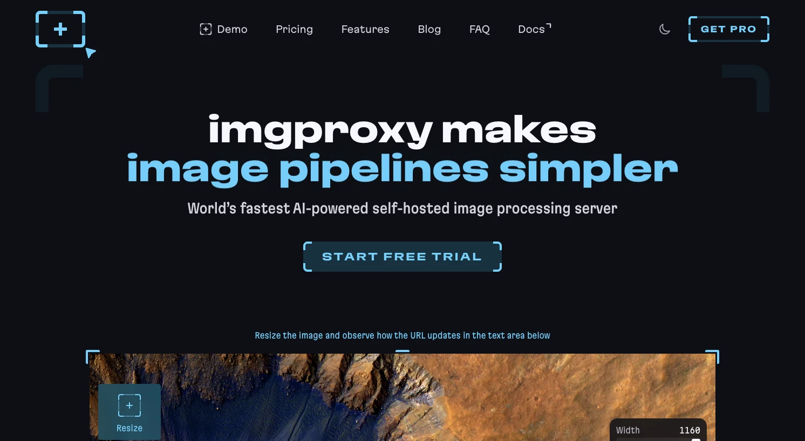

# 在 Sealos 上部署和托管 imgproxy

imgproxy 是一款快速、安全的图像处理服务器，通过签名 URL 实时完成缩放、裁剪和格式转换。本模板将 imgproxy v3.31.4 部署为无状态 Deployment，提供托管 HTTPS 地址和部署时生成的签名凭据。



## 关于托管 imgproxy

imgproxy 以单个 Go 服务运行，监听 `8080` 端口。它接收签名 URL，下载源图片，应用请求的处理参数，并按目标格式返回结果。模板通过上游图像编解码器支持 WebP 和 AVIF 转换，并使用配置的密钥和盐值校验每个请求。

部署是无状态的。Sealos 负责创建 Deployment、ClusterIP Service、Ingress、TLS 证书和应用卡片；应用入口打开 `/health`，用于确认公网地址上的服务正在运行。源图片可以位于 Pod 能够访问的任意 HTTP 或 HTTPS 来源。

签名密钥和盐值是部署输入。使用 `openssl rand -hex 32` 生成两个值，并在所有构建图片 URL 的客户端中保持一致。修改其中任一值会使此前生成的 URL 失效。

## 常见使用场景

- **响应式图片**：为 Web 和移动客户端生成不同宽度的图片变体，无需预先渲染全部尺寸。
- **缩略图服务**：为商品目录和媒体库生成方形或固定宽高比的缩略图。
- **格式转换**：将 JPEG 和 PNG 源图转换为 WebP 或 AVIF，降低带宽消耗。
- **签名图片交付**：使用 HMAC 签名和过期 URL 保护图片处理请求。
- **CDN 源站**：将 imgproxy 放在 CDN 后面，缓存处理后的图片变体。
- **用户生成内容**：在存储或展示前统一规范化上传图片。

## imgproxy 托管依赖

- 一个 Sealos 工作空间，至少提供 1Gi 可用内存。
- 部署前生成的十六进制签名密钥和盐值。
- Pod 到所有源图片地址的出站 HTTP 或 HTTPS 访问。
- 生成 imgproxy 签名 URL 的客户端、后端服务或 CDN。

### 部署依赖

- [imgproxy 官网](https://imgproxy.net) - 产品介绍和功能对比
- [imgproxy 文档](https://docs.imgproxy.net) - URL 格式、签名和处理选项
- [签名 URL 指南](https://docs.imgproxy.net/usage/signing_url) - 密钥、盐值和签名算法
- [imgproxy GitHub 仓库](https://github.com/imgproxy/imgproxy) - 源码和版本发布
- [imgproxy 容器镜像](https://github.com/imgproxy/imgproxy/pkgs/container/imgproxy) - 本模板使用的镜像
- [Sealos 文档](https://sealos.io/docs) - 平台概念和操作说明

## 实现细节

**架构组件：**

- **imgproxy Deployment**：一个副本，运行 `ghcr.io/imgproxy/imgproxy:v3.31.4`，监听 `8080` 端口。
- **Service**：ClusterIP 端口 `80`，转发到 imgproxy 的 HTTP 端口。
- **Ingress**：Sealos 托管的 HTTPS 域名，请求体上限 32Mi，代理超时 300 秒。
- **应用入口**：通过生成的公网地址打开 `/health`。
- **存储**：无，每个请求从源图片处理后直接返回。

**配置：**

- **镜像**：`ghcr.io/imgproxy/imgproxy:v3.31.4`
- **HTTP 端口**：`8080`
- **绑定地址**：`:8080`
- **签名密钥**：必填输入 `signing_key`，写入 `IMGPROXY_KEY`
- **签名盐值**：必填输入 `signing_salt`，写入 `IMGPROXY_SALT`
- **公网地址**：`https://${{ defaults.app_host }}.${{ SEALOS_CLOUD_DOMAIN }}/health`
- **健康检查**：`GET /health`
- **URL 校验**：对每个处理路径执行 HMAC 签名校验
- **运行用户**：UID `999`、GID `999`，移除全部 Linux capabilities，启用 `RuntimeDefault` seccomp 配置
- **时区**：`Asia/Shanghai`
- **存储**：无

**资源分配：**

| 组件 | CPU 请求 | CPU 限制 | 内存请求 | 内存限制 | 存储 |
| --- | ---: | ---: | ---: | ---: | ---: |
| imgproxy | 100m | 1 | 102Mi | 1024Mi | 无 |

Sealos 实测生成了两个签名 URL，均返回 HTTP `200` 和 `image/webp`。Pod 使用该配置保持就绪，实测数值已写入工作负载注解。

## 为什么在 Sealos 上部署 imgproxy？

Sealos 是构建在 Kubernetes 上的 AI 辅助云操作系统，通过统一界面提供 imgproxy 所需的计算、网络和运维能力：

- **一键部署**：用一个模板创建 Deployment、Service、Ingress 和应用卡片。
- **托管 HTTPS**：为图片 URL 提供公网域名和 TLS 证书。
- **签名访问**：使用部署表单中的密钥和盐值校验每次处理请求。
- **无状态扩容**：流量增长时，使用相同签名凭据增加副本。
- **资源可控**：针对大尺寸源图和高请求量，通过资源卡片调整 CPU 和内存。
- **运维可见**：在 Canvas 或 Sealos AI 对话框中查看 Pod、日志、事件和资源使用情况。

## 部署指南

1. 打开 [imgproxy 模板](https://sealos.io/products/app-store/imgproxy)，点击 **Deploy Now**。
2. 使用 `openssl rand -hex 32` 生成密钥和盐值，填入两个输入框，确认自动生成的应用名称。
3. 提交部署，等待 2-3 分钟，Pod 进入就绪状态并完成 HTTPS 证书签发。
4. 打开应用卡片，`/health` 页面确认 imgproxy 正在运行。
5. 为测试图片生成签名 URL，并在浏览器中打开或使用 `curl` 请求。
6. 将密钥和盐值保存到应用密钥管理系统，确保所有 URL 生成器使用相同凭据。

## 生成签名 URL

签名覆盖处理路径，并使用盐值作为 HMAC 密钥。部署表单中的密钥和盐值是十六进制字符串，计算 HMAC 前需要先解码。以下 Python 示例生成 400 像素宽的 WebP URL：

```python
import base64
import hashlib
import hmac

key = bytes.fromhex("YOUR_SIGNING_KEY")
salt = bytes.fromhex("YOUR_SIGNING_SALT")
path = "/resize/400/0/plain/https://example.com/photo.jpg@webp"
signature = base64.urlsafe_b64encode(
    hmac.new(salt, path.encode(), hashlib.sha256).digest()
).rstrip(b"=").decode()

print(f"https://YOUR_IMGPROXY_HOST/{signature}{path}")
```

imgproxy 的签名模式需要 `key` 值，盐值用于生成每个 URL 的签名。将两个值保存在服务端，通过可信后端生成 URL。

## 访问与安全

imgproxy 没有登录页。访问控制来自签名 URL：每个处理路径必须携带有效签名，缺失或不匹配的请求返回 `403 Forbidden`。`/health` 端点保持无签名，供探针和应用卡片检查进程健康。

模板允许 Pod 通过 HTTP 或 HTTPS 读取源图片。在网络层限制可信源站，并在轮换密钥时同步更新所有生成 URL 的客户端。

## 扩缩容

imgproxy 是无状态服务，模板支持水平扩容。在 Deployment 资源卡片中增加副本，并确保每个 Pod 使用相同的签名密钥和盐值；请求通过 Service 分发，无需共享存储。

大尺寸源图、AVIF 编码和高并发请求需要更高的内存限制。CPU 占用随图片尺寸和输出格式复杂度增长。模板未配置持久卷，重启只会清除正在处理的请求。

## 故障排查

### 请求返回 403 Forbidden

- 原因：签名与路径不匹配、密钥或盐值与部署值不一致，或者 URL 编码错误。
- 处理：对完整路径重新计算签名，解码十六进制密钥和盐值，并确认客户端使用当前值。

### 请求返回 404 或源图片下载错误

- 原因：源图片 URL 错误、源站需要认证，或者 Pod 无法访问该主机。
- 处理：在命名空间内的 Pod 中测试源 URL，确认集群出站访问，并使用公开可访问的源站或带签名的源 URL。

### 请求返回 422 表示格式不受支持

- 原因：当前 imgproxy 构建不支持请求的输出格式或处理选项。
- 处理：对照文档检查选项名称和格式，并使用当前镜像支持的 WebP、AVIF、JPEG 或 PNG 选项。

### 处理大图时 Pod 被杀

- 原因：解码和编码超大图片超出了 1024Mi 内存限制。
- 处理：提高内存限制，限制源图片尺寸，并在上传进入 imgproxy 前完成校验。

### 公网 `/health` 返回 502

- 原因：Pod 未就绪，或者 Ingress 无法访问 Service。
- 处理：检查 Pod 就绪状态和 Service Endpoints，然后查看 Ingress 事件和 imgproxy 日志。

### 获取帮助

- [imgproxy 文档](https://docs.imgproxy.net)
- [签名 URL 指南](https://docs.imgproxy.net/usage/signing_url)
- [imgproxy GitHub Issues](https://github.com/imgproxy/imgproxy/issues)
- [Sealos 文档](https://sealos.io/docs)

## 许可证

imgproxy 使用 [Apache License 2.0](https://github.com/imgproxy/imgproxy/blob/master/LICENSE) 发布。imgproxy Pro 版本使用单独的商业许可证。本 Sealos 模板是独立部署定义，遵循 templates 仓库许可证。
