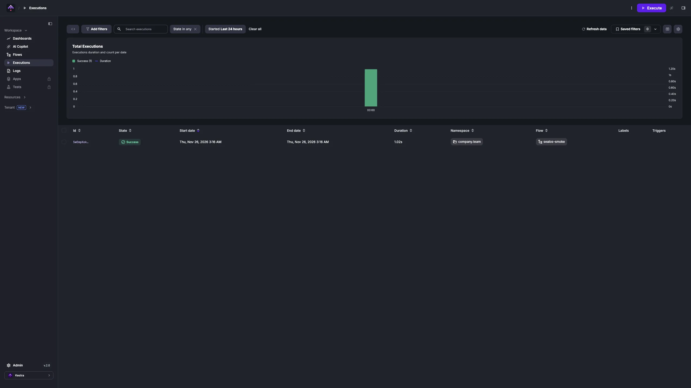

# Deploy and Host Kestra on Sealos

Kestra is an event-driven orchestration platform for data, AI, and infrastructure workflows. This Sealos template runs Kestra 2.0.11 in standalone mode with a KubeBlocks PostgreSQL 16 cluster, a persistent storage volume, and a first-run administrator setup.

## About Hosting Kestra

Kestra runs as one StatefulSet with a single container. The container starts `kestra server standalone`, which combines the webserver, scheduler, executor, indexer, and worker in one JVM process. PostgreSQL stores flows, executions, logs, and the queue, while a 1Gi volume at `/app/storage` holds task outputs and internal files.

The template creates a single-node KubeBlocks PostgreSQL 16.4 cluster with a 1Gi data volume. Database credentials come from the KubeBlocks-managed `*-pg-conn-credential` Secret, so no database password is part of the deployment inputs. Only the Kestra UI is published through the HTTPS Ingress; the management port stays internal to the Pod.

The first visitor completes the setup wizard at `/ui/main/setup`. Kestra requires a valid email address as the username and a password of at least 8 characters with an uppercase letter, a lowercase letter, and a digit. Credentials are hashed and stored in PostgreSQL, and every later login uses the same account.

## Common Use Cases

- **Data Pipelines**: Schedule ELT jobs that move data between databases, object storage, and warehouses.
- **Infrastructure Automation**: Run recurring API, shell, and Terraform tasks with retries and failure branches.
- **AI Workflows**: Chain model calls, document processing, and vector database updates in one declarative flow.
- **Business Automation**: Replace cron scripts with versioned flows, execution history, and per-task logs.
- **Event-Driven Jobs**: Start flows from webhooks, file arrivals, or messages and inspect every run.
- **Platform Evaluation**: Compare Kestra with Airflow, Temporal, and n8n using a private, self-hosted instance.

## Dependencies for Hosting Kestra

- A Sealos workspace with at least 3Gi of memory and 2Gi of persistent storage.
- A PostgreSQL 12 or newer database; the template provisions KubeBlocks PostgreSQL 16.4.
- Outbound network access for plugin downloads when a flow uses a plugin that is missing from the image.
- A browser for the setup wizard, flow editor, and execution views.
- No Docker socket. Kestra 2.0 runs tasks through the local process task runner inside the Pod.

### Deployment Dependencies

- [Kestra project page](https://github.com/kestra-io/kestra) - Source code, releases, and issue tracker
- [Docker Compose file](https://github.com/kestra-io/kestra/blob/v2.0.11/docker-compose.yml) - Reference PostgreSQL topology and environment
- [Configuration guide](https://kestra.io/docs/configuration) - Configuration sources, environment variables, and overrides
- [Architecture overview](https://kestra.io/docs/architecture) - Server components and execution model
- [Data storage components](https://kestra.io/docs/architecture/data-components) - Repository, queue, and internal storage
- [Basic auth troubleshooting](https://kestra.io/docs/administrator-guide/basic-auth-troubleshooting) - Setup page and credential recovery
- [Container image](https://hub.docker.com/r/kestra/kestra) - Official multi-architecture image
- [KubeBlocks PostgreSQL](https://kubeblocks.io/docs/preview/user_docs/kubeblocks-for-postgresql/cluster-management/create-and-connect-a-postgresql-cluster) - Database cluster reference
- [Sealos documentation](https://sealos.io/docs) - Platform concepts and operations

## Implementation Details

**Architecture Components:**

- **Kestra StatefulSet**: One replica running `kestra server standalone` on port `8080`.
- **Management port**: Port `8081` serves `/health` for startup, readiness, and liveness probes. The Service and Ingress expose only port `8080`.
- **PostgreSQL cluster**: A single-node KubeBlocks PostgreSQL 16.4 cluster with a 1Gi data volume.
- **Application volume**: A 1Gi volume at `/app/storage` for task outputs, internal files, and the generated encryption key.
- **Init containers**: One waits for PostgreSQL with `nc`; one generates a 32-byte base64 encryption key on first start and reuses it on every restart.
- **Service**: ClusterIP port `80` forwarding to the Kestra HTTP port.
- **Ingress**: Sealos-managed HTTPS host with a 32Mi request body limit and 300-second proxy timeouts.
- **App entry**: Opens the Kestra UI; unauthenticated visitors are redirected to the setup or login page.

**Configuration:**

- **Image**: `kestra/kestra:v2.0.11`
- **Command**: `/app/kestra server standalone`
- **HTTP port**: `8080`
- **Management port**: `8081`
- **Health check**: `GET /health` on the management port
- **Repository**: `postgres`
- **Queue**: `postgres`
- **Internal storage**: `local` at `/app/storage`
- **Task temporary directory**: `/tmp/kestra-wd/tmp`
- **Public URL**: `https://${{ defaults.app_host }}.${{ SEALOS_CLOUD_DOMAIN }}/`
- **Database URL**: `jdbc:postgresql://<host>:<port>/postgres`
- **Database credentials**: `${{ defaults.app_name }}-pg-conn-credential` Secret, `username` and `password` keys
- **Encryption key**: Generated once into `/app/storage/.kestra-encryption-key` and exported as `KESTRA_ENCRYPTION_SECRET_KEY`
- **JVM heap**: `InitialRAMPercentage=25`, `MaxRAMPercentage=60`, with `ExitOnOutOfMemoryError`
- **Security context**: Runs as UID `1000`, drops all Linux capabilities, disables privilege escalation, and applies the `RuntimeDefault` seccomp profile

**Resource Allocation:**

| Component | CPU Request | CPU Limit | Memory Request | Memory Limit | Storage |
| --- | ---: | ---: | ---: | ---: | ---: |
| Kestra | 100m | 1 | 204Mi | 2048Mi | 1Gi |
| PostgreSQL | 50m | 500m | 51Mi | 512Mi | 1Gi |
| Wait init container | 10m | 100m | 12Mi | 128Mi | Shared |
| Encryption key init container | 10m | 100m | 12Mi | 128Mi | Shared |

The values above are the live-tested profile. The Pod reached Ready with zero restarts. The setup wizard created the administrator account, a test flow ran to `SUCCESS` in 1.02 seconds, and a Pod restart preserved the flow, the execution history, the login, and the encryption key. Observed memory was about 1074Mi after startup and the first execution, and CPU peaked near 197m during startup.

## Why Deploy Kestra on Sealos?

Sealos is an AI-assisted cloud operating system built on Kubernetes. It provides the compute, storage, networking, and operations layer for Kestra in one interface:

- **One-Click Deployment**: Create the StatefulSet, PostgreSQL cluster, volume, Service, Ingress, and App entry from a single template.
- **Managed Database**: Run PostgreSQL as a KubeBlocks cluster with generated credentials and a dedicated volume.
- **Automatic HTTPS**: Receive a managed public domain and TLS certificate for the Kestra UI.
- **Persistent Orchestration State**: Keep flows, executions, logs, and task artifacts on persistent volumes.
- **Resource Control**: Adjust CPU and memory from the resource card as workflow volume grows.
- **Operational Visibility**: Inspect Pods, logs, events, and resource usage from Canvas or the Sealos AI dialog.

## Deployment Guide

1. Open the [Kestra template](https://sealos.io/products/app-store/kestra) and click **Deploy Now**.
2. Confirm the generated application name and submit the deployment.
3. Wait 2-3 minutes for PostgreSQL, the Kestra Pod, and the certificate; the first deployment needs several extra minutes while the Kestra image is pulled.
4. Open the App card. The first visit opens the setup wizard at `/ui/main/setup`.
5. Enter a valid email address and a strong password, confirm it, and click **Create admin user**.
6. Skip or complete the short survey, then click **Start Kestra UI**.
7. Create a flow from the Flows page or the AI Copilot, then click **Execute** and inspect the execution.

## Using Kestra

The left sidebar exposes **Dashboards**, **AI Copilot**, **Flows**, **Executions**, **Logs**, **Apps**, and **Tests**. The tutorial namespace ships with example flows for a first run. Creating a flow opens a YAML editor with autocomplete, a topology view, and per-task documentation.

Executions record the state history, task runs, logs, inputs, and outputs. The execution list filters by state, namespace, flow, and time range. The **Execute** button accepts flow inputs; tasks run as local processes inside the Pod, so a flow can call shell commands, Python, HTTP endpoints, and database plugins without a Docker socket.

The AI Copilot is available from the top bar and the sidebar. It works with the configured model provider; the template leaves provider credentials unset, and the flow editor, scheduler, and executor work without it.

## Authentication and Access

The setup wizard runs once. Kestra stores the hashed administrator credentials in the `settings` table under the `kestra.server.basic-auth` key. Every later visit redirects to `/ui/login` until the credentials are provided.

The username must be a valid email address, and the password must contain at least 8 characters with an uppercase letter, a lowercase letter, and a digit. The open-source edition always requires basic authentication; the `enabled` flag has no effect in version 2.0.

To recover access, connect to PostgreSQL and inspect the `settings` table. Removing the `kestra.server.basic-auth` row reopens the setup wizard on the next restart. Treat that row as an administrator credential and restrict database access accordingly.

## Storage and Persistence

PostgreSQL stores flows, revisions, executions, task runs, logs, and the queue. The KubeBlocks cluster exposes a `${{ defaults.app_name }}-pg-conn-credential` Secret with `host`, `port`, `username`, and `password` keys, and the template uses the default `postgres` database. The database volume is 1Gi on the `openebs-backup` storage class.

The application volume at `/app/storage` holds task outputs, internal files, and the encryption key. Kestra reads the key at every start, which keeps encrypted `SECRET` inputs and outputs readable across restarts. Back up the database and the application volume together so the key and the encrypted values stay paired.

Deleting the Instance removes the StatefulSet, the PostgreSQL cluster, and their PVCs. Export important flows and back up the database before deleting the deployment.

## Scaling

Scale vertically first. The tested profile uses a `2048Mi` memory limit with about 1074Mi observed usage; heavy flows, large execution histories, and plugin installation need a higher limit. Move to `4096Mi` with a `409Mi` request when the Pod reports memory pressure or gets OOMKilled.

For horizontal scaling, split the standalone process into dedicated webserver, executor, scheduler, indexer, and worker services that share PostgreSQL. Local storage ties task artifacts to one Pod; use S3-compatible storage before running multiple workers. The PostgreSQL queue supports multiple workers, and the webserver can run behind the same Service once session and storage concerns are addressed.

## Troubleshooting

### The setup page appears on every visit

The setup wizard stores credentials in PostgreSQL. A failing database write leaves `kestra.server.basic-auth` empty, so the wizard returns. Check the Kestra log for migration errors and confirm the `settings` table exists. After a successful save, later visits redirect to `/ui/login`.

### The Pod stays in Init while waiting for PostgreSQL

The `wait-for-postgres` init container resolves the database host and port from the `*-pg-conn-credential` Secret and waits with `nc`. Check the KubeBlocks cluster status, the Secret keys, and the Pod events. A cluster that is still provisioning keeps the Kestra Pod in `Init`.

### The startup probe fails for several minutes

The first deployment pulls a multi-gigabyte image and starts a JVM with plugin scanning. The startup probe allows up to 10 minutes. Check the Pod events for image pull progress, then read the container log for migration or datasource errors. A wrong `DATASOURCES_POSTGRES_URL` produces a driver error before the webserver binds.

### The Pod is OOMKilled or executions fail under load

The JVM uses 60 percent of the container limit as its maximum heap. Raise the memory limit one ladder step at a time, for example from `2048Mi` to `4096Mi`, and update the request to match. Large flow files and concurrent executions increase heap and temporary disk usage.

### Uploads return 413 or long requests return 504

The Ingress limits request bodies to 32Mi and proxy timeouts to 300 seconds. Raise `nginx.ingress.kubernetes.io/proxy-body-size` for larger flow files and the proxy timeouts for long-running synchronous requests. Long tasks belong in asynchronous flows with execution tracking.

### Setup rejects the email or password

Kestra validates the username as an email address and enforces at least 8 characters with an uppercase letter, a lowercase letter, and a digit. The open-source edition applies these rules in every deployment. Use a valid address such as `admin@example.com` and a password such as a generated passphrase that meets all four rules.

### Getting Help

- [Kestra documentation](https://kestra.io/docs)
- [Kestra GitHub issues](https://github.com/kestra-io/kestra/issues)
- [Sealos documentation](https://sealos.io/docs)

## License

Kestra is released under the [Apache License 2.0](https://github.com/kestra-io/kestra/blob/v2.0.11/LICENSE). Kestra is a trademark of Kestra Technologies; this template is an independent deployment definition and is not affiliated with or endorsed by Kestra Technologies. This Sealos template is distributed under the templates repository license.
