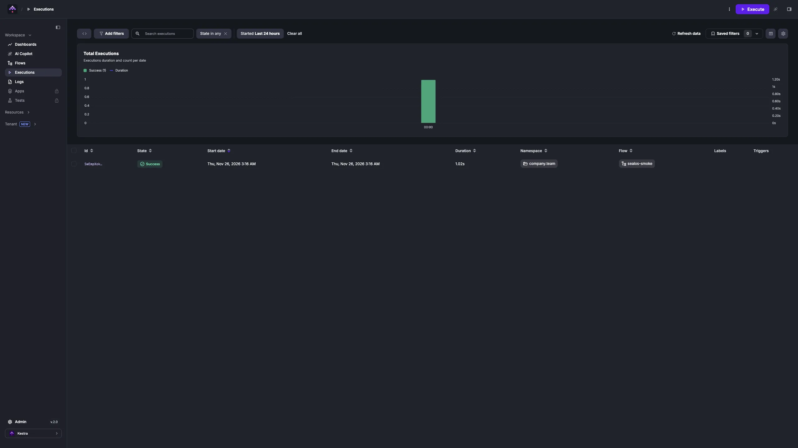

# 在 Sealos 上部署和托管 Kestra

Kestra 是面向数据、AI 和基础设施工作流的事件驱动编排平台。本 Sealos 模板运行 Kestra 2.0.11 standalone 模式，包含 KubeBlocks PostgreSQL 16 集群、持久化存储卷和首次访问的管理员设置向导。

## 托管说明

Kestra 以单个 StatefulSet 运行一个容器。容器启动 `kestra server standalone`，在同一个 JVM 进程中组合 Web 服务、调度器、执行器、索引器和 Worker。PostgreSQL 保存流程、执行记录、日志和队列，挂载到 `/app/storage` 的 1Gi 卷保存任务输出和内部文件。

模板通过 KubeBlocks 创建单节点 PostgreSQL 16.4 集群，数据卷为 1Gi。数据库凭据来自 KubeBlocks 管理的 `*-pg-conn-credential` Secret，部署输入中不包含数据库密码。公网仅通过 HTTPS Ingress 发布 Kestra UI，管理端口只在 Pod 内可见。

首位访问者在 `/ui/main/setup` 完成设置向导。Kestra 要求用户名为合法邮箱地址，密码至少 8 位并包含大写字母、小写字母和数字。凭据经过哈希后写入 PostgreSQL，后续登录使用同一账户。

## 常见使用场景

- **数据管道**：调度数据库、对象存储和数据仓库之间的 ELT 任务。
- **基础设施自动化**：运行带重试和失败分支的 API、Shell 和 Terraform 任务。
- **AI 工作流**：把模型调用、文档处理和向量库更新组织成一条声明式流程。
- **业务自动化**：用版本化流程、执行历史和逐任务日志替代 cron 脚本。
- **事件驱动任务**：通过 Webhook、文件到达或消息触发流程，并检查每次运行。
- **平台评估**：用私有自托管实例对比 Kestra、Airflow、Temporal 和 n8n。

## 部署依赖

- 至少 3Gi 内存和 2Gi 持久化存储的 Sealos 工作区。
- PostgreSQL 12 或更新版本；模板会创建 KubeBlocks PostgreSQL 16.4。
- 流程使用镜像中缺失的插件时，需要出网访问插件仓库。
- 用于设置向导、流程编辑器和执行视图的浏览器。
- 环境不需要 Docker socket。Kestra 2.0 通过 Pod 内的本地进程任务运行器执行任务。

### 部署相关链接

- [Kestra 项目页](https://github.com/kestra-io/kestra)：源码、发布和问题跟踪
- [Docker Compose 文件](https://github.com/kestra-io/kestra/blob/v2.0.11/docker-compose.yml)：PostgreSQL 拓扑和环境变量参考
- [配置指南](https://kestra.io/docs/configuration)：配置来源、环境变量和覆盖顺序
- [架构概览](https://kestra.io/docs/architecture)：服务组件和执行模型
- [数据存储组件](https://kestra.io/docs/architecture/data-components)：Repository、Queue 和内部存储
- [Basic Auth 排障](https://kestra.io/docs/administrator-guide/basic-auth-troubleshooting)：设置页面与凭据恢复
- [容器镜像](https://hub.docker.com/r/kestra/kestra)：官方多架构镜像
- [KubeBlocks PostgreSQL](https://kubeblocks.io/docs/preview/user_docs/kubeblocks-for-postgresql/cluster-management/create-and-connect-a-postgresql-cluster)：数据库集群参考
- [Sealos 文档](https://sealos.io/docs)：平台概念与操作

## 实现细节

**架构组件：**

- **Kestra StatefulSet**：单副本运行 `kestra server standalone`，HTTP 端口 `8080`。
- **管理端口**：端口 `8081` 提供 `/health`，供启动、就绪和存活探针使用。Service 和 Ingress 仅发布 `8080`。
- **PostgreSQL 集群**：单节点 KubeBlocks PostgreSQL 16.4 集群，数据卷 1Gi。
- **应用卷**：挂载到 `/app/storage` 的 1Gi 卷，保存任务输出、内部文件和生成的加密密钥。
- **初始化容器**：一个用 `nc` 等待 PostgreSQL；另一个在首次启动时生成 32 字节 base64 加密密钥，后续重启复用同一密钥。
- **Service**：ClusterIP 端口 `80` 转发到 Kestra HTTP 端口。
- **Ingress**：Sealos 管理的 HTTPS 域名，请求体上限 32Mi，代理超时 300 秒。
- **App 入口**：打开 Kestra UI；未认证访问会跳转到设置页或登录页。

**配置：**

- **镜像**：`kestra/kestra:v2.0.11`
- **命令**：`/app/kestra server standalone`
- **HTTP 端口**：`8080`
- **管理端口**：`8081`
- **健康检查**：管理端口上的 `GET /health`
- **Repository**：`postgres`
- **Queue**：`postgres`
- **内部存储**：`local`，路径 `/app/storage`
- **任务临时目录**：`/tmp/kestra-wd/tmp`
- **公网地址**：`https://${{ defaults.app_host }}.${{ SEALOS_CLOUD_DOMAIN }}/`
- **数据库 URL**：`jdbc:postgresql://<host>:<port>/postgres`
- **数据库凭据**：`${{ defaults.app_name }}-pg-conn-credential` Secret 的 `username` 和 `password` 键
- **加密密钥**：首次启动生成到 `/app/storage/.kestra-encryption-key`，通过 `KESTRA_ENCRYPTION_SECRET_KEY` 导出
- **JVM 堆**：`InitialRAMPercentage=25`、`MaxRAMPercentage=60`，并启用 `ExitOnOutOfMemoryError`
- **安全上下文**：以 UID `1000` 运行，丢弃全部 Linux capability，禁用权限提升，并应用 `RuntimeDefault` seccomp 配置

**资源分配：**

| 组件 | CPU 请求 | CPU 上限 | 内存请求 | 内存上限 | 存储 |
| --- | ---: | ---: | ---: | ---: | ---: |
| Kestra | 100m | 1 | 204Mi | 2048Mi | 1Gi |
| PostgreSQL | 50m | 500m | 51Mi | 512Mi | 1Gi |
| 等待数据库初始化容器 | 10m | 100m | 12Mi | 128Mi | 共享 |
| 加密密钥初始化容器 | 10m | 100m | 12Mi | 128Mi | 共享 |

以上为实测档位。Pod 达到 Ready 且零重启。设置向导完成管理员创建，测试流程在 1.02 秒内达到 `SUCCESS`，Pod 重启后流程、执行历史、登录凭据和加密密钥均保留。启动并完成首次执行后内存约为 1074Mi，启动阶段 CPU 峰值接近 197m。

## 为什么在 Sealos 上部署 Kestra？

Sealos 是构建在 Kubernetes 之上的 AI 辅助云操作系统，用一个界面提供 Kestra 所需的计算、存储、网络和运维能力：

- **一键部署**：通过单个模板创建 StatefulSet、PostgreSQL 集群、存储卷、Service、Ingress 和 App 入口。
- **托管数据库**：PostgreSQL 以 KubeBlocks 集群运行，自动生成凭据并分配独立存储卷。
- **自动 HTTPS**：获得 Sealos 管理的公网域名和 TLS 证书。
- **持久化编排状态**：流程、执行记录、日志和任务产物保存在持久化卷中。
- **资源控制**：随着工作流数量增长，在资源卡片中调整 CPU 和内存。
- **运维可见性**：在 Canvas 或 Sealos AI 对话框中查看 Pod、日志、事件和资源使用。

## 部署指南

1. 打开 [Kestra 模板页面](https://sealos.io/products/app-store/kestra)，点击 **Deploy Now**。
2. 确认自动生成的应用名称并提交部署。
3. 等待 2-3 分钟，让 PostgreSQL、Kestra Pod 和证书就绪；首次部署还需要额外几分钟拉取 Kestra 镜像。
4. 打开 App 卡片，首次访问会进入 `/ui/main/setup` 设置向导。
5. 输入合法邮箱和强密码，确认密码后点击 **Create admin user**。
6. 跳过或完成简短问卷，然后点击 **Start Kestra UI**。
7. 在 Flows 页面或 AI Copilot 中创建流程，点击 **Execute** 并检查执行结果。

## 使用 Kestra

左侧导航包含 **Dashboards**、**AI Copilot**、**Flows**、**Executions**、**Logs**、**Apps** 和 **Tests**。教程命名空间自带示例流程，可用于第一次运行。创建流程会打开 YAML 编辑器，提供自动补全、拓扑视图和逐任务文档。

执行记录保存状态历史、任务运行、日志、输入和输出。执行列表支持按状态、命名空间、流程和时间范围筛选。**Execute** 按钮接收流程输入；任务以本地进程在 Pod 内运行，因此流程可以调用 Shell 命令、Python、HTTP 接口和数据库插件，无需 Docker socket。

AI Copilot 位于顶栏和侧边栏。它使用已配置的模型提供方；模板保留提供方凭据为空，流程编辑器、调度器和执行器在没有 Copilot 的情况下仍可正常使用。

## 认证与访问

设置向导只运行一次。Kestra 把哈希后的管理员凭据保存在 `settings` 表的 `kestra.server.basic-auth` 键下。后续访问会跳转到 `/ui/login`，直到提供正确凭据。

用户名必须是合法邮箱地址，密码至少 8 位并包含大写字母、小写字母和数字。开源版始终要求 Basic Auth，2.0 版本中的 `enabled` 开关不改变这一行为。

需要恢复访问时，连接 PostgreSQL 并检查 `settings` 表。删除 `kestra.server.basic-auth` 行后，下次重启会重新打开设置向导。该行等同于管理员凭据，数据库访问应保持受控。

## 存储与持久化

PostgreSQL 保存流程、版本、执行记录、任务运行、日志和队列。KubeBlocks 集群通过 `${{ defaults.app_name }}-pg-conn-credential` Secret 提供 `host`、`port`、`username` 和 `password`，模板使用默认的 `postgres` 数据库。数据库卷为 1Gi，使用 `openebs-backup` 存储类。

应用卷 `/app/storage` 保存任务输出、内部文件和加密密钥。Kestra 每次启动都会读取该密钥，保证加密的 `SECRET` 输入和输出在重启后仍可解密。备份时需要同时保留数据库和应用卷，让密钥与加密数据保持配对。

删除 Instance 会移除 StatefulSet、PostgreSQL 集群及其 PVC。删除部署前请导出重要流程并备份数据库。

## 扩展

优先纵向扩展。实测档位使用 `2048Mi` 内存上限，观测占用约 1074Mi；大流程、长执行历史和插件安装需要更高上限。出现内存压力或 OOMKilled 时，逐步提升到 `4096Mi`，并同步把请求调整为 `409Mi`。

需要横向扩展时，把 standalone 进程拆分为独立的 webserver、executor、scheduler、indexer 和 worker 服务，共享同一个 PostgreSQL。本地存储会把任务产物绑定到单个 Pod，多 Worker 场景应改用 S3 兼容存储。PostgreSQL 队列支持多个 Worker，处理完会话和存储问题后，Web 服务可以在同一 Service 后运行多个副本。

## 故障排查

### 每次访问都回到设置页面

设置向导把凭据写入 PostgreSQL。数据库写入失败会让 `kestra.server.basic-auth` 保持为空，设置页面因此反复出现。检查 Kestra 日志中的迁移错误，并确认 `settings` 表存在。保存成功后，后续访问会跳转到 `/ui/login`。

### Pod 一直停留在 Init 等待 PostgreSQL

`wait-for-postgres` 初始化容器从 `*-pg-conn-credential` Secret 读取数据库主机和端口，并用 `nc` 等待。检查 KubeBlocks 集群状态、Secret 键和 Pod 事件。集群仍在创建时，Kestra Pod 会保持 `Init`。

### 启动探针连续几分钟失败

首次部署需要拉取数 GB 镜像，并启动带插件扫描的 JVM。启动探针允许最多 10 分钟。先在 Pod 事件中查看镜像拉取进度，再检查容器日志中的迁移或数据源错误。`DATASOURCES_POSTGRES_URL` 配置错误会在 Web 服务监听端口之前触发驱动错误。

### Pod 被 OOMKilled 或高负载下执行失败

JVM 以容器内存上限的 60% 作为最大堆。按资源阶梯逐档提高内存上限，例如从 `2048Mi` 提升到 `4096Mi`，并同步调整请求。大流程文件和并发执行会增加堆内存与临时磁盘占用。

### 上传返回 413 或长请求返回 504

Ingress 将请求体限制为 32Mi，代理超时限制为 300 秒。更大的流程文件需要提高 `nginx.ingress.kubernetes.io/proxy-body-size`，长时间同步请求需要提高代理超时。耗时任务适合放入带执行记录的异步流程。

### 设置向导拒绝邮箱或密码

Kestra 把用户名校验为邮箱地址，并要求密码至少 8 位且同时包含大写字母、小写字母和数字。开源版在所有部署中应用这些规则。使用 `admin@example.com` 这类合法地址，并设置满足全部规则的密码。

### 获取帮助

- [Kestra 文档](https://kestra.io/docs)
- [Kestra GitHub Issues](https://github.com/kestra-io/kestra/issues)
- [Sealos 文档](https://sealos.io/docs)

## 许可证

Kestra 使用 [Apache License 2.0](https://github.com/kestra-io/kestra/blob/v2.0.11/LICENSE) 发布。Kestra 是 Kestra Technologies 的商标；本模板是独立部署定义，与 Kestra Technologies 无隶属关系，也未获得其背书。本 Sealos 模板按 templates 仓库许可证分发。
