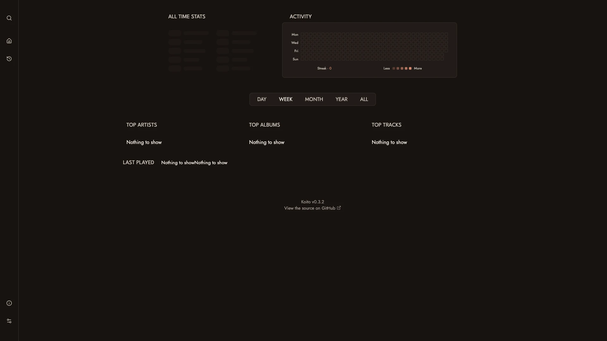

# Deploy and Host Koito on Sealos

Koito is a modern, self-hosted music scrobbler with ListenBrainz-compatible endpoints, listening statistics, charts, and a themeable web interface. This template deploys Koito v0.3.2 as a single StatefulSet with SQLite storage and a generated administrator account.

## About Hosting Koito

Koito runs as one Go service on port `4110`. The template mounts a 1Gi volume at `/etc/koito`, where Koito stores its SQLite database, configuration, and cached artwork. The deployment creates the default administrator from deployment inputs and enables the login gate for the web interface.

Koito accepts listens through ListenBrainz-compatible APIs, so players and clients that support this protocol can submit listening history. The web interface then presents top artists, albums, tracks, listening clocks, and time-based charts.

Sealos provisions the StatefulSet, persistent volume, ClusterIP Service, Ingress, TLS certificate, and App card. The API keys page exposes the default key created for the administrator, which clients can use for submissions.

## Common Use Cases

- **Personal listening history**: Record plays from your music player and review long-term statistics.
- **Self-hosted Last.fm style service**: Keep scrobbles on infrastructure you control.
- **ListenBrainz client compatibility**: Connect players that submit listens through ListenBrainz endpoints.
- **Music taste analysis**: Explore top artists, albums, and listening trends by period.
- **Household music profile**: Run one instance for a family or small group with separate accounts.

## Dependencies for Koito Hosting

- A Sealos workspace with at least 512Mi of available memory and 1Gi of persistent storage.
- A browser for the Koito web interface.
- A music player or client that supports ListenBrainz-compatible submissions.
- Outbound HTTPS access for cover art and optional metadata lookups.

### Deployment Dependencies

- [Koito website](https://koito.io) - Product overview
- [Koito GitHub repository](https://github.com/gabehf/Koito) - Source code and releases
- [Koito README](https://github.com/gabehf/Koito#readme) - Setup and client guidance
- [Koito container image](https://hub.docker.com/r/gabehf/koito) - Image used by this template
- [ListenBrainz API documentation](https://listenbrainz.readthedocs.io/en/latest/users/api/) - Submission protocol reference
- [Sealos documentation](https://sealos.io/docs) - Platform concepts and operations

## Implementation Details

**Architecture Components:**

- **Koito StatefulSet**: One replica running `gabehf/koito:v0.3.2` on port `4110`.
- **Data volume**: A 1Gi volume mounted at `/etc/koito` for the SQLite database, configuration, and cached images.
- **Service**: ClusterIP port `80` forwarding to the Koito HTTP port.
- **Ingress**: Sealos-managed HTTPS host with a 32Mi request body limit and 300-second proxy timeouts.
- **App entry**: Opens the Koito dashboard.

**Configuration:**

- **Image**: `gabehf/koito:v0.3.2`
- **HTTP port**: `4110`
- **Configuration directory**: `/etc/koito`
- **Bind address**: `0.0.0.0`
- **Administrator username**: Required input `admin_username`, default `admin`
- **Administrator password**: Required input `admin_password`, default generated value
- **Login gate**: Enabled with `KOITO_LOGIN_GATE=true`
- **Public URL**: `https://${{ defaults.app_host }}.${{ SEALOS_CLOUD_DOMAIN }}/`
- **Health probe**: `GET /`
- **Runtime user**: UID `1000`, GID `1000`, with all Linux capabilities dropped and the `RuntimeDefault` seccomp profile
- **Timezone**: `Asia/Shanghai`
- **Log level**: `info`

**Resource Allocation:**

| Component | CPU Request | CPU Limit | Memory Request | Memory Limit | Storage |
| --- | ---: | ---: | ---: | ---: | ---: |
| Koito | 50m | 500m | 51Mi | 512Mi | 1Gi |

The live Sealos test signed in as the administrator, found the default API key on the API Keys page, and confirmed that the statistics API responded after a Pod restart. The Pod stayed ready with this profile, and the tested values are recorded in the workload annotation.

## Why Deploy Koito on Sealos?

Sealos is an AI-assisted cloud operating system built on Kubernetes. It supplies the compute, storage, networking, and operations layer for Koito through one interface:

- **One-click deployment**: Create the StatefulSet, data volume, Service, Ingress, and App card from one template.
- **Persistent listening history**: Keep scrobbles, accounts, and cached artwork on a dedicated volume.
- **Managed HTTPS**: Receive a public domain and TLS certificate for the web interface and API.
- **Generated administrator**: Start with a username and password from the deployment form.
- **Resource control**: Adjust CPU and memory from the resource card as the library grows.
- **Operational visibility**: Inspect Pods, logs, events, and resource usage from Canvas or the Sealos AI dialog.

## Deployment Guide

1. Open the [Koito template](https://sealos.io/products/app-store/koito) and click **Deploy Now**.
2. Set the administrator username and password, save the password, and confirm the generated application name.
3. Submit the deployment and wait 2-3 minutes for the Pod to become ready and for the HTTPS certificate to be issued.
4. Open the App card and sign in to the Koito dashboard.
5. Open the **API Keys** page and copy the default key for your music client.
6. Configure the client with the public Koito URL and the API key, then submit a test listen.
7. Refresh the dashboard and confirm that the play appears in the listening history and charts.

## Login and Access

The public URL opens the Koito login page. Sign in with the administrator username and password from the deployment inputs. The login gate is enabled, so the dashboard and API pages require a session or a valid API key.

The **API Keys** page manages keys for music clients. The default key is created for the administrator and appears after the first login. Treat the key as a password; rotate it from the page when a client is retired.

## Using Koito

The dashboard summarizes listening activity across the selected period. Artist, album, and track pages show play counts and chart positions, and the statistics views expose listening clocks and time series.

Music clients submit listens to the ListenBrainz-compatible endpoints exposed by Koito. Point the client at the public HTTPS URL, provide the user name and API key, and submit a test play. The API key page also documents the exact endpoint that clients should use.

## Scaling

Koito runs one replica because the template uses a single SQLite database on a ReadWriteOnce volume. Scale vertically by raising the CPU and memory limits for large listening histories, many clients, and artwork caching.

The 1Gi volume holds the database, configuration, and cached images. Expand the PVC when the history or artwork outgrows the volume, provided the storage class supports expansion. Horizontal scaling needs an external database and shared image storage, which this single-node template does not configure.

## Troubleshooting

### The configured password is rejected

- Cause: The administrator account was created during an earlier deployment, and Koito keeps the original password.
- Solution: Sign in with the current password and rotate it from the account settings, or create a fresh deployment with the intended credentials.

### A music client receives 401 Unauthorized

- Cause: The API key is missing, revoked, or belongs to a different account.
- Solution: Copy the current key from the **API Keys** page, update the client, and confirm that the client uses the public HTTPS URL.

### Listens are timestamped with the wrong time

- Cause: The client sends UTC timestamps while the display timezone is set to `Asia/Shanghai`.
- Solution: Keep the client timezone in UTC and rely on `KOITO_FORCE_TZ` for display, or align both settings to the intended reporting timezone.

### The dashboard is empty after a successful submission

- Cause: The client submitted to the wrong endpoint, or the listen was rejected before it reached the database.
- Solution: Check the client log, confirm the ListenBrainz-compatible endpoint, and verify that the API key has submission permission.

### The page returns 502 after deployment

- Cause: Koito is still starting, or the readiness probe has not passed.
- Solution: Wait for the startup probe to finish, then inspect Pod events and logs for database or permission errors.

### Getting Help

- [Koito GitHub repository](https://github.com/gabehf/Koito)
- [Koito GitHub issues](https://github.com/gabehf/Koito/issues)
- [ListenBrainz API documentation](https://listenbrainz.readthedocs.io/en/latest/users/api/)
- [Sealos documentation](https://sealos.io/docs)

## License

Koito is released under the [MIT License](https://github.com/gabehf/Koito/blob/main/LICENSE). This Sealos template is an independent deployment definition and is distributed under the templates repository license.
