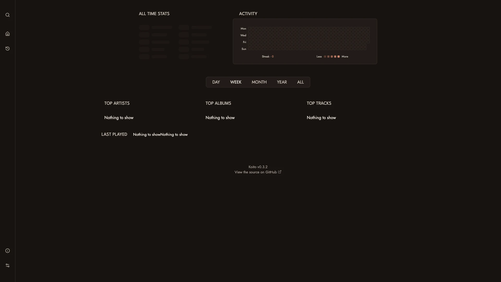

# 在 Sealos 上部署和托管 Koito

Koito 是一款现代自托管音乐记录服务，兼容 ListenBrainz 端点，提供听歌统计、图表和可换主题的 Web 界面。本模板将 Koito v0.3.2 部署为单个 StatefulSet，使用 SQLite 存储并创建管理员账号。

## 关于托管 Koito

Koito 以单个 Go 服务运行，监听 `4110` 端口。模板将 1Gi 卷挂载到 `/etc/koito`，Koito 在该目录保存 SQLite 数据库、配置和封面缓存。部署使用输入创建默认管理员，并为 Web 界面启用登录限制。

Koito 通过 ListenBrainz 兼容 API 接收收听记录，支持该协议的播放器和客户端可以提交听歌历史。Web 界面随后展示热门艺术家、专辑、曲目、收听时钟和按时间统计的图表。

Sealos 负责创建 StatefulSet、持久卷、ClusterIP Service、Ingress、TLS 证书和应用卡片。API Keys 页面会显示为管理员创建的默认密钥，客户端可以使用该密钥提交记录。

## 常见使用场景

- **个人收听历史**：记录播放器的播放记录，并查看长期统计。
- **自托管 Last.fm 风格服务**：将收听记录保存在自己控制的基础设施中。
- **ListenBrainz 客户端兼容**：连接通过 ListenBrainz 端点提交记录的播放器。
- **音乐偏好分析**：按时间段查看热门艺术家、专辑和收听趋势。
- **家庭音乐档案**：为一个家庭或小群体运行实例，并分配独立账号。

## Koito 托管依赖

- 一个 Sealos 工作空间，至少提供 512Mi 可用内存和 1Gi 持久存储。
- 用于 Koito Web 界面的浏览器。
- 支持 ListenBrainz 兼容提交的音乐播放器或客户端。
- 可选出站 HTTPS 访问，用于封面和元数据查询。

### 部署依赖

- [Koito 官网](https://koito.io) - 产品介绍
- [Koito GitHub 仓库](https://github.com/gabehf/Koito) - 源码和版本发布
- [Koito README](https://github.com/gabehf/Koito#readme) - 设置和客户端说明
- [Koito 容器镜像](https://hub.docker.com/r/gabehf/koito) - 本模板使用的镜像
- [ListenBrainz API 文档](https://listenbrainz.readthedocs.io/en/latest/users/api/) - 提交协议参考
- [Sealos 文档](https://sealos.io/docs) - 平台概念和操作说明

## 实现细节

**架构组件：**

- **Koito StatefulSet**：一个副本，运行 `gabehf/koito:v0.3.2`，监听 `4110` 端口。
- **数据卷**：1Gi，挂载到 `/etc/koito`，保存 SQLite 数据库、配置和图片缓存。
- **Service**：ClusterIP 端口 `80`，转发到 Koito 的 HTTP 端口。
- **Ingress**：Sealos 托管的 HTTPS 域名，请求体上限 32Mi，代理超时 300 秒。
- **应用入口**：打开 Koito 仪表盘。

**配置：**

- **镜像**：`gabehf/koito:v0.3.2`
- **HTTP 端口**：`4110`
- **配置目录**：`/etc/koito`
- **绑定地址**：`0.0.0.0`
- **管理员用户名**：必填输入 `admin_username`，默认 `admin`
- **管理员密码**：必填输入 `admin_password`，默认自动生成
- **登录限制**：通过 `KOITO_LOGIN_GATE=true` 启用
- **公网地址**：`https://${{ defaults.app_host }}.${{ SEALOS_CLOUD_DOMAIN }}/`
- **健康检查**：`GET /`
- **运行用户**：UID `1000`、GID `1000`，移除全部 Linux capabilities，启用 `RuntimeDefault` seccomp 配置
- **时区**：`Asia/Shanghai`
- **日志级别**：`info`

**资源分配：**

| 组件 | CPU 请求 | CPU 限制 | 内存请求 | 内存限制 | 存储 |
| --- | ---: | ---: | ---: | ---: | ---: |
| Koito | 50m | 500m | 51Mi | 512Mi | 1Gi |

Sealos 实测使用管理员登录，在 API Keys 页面找到默认密钥，Pod 重启后统计 API 仍正常响应。Pod 使用该配置保持就绪，实测数值已写入工作负载注解。

## 为什么在 Sealos 上部署 Koito？

Sealos 是构建在 Kubernetes 上的 AI 辅助云操作系统，通过统一界面提供 Koito 所需的计算、存储、网络和运维能力：

- **一键部署**：用一个模板创建 StatefulSet、数据卷、Service、Ingress 和应用卡片。
- **收听历史持久化**：将记录、账号和封面缓存保存在独立持久卷中。
- **托管 HTTPS**：为 Web 界面和 API 提供公网域名和 TLS 证书。
- **自动管理员**：通过部署表单创建管理员用户名和密码。
- **资源可控**：音乐库增长时，通过资源卡片调整 CPU 和内存。
- **运维可见**：在 Canvas 或 Sealos AI 对话框中查看 Pod、日志、事件和资源使用情况。

## 部署指南

1. 打开 [Koito 模板](https://sealos.io/products/app-store/koito)，点击 **Deploy Now**。
2. 设置管理员用户名和密码并保存密码，确认自动生成的应用名称。
3. 提交部署，等待 2-3 分钟，Pod 进入就绪状态并完成 HTTPS 证书签发。
4. 打开应用卡片，登录 Koito 仪表盘。
5. 打开 **API Keys** 页面，复制音乐客户端使用的默认密钥。
6. 在客户端中配置 Koito 公网地址和 API 密钥，然后提交一条测试记录。
7. 刷新仪表盘，确认播放记录出现在收听历史和图表中。

## 登录与访问

公网地址打开 Koito 登录页。使用部署输入中的管理员用户名和密码登录。登录限制已启用，仪表盘和 API 页面需要有效会话或 API 密钥。

**API Keys** 页面管理音乐客户端密钥。默认密钥为管理员创建，首次登录后可见。将密钥视为密码，在客户端停用时从页面轮换。

## 使用 Koito

仪表盘按所选时间段汇总收听活动。艺术家、专辑和曲目页面展示播放次数和图表位置，统计视图提供收听时钟和时间序列。

音乐客户端将记录提交到 Koito 暴露的 ListenBrainz 兼容端点。将客户端指向公网 HTTPS 地址，填写用户名和 API 密钥，并提交一条测试播放。API Keys 页面也会记录客户端应使用的准确端点。

## 扩缩容

模板使用单个 SQLite 数据库和 ReadWriteOnce 卷，因此 Koito 运行一个副本。收听历史较大、客户端较多或封面缓存增长时，通过提高 CPU 和内存限制纵向扩容。

1Gi 卷保存数据库、配置和图片缓存。历史或封面增长后可以扩展 PVC，前提是存储类支持扩容。水平扩容需要外部数据库和共享图片存储，本单节点模板未配置这些组件。

## 故障排查

### 配置的密码无法登录

- 原因：管理员账号在更早的部署中创建，Koito 保留原密码。
- 处理：使用当前密码登录并在账号设置中轮换，或者用目标凭据创建新的部署。

### 音乐客户端收到 401 Unauthorized

- 原因：API 密钥缺失、已撤销，或者属于其他账号。
- 处理：从 **API Keys** 页面复制当前密钥，更新客户端，并确认客户端使用公网 HTTPS 地址。

### 记录时间显示错误

- 原因：客户端发送 UTC 时间戳，而显示时区设置为 `Asia/Shanghai`。
- 处理：客户端保持 UTC 时间，显示交给 `KOITO_FORCE_TZ` 处理，或者将两端统一到目标报告时区。

### 提交成功后仪表盘仍为空

- 原因：客户端提交到错误端点，或者记录在写入数据库前被拒绝。
- 处理：检查客户端日志，确认 ListenBrainz 兼容端点，并验证 API 密钥具有提交权限。

### 部署后页面返回 502

- 原因：Koito 仍在启动，或者就绪探针尚未通过。
- 处理：等待启动探针完成，然后检查 Pod 事件和日志中的数据库或权限错误。

### 获取帮助

- [Koito GitHub 仓库](https://github.com/gabehf/Koito)
- [Koito GitHub Issues](https://github.com/gabehf/Koito/issues)
- [ListenBrainz API 文档](https://listenbrainz.readthedocs.io/en/latest/users/api/)
- [Sealos 文档](https://sealos.io/docs)

## 许可证

Koito 使用 [MIT License](https://github.com/gabehf/Koito/blob/main/LICENSE) 发布。本 Sealos 模板是独立部署定义，遵循 templates 仓库许可证。
