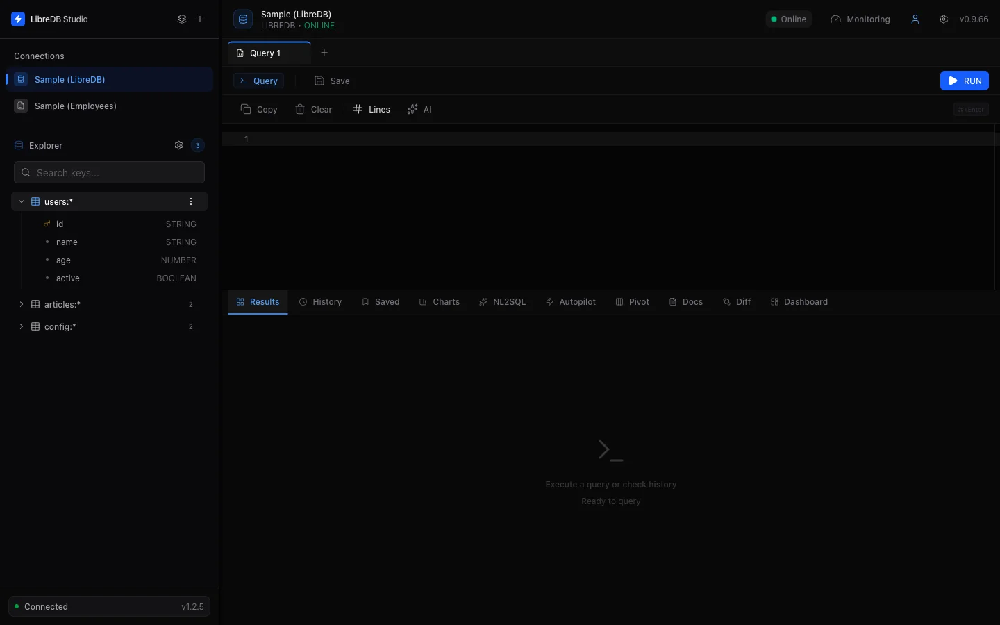

# Deploy and Host LibreDB Studio on Sealos

LibreDB Studio is an open-source database IDE for querying and managing PostgreSQL, MySQL, SQLite, MongoDB, and other supported data sources from a browser. This template deploys LibreDB Studio 1.3.0 with HTTPS access, persistent server-side storage, health probes, and deployment-defined administrator credentials on Sealos Cloud.

## About Hosting LibreDB Studio

LibreDB Studio provides a web editor, schema explorer, result viewer, connection manager, monitoring pages, and administrative tools in one application. The default deployment stores saved application state in SQLite on a 1 GiB persistent volume. A deployment option provisions a dedicated KubeBlocks-managed PostgreSQL database for shared server-side state.

The PostgreSQL option stores LibreDB Studio settings such as saved connections and queries. Databases that you want to inspect remain separate data sources and can be added from the LibreDB Studio interface after login.

## Common Use Cases

- **Browser-based database work**: Run queries and inspect schemas from any browser with a lightweight client footprint.
- **Shared administration workspace**: Keep connection profiles and saved queries on persistent server storage.
- **Development and debugging**: Explore application databases and review query results from one interface.
- **Self-hosted data tooling**: Operate the IDE inside your own Sealos workspace with a generated HTTPS endpoint.

## Dependencies for LibreDB Studio Hosting

The template includes the runtime components required for a working deployment:

- **LibreDB Studio**: `ghcr.io/libredb/libredb-studio:1.3.0`
- **Default SQLite storage**: `/app/data/libredb-storage.db` on a 1 GiB application PVC
- **Optional PostgreSQL storage**: KubeBlocks-managed `postgresql-16.4.0` with a 1 GiB data PVC
- **HTTPS entrypoint**: Sealos Service, Ingress, and App resources on port `3000`

### Deployment Dependencies

- [LibreDB Studio Website](https://libredb.org) - Product information
- [LibreDB Studio GitHub Repository](https://github.com/LibreDB/libredb-studio) - Source code, releases, and issue tracking
- [Sealos Cloud](https://cloud.sealos.io) - Cloud workspace and App Launchpad
- [Sealos Documentation](https://sealos.io/docs) - Deployment and operations guides

### Implementation Details

**Architecture Components:**

- **LibreDB Studio StatefulSet**: Runs one application replica; SQLite mode mounts persistent storage at `/app/data`.
- **SQLite mode**: Persists server-side application state in the application PVC and is selected by default.
- **PostgreSQL mode**: Creates a PostgreSQL cluster, database access resources, a `libredb_storage` initialization Job, and a database readiness init container.
- **Service + Ingress + App**: Routes the generated HTTPS domain to the application and opens the `/login` page.
- **Health checks**: Use the upstream `/api/db/health` endpoint for startup, readiness, and liveness probes.

**Resource baseline:**

The application tier is a `100m` CPU limit with a `10m` CPU request, and `512Mi` memory with a `160Mi` memory request. The template shipped a `128Mi` limit and the application does not fit inside it. Measured in local container runs, not on a cluster, at `100m` CPU in SQLite mode with `AUTH_BOOTSTRAP=off`, driving repeated `POST /api/auth/login` plus `GET /` and `GET /login`: `/api/db/health` answers 9 to 14 seconds after start, well inside the startup probe's 60 second budget, sign-ins return 200, and the container is then OOM killed. Four runs under that exercise, carried out separately by two people, were killed four times out of four. Of those four kills, two recorded a sample just before death, at 112.5Mi and 127.2Mi of the 128Mi cap, and a third peaked at 120.0Mi. Three of those runs recorded exit code 137 about 16 seconds after start, while the login page was being rendered. A lighter pass that only polled health and the index page was not killed at `128Mi` and stayed near 113Mi to 119Mi, so the shipped ceiling holds while only health and the index page are polled. The same login exercise under `512Mi` completes: health answers in 9 to 13 seconds, requests are served without error, and memory settles between 130Mi and 140Mi, at most about 27 percent of that cap. `512Mi` is headroom rather than a measured requirement; nothing here approached it, and `256Mi` was never run. It is chosen because the image pins `NODE_OPTIONS=--max-old-space-size=384`, so V8 old space alone is allowed to reach 384Mi, which a `256Mi` ceiling could not hold if it did. That flag has been in the image since at least 0.14.1, so none of this is new in 1.2.0. The `160Mi` request is sized to the steady state measured above, not to the worst case the limit covers, and it departs from this repository's usual request of a tenth of the limit because a `51Mi` request would sit far below what the container actually holds. Cluster figures can differ, since the pod is guaranteed `10m` CPU rather than the `100m` used here, which can also slow the start times. The PostgreSQL initialization containers and Job stay on `100m` CPU and `128Mi` memory, and were not re-measured. The optional PostgreSQL cluster uses `500m` CPU and `512Mi` memory and was not re-measured either.

**Security defaults:**

The application runs as a non-root user, drops Linux capabilities, disables service account token mounting, and receives a generated JWT signing secret. Administrator credentials come from required deployment inputs.

## Why Deploy LibreDB Studio on Sealos?

Sealos combines Kubernetes deployment, networking, storage, and visual operations in one cloud workspace:

- **One-click topology**: Launch the application and its selected storage backend from one template.
- **Persistent state**: Use a PVC-backed SQLite database or a managed PostgreSQL cluster.
- **Immediate HTTPS access**: Receive a generated public domain after deployment.
- **App Launchpad and Canvas operations**: Inspect workloads, logs, storage, and networking from resource cards.
- **AI-assisted changes**: Describe resource or configuration updates in the Canvas dialog.
- **Pay-as-you-go resources**: Start from the tier the template ships and scale with actual workload demand.

## Deployment Guide

1. Open the [LibreDB Studio template](https://sealos.io/products/app-store/libredb-studio) and click **Deploy Now**.
2. Enter an administrator email and a password of at least 8 characters.
3. Keep **Use PostgreSQL storage** disabled for the default SQLite deployment, or enable it to provision a dedicated PostgreSQL backend.
4. Wait for the deployment to complete, typically 2-3 minutes. PostgreSQL mode becomes ready after the database cluster and initialization Job complete.
5. Open the application from its Canvas card. The generated URL leads to `/login`.
6. Sign in with the administrator email and password entered during deployment.

## First Login

LibreDB Studio uses a sign-in-only account model for this deployment. The template provisions the administrator from the deployment form.

1. Open the generated application URL.
2. Enter the configured administrator email and password on `/login`.
3. Click **Sign in** to open the administration overview.
4. Choose **Editor** to add database connections and run queries.

Store the deployment credentials in your password manager. This template runs a server-side store, so from 0.18.0 the account lives in the database and `ADMIN_PASSWORD` only seeds it on the first start. Editing that variable later and restarting does not change the password. To change it, set `ADMIN_PASSWORD` to the new value, add `ADMIN_PASSWORD_RESET=true` on the LibreDB Studio StatefulSet in Canvas, restart the workload, then remove `ADMIN_PASSWORD_RESET` so the value is not reapplied on every start.

## Configuration

| Input | Description | Status | Default |
| --- | --- | --- | --- |
| `admin_email` | Administrator email used on the login page | Required | Set during deployment |
| `admin_password` | Administrator password, minimum 8 characters | Required | Set during deployment |
| `enable_postgres_storage` | Provisions PostgreSQL for LibreDB Studio server-side state | Optional | `false` (SQLite) |

The template generates the application name, public host, and JWT signing secret. SQLite data is stored at `/app/data/libredb-storage.db`. PostgreSQL mode creates the `libredb_storage` database and builds the connection URL from the KubeBlocks credential Secret.

## Scaling

The template keeps one LibreDB Studio replica and supports vertical scaling from Canvas. Increase application CPU or memory for more concurrent sessions or heavier result sets. Expand the application PVC for SQLite mode, or the PostgreSQL data PVC for PostgreSQL mode, as stored state grows.

A multi-replica design requires PostgreSQL server storage plus a review of session handling and application behavior. The published template ships a single-replica topology.

## Troubleshooting

### The login credentials are rejected

Confirm that the email and password match the values entered during deployment. On a server-side store the password is held in the database, so correcting `ADMIN_PASSWORD` on the StatefulSet resource card is not enough on its own: add `ADMIN_PASSWORD_RESET=true` next to it, restart the workload, then remove that flag. The pod log warns at each start when the stored password and the variable disagree.

### The application page is still starting

Open Canvas and check the LibreDB Studio StatefulSet. In PostgreSQL mode, also confirm that the PostgreSQL cluster is `Running` and the `-pg-init` Job is `Complete`. If the pod restarts in a loop instead, check whether it was OOM killed: at the `128Mi` limit this template shipped before, the container was OOM killed with exit code 137 shortly after start in all four runs of the login exercise described above. Lower the memory limit below the shipped `512Mi` only with that in mind.

### Saved settings are missing after a restart

In SQLite mode, confirm that the application PVC is bound and mounted at `/app/data`. In PostgreSQL mode, confirm that the cluster is healthy and the `STORAGE_PROVIDER` value is `postgres`.

### A database connection fails

Use a database hostname that is reachable from the Sealos workspace, verify the port and credentials, and select the TLS settings required by the target database.

### Getting Help

- [LibreDB Studio GitHub Issues](https://github.com/LibreDB/libredb-studio/issues)
- [LibreDB Studio Releases](https://github.com/LibreDB/libredb-studio/releases)
- [Sealos Discord](https://discord.gg/wdUn538zVP)

## Additional Resources

- [LibreDB Studio Website](https://libredb.org)
- [LibreDB Studio Source Code](https://github.com/LibreDB/libredb-studio)
- [Sealos Cloud](https://cloud.sealos.io)
- [Sealos Documentation](https://sealos.io/docs)

## License

LibreDB Studio is licensed under the MIT License. This Sealos template follows the license of the templates repository.
