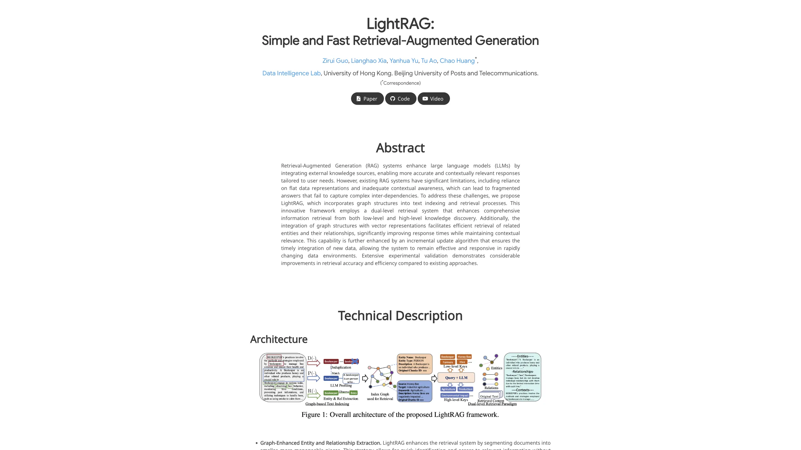

# Deploy and Host LightRAG on Sealos

LightRAG is a graph-based retrieval-augmented generation server from the University of Hong Kong. It extracts entities and relationships from documents, stores them alongside vector embeddings, and answers questions with graph-aware retrieval. This Sealos template runs LightRAG 1.5.8 with JWT login, persistent document storage, and configurable OpenAI-compatible LLM and embedding endpoints.



## About Hosting LightRAG

LightRAG runs as one StatefulSet with the official `ghcr.io/hkuds/lightrag:v1.5.8` image. The server listens on port `9621`, serves the web UI at `/webui`, the OpenAPI page at `/docs`, and the REST API at the root path. Two 1Gi volumes keep `/app/data/rag_storage` and `/app/data/inputs`, so the knowledge graph, vector index, document metadata, and uploaded files survive Pod restarts.

The template requires an OpenAI-compatible chat endpoint and an OpenAI-compatible embedding endpoint. The chat model handles entity and relation extraction and answer generation; the embedding model vectorizes chunks, entities, and relations. Both endpoints, their model names, the embedding dimension, and one API key are deployment inputs. OpenAI defaults are prefilled, and any compatible provider works by changing the base URLs.

Authentication is enabled by default. The web UI and API use the username `admin` and the required `admin_password` input, backed by a generated JWT secret. A separate generated API key protects the Ollama-compatible routes. The tested profile uses `50m` CPU and `51Mi` memory as requests, with `500m` CPU and `512Mi` memory as limits.

## Common Use Cases

- **Private Knowledge Bases**: Build a searchable graph over internal documents, policies, and research notes.
- **Graph-Aware RAG**: Retrieve connected entities and relationships that flat vector search can miss.
- **Document Q&A**: Upload reports and manuals, then ask questions with cited sources.
- **Entity Exploration**: Inspect the extracted knowledge graph to validate names, relations, and coverage.
- **Multi-Provider Experiments**: Compare chat and embedding providers without changing the deployment topology.
- **Agent Memory**: Expose a persistent retrieval service for agents that need long-term document context.

## Dependencies for Hosting LightRAG

- A Sealos workspace with at least 512Mi of memory and 2Gi of persistent storage.
- An OpenAI-compatible chat completion endpoint and API key.
- An OpenAI-compatible embedding endpoint whose output dimension matches `embedding_dim`.
- Outbound network access from the cluster to both endpoints.
- A browser for the web UI, or `curl` for the REST API.

### Deployment Dependencies

- [LightRAG project page](https://lightrag.github.io/) - Paper, architecture, and results
- [LightRAG repository](https://github.com/HKUDS/LightRAG) - Source code, examples, and release notes
- [LightRAG API server guide](https://github.com/HKUDS/LightRAG/blob/main/docs/LightRAG-API-Server.md) - Server configuration and authentication
- [Docker deployment guide](https://github.com/HKUDS/LightRAG/blob/main/docs/DockerDeployment.md) - Container layout and environment variables
- [LLM provider options](https://github.com/HKUDS/LightRAG/blob/main/docs/LLMProviderOptions.md) - Supported bindings and model settings
- [Environment variable reference](https://github.com/HKUDS/LightRAG/blob/main/env.example) - Complete configuration surface
- [LightRAG container image](https://github.com/HKUDS/LightRAG/pkgs/container/lightrag) - Image used by this template
- [LightRAG paper](https://arxiv.org/abs/2410.05779) - Graph-based RAG design and evaluation

## Implementation Details

**Architecture Components:**

- **LightRAG StatefulSet**: One replica running the official image with the API and web UI on port `9621`.
- **Storage volume**: A 1Gi volume at `/app/data/rag_storage` holding the graph, vector index, caches, and document status.
- **Input volume**: A 1Gi volume at `/app/data/inputs` holding uploaded source files.
- **Service**: ClusterIP port `80` forwarding to the LightRAG HTTP port.
- **Ingress**: Sealos-managed HTTPS host with a 32Mi request body limit and 300-second proxy timeouts.
- **App entry**: Opens the web UI at `/webui`.

**Configuration:**

- **Image**: `ghcr.io/hkuds/lightrag:v1.5.8`
- **HTTP port**: `9621`
- **Web UI**: `/webui`
- **API documentation**: `/docs`
- **Chat binding**: OpenAI-compatible, configured by `llm_base_url`, `llm_api_key`, and `llm_model`
- **Embedding binding**: OpenAI-compatible, configured by `embedding_base_url`, `embedding_model`, and `embedding_dim`
- **Authentication**: `AUTH_ACCOUNTS=admin:<admin_password>` with a generated `TOKEN_SECRET`
- **API key**: A generated `LIGHTRAG_API_KEY` protects the Ollama-compatible routes
- **Default chat model**: `gpt-4.1-mini`
- **Default embedding model**: `text-embedding-3-small` at 1536 dimensions
- **Health check**: `GET /health`
- **Storage paths**: `/app/data/rag_storage` and `/app/data/inputs`
- **Security context**: Runs as UID `1000`, drops all Linux capabilities, disables privilege escalation, and applies the `RuntimeDefault` seccomp profile

**Resource Allocation:**

| Component | CPU Request | CPU Limit | Memory Request | Memory Limit | Storage |
| --- | ---: | ---: | ---: | ---: | ---: |
| LightRAG | 50m | 500m | 51Mi | 512Mi | 2Gi |

The resource values are the live-tested profile. A 303-character document produced 16 entities and 16 relations, and a `mix` query returned an answer with a source reference. The server used about 269Mi of memory and 129m of CPU during the query, with zero restarts. Larger documents and higher retrieval depth benefit from more memory and CPU.

## Why Deploy LightRAG on Sealos?

Sealos is an AI-assisted cloud operating system built on Kubernetes. It provides the compute, storage, networking, and operations layer for LightRAG in one interface:

- **One-Click Deployment**: Create the StatefulSet, two data volumes, Service, Ingress, and App entry from a single template.
- **Automatic HTTPS**: Receive a managed public domain and TLS certificate for the web UI and API.
- **Persistent Knowledge Graph**: Keep documents, entities, relations, and vectors on dedicated volumes.
- **Bring Your Own Models**: Point the chat and embedding inputs at any OpenAI-compatible provider.
- **Resource Control**: Adjust CPU and memory from the resource card while the platform handles scheduling and health checks.
- **Operational Visibility**: Inspect Pods, logs, events, and resource usage from Canvas or the Sealos AI dialog.

## Deployment Guide

1. Open the [LightRAG template](https://sealos.io/products/app-store/lightrag) and click **Deploy Now**.
2. Set the admin password and API key, then configure the chat and embedding base URLs, model names, and embedding dimension.
3. Confirm the generated application name and the two 1Gi volumes, then submit the deployment.
4. Wait 2-3 minutes for the Pod to become ready and the certificate to be issued.
5. Open the App card and sign in with `admin` and the deployment password.
6. Upload a document, wait for the status to become **Completed**, and run a question from the **Retrieval** tab.

## Using the Web UI

The web UI at `https://<your-app-host>/webui` has three tabs:

- **Documents** lists uploaded files, their processing status, chunk counts, and errors. Use **Upload** for new files and **Scan/Retry** for failed documents.
- **Knowledge Graph** renders the extracted entities and relationships for exploration.
- **Retrieval** sends questions to the configured chat model and shows answers with source references.

The interface follows the browser language and supports English and Chinese. The first document triggers the extraction pipeline, which makes multiple LLM calls and can take from seconds to several minutes depending on document size and provider latency.

## Using the REST API

Log in with the admin credentials to obtain a JWT:

```bash
BASE=https://<your-app-host>
curl -sS -X POST "$BASE/login" --data-urlencode 'username=admin' --data-urlencode "password=<admin-password>" > login.json
TOKEN=$(python3 -c 'import json;print(json.load(open("login.json"))["access_token"])')
```

Insert a text document and poll the pipeline:

```bash
curl -sS -X POST "$BASE/documents/text" \
  -H "Authorization: Bearer $TOKEN" \
  -H 'Content-Type: application/json' \
  -d '{"text":"Sealos runs LightRAG with persistent storage and JWT login.","file_source":"intro.txt"}'

curl -sS "$BASE/documents/pipeline_status" -H "Authorization: Bearer $TOKEN"
```

Query the knowledge base:

```bash
curl -sS -X POST "$BASE/query" \
  -H "Authorization: Bearer $TOKEN" \
  -H 'Content-Type: application/json' \
  -d '{"query":"What does Sealos provide?","mode":"mix","include_references":true}'
```

The response contains `response`, `references`, and timing fields. `GET /health` is public and reports the auth mode, version, and pipeline state. The OpenAPI page at `/docs` documents every route, including document management, graph edits, and scan operations.

## Storage and Persistence

`/app/data/rag_storage` holds the JSON key-value store, the NetworkX graph, the vector database, the document status store, and the LLM response cache. `/app/data/inputs` holds uploaded source files. The StatefulSet maps one 1Gi volume to each path through `volumeClaimTemplates`.

Keep both volumes bound for the lifetime of the knowledge base. A fresh `rag_storage` volume starts an empty graph and requires re-ingestion. The embedding model name and dimension are recorded as a baseline; changing either one after ingestion requires clearing documents and rebuilding the index.

## Scaling

This template runs one replica because the default storage backends are local JSON, NetworkX, and NanoVectorDB files, and the server keeps an in-process pipeline. Scale vertically by raising the memory limit for larger documents and the CPU limit for faster extraction and embedding.

For horizontal scaling, move the key-value, vector, and graph stores to external services such as PostgreSQL with pgvector, Neo4j, or Milvus, then run multiple LightRAG replicas with shared configuration. Those backends require additional environment variables and are outside this single-node profile.

## Troubleshooting

### The Pod exits with "EMBEDDING_MODEL is not set"

LightRAG refuses to start when the embedding model name is empty because it records that name with every vector. Set `embedding_model` to the exact model served by your embedding endpoint, and set `embedding_dim` to its output dimension.

### Documents stay in "Processing" or fail

Check the Pod log for chat endpoint errors. A 401 or 404 usually means the API key, base URL, or model name is wrong. Entity extraction makes several LLM calls per chunk, so rate limits and timeouts appear as failed documents. Retry from the Documents tab after fixing the endpoint.

### Queries return no context

Confirm that the document status is **Completed** and that the graph contains entities. The retrieval path uses the embedding model recorded at ingestion; a different model or dimension produces a mismatch. Clear the documents and re-ingest after changing the embedding configuration.

### Login returns 422

The `/login` endpoint expects form-encoded `username` and `password` fields. Send them with `--data-urlencode` or an HTML form, using the `application/x-www-form-urlencoded` content type.

### Web UI returns a redirect

Use `/webui/` with the trailing slash. The bare `/webui` path redirects to the versioned UI route.

### Uploads return 413

The Ingress caps request bodies at 32Mi. Split large PDFs, compress them, or raise the `nginx.ingress.kubernetes.io/proxy-body-size` annotation for your deployment. LightRAG also has its own request body and upload limits in the environment configuration.

### The public endpoint is reachable by anyone

JWT login protects the web UI and the API, and the generated API key protects the Ollama-compatible routes. Use a strong admin password, keep the generated secrets private, and delete the instance when the knowledge base is no longer needed.

### Getting Help

- [LightRAG documentation](https://github.com/HKUDS/LightRAG)
- [LightRAG GitHub issues](https://github.com/HKUDS/LightRAG/issues)
- [Sealos documentation](https://sealos.io/docs)

## License

LightRAG is released under the [MIT License](https://github.com/HKUDS/LightRAG/blob/main/LICENSE). This Sealos template is distributed under the templates repository license.
